# Extboot 定制分区镜像编译及使用手册 v2.0

> 来源：《【北京迅为】Extboot定制分区镜像编译及使用手册_v2.0.pdf》（25 页）
> 本文件为**合并版**（全部章节合为一篇）；按章拆分的版本见 `../拆分版/`。
> 所有插图统一放在上级目录 `../images/` 中（拆分版与合并版共用）。

## 目录

| 章节 | 页码 |
| --- | --- |
| [更新记录](#更新记录) | p2-2 |
| [版权声明](#版权声明) | p3-3 |
| [更多帮助](#更多帮助) | p4-4 |
| [第1章 Extboot SDK 简介](#第1章-extboot-sdk-简介) | p6-7 |
| [第2章 选择开发板](#第2章-选择开发板) | p8-10 |
| [第3章 编译镜像](#第3章-编译镜像) | p11-21 |
| [第4章 切换屏幕与摄像头](#第4章-切换屏幕与摄像头) | p22-23 |
| [第5章 自定义设备树 Overlay](#第5章-自定义设备树-overlay) | p24-25 |

## 更新记录

| 更新版本 | 修改内容 |
| --- | --- |
| V1.0 | 初版 |
| V1.1 | 更新部分网盘路径 |
| V2.0 | 统一支持 8 款开发板，整理直接编译、开发板选择、屏幕切换和自定义 Overlay 的操作流程。 |

<div style="page-break-after: always;"></div>

## 版权声明

本文档版权归北京迅为电子有限公司所有。未经本公司书面许可，任何单位和个人无权以任何形式复制、传播、转载本文档的任何内容，违者将被追究法律责任。

<div style="page-break-after: always;"></div>

## 更多帮助

#### 注意事项与维护

请注意和遵循标注在产品上的所有警示和指引信息；

请勿带电插拔核心板及外围模块；

使用产品之前，请仔细阅读本手册，并妥善保管，以备将来参考；

请使用配套电源适配器，以保证电压、电流的稳定；

请勿在冷热交替环境中使用本产品，避免结露损坏元器件；

请保持产品干燥，如果不慎被任何液体泼溅或浸润，请立刻断电并充分晾干；

请勿使用有机溶剂或腐蚀性液体清洗本产品；

请勿在多尘、脏乱的环境中使用本产品，如果长期不使用，请包装好本产品；

如果在震动场景使用，请做好核心板与底板的固定，避免核心板跌落损坏；

请勿在通电情况下，插拔核心板及外围模块(特别是串口模块)；

请勿自行维修、拆解本产品，如产品出现故障应及时联系本公司进行维修；

请勿自行修改或使用未经授权的配件，由此造成的损坏将不予保修；

#### 资料的更新

为了确保您的资料是最新状态，请密切关注我们的动态，我们将会通过微信公众号和QQ群推送。

关注“迅为电子”微信公众号，不定期分享教程、资料和行业干货及产品一线资料。

#### 售后服务政策

1．如产品使用过程中出现硬件故障可根据售后服务政策进行维修

2．服务政策：参见官方网售后服务说明

https://www.topeetboard.com/sydymfl/Service/bx.html

#### 技术支持范围

1．了解产品的软、硬件资源提供情况咨询

2．产品的软、硬件手册使用过程中遇到的问题

3．下载和烧写更新系统过程中遇到的问题

4．产品用户的资料丢失、更新后重新获取

5．产品的故障判断及售后维修服务。

PS：（由于嵌入式系统知识范围广泛，我们无法保证对各种问题都能一一解答，部分内容无法供技术支持

只能提供建议

#### 迅为新媒体账号

官网：https://www.topeetboard.com

知乎https://www.zhihu.com/people/topeetabc123

CSDN：https://blog.csdn.net/BeiJingXunWei

#### 送修地址：

1．地址：北京市海淀区永翔北路9 号中国航发大厦三层

2．联系人：迅为开发板售后服务部

3．电话：010-85270716

4．邮编：100094

5．邮寄须知：建议使用顺丰、圆通或韵达，且不接受任何到付

#### 技术支持

1. 周一至周五：（法定节假日除外）

上午9:00 ~ 11:30/ 下午13:30 ~ 17:30

2. QQ 技术交流群：824412014

822183461

95631883

861311530

<div style="page-break-after: always;"></div>

## 第1章 Extboot SDK 简介

### 1.1 Extboot 的作用

Extboot 将内核、设备树和屏幕等外设的配置放在一个启动分区中。使用同一款开发板时，可以通过修改uEnv.txt 并重启，在已适配的屏幕或摄像头之间切换，无需为每种屏幕分别准备一套系统镜像。

统一SDK 为多款开发板提供相同的编译和使用方法。选择开发板后，SDK 会使用对应配置生成该板的镜像，使用时选择与实物板型对应的文件即可。

下文以RK3588 标准版（target：rk3588-standard）为示例，其他开发板采用相同流程，选择对应板型即可。

### 1.2 支持的开发板

当前支持下表中的8 款开发板。target 是开发板在命令行中的名称；使用图形菜单时，直接选择开发板名称即可。

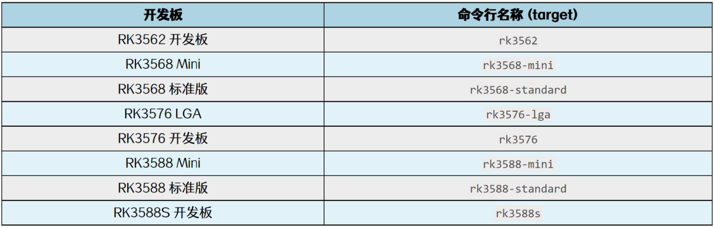

### 1.3 获取源码并进入SDK

本SDK 可在Ubuntu 18.04、20.04 和22.04 主机上直接编译，无需手动配置编译环境。从网盘资料中的“03_系统源码\02_Linux 系统源码”路径下找到定制扩展分区SDK 源码目录，如下图所示：

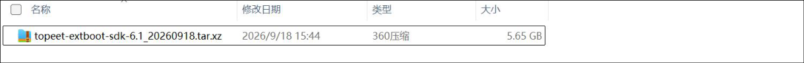

下载统一Extboot SDK 并解压，然后进入源码根目录，如下图所示：

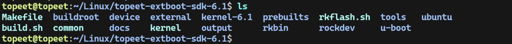

本文所用的编译命令均在此目录执行。编译电脑的Ubuntu 版本可以不同，当前SDK 生成的开发板系统为Ubuntu 22。

<div style="page-break-after: always;"></div>

## 第2章 选择开发板

### 2.1 首次选择

在SDK 根目录打开终端，输入以下命令：

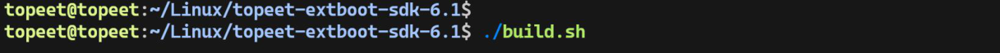

首次运行会显示开发板列表,如下图所示：

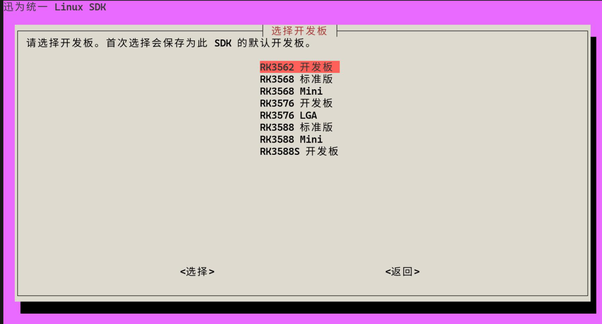

本文选择RK3588 标准版，如下图所示：

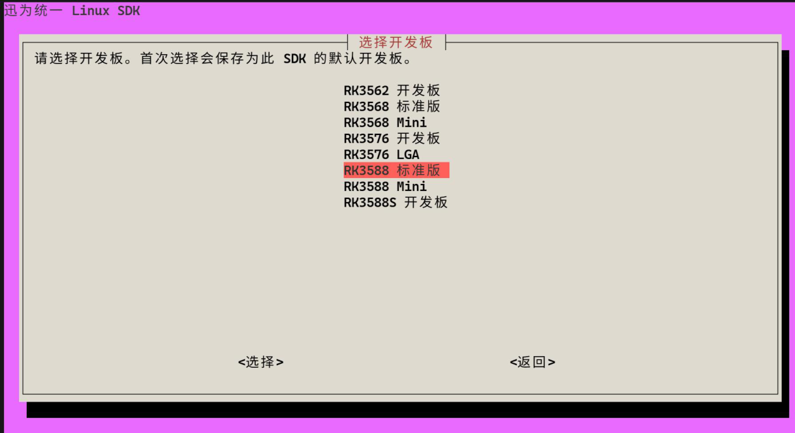

按回车进入“编译中心”。SDK 会记住本次选择，后续打开菜单时直接使用该开发板。


### 2.2 查看与切换开发板

“编译中心”顶部显示当前开发板。需要换板时，选择“切换开发板”，重新选择即可；继续编译前需要确认顶部名称正确。

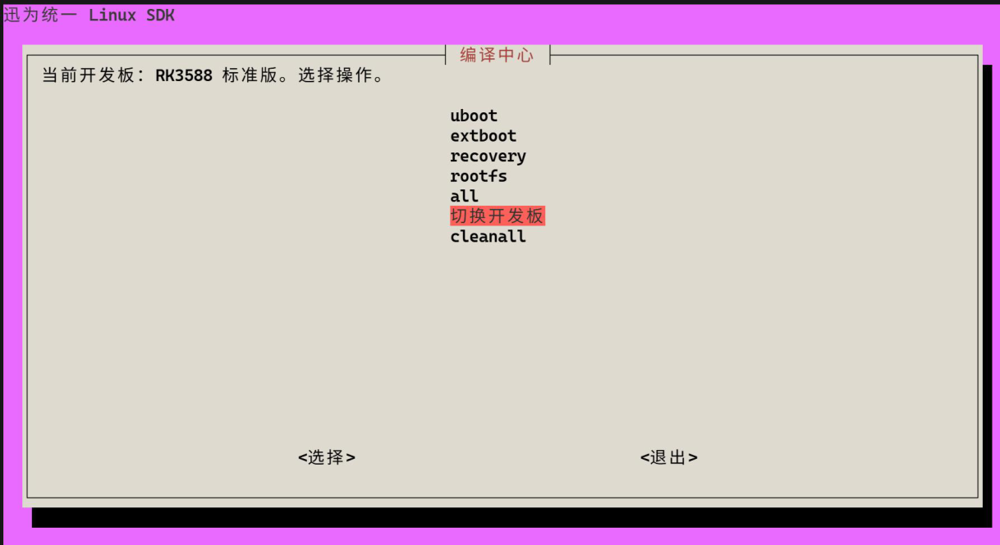

### 2.3 直接指定开发板（可选）

也可以在命令行直接指定板型，无需先进入菜单。例如，完整编译RK3588 标准版：

```bash
tools/topeet-build --target rk3588-standard all
```

其他开发板将rk3588-standard 替换为1.2 节表格中的target 名称即可，编译过程如下图所示：

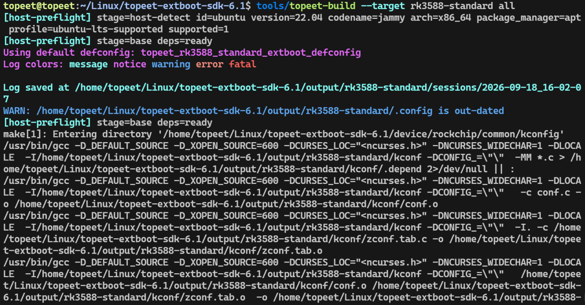

<div style="page-break-after: always;"></div>

## 第3章 编译镜像

在“04_系统镜像\02_Linux 系统镜像”下的定制扩展分区SDK 镜像目录下已经存放了编译好的镜像，如果不想编译镜像可以直接根据烧写手册来进行烧写。

### 3.1 一键编译完整镜像

第一次编译时，推荐使用all。运行./build.sh，在“编译中心”确认板型后选择all，等待编译完成即可，如下图所示：

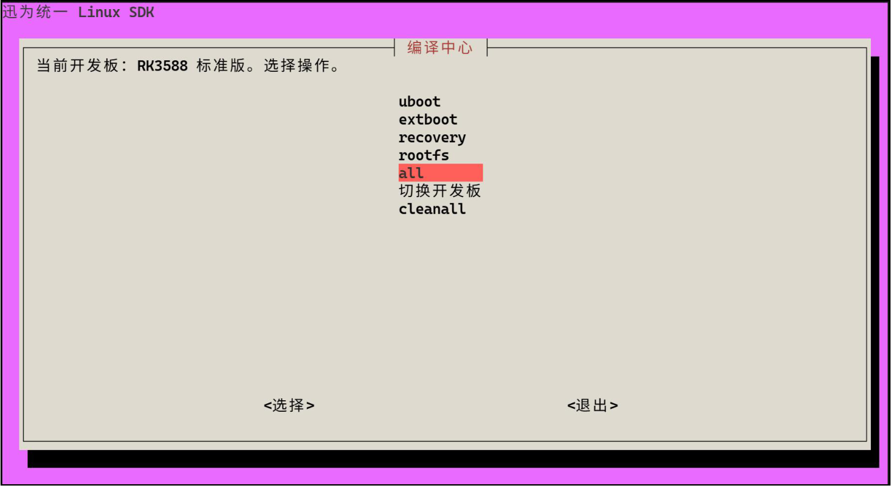

SDK 会完成U-Boot、Extboot、Recovery 和Ubuntu 根文件系统的编译，并打包生成完整的update.img。编译过程中按提示输入sudo 密码即可。

已经通过菜单选择过开发板后，也可以直接执行：

```bash
./build.sh all
```

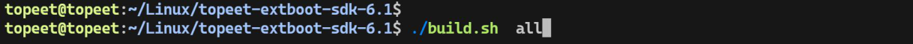

编译完成的打印如下图所示：

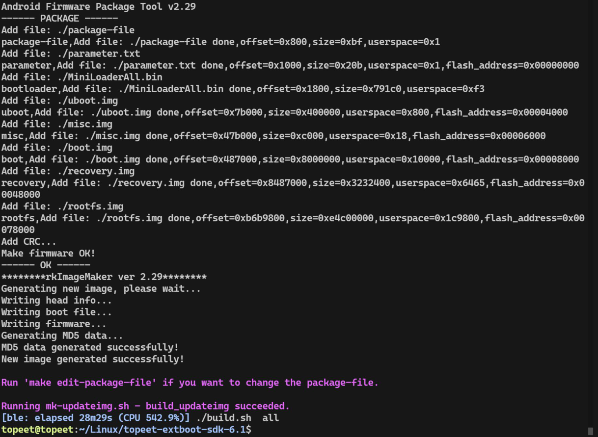

以RK3588 标准版为例，完整镜像的实际文件生成路径为：

```bash
output/rk3588-standard/update/Image/update.img
```

如下图所示：

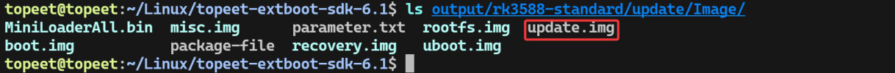

### 3.2 单独编译与打包

下面以RK3588 标准版为例，依次完成各部分编译，最后打包成update.img。开始前运行./build.sh，在菜单中选择RK3588 标准版；后续./build.sh 命令均使用保存的板型。

首次采用分项方式编译时，按U-Boot →Extboot →Recovery →Ubuntu rootfs →firmware→updateimg 的顺序操作。每一步成功结束后再继续下一步。已有完整编译结果时，可按修改内容重新编译对应部分。

图形菜单每次完成一个操作后返回终端。继续选择下一项时，再运行./build.sh；也可以直接使用下列命令。

#### 3.2.1 编译U-Boot

在“编译中心”选择uboot 并回车，或在SDK 根目录执行：

```bash
./build.sh uboot
```


脚本使用当前开发板的启动配置，生成Loader 和U-Boot。编译完成后，以下两个文件会保存在firmware 目录中，如下图所示：

```bash
output/rk3588-standard/firmware/MiniLoaderAll.bin
output/rk3588-standard/firmware/uboot.img
```

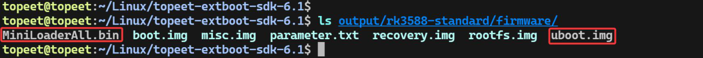

#### 3.2.2 编译Extboot

在菜单中选择extboot，或执行：

```bash
./build.sh extboot
```

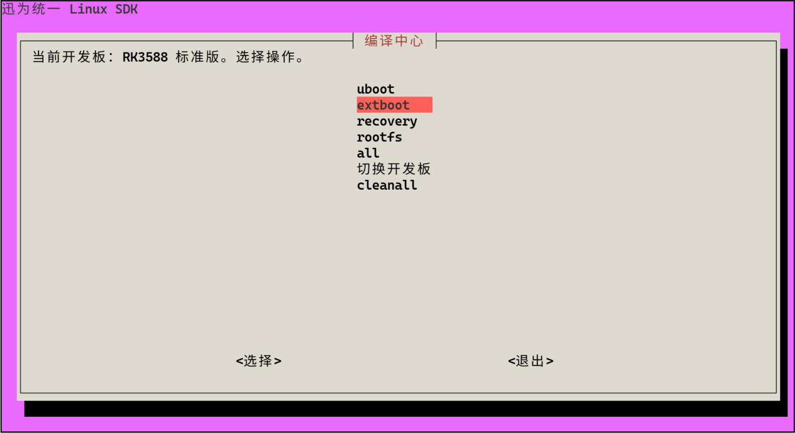

该步骤会编译内核、基础设备树和Overlay，再把内核、设备树、启动脚本及uEnv.txt 打包成Extboot 镜像，无需先单独执行kernel 命令，编译完成如下图所示：

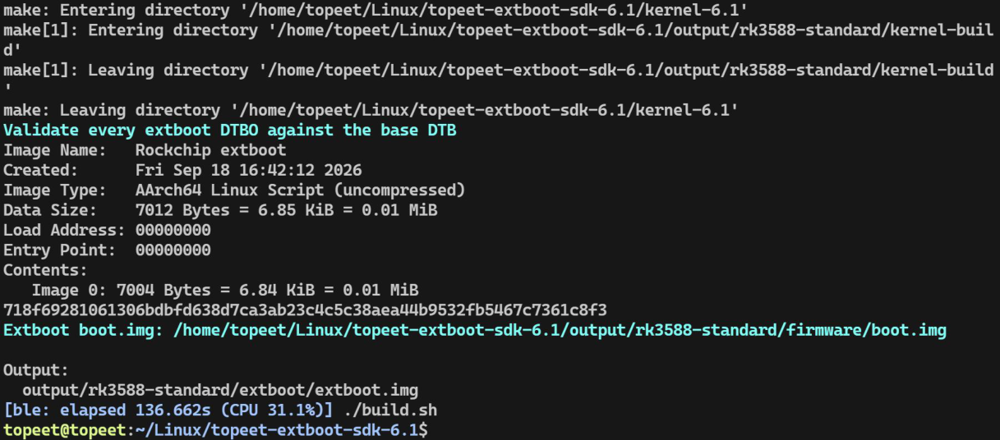

编译完成的实际镜像存放路径为：

```bash
output/rk3588-standard/extboot/extboot.img
```

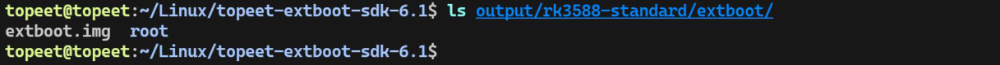

#### 3.2.3 编译Recovery

在菜单中选择recovery，或执行：

```bash
./build.sh recovery
```

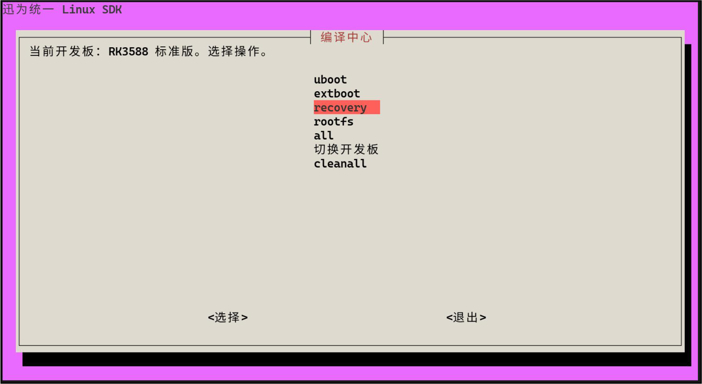

Recovery 是独立的恢复系统，完整升级包需要包含该镜像。编译完成如下图所示：

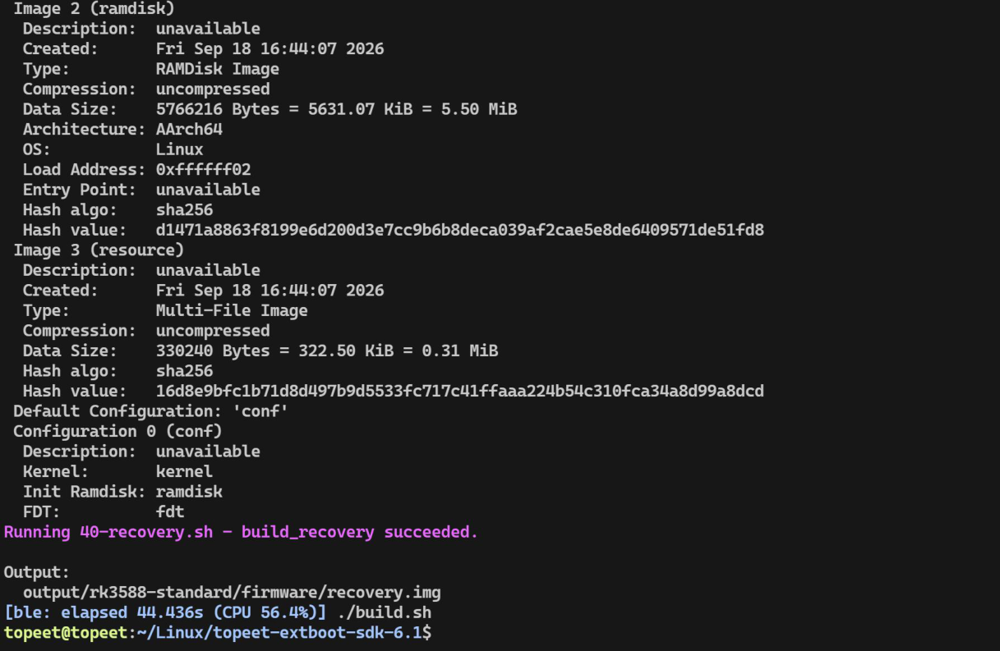

脚本会编译Recovery 所需内容，镜像的生成路径为

```bash
output/rk3588-standard/recovery/ramboot.img
```

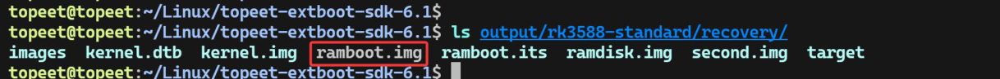

用于打包的firmware/recovery.img 是指向recovery/ramboot.img 的软链接。这里的ramboot.img 是Recovery 构建产物的文件名。

#### 3.2.4 编译Ubuntu 根文件系统

在菜单中选择rootfs，或执行：

```bash
./build.sh rootfs
```

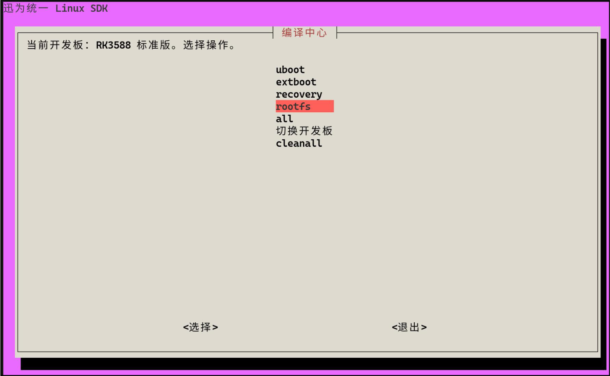

脚本使用SDK 内的Ubuntu 22 基础包，加入RK3588 标准版的系统文件、内核模块和相关配置，生成根文件系统。操作过程中按提示输入sudo 密码，等待构建结束，构建完成的打印如下图所示：

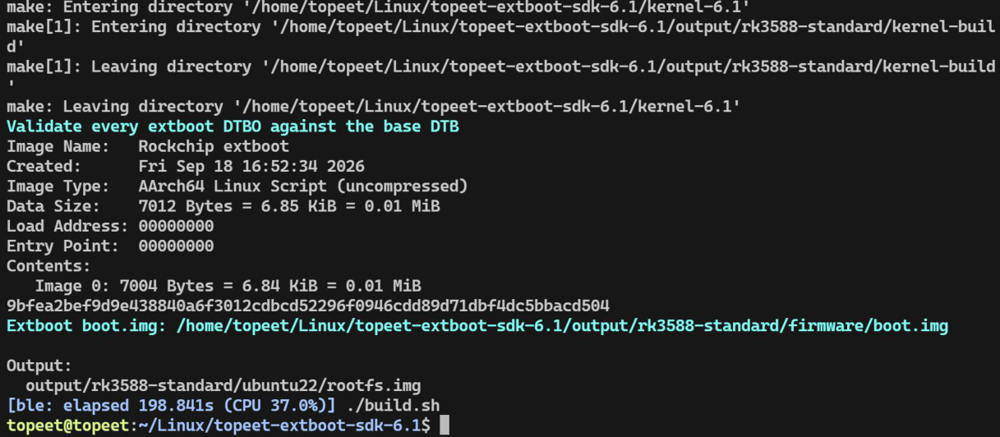

实际文件为：

```bash
output/rk3588-standard/ubuntu22/rootfs.img
```

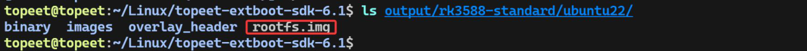

firmware/rootfs.img 链接到这份实际镜像。本步骤生成rootfs.img，完整update.img 需在后续打包步骤中生成。修改内核或驱动后，应重新编译rootfs，使镜像中的模块与内核配套。

#### 3.2.5 整理固件

前面的分项编译完成后，在SDK 根目录执行：

```bash
./build.sh firmware
```

firmware 用于整理和检查打包所需文件，将分区配置与各镜像通过文件或软链接汇集到output/rk3588-standard/firmware/。同时，rockdev/rk3588-standard 会指向这个目录，命令运行完成如下图所示：

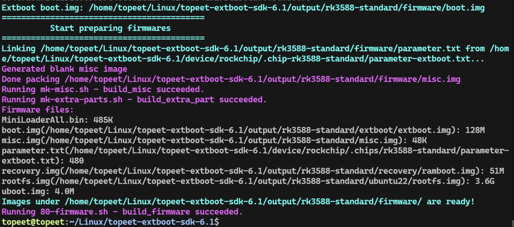

可以查看目录内容：

```bash
ls -lh output/rk3588-standard/firmware/
```

其中应包含MiniLoaderAll.bin、uboot.img、parameter.txt、misc.img、boot.img、recovery.img 和rootfs.img 等输入。文件名后面的“->”表示软链接指向，如下图所示：

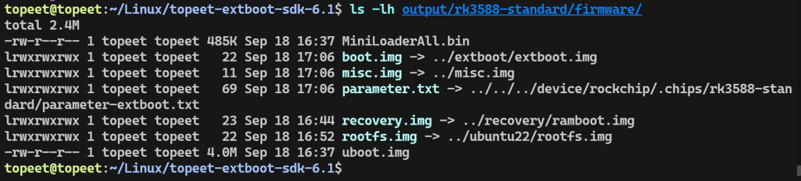

#### 3.2.6 打包完整update.img

继续执行以下命令，将当前板的各部分镜像打包为完整升级镜像：

```bash
./build.sh updateimg
```

打包完成后，实际update.img 保存在以下路径，如下图所示：

```bash
output/rk3588-standard/update/Image/update.img
```

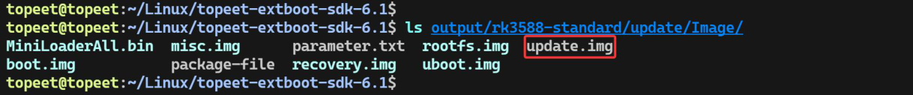

### 3.3 镜像保存位置

以RK3588 标准版为例，编译结果位于output/rk3588-standard/。firmware/ 是日常取用镜像的入口目录，其中既有实际文件，也有指向其他目录的软链接。

软链接类似文件的快捷入口，本身不保存镜像数据；其目标文件才是镜像内容。下表所有路径均相对于output/rk3588-standard/：

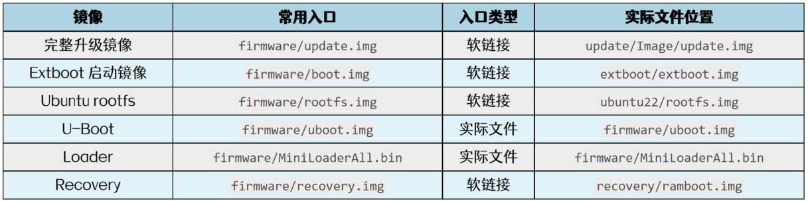

rockdev/rk3588-standard 本身也是目录软链接，指向output/rk3588-standard/firmware/，不是另一套镜像。update.img 在完整打包成功后生成；如果刚重新编译过部件，请完成updateimg 再取用完整镜像。

### 3.4 清理编译结果

需要重新从头编译时，可以在菜单中选择cleanall，或执行：

```bash
./build.sh cleanall
```

注意：cleanall 会清理所有开发板的编译结果和共享中间文件，包括output/ 与rockdev/。需要保留的镜像请先另行保存。

<div style="page-break-after: always;"></div>

## 第4章 切换屏幕与摄像头

Extboot 已包含当前板的屏幕和摄像头配置，可以在板端切换，也可以在编译前设置。配置在重启后生效。

### 4.1 在开发板上切换屏幕

以下命令在开发板的Ubuntu 终端或调试串口中执行。系统启动后会自动将Extboot 分区挂载到/boot，如下图所示：

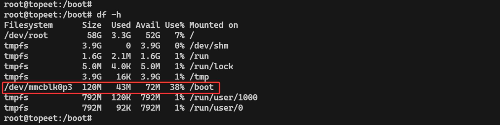

看到/boot 的挂载记录后,打开uEnv.txt 文件

`vim /boot/uEnv/uEnv.txt`

文件中每个dtoverlay= 行对应一项外设配置。行首带# 表示关闭，去掉# 表示启用。只修改#overlay_start 和#overlay_end 之间需要切换的项目，保留其他内容。

RK3588 标准版默认启用HDMI0 和HDMI1，这里以启用MIPI0 屏幕为例进行演示。需要取消VP2 中MIPI0 的注释，并将同组其他选项保持为注释，修改完成之后如下图所示：

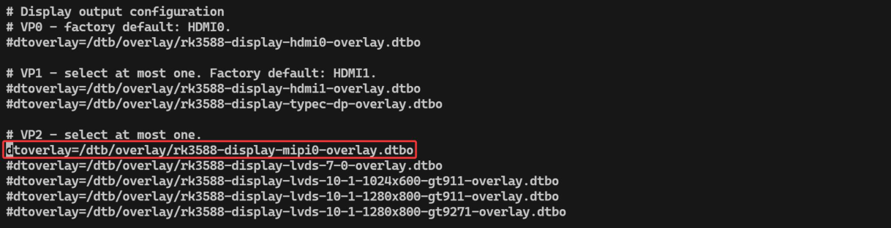

同一个VP 分组只启用一种配置；其他板型使用各自文件中的选项。例如RK3568 的HDMI VP0 与HDMI VP1 共用同一接口，也只能启用其中一个。

然后保存退出，重启开发板之后配置即可自动生效。

### 4.2 设置新镜像的默认屏幕

在编译电脑的SDK 根目录使用以下命令可以查询RK3588 标准版可用的屏幕配置：

```bash
tools/topeet-screen list --target rk3588-standard
```

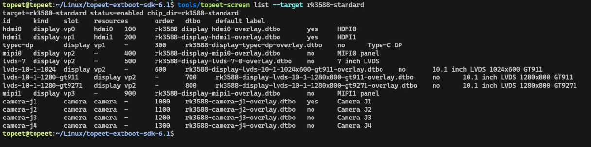

列表中的id 是配置名称，slot 是所属分组。例如将VP2 设置为7 英寸LVDS 屏，再重新编译Extboot：

```bash
tools/topeet-screen apply --target rk3588-standard --set vp2=lvds-7
tools/topeet-build --target rk3588-standard extboot
```

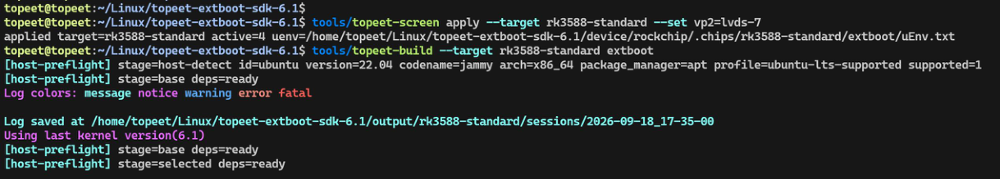

这会更新源码配置，生成output/rk3588-standard/extboot/extboot.img。其他板型先替换--target 后的名称，再从该板列表中选择配置。

如果需要完整update.img，在各部分镜像已编译完成后执行：

```bash
tools/topeet-build --target rk3588-standard updateimg
```

### 4.3 切换摄像头

提供摄像头Overlay 的开发板，操作方法与切换屏幕相同。在板端uEnv.txt 的Camera 分组中关闭原选项、启用新选项，再重启即可。

RK3588 标准版默认启用Camera J1。编译前切换到J2 的命令如下：

```bash
tools/topeet-screen apply --target rk3588-standard --set camera=camera-j2
tools/topeet-build --target rk3588-standard extboot
```

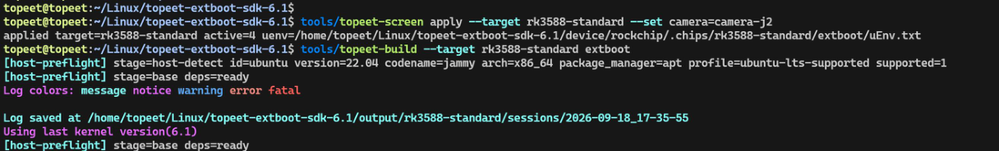

摄像头名称和接口以当前开发板的配置为准。RK3568 标准板和Mini 板当前未提供摄像头切换项，其摄像头配置在基础设备树中。

<div style="page-break-after: always;"></div>

## 第5章 自定义设备树 Overlay

需要适配自己的底板或调整外设功能时，可以增加自定义Overlay。本章以RK3588 标准版关闭PCIe 3.0 为例；只使用现有屏幕和摄像头的用户，可直接使用第4 章的方法。

### 5.1 添加Overlay 源文件

以下示例使用RK3588 标准版的节点。仅在项目不使用该PCIe 3.0 接口及其连接设备时采用此配置；其他开发板需要根据各自设备树修改节点。

在下面的目录中新建rk3588-standard-pcie3-disabled.dts：

```bash
kernel-6.1/arch/arm64/boot/dts/rockchip/overlay/
```

填入以下内容，将PCIe 3.0 PHY 和控制器设置为disabled，如下图所示：

```dts
/dts-v1/;
/plugin/;
/ {
    fragment@0 {
        target = <&pcie30phy>;
        __overlay__ { status = "disabled"; };
    };
    fragment@1 {
        target = <&pcie3x4>;
        __overlay__ { status = "disabled"; };
    };
};
```

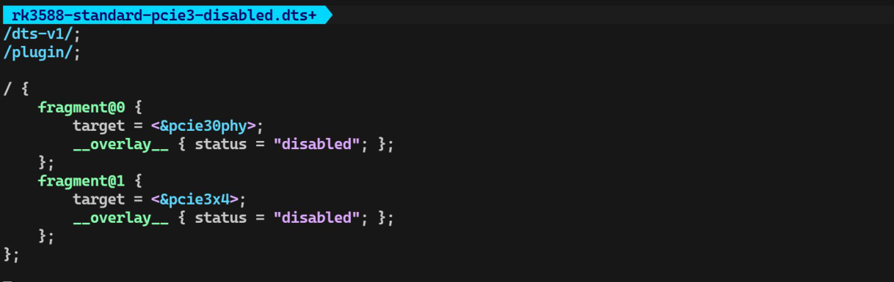

### 5.2 在配置文件中启用

打开RK3588 标准版的配置文件：

```bash
device/rockchip/.chips/rk3588-standard/extboot/uEnv.txt
```

在现有#overlay_end 行的前面加入下面一行，保留原有屏幕和摄像头配置：

```bash
dtoverlay=/dtb/overlay/rk3588-standard-pcie3-disabled.dtbo
```

保存后，构建脚本会根据此行自动编译并加入对应的DTS 文件，无需另行修改Overlay Makefile。

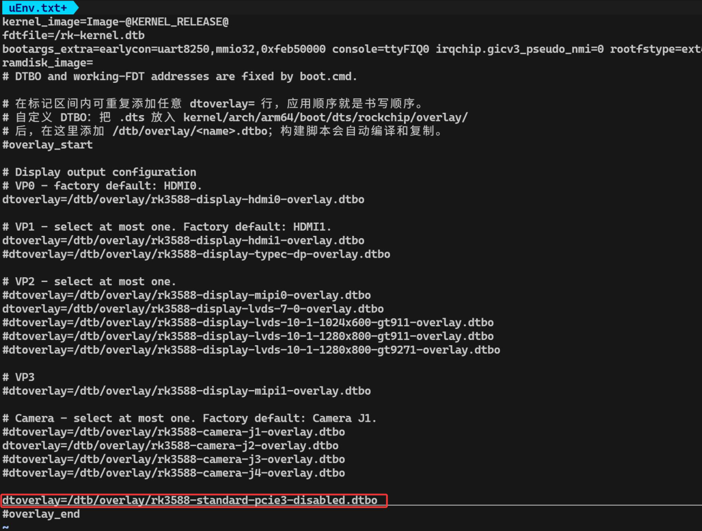

### 5.3 重新编译Extboot

在SDK 根目录执行：

```bash
tools/topeet-build --target rk3588-standard extboot
```

生成的镜像位于output/rk3588-standard/extboot/extboot.img。更新开发板的启动镜像并重启后，新Overlay 即可生效。
