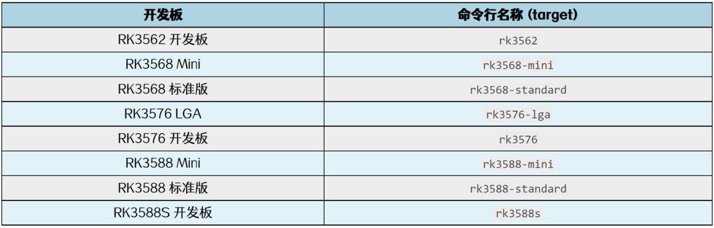
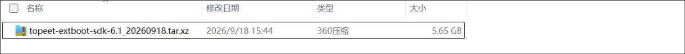
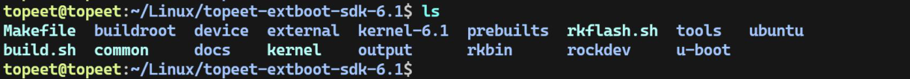

# 第1章 Extboot SDK 简介

## 1.1 Extboot 的作用

Extboot 将内核、设备树和屏幕等外设的配置放在一个启动分区中。使用同一款开发板时，可以通过修改uEnv.txt 并重启，在已适配的屏幕或摄像头之间切换，无需为每种屏幕分别准备一套系统镜像。

统一SDK 为多款开发板提供相同的编译和使用方法。选择开发板后，SDK 会使用对应配置生成该板的镜像，使用时选择与实物板型对应的文件即可。

下文以RK3588 标准版（target：rk3588-standard）为示例，其他开发板采用相同流程，选择对应板型即可。

## 1.2 支持的开发板

当前支持下表中的8 款开发板。target 是开发板在命令行中的名称；使用图形菜单时，直接选择开发板名称即可。

## 1.3 获取源码并进入SDK

本SDK 可在Ubuntu 18.04、20.04 和22.04 主机上直接编译，无需手动配置编译环境。从网盘资料中的“03_系统源码\02_Linux 系统源码”路径下找到定制扩展分区SDK 源码目录，如下图所示：

下载统一Extboot SDK 并解压，然后进入源码根目录，如下图所示：

本文所用的编译命令均在此目录执行。编译电脑的Ubuntu 版本可以不同，当前SDK 生成的开发板系统为Ubuntu 22。
