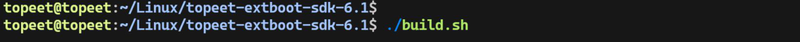
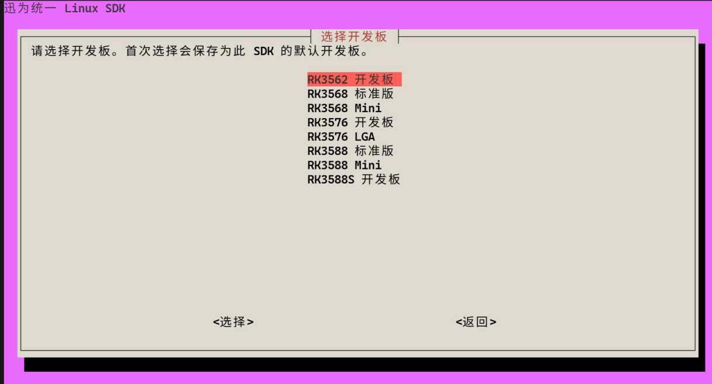
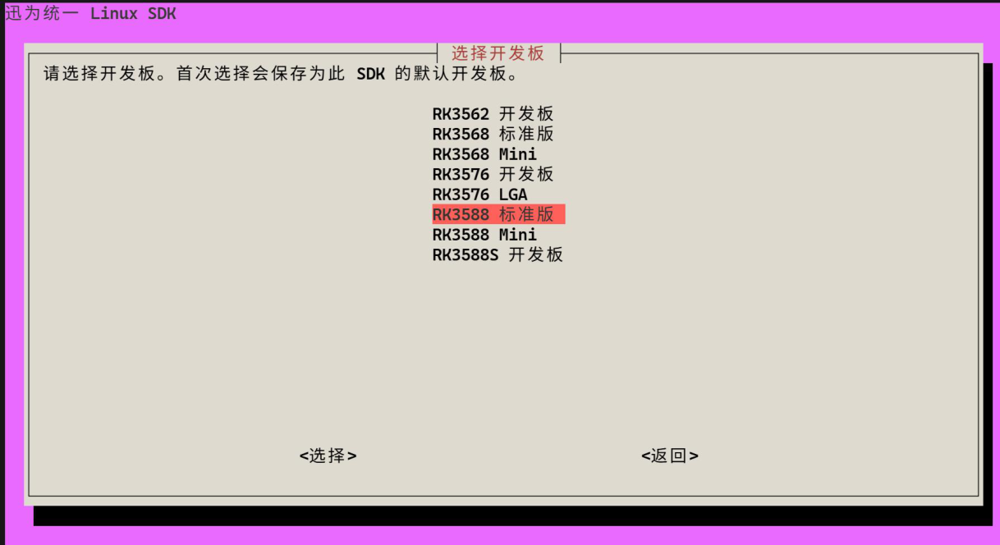
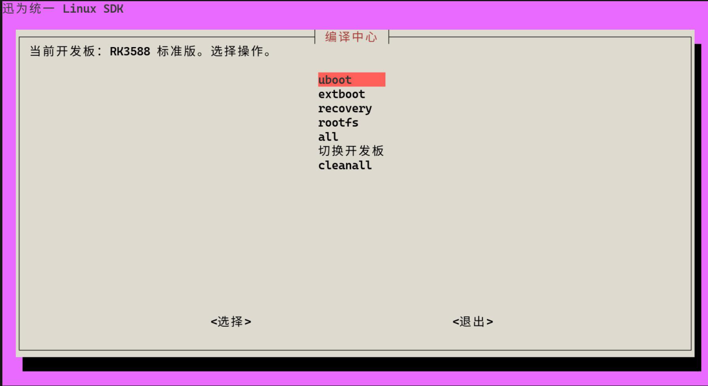
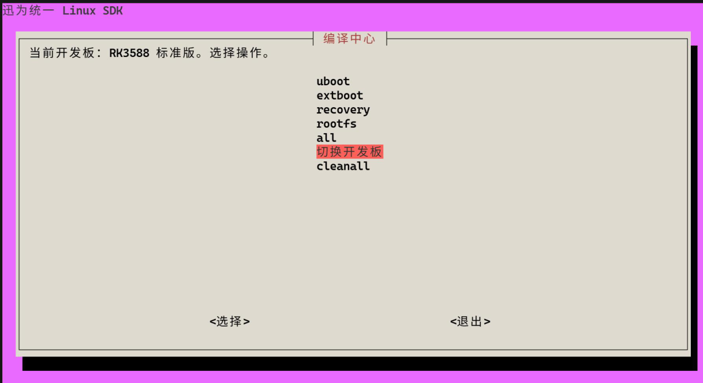
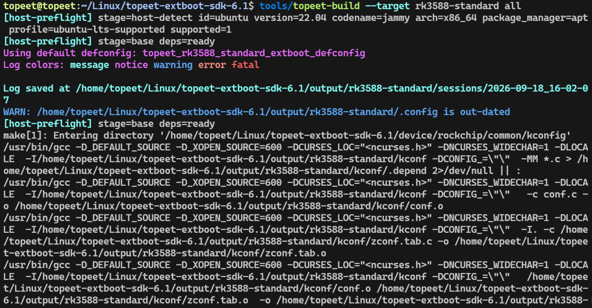

# 第2章 选择开发板

## 2.1 首次选择

在SDK 根目录打开终端，输入以下命令：



首次运行会显示开发板列表,如下图所示：



本文选择RK3588 标准版，如下图所示：



按回车进入“编译中心”。SDK 会记住本次选择，后续打开菜单时直接使用该开发板。



## 2.2 查看与切换开发板

“编译中心”顶部显示当前开发板。需要换板时，选择“切换开发板”，重新选择即可；继续编译前需要确认顶部名称正确。



## 2.3 直接指定开发板（可选）

也可以在命令行直接指定板型，无需先进入菜单。例如，完整编译RK3588 标准版：

```bash
tools/topeet-build --target rk3588-standard all
```

其他开发板将rk3588-standard 替换为1.2 节表格中的target 名称即可，编译过程如下图所示：


