# 第3章 编译镜像

在“04_系统镜像\02_Linux 系统镜像”下的定制扩展分区SDK 镜像目录下已经存放了编译好的镜像，如果不想编译镜像可以直接根据烧写手册来进行烧写。

## 3.1 一键编译完整镜像

第一次编译时，推荐使用all。运行./build.sh，在“编译中心”确认板型后选择all，等待编译完成即可，如下图所示：

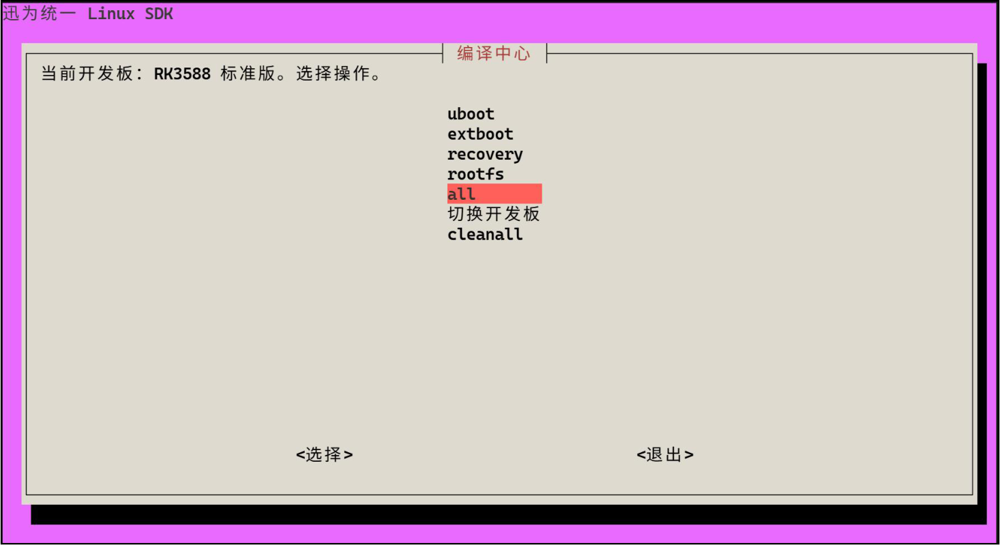

SDK 会完成U-Boot、Extboot、Recovery 和Ubuntu 根文件系统的编译，并打包生成完整的update.img。编译过程中按提示输入sudo 密码即可。

已经通过菜单选择过开发板后，也可以直接执行：

```bash
./build.sh all
```

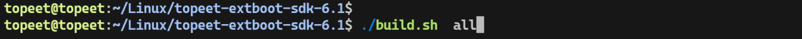

编译完成的打印如下图所示：

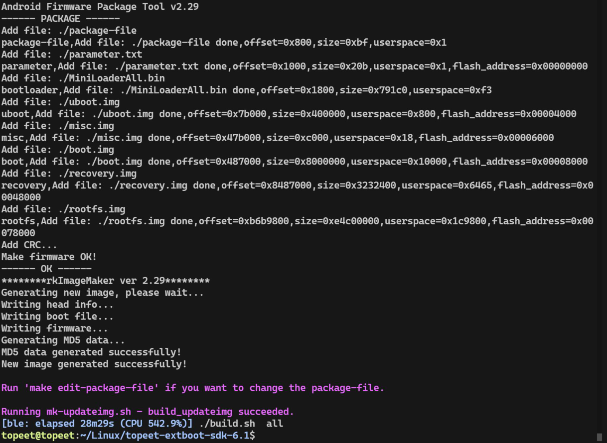

以RK3588 标准版为例，完整镜像的实际文件生成路径为：

```bash
output/rk3588-standard/update/Image/update.img
```

如下图所示：

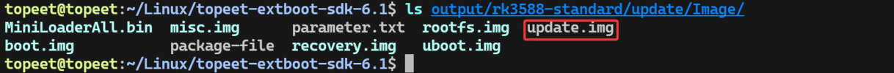

## 3.2 单独编译与打包

下面以RK3588 标准版为例，依次完成各部分编译，最后打包成update.img。开始前运行./build.sh，在菜单中选择RK3588 标准版；后续./build.sh 命令均使用保存的板型。

首次采用分项方式编译时，按U-Boot →Extboot →Recovery →Ubuntu rootfs →firmware→updateimg 的顺序操作。每一步成功结束后再继续下一步。已有完整编译结果时，可按修改内容重新编译对应部分。

图形菜单每次完成一个操作后返回终端。继续选择下一项时，再运行./build.sh；也可以直接使用下列命令。

### 3.2.1 编译U-Boot

在“编译中心”选择uboot 并回车，或在SDK 根目录执行：

```bash
./build.sh uboot
```


脚本使用当前开发板的启动配置，生成Loader 和U-Boot。编译完成后，以下两个文件会保存在firmware 目录中，如下图所示：

```bash
output/rk3588-standard/firmware/MiniLoaderAll.bin
output/rk3588-standard/firmware/uboot.img
```

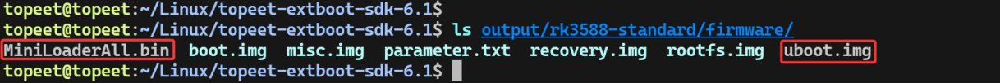

### 3.2.2 编译Extboot

在菜单中选择extboot，或执行：

```bash
./build.sh extboot
```

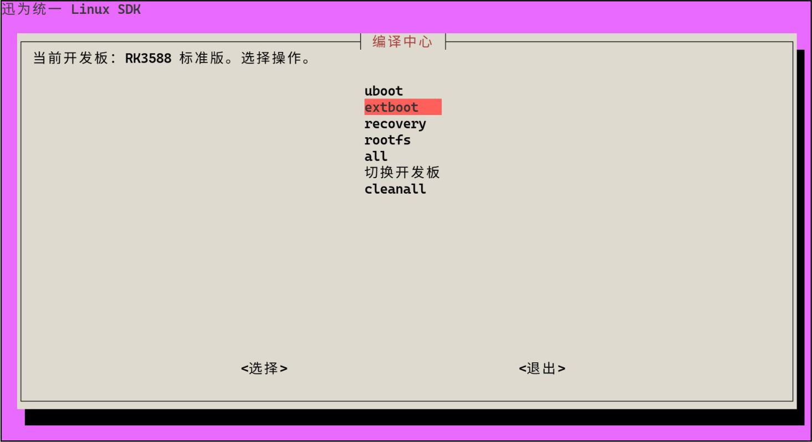

该步骤会编译内核、基础设备树和Overlay，再把内核、设备树、启动脚本及uEnv.txt 打包成Extboot 镜像，无需先单独执行kernel 命令，编译完成如下图所示：

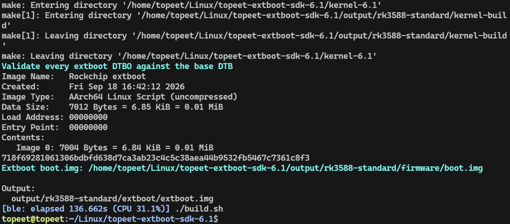

编译完成的实际镜像存放路径为：

```bash
output/rk3588-standard/extboot/extboot.img
```

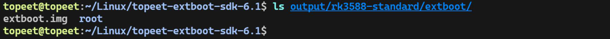

### 3.2.3 编译Recovery

在菜单中选择recovery，或执行：

```bash
./build.sh recovery
```

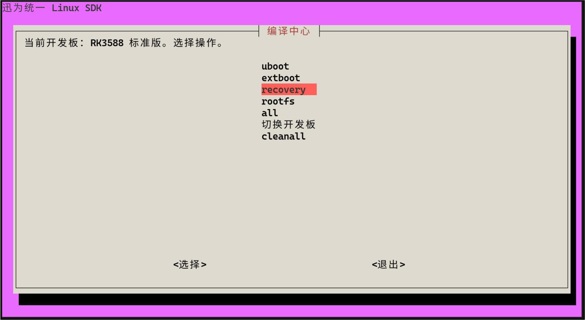

Recovery 是独立的恢复系统，完整升级包需要包含该镜像。编译完成如下图所示：

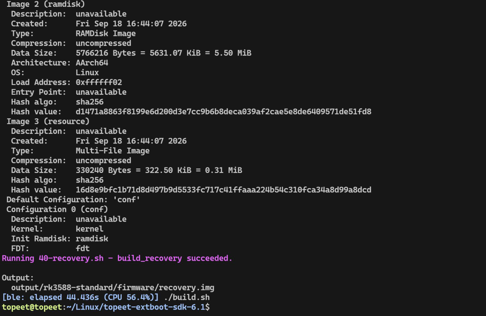

脚本会编译Recovery 所需内容，镜像的生成路径为

```bash
output/rk3588-standard/recovery/ramboot.img
```

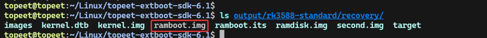

用于打包的firmware/recovery.img 是指向recovery/ramboot.img 的软链接。这里的ramboot.img 是Recovery 构建产物的文件名。

### 3.2.4 编译Ubuntu 根文件系统

在菜单中选择rootfs，或执行：

```bash
./build.sh rootfs
```

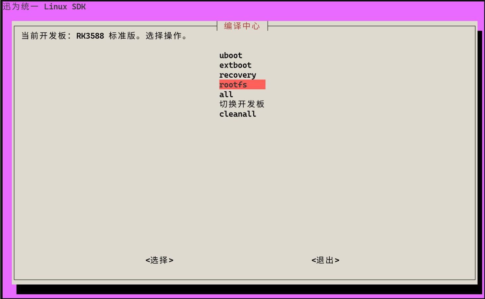

脚本使用SDK 内的Ubuntu 22 基础包，加入RK3588 标准版的系统文件、内核模块和相关配置，生成根文件系统。操作过程中按提示输入sudo 密码，等待构建结束，构建完成的打印如下图所示：

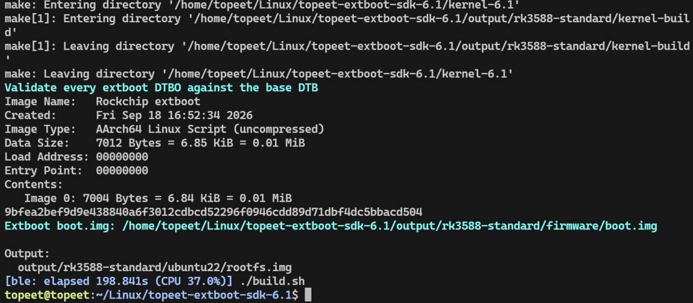

实际文件为：

```bash
output/rk3588-standard/ubuntu22/rootfs.img
```

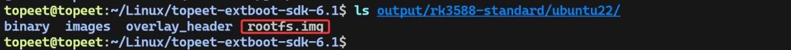

firmware/rootfs.img 链接到这份实际镜像。本步骤生成rootfs.img，完整update.img 需在后续打包步骤中生成。修改内核或驱动后，应重新编译rootfs，使镜像中的模块与内核配套。

### 3.2.5 整理固件

前面的分项编译完成后，在SDK 根目录执行：

```bash
./build.sh firmware
```

firmware 用于整理和检查打包所需文件，将分区配置与各镜像通过文件或软链接汇集到output/rk3588-standard/firmware/。同时，rockdev/rk3588-standard 会指向这个目录，命令运行完成如下图所示：

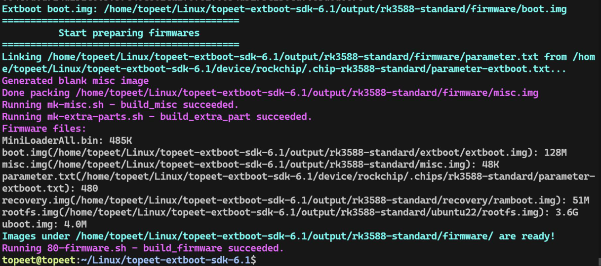

可以查看目录内容：

```bash
ls -lh output/rk3588-standard/firmware/
```

其中应包含MiniLoaderAll.bin、uboot.img、parameter.txt、misc.img、boot.img、recovery.img 和rootfs.img 等输入。文件名后面的“->”表示软链接指向，如下图所示：

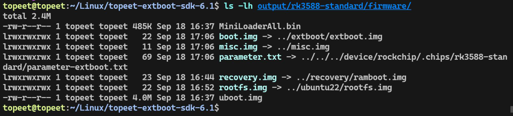

### 3.2.6 打包完整update.img

继续执行以下命令，将当前板的各部分镜像打包为完整升级镜像：

```bash
./build.sh updateimg
```

打包完成后，实际update.img 保存在以下路径，如下图所示：

```bash
output/rk3588-standard/update/Image/update.img
```

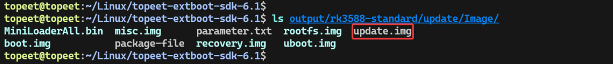

## 3.3 镜像保存位置

以RK3588 标准版为例，编译结果位于output/rk3588-standard/。firmware/ 是日常取用镜像的入口目录，其中既有实际文件，也有指向其他目录的软链接。

软链接类似文件的快捷入口，本身不保存镜像数据；其目标文件才是镜像内容。下表所有路径均相对于output/rk3588-standard/：

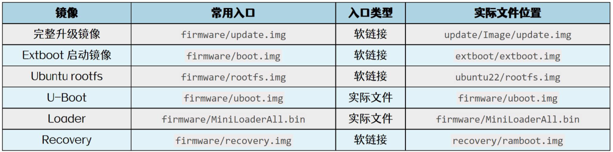

rockdev/rk3588-standard 本身也是目录软链接，指向output/rk3588-standard/firmware/，不是另一套镜像。update.img 在完整打包成功后生成；如果刚重新编译过部件，请完成updateimg 再取用完整镜像。

## 3.4 清理编译结果

需要重新从头编译时，可以在菜单中选择cleanall，或执行：

```bash
./build.sh cleanall
```

注意：cleanall 会清理所有开发板的编译结果和共享中间文件，包括output/ 与rockdev/。需要保留的镜像请先另行保存。
