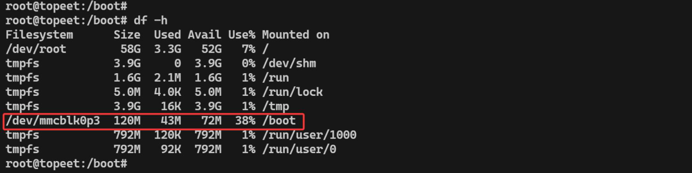
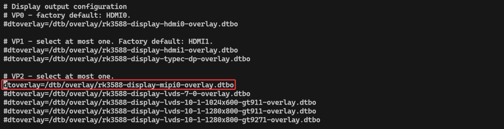
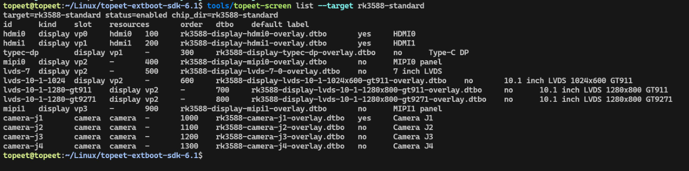
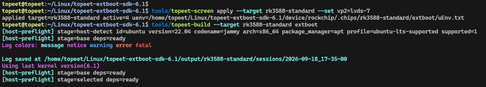
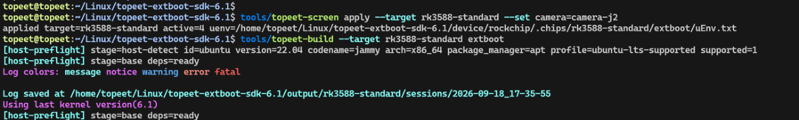

# 第4章 切换屏幕与摄像头

Extboot 已包含当前板的屏幕和摄像头配置，可以在板端切换，也可以在编译前设置。配置在重启后生效。

## 4.1 在开发板上切换屏幕

以下命令在开发板的Ubuntu 终端或调试串口中执行。系统启动后会自动将Extboot 分区挂载到/boot，如下图所示：



看到/boot 的挂载记录后,打开uEnv.txt 文件

`vim /boot/uEnv/uEnv.txt`

文件中每个dtoverlay= 行对应一项外设配置。行首带# 表示关闭，去掉# 表示启用。只修改#overlay_start 和#overlay_end 之间需要切换的项目，保留其他内容。

RK3588 标准版默认启用HDMI0 和HDMI1，这里以启用MIPI0 屏幕为例进行演示。需要取消VP2 中MIPI0 的注释，并将同组其他选项保持为注释，修改完成之后如下图所示：



同一个VP 分组只启用一种配置；其他板型使用各自文件中的选项。例如RK3568 的HDMI VP0 与HDMI VP1 共用同一接口，也只能启用其中一个。

然后保存退出，重启开发板之后配置即可自动生效。

## 4.2 设置新镜像的默认屏幕

在编译电脑的SDK 根目录使用以下命令可以查询RK3588 标准版可用的屏幕配置：

```bash
tools/topeet-screen list --target rk3588-standard
```



列表中的id 是配置名称，slot 是所属分组。例如将VP2 设置为7 英寸LVDS 屏，再重新编译Extboot：

```bash
tools/topeet-screen apply --target rk3588-standard --set vp2=lvds-7
tools/topeet-build --target rk3588-standard extboot
```



这会更新源码配置，生成output/rk3588-standard/extboot/extboot.img。其他板型先替换--target 后的名称，再从该板列表中选择配置。

如果需要完整update.img，在各部分镜像已编译完成后执行：

```bash
tools/topeet-build --target rk3588-standard updateimg
```

## 4.3 切换摄像头

提供摄像头Overlay 的开发板，操作方法与切换屏幕相同。在板端uEnv.txt 的Camera 分组中关闭原选项、启用新选项，再重启即可。

RK3588 标准版默认启用Camera J1。编译前切换到J2 的命令如下：

```bash
tools/topeet-screen apply --target rk3588-standard --set camera=camera-j2
tools/topeet-build --target rk3588-standard extboot
```



摄像头名称和接口以当前开发板的配置为准。RK3568 标准板和Mini 板当前未提供摄像头切换项，其摄像头配置在基础设备树中。
