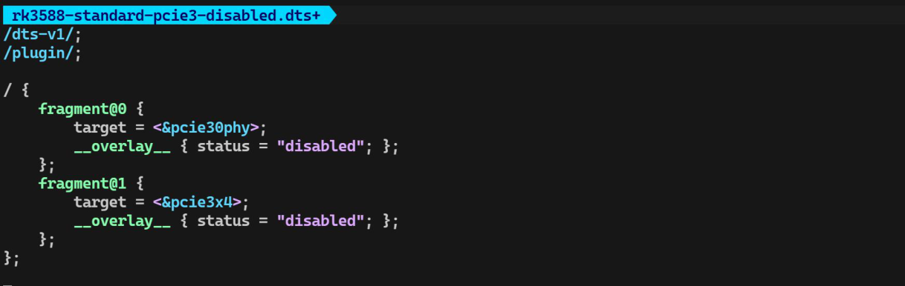
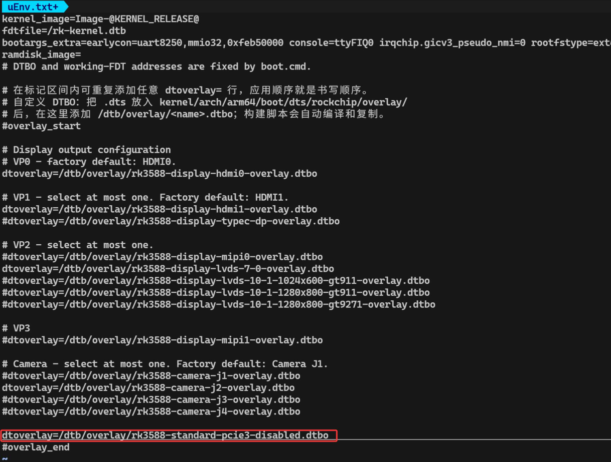

# 第5章 自定义设备树 Overlay

需要适配自己的底板或调整外设功能时，可以增加自定义Overlay。本章以RK3588 标准版关闭PCIe 3.0 为例；只使用现有屏幕和摄像头的用户，可直接使用第4 章的方法。

## 5.1 添加Overlay 源文件

以下示例使用RK3588 标准版的节点。仅在项目不使用该PCIe 3.0 接口及其连接设备时采用此配置；其他开发板需要根据各自设备树修改节点。

在下面的目录中新建rk3588-standard-pcie3-disabled.dts：

```bash
kernel-6.1/arch/arm64/boot/dts/rockchip/overlay/
```

填入以下内容，将PCIe 3.0 PHY 和控制器设置为disabled，如下图所示：

```dts
/dts-v1/;
/plugin/;
/ {
    fragment@0 {
        target = <&pcie30phy>;
        __overlay__ { status = "disabled"; };
    };
    fragment@1 {
        target = <&pcie3x4>;
        __overlay__ { status = "disabled"; };
    };
};
```



## 5.2 在配置文件中启用

打开RK3588 标准版的配置文件：

```bash
device/rockchip/.chips/rk3588-standard/extboot/uEnv.txt
```

在现有#overlay_end 行的前面加入下面一行，保留原有屏幕和摄像头配置：

```bash
dtoverlay=/dtb/overlay/rk3588-standard-pcie3-disabled.dtbo
```

保存后，构建脚本会根据此行自动编译并加入对应的DTS 文件，无需另行修改Overlay Makefile。



## 5.3 重新编译Extboot

在SDK 根目录执行：

```bash
tools/topeet-build --target rk3588-standard extboot
```

生成的镜像位于output/rk3588-standard/extboot/extboot.img。更新开发板的启动镜像并重启后，新Overlay 即可生效。
