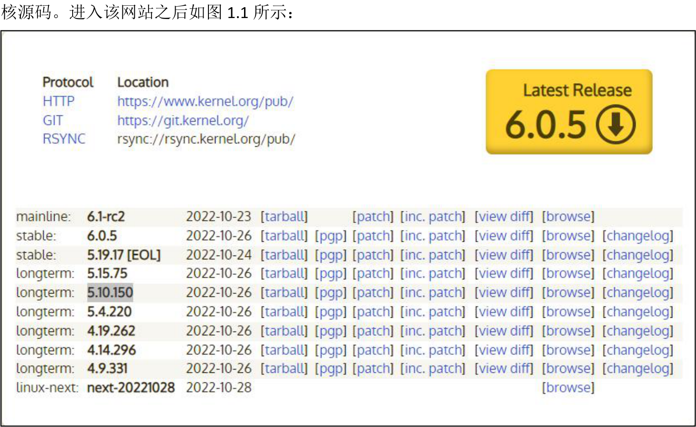
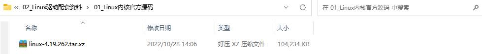
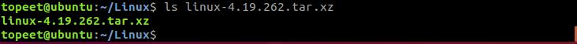
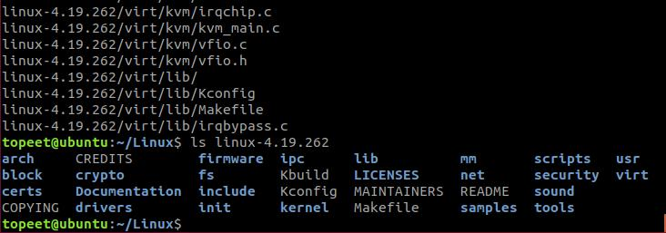
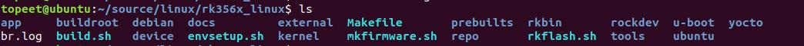
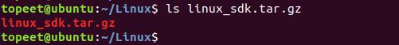
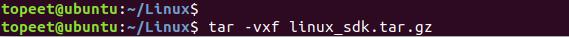
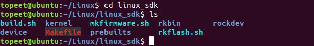
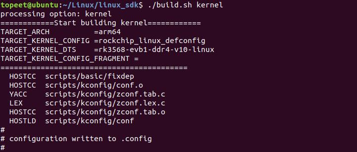
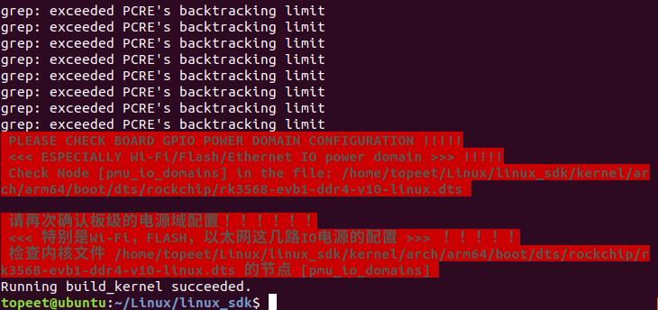

# 第001章 你好！内核源码

本章我们认识Linux 内核源码，开始真正进入到驱动的世界里面，不知道各位同学有没有做好准备呢？
## 1.1 初识内核源码
Linux 内核源码的官方网站为https://www.kernel.org/，可以在该网站下载最新的Linux 内

图1.1图1.1 中有多个版本的内核分支，分别为主线版本（mainline）、稳定版本（stable）和长期支持版本（longterm）。以上各个支线和主线是由linus torvalds（Linux 内核的爸爸）所领导。作者在Linux 官方网站中下载了4.19.262 分支源码，并存放在网盘资料“iTOP-RK3568 开发板\07_学习教程配套资料\03_Linux 驱动配套资料\01_Linux 内核官方源码”目录下，如图1.2 所示：

图1.2

将在官网中下载的4.19.262 分支源码拷贝到虚拟机ubuntu 中，如图1.3 所示。

图1.3使用sudo tar -vxf linux-4.19.262.tar.xz 命令对内核官方源码进行解压，解压完成如图1.4 所示。

图1.4解压完成后进到内核源码目录下会看到非常多的文件夹，这些文件夹放的就是Linux 内核源码，各个文件夹作用如表1.1 所示。表1.1目录作用arch存放不同平台体系相关代码block存放块设备相关代码crypto存放加密、压缩、CRC 校验等算法相关代码Documentation存放相关说明文档，如驱动编写相关文档等drivers存放Linux 内核设备驱动程序源码。该目录包含众多驱动，并按照设备类别进行分类，如char、block 、input、i2c、spi、pci、usb 等。firmware存放处理器相关的一些特殊固件fs存放虚拟文件系统代码include存放内核所需、与平台无关的头文件initLinux 系统启动初始化相关的代码ipc存放进程间通信代码kernelLinux 内核的核心代码，包含了进程调度子系统，以及和进程调度相关的模块。lib库文件代码，实现需要在内核中使用的库函数，例如CRC、FIFO、list、MD5等。mm实现存放内存管理代码net存放网络相关代码samples存放提供的一些内核编程范例scripts存放一些脚本文件security存放系统安全性相关代码

sound存放声音、声卡相关驱动tools一些常用工具，如性能剖析、自测试工具等usr用于生成initramfs 的代码。virt提供虚拟机技术（KVM 等）的支持
## 1.2 SDK 包介绍
如果不在芯片原厂工作，大多数工程师都是基于芯片原厂提供的源码包做二次开发，而不是自己在Linux 内核网站上去下载内核源码。因为芯片原厂提供的源码包已经对相应的芯片做好了适配，直接使用针对芯片适配好的源码包可以极大地提高开发效率和减少bug 的产生。如迅为RK3568、RK3588、RK3576 等开发板都是直接使用瑞芯微提供的源码包，龙芯、NXP、三星、全志等开发板亦是如此。Linux 官网下载的内核源码与芯片原厂提供的源码包中的内核源码目录结构基本相同。Linux 驱动开发需要uboot、Linux 内核和文件系统三部分。在一些性能较低的处理器中这三部分往往是单独提供。uboot 源码包中就是uboot 源码，Linux 内核源码包中就是Linux 内核源码，文件系统源码包中就是文件系统源码。如北京迅为的4412，6ull 开发板源码。但是随着处理器性能的提高，芯片原厂为了将处理器性能完全发挥出来，往往将uboot、Linux 内核和文件系统源码打包在一起形成SDK 包，SDK 包中也会包含各种驱动库，第三方库等，SDK 包中各个部分互相依赖，互相交织。如北京迅为的RK3568、RK3588 开发板源码就提供了安卓源码SDK包和Linux 源码SDK 包俩种。图1.5 是iTOP-RK3568 开发板Linux 源码SDK 包目录结构。

图1.5Linux 源码SDK 包中目录其作用如表1.2 所示。表1.2目录作用app存放应用程序，如QT 程序，C/C++程序buildroot存放buildroot 文件系统源码debian存放debian 文件系统源码doc存放芯片外设开发文档external存放第三方库perbuilts存放交叉编译工具rkbin存放芯片所需的bin 文件rockdev编译好的镜像会被输出到该目录u-boot存放uboot 源码yocto存放yocto 文件系统源码device存放板级文件kernel存放Linux 内核源码tools存放开发所需工具，如果烧写工具。ubuntu存放ubuntu 文件系统源码

## 1.3 内核源码编译
为了降低驱动学习难度，北京迅为工程师将Linux 源码SDK 包中的内核源码单独提取了出来，存放在网盘“ iTOP-RK3568 开发板\07_ 学习教程配套资料\03_Linux 驱动配套资料\02_Linux_SDK 源码”目录下。在学习Linux 驱动之前，需要先将Linux 内核源码编译通过。1.准备编译环境本小节编译环境使用的是迅为搭建好的编译环境，迅为的环境经过测试在不进行修改的前提下，可以直接将内核源码编译通过，可在网盘“iTOP-RK3568 开发板\02_开发工具\01_搭建虚拟机Ubuntu 环境配套资料\02_搭建好编译环境的虚拟机镜像”目录下下载。因ubuntu 版本众多，所以无法一一验证，其他版本编译环境恕不能提供技术支持。搭建好的编译环境使用手册可在“售后群群文件03_开发环境搭建/03_【北京迅为】itop-3568 开发板快速使用编译环境ubuntu18.04”路径下载。2.编译步骤将内核源码拷贝到虚拟机ubuntu 目录下，如图1.6 所示：

图1.6使用tar -vxf linux_sdk.tar.gz 命令对内核源码的进行解压，解压完成如图1.7 所示：

图1.7使用cd linux_sdk 命令进入内核源码目录，如图1.8 所示：

图1.8使用命令./build.sh kernel 进行内核源码的编译，编译过程如图1.9 所示：

图1.9编译时间和电脑虚拟机配置相关，编译完成如图1.10 所示：

图1.10

