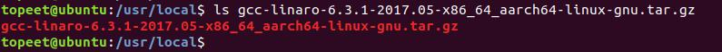
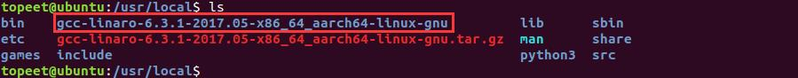
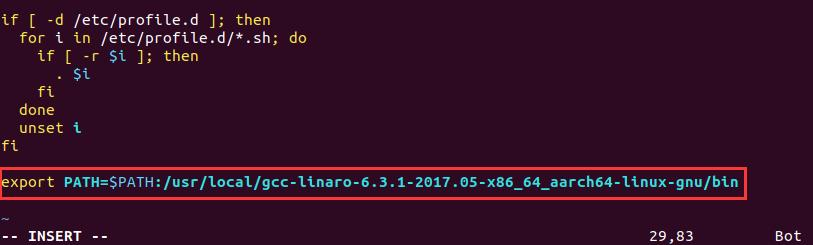
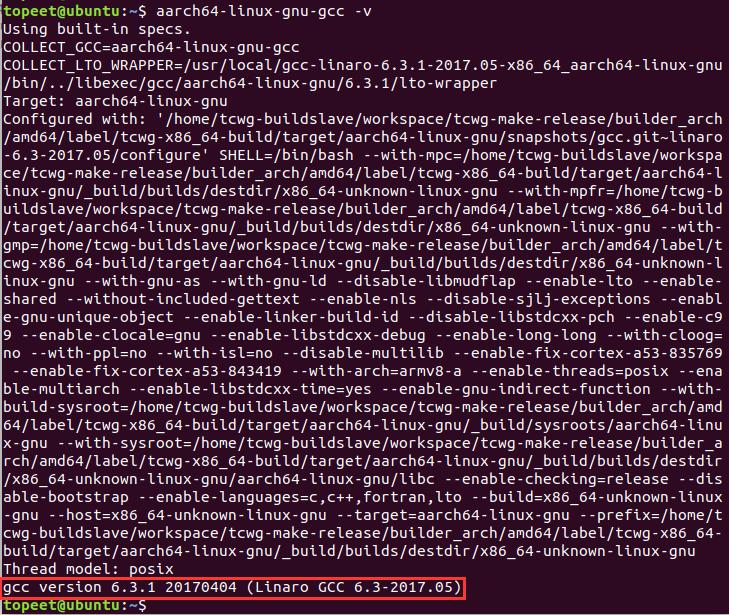
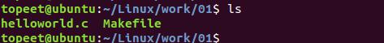
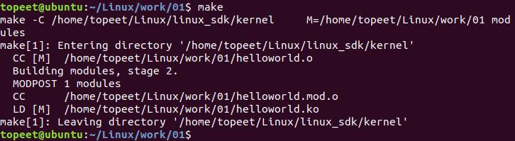
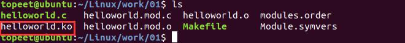
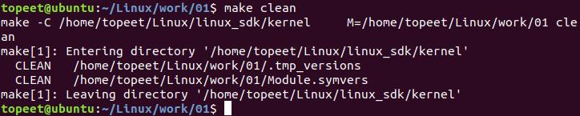
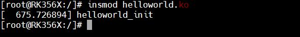
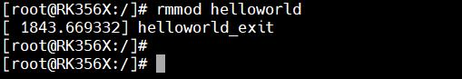

# 第003章 内核模块实验

```c
#include <linux/kernel.h>
```
通过上面的分析可知，helloworld 驱动包含了驱动框架所有必要部分。因此helloworld 驱动可以看作是驱动代码的模板。任何一个驱动代码可以都用它作为基础来编写实现。因此同学们要将helloworld 驱动记忆下来！
在上一章节编写了最简单的驱动程序helloworld。helloworld 驱动程序要如何编译并运行呢？编译驱动有两种方法，分别是将驱动编译进内核和将驱动编译成内核模块。我们先来学习如何将驱动编译成内核模块。把驱动编译成内核模块并运行需要设置交叉编译器、编写Makefile 和编译模块三个步骤。编译好的内核模块可以使用insmod 命令加载到内核运行，从内核中卸载内核模块使用rmmod命令。
## 3.1 设置交叉编译器
1.下载交叉编译器在网盘“iTOP-RK3568 开发板\07_学习教程配套资料\03_Linux 驱动配套资料\03_交叉编译器”路径下下载交叉编译器，将下载好的交叉编译器拷贝到虚拟机Ubuntu 环境中的/usr/local目录下，如图3.1 所示。

图3.1输入tar -vxf gcc-linaro-6.3.1-2017.05-x86_64_aarch64-linux-gnu.tar.gz 命令解压交叉编译压缩包，解压完毕后会生成交叉编译器所在的文件夹。如图3.2 所示。

图3.22.设置环境变量在终端输入sudo vi /etc/profile 命令打开profile 文件，接着在profile 文件末尾添加以下代码。export PATH=$PATH:/usr/local/gcc-linaro-6.3.1-2017.05-x86_64_aarch64-linux-gnu/bin添加完后如图3.3 所示。


图3.3保存退出后在终端输入reboot 命令重新启动Ubuntu 系统，使交叉编译环境生效。3.检查是否设置成功Ubuntu 系统重新启动登录到系统后，打开命令行终端，输入命令aarch64-linux-gnu-gcc -v，如果终端有如图3.4 所示的打印信息，说明交叉编译环境搭建成功。如果没有出现如图3.4 的打印信息，需要检查上一步骤是否设置正确。

图3.4

## 3.2 编写Makefile
编译驱动程序需要使用Makefile 文件。接下来为helloworld.c 编写一个简单的Makefile，其代码如代码清单3.1 所示。代码清单3.1
```c
#如果要在arm32 架构的开发板上运行，ARCH 变量值写成arm，如果在arm64 架构开发
板上运行则写成arm64，根据具体情况选择。
export ARCH=arm64
#设置交叉编译器前缀，依据具体开发板对应的交叉编译器前缀选择。
export CROSS_COMPILE=aarch64-linux-gnu-
#生成helloworld.o 文件。helloworld.o 名称要与helloworld.c 驱动名称保持一致。
obj-m += helloworld.o
#内核源码所在虚拟机ubuntu 的实际路径，并且保证该路径下的内核源码已经编译通过，
否则编译驱动会出现报错。具体编译方法请参考对应开发板使用手册，如iTOP-RK3568
开发板编译手册。
KDIR :=/home/topeet/Linux/linux_sdk/kernel
PWD ?= $(shell pwd)
all:
     make -C $(KDIR) M=$(PWD) modules#make 操作
clean:
  make -C $(KDIR) M=$(PWD) clean#make clean 操作
```
源文件helloworld.c 与Makefile 文件需要位于同一级目录下。如下图3.5 所示：

图3.5
## 3.3 编译成内核模块
在把驱动编译成内核模块之前需先编译通过在Makefile 文件中通过KDIR 变量指定路径下的内核源码。内核源码编译通过后，在Makefile 与helloworld 驱动路径下输入make 命令即可把helloworld 驱动编译成内核模块，如图3.6 所示。

图3.6内核模块是以ko 为后缀名，因此编译成功得到的helloworld.ko 文件即内核模块，也就是编译好的驱动程序。如图3.7 所示：


图3.7输入make clean 命令可清除编译文件，如图3.8 所示：

图3.8
## 3.4 模块加载与卸载
内核模块可以通过insmod 命令加载、通过rmmod 命令卸载。将helloworld.ko 内核模块拷贝到iTOP-RK3568 开发板上，通过insmod helloworld.ko 命令加载helloworld 内核模块，加载内核模块时会调用驱动入口函数helloworld_init，从而输出打印字符串信息“helloworld_init”，如图3.9 所示：

图3.9如果要卸载helloworld 内核模块，执行rmmod helloworld 命令。同理，在卸载内核模块的时候会执行驱动出口函数，所以可以看到驱动出口函数打印出来的字符串信息helloworld_exit，如下3.10 所示：

图3.10加载内核模块也可以使用modprobe 命令，它比insmod 命令更强大，modprobe 命令在加载驱动模块的时候，会同时加载该模块依赖的其他模块。比如helloworld.ko 依赖before.ko，使用insmod 加载的时候，就必须先加载before.ko，然后再加载helloworld.ko 才可以加载成功。使用modprobe 加载的时候，他会自动分析模块的依赖关系，然后将所有依赖的模块都加载到内核当中，所以modprobe 命令比较“聪明”。

