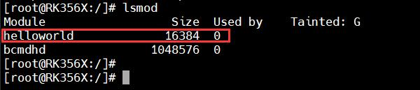
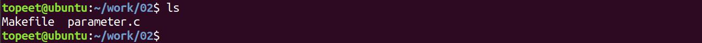
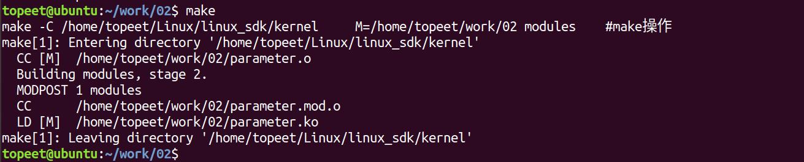

# 第004章 驱动模块传参实验

同样，在卸载驱动模块的时候，如果模块存在依赖关系，如果使用insmod 命令，需要手动卸载依赖的内核模块，但是使用modprobe 命令可以自动卸载驱动模块所依赖的其他模块。如果驱动模块是以modprobe helloworld.ko 命令加载的，卸载的时候使用modprobe -rhelloworld.ko 命令卸载。但是，使用modprobe 卸载存在一个问题，如果所依赖的模块被其他模块所使用，比如刚才例子中的before.ko 还被其他的模块使用，这时候就不能使用modprobe 卸载。所以要根据需求选择合适的命令进行操作。
## 3.5 查看模块信息
lsmod 命令可以列出已经载入Linux 内核模块，在helloworld 驱动加载之后，使用lsmod命令查看内核中加载的模块，如图3.11 所示：

图3.11除了使用lsmod 命令，也可以使用modinfo helloworld.ko 命令可以获得模块的其他信息，如模块作者，模块说明，模块支持的参数等等。
本章我们学习驱动模块传参，加载内核模块时使用insmod 命令也可以传递参数。
## 4.1 内核模块传参简介
内核模块传参是一种可以随时向内核模块传递、修改参数的方法。例如可以传递串口驱动的波特率、数据位数、校验位、停止位等参数进行功能的设置，从而节省编译模块的时间，提高调试速度。Linux 内核提供了module_param(name, type, perm)、module_param_array(name, type, nump, perm)宏和module_param_string(name, string, len, perm)宏，分别进行基本类型、数组和字符串参数的传递。这些宏定义在内核源码/include/linux/moduleparam.h 文件中(在module.h 头文件中已经对export.h 头进行引用，所以不需要单独引用moduleparam.h 文件),详细定义如代码4.1 所示：代码清单4.1
```c
#define module_param(name, type, perm)\
    module_param_named(name, name, type, perm)
```

```c
#define module_param_array(name, type, nump, perm)\
    module_param_array_named(name, name, type, nump, perm)
#define module_param_string(name, string, len, perm)\
    static const struct kparam_string __param_string_##name\
        = { len, string };\
    __module_param_call(MODULE_PARAM_PREFIX, name,\
                &param_ops_string,\
                .str = &__param_string_##name, perm, -1, 0);\
    __MODULE_PARM_TYPE(name, "string")
```
module_param 宏用来进行基本类型参数的传递。其中参数name 表示模块参数的名称。参数type 表示模块参数的数据类型，参数type 可以取以下任意一种情况：代码清单4.2
```c
bool : 布尔型
inbool : 布尔反值
charp: 字符指针（相当于char *,不超过1024 字节的字符串）
short: 短整型
ushort : 无符号短整型
int : 整型
uint : 无符号整型
long : 长整型
ulong: 无符号长整型。
```
参数perm 表示在sysfs 中相应文件的访问权限。访问权限与Linux 中访问权限管理相同，权限可以使用数字如0666 或者使用内核源码/include/linux/stat.h 文件宏定义表示，如代码清单4.3 所示。代码清单4.3
```c
#define S_IRUSR 00400 /*文件所有者可读*/
#define S_IWUSR 00200 /*文件所有者可写*/
#define S_IXUSR 00100 /*文件所有者可执行*/
                     #define S_IRGRP 00040 /*与文件所有者同组的用户可读*/
#define S_IWGRP 00020 /*与文件所有者同组的用户可写*/
#define S_IXGRP 00010 /*与文件所有者同组的用户可执行*/
#define S_IROTH 00004 /*与文件所有者不同组的用户可读*/
#define S_IWOTH 00002 /*与文件所有者不同组的用户可写*/
#define S_IXOTH 00001 /*与文件所有者不同组的用户可可执行*/
```
如果要传递数组类型参数可以使用module_param_array 宏，module_param_array 宏相较于module_param 宏多了n_para 参数，该参数用来表示传递参数个数，因为n_para 参数值会根据输入的参数个数而改变，所以n_para 的最终值为传递的数组元素个数。最后是module_param_string(name, string, len, perm)宏，改用来传递字符串类型的变量，四

个参数的定义如下所示：name:外部传入的参数名，即加载模块时的传入值string:内部的变量名，即程序内定义的参数名len:以string 命名的buffer 大小(可以小于buffer 的大小，但是没有意义)perm:模块参数的访问权限如代码清单4.4 使用module_param_string(name, string, len, perm)宏传递字符串类型变量str。代码清单4.4
```c
static char str1[10];//定义char 类型字符串str1
module_param_string(str, str1 ,sizeof(str1), S_IRUGO);//传递字符串类型的变量str1
```
## 4.2 实验程序的编写
本实验代码存放在iTOP-RK3568 开发板\07_学习教程配套资料\03_Linux 驱动配套资料\04_Linux 驱动例程\02 目录下。parameter.c 代码实现通过insmod 命令加载内核模块时候实现参数传递，并将传递给内核模块的参数打印到串口终端上。其代码如代码清单4.5 所示。代码清单4.5
```c
#include <linux/init.h>
#include <linux/module.h>
static int number;//定义int 类型变量number
static char *name;//定义char 类型变量name
static int para[8];//定义int 类型的数组
static char str1[10];//定义char 类型字符串str1
static int n_para;//定义int 类型的用来记录module_param_array 函数传递数组元素个数的变量n_para
module_param(number, int, S_IRUGO);//传递int 类型的参数number，S_IRUGO 表示权限为可读
module_param(name, charp, S_IRUGO);//传递char 类型变量name
module_param_array(para , int , &n_para , S_IRUGO);//传递int 类型的数组变量para
module_param_string(str, str1 ,sizeof(str1), S_IRUGO);//传递字符串类型的变量str1
static int __init parameter_init(void)//驱动入口函数
{
    static int i;
    printk(KERN_EMERG "%d\n",number);
    printk(KERN_EMERG "%s\n",name);
    for(i = 0; i < n_para; i++)
    {
        printk(KERN_EMERG "para[%d] : %d \n", i, para[i]);
    }
    printk(KERN_EMERG "%s\n",str1);
    return 0;
```

```c
}
static void __exit parameter_exit(void)//驱动出口函数
{
    printk(KERN_EMERG "parameter_exit\n");
}
module_init(parameter_init);//注册入口函数
module_exit(parameter_exit);//注册出口函数
MODULE_LICENSE("GPL v2");//同意GPL 开源协议
MODULE_AUTHOR("topeet"); //作者信息
```
代码清单4.5 将传递int 类型参数number、char 类型参数name、int 类型的数组para 和char类型字符串str1，并在驱动入口函数中对各个参数值进行打印。
## 4.3 运行测试
### 4.3.1 编译驱动程序
在parameter.c 代码同一目录下创建Makefile 文件，如图4.1 所示。

图4.1Makefile 文件内容如代码清单4.6 所示.代码清单4.6
```c
export ARCH=arm64#设置平台架构
export CROSS_COMPILE=aarch64-linux-gnu-#交叉编译器前缀
obj-m += parameter.o#此处要和你的驱动源文件同名
KDIR :=/home/topeet/Linux/linux_sdk/kernel#这里是你的内核目录
PWD ?= $(shell pwd)
all:
    make -C $(KDIR) M=$(PWD) modules#make 操作
clean:
    make -C $(KDIR) M=$(PWD) clean#make clean 操作
```
使用命令make 编译驱动程序，编译成功如图4.2 所示。

图4.2编译完生成parameter.ko 目标文件，如下图4.3 所示：

