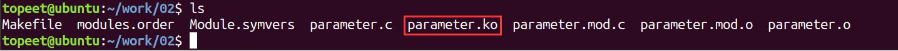
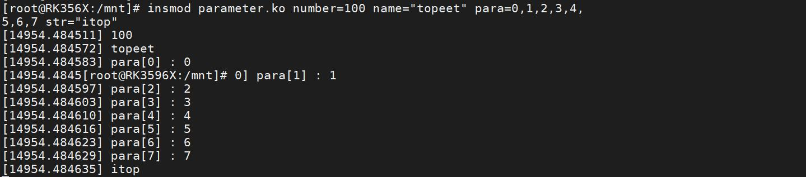
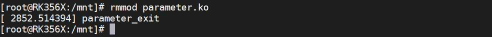
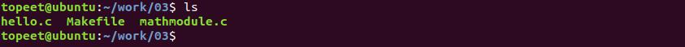
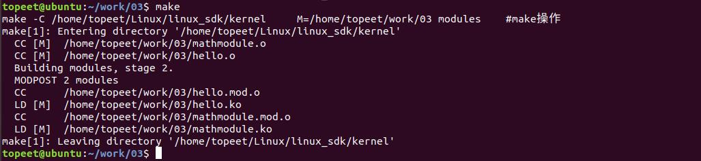
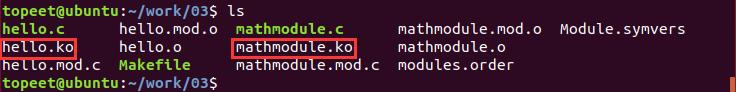

# 第005章 内核模块符号导出实验


图4.3
### 4.3.2 运行测试
使用insmod 命令加载内核模块实现内核模块传参，命令格式为：insmod 对应的模块参数parameter.ko 内核模块可以传递3 个参数，使用以下命令分别传递为int 类型的参数number，char 类型的参数name 和int 数组类型的参数para。insmod parameter.ko number=100 name="topeet" para=0,1,2,3,4,5,6,7 str="itop"打印信息如图4.4 所示：

图4.4通过图4.4 可以看出传递的参数都分别打印了出来。输入rmmod parameter.ko 命令可以卸载驱动。打印信息如图4.5 所示：

图4.5
本章节我们学习内核模块符号导出，什么是内核模块符号导出呢？内核模块之间是相互独立的，互相不能直接访问。将内核模块的符号（函数或变量）导出后，导出的符号（函数或变量）可以被其他模块使用。
## 5.1 内核模块符号导出简介
驱动程序编译生成的ko 文件是相互独立的，即模块之间变量或者函数在正常情况下无法进行互相访问。而一些复杂的驱动模块需要分层进行设计，这时候就需要用到内核模块符号导

出。内核模块符号导出指的是在内核模块中导出相应的函数和变量，符号导出所使用的宏为EXPORT_SYMBOL(sym)和EXPORT_SYMBOL_GPL(sym)。定义在内核源码/include/linux/export.h 文件中（在module.h 文件中已经对export.h 进行引用，所以不需要单独引用export.h 文件）,详细定义如代码清单5.1 所示：代码清单5.1
```c
#define EXPORT_SYMBOL(sym)\
    __EXPORT_SYMBOL(sym, "")
#define EXPORT_SYMBOL_GPL(sym)\
    __EXPORT_SYMBOL(sym, "_gpl")
```
EXPORT_SYMBOL(sym)和EXPORT_SYMBOL_GPL(sym)两个宏使用方法相同，sym 参数表示要导出的函数或变量名称。宏EXPORT_SYMBOL_GPL(sym)导出的内核模块符号只能被GPL 许可的模块使用，因此绝大多数情况都是使用EXPORT_SYMBOL(sym)宏进行内核模块符号导出。
## 5.2 实验程序的编写
本实验代码存在网盘iTOP-RK3568 开发板\07_学习教程配套资料\03_Linux 驱动配套资料\04_Linux 驱动例程\03 路径下。本章实验将编写Linux 下的内核模块符号导出实例代码，总共有两个驱动程序，第一个驱动文件名为mathmodule.c，用来定义参数num 和函数add(a,b)，第二个驱动文件名为hello.c,会引用mathmodule.c 驱动程序中的参数num 和数学函数add(a,b)，并将相应的参数值和函数返回值打印到串口终端上。代码清单5.2 是mathmodule.c 代码。代码清单5.2
```c
#include <linux/init.h>
#include <linux/module.h>
int num = 10;//定义参数num
EXPORT_SYMBOL(num);//导出参数num
int add(int a, int b)//定义数学函数add()，用来实现加法
{
    return a + b;
}
EXPORT_SYMBOL(add);//导出数学函数add()
static int __init math_init(void)//驱动入口函数
```

```c
{
    printk("math_moudle init\n");
    return 0;
}
static void __exit math_exit(void)//驱动出口函数
{
    printk("math_module exit\n");
}
module_init(math_init);//注册入口函数
module_exit(math_exit);//注册出口函数
MODULE_LICENSE("GPL");//同意GPL 开源协议
MODULE_AUTHOR("topeet");//作者信息
```
代码清单5.2 定义了一个int 类型的num 变量和add()数学函数，并使用EXPORT_SYMBOL宏进行导出。代码清单5.3 是hello.c 代码。代码清单5.3
```c
#include <linux/init.h>
#include <linux/module.h>
extern int num;//导入int 类型变量num
extern int add(int a, int b);//导入函数add
static int __init hello_init(void)//驱动入口函数
{
    static int sum;
    printk("num = %d\n", num);//打印num 值
    sum = add(3, 4);//使用add 函数进行3+4 的运算
    printk("sum = %d\n", sum);//打印add 函数的运算值
    return 0;
}
static void __exit hello_exit(void)//驱动出口函数
{
    printk("Goodbye hello module\n");
}
module_init(hello_init);//注册入口函数
module_exit(hello_exit);//注册出口函数
MODULE_LICENSE("GPL");//同意GPL 开源协议
MODULE_AUTHOR("topeet");//作者信息
```
代码清单5.3 中程序使用了在代码清单5.2 中定义的int 类型的变量num 和add()函数，并在驱动入口函数中打印相应了num 的参数值并对add()函数进行了调用。

## 5.3 运行测试
### 5.3.1 编译驱动程序
在mathmodule.c 和hello.c 的同一目录下创建Makefile 文件，如图5.1 所示。

Makefile 文件内容如代码清单5.4 所示：代码清单5.4
```c
export ARCH=arm64#设置平台架构
export CROSS_COMPILE=aarch64-linux-gnu-#交叉编译器前缀
obj-m := mathmodule.o
obj-m += hello.o
KDIR :=/home/topeet/Linux/linux_sdk/kernel#这里是你的内核目录
PWD ?= $(shell pwd)
all:
    make -C $(KDIR) M=$(PWD) modules#make 操作
clean:
    make -C $(KDIR) M=$(PWD) clean#make clean 操作
```
这里要注意的是在hello.c 代码中使用了mathmodule.c 所导出的符号，所以mathmodule.c要在hello.c 之前进行编译，即Makefile 中第3 行和第4 行代码顺序不能交换。使用命令make 编译驱动程序，编译成功后如图5.2 所示：

图5.2编译完后会生成hello.ko 和mathmodule.ko 目标文件，如图5.3 所示：

图5.3

