# 第006章 menuconfig图形化配置实验

### 5.3.2 运行测试
由于hello.ko 依赖于mathmodule.ko，所以mathmodule.ko 需要先加载，分别使用以下命令进行模块的加载（加载顺序不能变）：
```c
insmod mathmodule.ko
insmod hello.ko
```
打印信息如图5.4 所示。
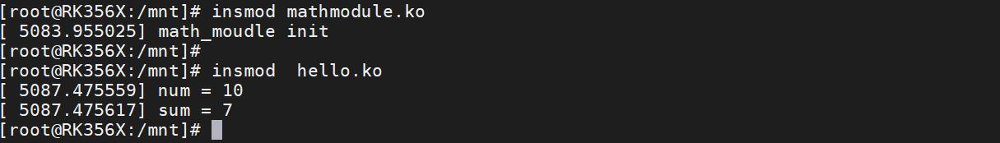
图5.4通过图5.4 可以看出当hello.ko 驱动加载的时候，在mathmodule.ko 模块中定义的num 参数值和在hello.ko 中调用add()函数的后的返回值都被打印了出来。说明mathmodule.ko 中已经成功实现内核模块符号导出。可以输入以下命令进行驱动的卸载：
```c
rmmod hello.ko
rmmod mathmodule.ko
```
打印信息如图5.5 所示。
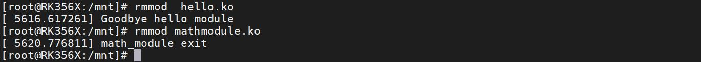
图5.5注意：由于hello.ko 文件使用了mathmodule.ko 导出的符号，所以要先卸载hello.ko，卸载完成之后再卸载mathmodule.ko。
学习把驱动编译进内核之前需要先掌握menuconfig 图形化配置界面的知识。menuconfig是一套图形化的配置工具，在Linux 内核源码顶层目录下输入make menuconfig 命令可以打开图形化配置界面。
## 6.1 图形化界面的操作
图形化配置界面主要有以下四种。make config （基于文本的最为传统的配置界面，不推荐使用）make menuconfig （基于文本菜单的配置界面）make xconfig （要求QT 被安装）

make gconfig （要求GTK+ 被安装）在这四种方式中，最推荐的是make menuconfig，它不依赖于QT 或GTK+，且非常直观。menuconfig 图形化的配置工具需要ncurses 库支持。ncurses 库提供了一系列的API 函数供调用者生成基于文本的图形界面，因此在使用menuconfig 图形化配置界面之前需要先在虚拟机Ubuntu 中安装ncurses 库，命令如下：sudo apt-get install build-essentialsudo apt-get install libncurses5-dev那如何打开menuconfig 图形化配置界面呢？以iTOP-RK3568 开发板为例，在内核源码目录下输入以下命令即可打开menuconfig 图形化配置界面。export ARCH=arm64make rockchip_linux_defconfig注意：要在内核源码顶层目录下输入命令。即kernel 目录下，如图6.1 所示
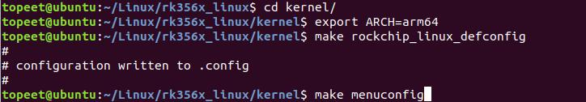
图6.1打开后界面图6.2 所示：
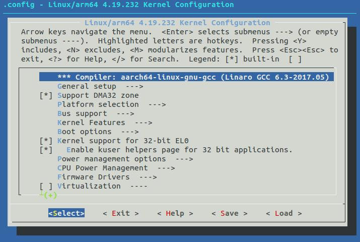
图6.2
打开menuconfig 图形化配置界面以后，可以使用以下方式进行操作，如下表6.1 所示.表6.1上下键选择不同的行，即移动到不同的（每一行的）选项上

空格键用于在选择该选项与取消选择该选项之间来回切换。使用空格键将对应该选项前面改成[ * ]表示将该选项对应的驱动编译进内核。将对应该选项前面改成[ M]表示把驱动编译成内核模块。将对应该选项前面改成[ ]表示不对该选项对应的驱动进行操作。左右键用于在Select/Exit/Help 之前切换
回车键执行或进入选项操作Select一般是所在（的行的）选项，如果选项后面有三个短横线加上一个右箭头，即—>，表示此项下面还有子选项，按回车键即进入该选项的子选项中Exit直接退出当前的配置。当更改配置后，但是又没有保存，退出当前配置时会询问你是否要保存当前，然后再退出。Help查看你当前所在某个（行的）选项的帮助信息。如果对某个选项的功能不是很清楚，可以通过查看其Help 信息找到详细解释，以便你更加了解此配置的含义。/ 键输入“/”即可弹出搜索界面，然后输入想要搜索的内容即可实现搜索功能。
## 6.2 Kconfig 语法简介
图形化配置界面中的每一个选项都会对应一个Kconfig 文件。所以图形化配置界面的每一级菜单是由Kconfig 文件来决定的。图形化配置界面有很多菜单。所以就会有很多Kconfig 文件，这也就是为什么我们会在内核源码的每个子目录下，都会看到Kconfig 文件的原因。这一小节我们来学习如何编写Kconfig文件来生成图形化配置界面中的选项。1.mainmenumainmenu 顾名思义就是主菜单，也就是输入完“make menuconfig”以后默认打开的界面。mainmenu 用来设置主菜单的标题，如代码清单6.1 用mainmenu 设置主菜单名称为Linux/arm644.19.232 Kernel configuration。代码清单6.1mainmenu "Linux/$(ARCH) $(KERNELVERSION) Kernel Configuration"代码清单6.1 设置菜单的名字为“Linux/$(ARCH) $(KERNELVERSION) Kernel Configuration”。其中ARCH 变量值是通过命令export ARCH=arm64 设置的，内核版本KERNELVERSION4.19.232。如图6.3 所示

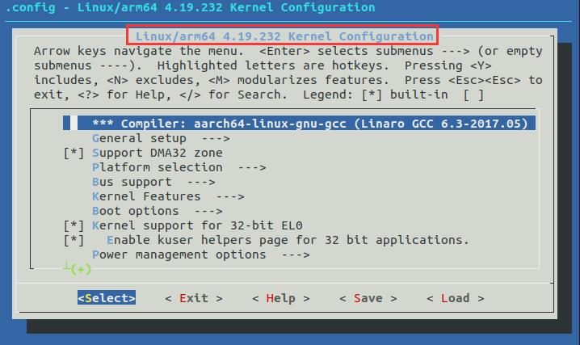
图6.3
2.sourcesource 用于读取另一个Kconfig 文件，比如source init/Kconfig 就是读取init 目录下的Kconfig文件。
3.menu/endmenumenu/endmenu 用于生成菜单，代码清单6.2 生成了Watchdog Timer Support 的菜单。代码清单6.2
```c
menu "Watchdog Timer Support"
config HW_WATCHDOG
bool
config WDT
bool "Enable driver model for watchdog timer drivers"
depends on DM
help
  Enable driver model for watchdog timer. At the moment the API.
......
endmenu
```
menu 之后的字符串是菜单名，menu 是菜单开始的标志，endmenu 是菜单结束的标志，这俩个是成对出现的。menu 和endmenu 之间有很多config 条目。在kernel 目录下输入makemenuconfig，可以看到上述代码描述的Watchdog Timer Support 菜单。如图6.4 所示

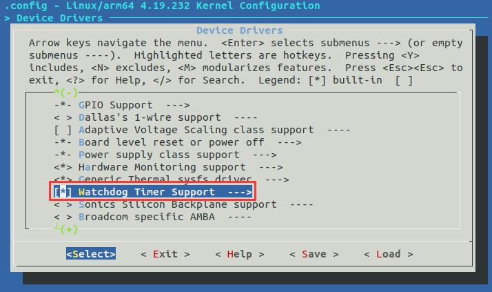
图6.4进入Watchdog Timer Support---> 菜单中可以看到很多config 定义的条目，如图6.5 所示：
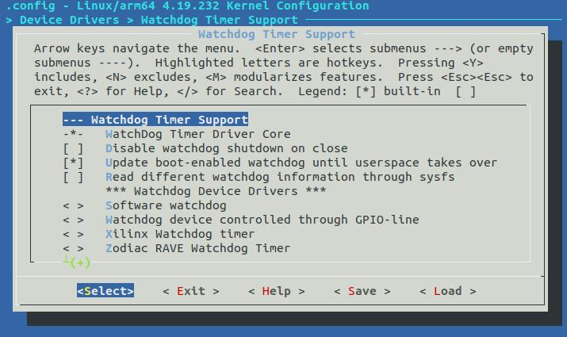
图6.54.if/endifif/endif 语句是一个条件判断，使用方法与C 语言中if 语句一致。代码清单7.8 当if 语句不成立时，即没有选中Enable CAN 选项，if 语句中的Enable CAN1 选项在menuconfig 界面中并不会出现。当if 语句成立时，即选中Enable CAN 时，Enable CAN1 选项在menuconfig 界面中才会显示出来。代码清单6.3
```c
menu "Hardware Drivers Config"
    menuconfig BSP_USING_CAN
          bool "Enable CAN"
          default n
          select RT_USING_CAN
          if BSP_USING_CAN
               config BSP_USING_CAN1
```

```c
bool "Enable CAN1"
default n
endif
endmenu
```
5.choice/endchooicechoice 将多个类似的配置选项组合到一起，供用户选择，用户选择从choice 开始，到endchoice 结束，choice 和endchoice 之间有很多的config 条目，这些config 条目是提供用户选择的，如代码清单6.4 所示：代码清单6.4
```c
choice
      bool "Parade TrueTouch Gen5 MultiTouch Protocol"
      depends on TOUCHSCREEN_CYPRESS_CYTTSP5
      default TOUCHSCREEN_CYPRESS_CYTTSP5_MT_B
            help
              This option controls which MultiTouch protocol will be used to
              report the touch events.
    config TOUCHSCREEN_CYPRESS_CYTTSP5_MT_A
            bool "Protocol A"
            help
              Select to enable MultiTouch touch reporting using protocol A
              on Parade TrueTouch(tm) Standard Product Generation4 touchscreen
              controller.
    config TOUCHSCREEN_CYPRESS_CYTTSP5_MT_B
            bool "Protocol B"
            help
              Select to enable MultiTouch touch reporting using protocol B
              on Parade TrueTouch(tm) Standard Product Generation4 touchscreen
              controller.
endchoice
```
如图6.6 中Parade TrueTouch Gen5 MultiTouch Protocol 是choice 选项名称，Protocol B 是Kconfig 里面默认选择的。--->代表此菜单能进入，需要键盘操作进入。

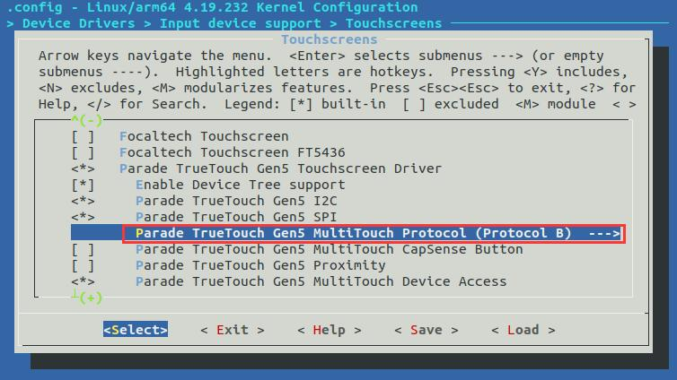
图6.6进入Parade TrueTouch Gen5 MultiTouch Protocol 后，可以看到多选项提供给用户进行选择，如图6.7 所示：
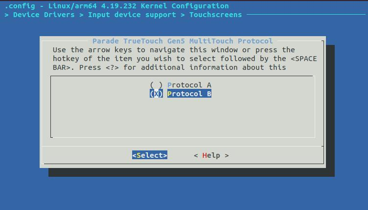
图6.76.commentcomment 语句主要出现在界面的第一行，用于定义一些提示信息。如代码清单7.11 对编译器版本信息进行了提示。代码清单6.5comment "Compiler: $(CC_VERSION_TEXT)"如图6.8 所示。

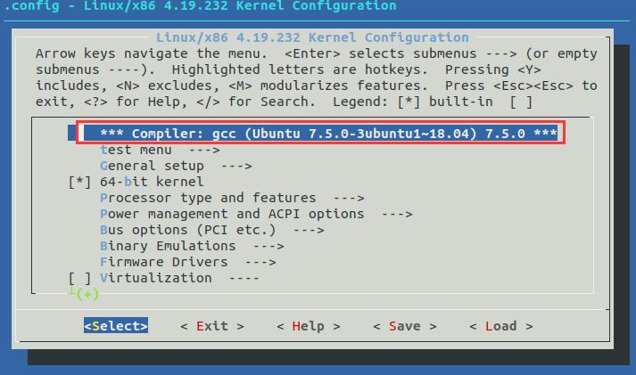
图6.87.config使用关键字config 来定义一个新的选项，如代码清单6.6 所示代码清单6.6
```c
config helloworld
bool “hello world support”
default y
help
hello world
```
在代码清单6.6 中使用config 关键字定义了一个bool 类型的helloworld 选项。此选项在图形化界面中对应hello world support 选项。每个选项都必须指定类型，类型包括bool，tristate，string，hex，int。作用如下：bool 类型取值只有“y”和“n”tristate 类型的变量取值有3 种：“y”,“n”,“m”string 类型取值为字符串hex 类型取值为十六进制的数据int 类型取值为十进制的数据最常用的是bool，tristate，string 这三个类型。help 表示帮助信息，当我们在图形化界面按下h 按键，弹出来的就是help 的内容。8.depends ondepends on 关键字用来指定依赖关系，当依赖的选项被选中时，当前的配置选项的信息才会在菜单中显示出来，才能操作该选项的内容。举例来说，选项A 依赖选项B，只有当选项B被选中时，选项A 才可以被选中。如代码清单6.7 所示代码清单6.7

config Adepends on B9.selectselect 关键字用来表示反向依赖关系，当指定当前选项被选中时，此时select 后面的选项也会被自动选中。举个例子来说，在选项A 被选中的情况下，选项B 自动被选中。如代码清单所示。代码清单6.8config Aselect on B10.menuconfigmenuconfig 可以认为是config 的升级版。menuconfig 也是一个正常的配置项，通过自己的配置值来决定另外一组配置项是否作为子菜单的形式显示出来并供用户配置。代码清单6.9
```c
menuconfig NETDEVICES
default y if UML
depends on NET
bool "Network device support"
---help---
if NETDEVICES
config MII
tristate
config NET_CORE
default y
bool "Network core driver support"
---help---
  You can say N here if you do not intend to use any of the
  networking core drivers (i.e. VLAN, bridging, bonding, etc.)
```
代码清单6.9 通过menuconfig 配置了一个bool 类型的配置项，在图形化配置界面中显示如图6.9 所示。

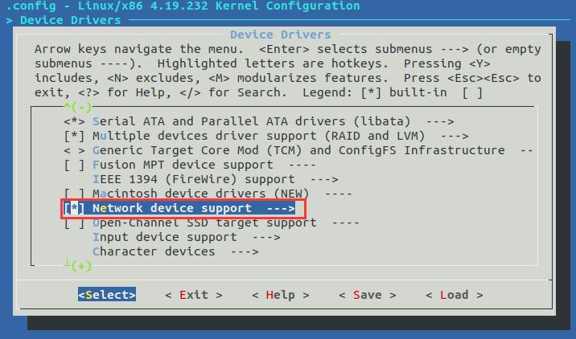
图6.9当选中Network device support 配置项时，其子菜单被显示出来，如图6.10 所示：
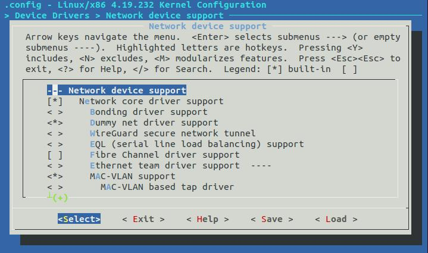
图6.10

## 6.3 .config 配置文件介绍
通过图形化配置界面完成配置并保存后，系统会在内核源码顶层目录下生成一个.config 配置文件。在编译内核时，将根据.config 文件中的配置编译内核。这便实现了通过图像化界面配置内核的过程。上一段话如果用通俗的话解释可以这样类比。Kconfig 如同饭店的菜单，.config 就是客人点好的菜。根据.config 中的配置编译内核可以类比成厨师根据客人点好的菜品（即.config）来烹饪。.config 文件是如何生成的呢？当我们使用make menuconfig 的时候，会通过mconf 程序去解析Kconfig 文件，然后生成对应的配置文件.config。所以mconf 充当了“服务员”的角色。mconf 程序源码在内核源码scripts/kconfig 目录下，如图6.11 所示，对具体过程感兴趣的同学可以自行阅读分析mconf 的源码。
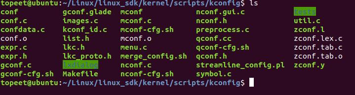
图611
内核可基于.config 配置文件进行编译，比如控制某些驱动编译进内核，或者控制某些驱动不编译内核。这个过程是怎么实现的呢？.config 会通过syncconfig 目标将.config 作为输入然后输出需要文件，这里重点关注auto.conf和autoconf.h 这俩个输出文件。如图6.12 所示：
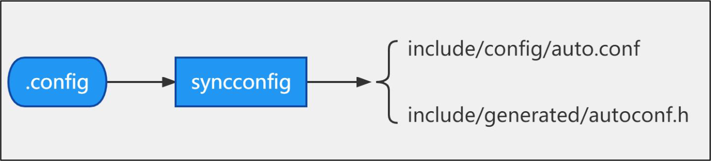
图6.12在auto.conf 文件中，存放的是配置信息。如图6.13 所示：

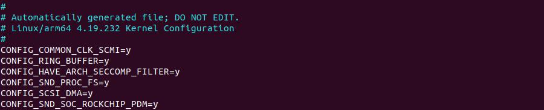
图6.13在内核源码的顶层Makefile 中会包含auto.conf 文件，以此引用其中的变量来控制Makefile的动作，如哪些驱动编译，哪些驱动不编译。如auto.conf 文件中代码通过代码CONFIG _A=y控制是否编译A.c 驱动程序。过程如下：1.在include include/config/auto.conf 文件中有代码CONFIG _A=y。2.顶层Makefile 中包含auto.conf 文件，如代码清单6.10 所示。代码清单6.10
```c
ifeq ($(dot-config),1)
include include/config/auto.conf
Endif
```
3.内核源码下drivers/A/Makefile 引用这个变量，如代码清单6.11 所示。代码清单6.11obj-$(CONFIG _A) +=A.o
注：obj-y 就是编译进内核，obj-m 就是编译成ko 文件。代码清单6.11 中CONFIG _A 的值为y。在autoconf.h 中，是C 语言代码。用来配合编译时的条件选择。如图6.14 所示：
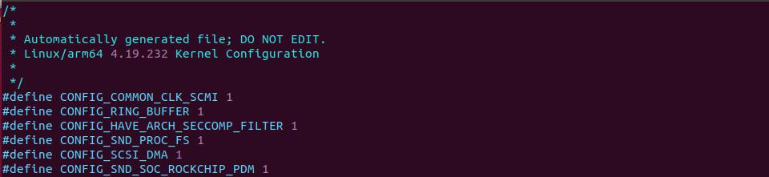
图6.14
## 6.4 defconfig 配置文件
defconfig 文件和.config 文件都是linux 内核的配置文件，defconfig 文件在内核源码的arch/$(ARCH)/configs 目录下，是Linux 系统默认的配置文件。比如说瑞芯微平台Linux 源码默

认的配置文件为：kernel/arch/arm64/configs/rockchip_linux_defconfig。.config 文件位于Linux 内核源码的顶层目录下，编译Linux 内核时会使用.config 文件里面的配置来编译内核镜像。如果.config 文件存在，make menuconfig 界面的默认配置也就是当前.config 文件的配置，如果修改了图形化配置界面的设置并保存，那么.config 文件会被更新。如果.config 文件不存在，使用命令“make XXX_defconfig”用默认配置文件生成.config 文件。即该命令会根据arch/$(ARCH)/configs 目录下的XXX_defconfig 自动生成.config。如在瑞芯微平台Linux 内核源码顶层目录下输入“make rockchip_linux_defconfig”会自动生成.config 文件。那么此时rockchip_linux_defconfig 的配置项和.config 的配置项是相同的。
## 6.5 自定义菜单实验
有了上面的理论基础后，就可以自己在图形化配置界面中自定义一个菜单，根据我们前面的分析，自定义一个菜单需要从Kconfig 文件入手。自定义一个菜单有创建Kconfig 文件和配置.config 两步。步骤1：创建Kconfig 文件在kernel 目录下创建一个topeet 的文件夹，如图6.15 所示。此目录下以后可以存放要被编译进内核的驱动程序。

图6.15打开kernel 目录下的Kconfig 文件，在Kconfig 文件合适的位置加入代码清单6.12 中的内容包含topeet 下的Kconfig 文件。代码清单6.12source "topeet/Kconfig"添加完成后如图6.16 所示：

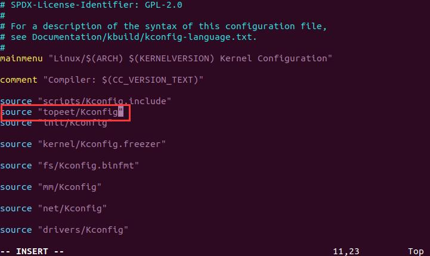
图6.16
进入到topeet 文件夹，在此文件夹下创建一个Kconfig 文件，创建完成如图6.17 所示：
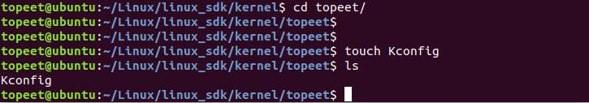
图6.17打开创建好的Kconfig 文件，写入代码清单6.12 中的内容。代码清单6.12
```c
menu "test menu"
config TEST_CONFIG
  bool "test"
  default y
  help
    just test
    comment "just test"
endmenu
```
在代码清单6.12 中在主菜单中添加了一个名为test menu 的子菜单，然后在这个子菜单里面添加了一个名为TEST_CONFIG 的配置项，这个配置项变量类型为bool，默认配置为Y，帮助信息为just test，注释为just test。添加完成如图6.18 所示：

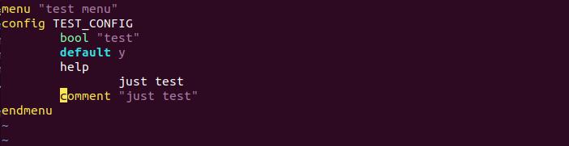
图6.18添加完成以后，打开图形化配置界面，检查Kconfig 文件是否创建成功，创建成功可以在menuconfig 界面找到test menu 选项，如图6.19 所示：
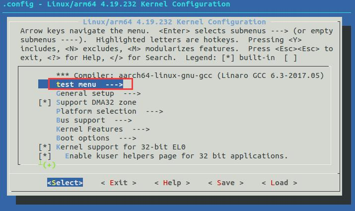
图6.19并且子菜单中的配置项默认为y，注释信息为just test。如图6.20 所示。
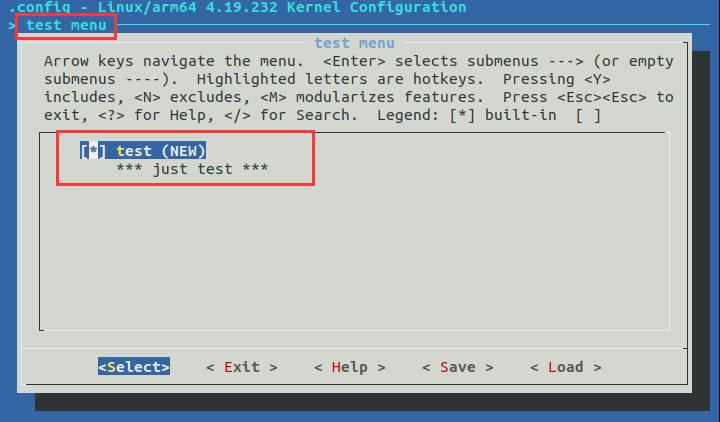
图6.20

在此界面输入？，检查显示帮助信息是否为just test，显示成功图6.21 所示：
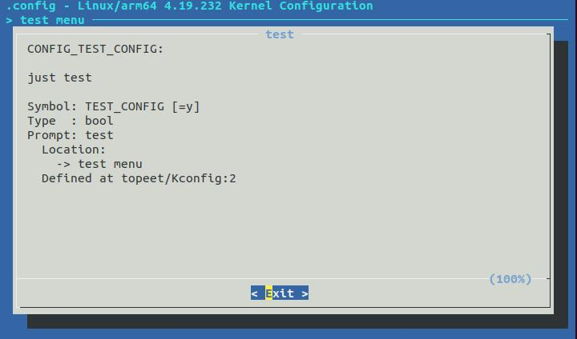
图6.21如果检查无误保存退出即可。注意退出menuconfig 界面时一定要保存，不然在步骤2 中会找不到代码CONFIG_TEST_CONFIG=y。步骤2：配置.config 文件打开内核源码目录下的.config 文件，如6.22 所示：
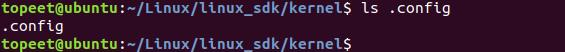
图6.22如步骤1 操作成功，在内核源码顶层目录下的.config 文件中可以找到TEST_CONFIG 选项（注意，我们需要在make menuconfig 中保存才可以看到，否则是看不到我们添加的这个选项的）如图6.23 所示。
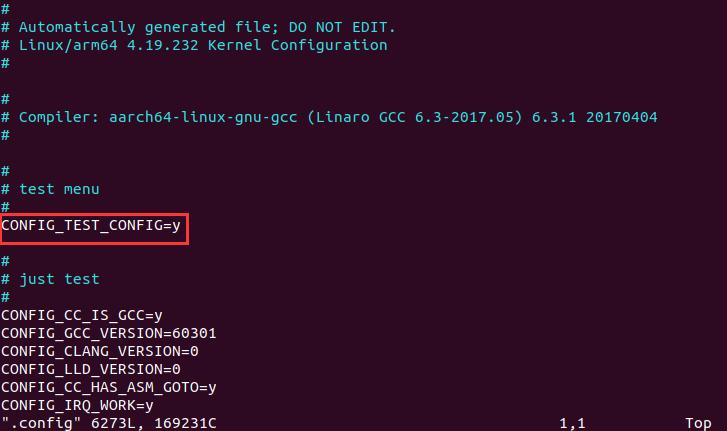

