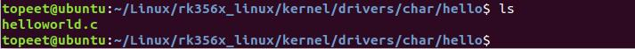
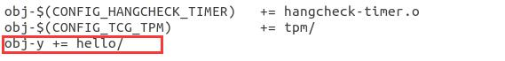
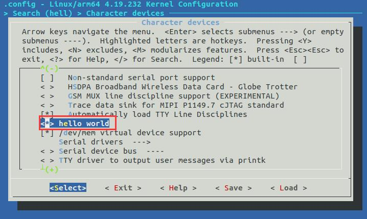
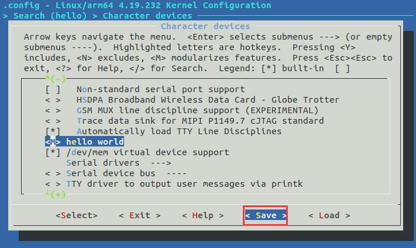
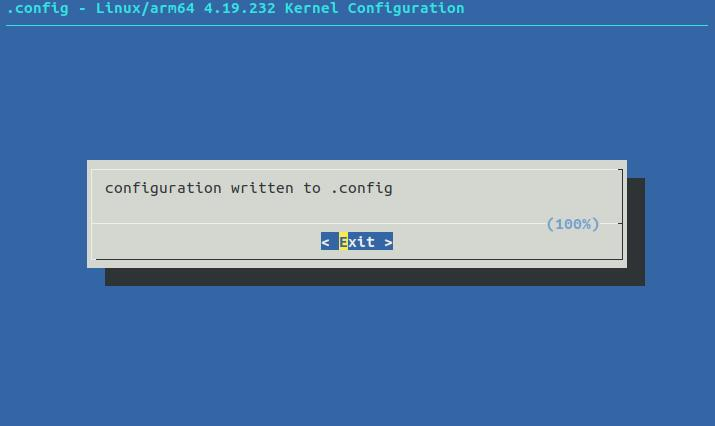
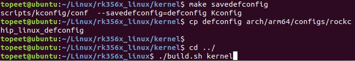

# 第007章 驱动模块编译进内核实验

图6.23
如果忘记在步骤1 保存可以重新打开menuconfig 界面将test menu 选项选中然后保存，或者在.config 文件中手动添加代码CONFIG_TEST_CONFIG=y。这样在编译内核的时候就可以根据这个配置信息来执行对应的操作了.
通过上一章的学习，我们学会在menuconfig 图形化配置界面中添加菜单。本章节学习将helloworld 驱动编译进内核。
步骤1：创建存放驱动的目录如把helloworld 驱动放在drivers/char/hello 目录下，则先输入命令cd drivers/char 进入到drivers/char 目录下，然后输入mkdir hello 建立hello 文件夹，并输入cd hello 进入hello 文件夹，操作过程图7.1 所示：

图7.1然后将helloworld.c 驱动程序拷贝到hello 文件夹内。如图7.2 所示：

图7.2步骤2：创建Kconfig 文件在drivers/char/hello 目录下输入touch Kconfig 命令创建Kconfig 文件，Kconfig 文件内容如代码清单7.1 所示代码清单7.1
```c
config HELLO
tristate "hello world"
help
hello hello
```
在drivers/char/hello 目录下使用touch Makefile 命令创建Makefile 文件,在Makefile 文件添加代码代码清单7.2 中内容代码清单7.2obj-$(CONFIG_HELLO)+=helloworld.o

接下来修改上一级目录的Kconfig 文件和Makefile 文件，也就是driver/char 目录下的Kconfig文件和Makefile 文件。在Makefile 添加代码清单7.3 中内容。代码清单7.3obj-y += hello/添加完成如图7.3 所示

图7.3在Kconfig 添加代码清单7.4 中内容。代码清单7.4source "drivers/char/hello/Kconfig"添加完成如图7.4 所示

图7.4步骤3：配置.config 文件打开menuconfig 图形化配置界面，把驱动编译进Linux 内核，用* 来表示，所以配置选项改为*。如果想要将驱动编译为模块，则把配置选项改为M。这里我们选择成* 。hello world 配置项在menuconfig 图形化配置界面路径如代码清单7.5 所示。代码清单7.5
```c
Device Drivers ─>
    Character devices --->
        <*> hello world 或者<M> hello world
```
配置完成后如图7.5 所示。


图7.5将光标移动到save，保存配置，如图7.6 所示：

图7.6这里会提示保存到.config 文件，选择exit 即可。如图7.7 所示：


图7.7步骤4：编译内核测试验证然后通过代码清单7.6 中命令编译内核。代码清单7.6
```c
make savedefconfig
cp defconfig arch/arm64/configs/rockchip_linux_defconfig
cd ../
./build.sh kernel
```
编译过程如图7.8 所示

图7.8编译成功之后，进入到drivers/char/hello 目录下，如果生成helloworld.c 对应的.o 文件。就说明已经成功将驱动编译进内核。

图7.9将编译好的内核镜像烧写到开发板上后，在开发板系统启动的时候也可以成功看到加载helloworld 驱动，如下图7.10 所示：

图7.10

