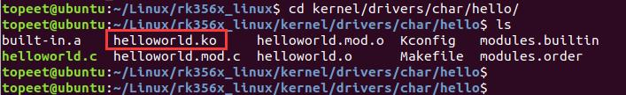
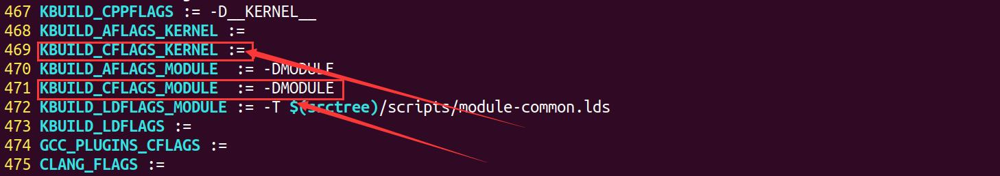
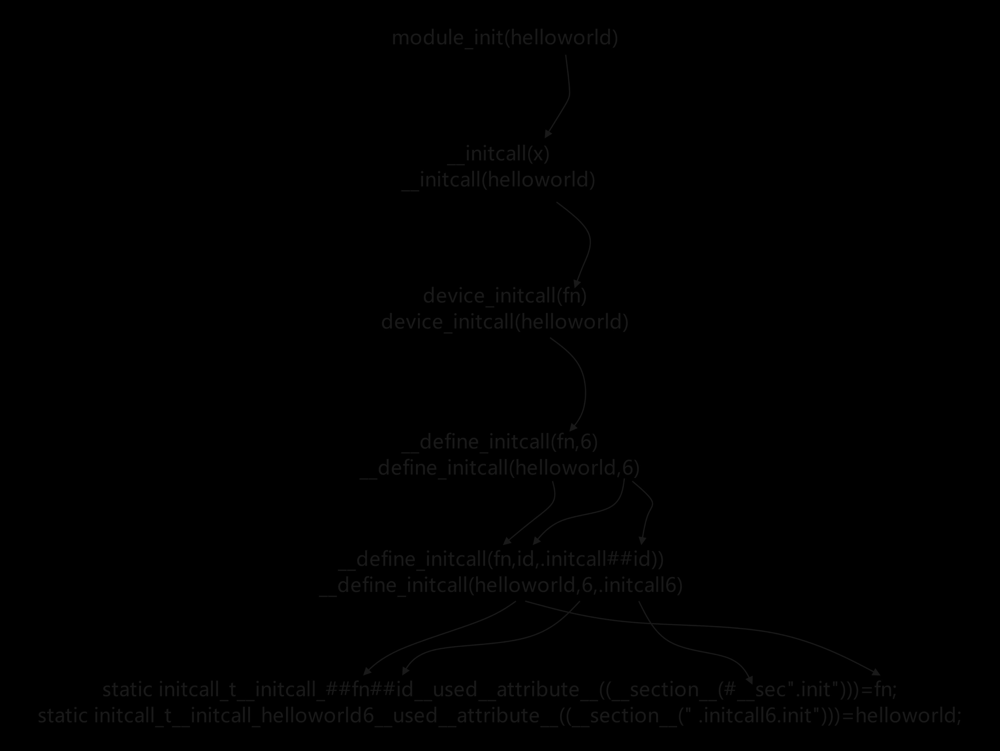
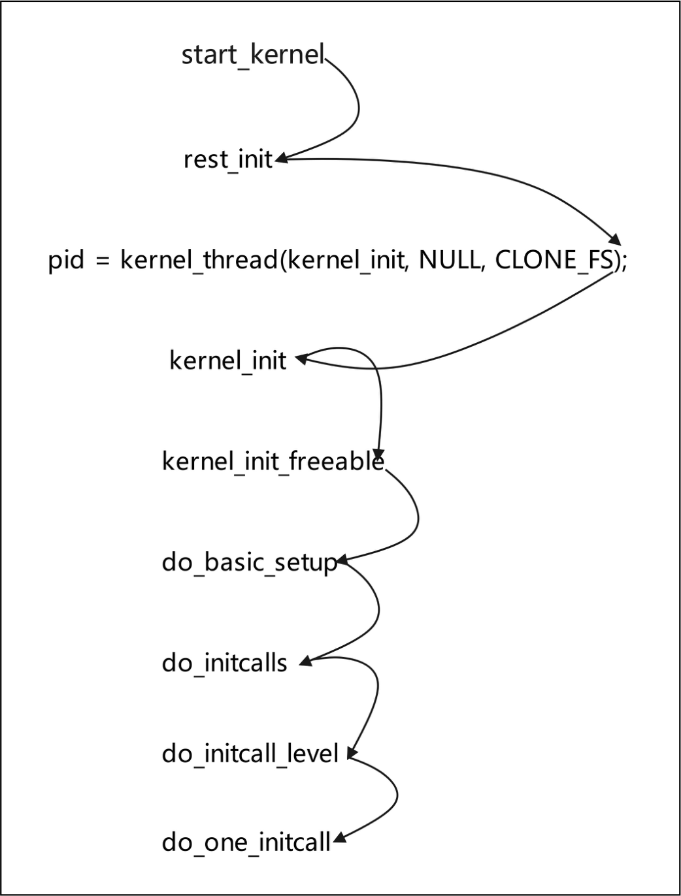

# 第008章 编译进内核的驱动系统是如何运行的？

如果在图形化配置界面中选择的M，也就是编译成驱动模块，则会生成helloworld.ko 文件如下7.11 所示.

图7.11
本章为驱动基础中的进阶部分。本章要讲解的内容为编译进内核的驱动系统是如何运行的？
## 8.1 驱动入口函数分析
当驱动被加载时会执行驱动的入口函数，在驱动程序中使用module_init 宏定义了驱动的入口函数，该宏定义在内核源码目录下的include/linux/module.h 文件中，如代码清单8.1 所示。代码清单8.1
```c
#ifndef MODULE
#define module_init(x)__initcall(x);
#define module_exit(x)__exitcall(x);
#else /* MODULE */
..........
#define module_init(initfn)\
    static inline initcall_t __maybe_unused __inittest(void)\
    { return initfn; }\
    int init_module(void) __copy(initfn) __attribute__((alias(#initfn)));
..........
#endif
```
通过代码清单8.1 可知，module_init 宏有俩种实现方法。条件判断中MODULE 宏通过内核源码的顶层Makefile 中KBUILD_CFLAGS_KERNEL 和KBUILD_CFLAGS_MODULE 俩个变量决定，如图8.1 所示。


图8.1如果把驱动编译进内核，通过变量KBUILD_CFLAGS_KERNEL 定义MODULE 宏，如果把驱动编译成内核模块，通过变量KBUILD_CFLAGS_MODULE 定义MODULE 宏。把驱动编译进内核时，时没有通过变量KBUILD_CFLAGS_KERNEL 定义MODULE 宏。那module_init 的宏定义原型如代码清单8.2 所示。代码清单8.2
```c
#define module_init(x)__initcall(x);
```
需要注意的是，因为编译进内核的驱动没有卸载的动作，所以把驱动编译进内核时可以不通过module_exit 宏定义驱动出口函数。只有把驱动编译成内核模块时，在通过rmmod 命令卸载内核模块时才会有卸载动作，此时驱动程序必须通过module_exit 宏定义的驱动出口函数。所以本章不分析module_exit 宏。__initcall宏定义原型在内核源码目录下的include/linux/init.h文件中，如代码清单8.3所示.。代码清单8.3
```c
#define __initcall(fn) device_initcall(fn)
```
接下来会发现该宏定义仍会套很多层宏定义，这些宏都在内核源码目录下的include/linux/init.h 文件中，调用顺序如代码清单8.4 所示。代码清单8.4
```c
#define device_initcall(fn)__define_initcall(fn, 6)
#define __define_initcall(fn, id) ___define_initcall(fn, id, .initcall##id)
#define ___define_initcall(fn, id, __sec) \
    static initcall_t __initcall_##fn##id __used \
        __attribute__((__section__(#__sec ".init"))) = fn;
```
图8.2 以module_init(helloworld)为例绘制了调用关系。


图8.2注意:##代表强制连接，#表示对这个变量替换后，用双引号引起来。图8.2 宏定义展开到最后的initcall_t 是一个函数指针，原型如代码清单8.5 所示：代码清单8.5
```c
typedef int (*initcall_t)(void);
```
所以当使用module_init(helloworld)宏定义模块的入口函数后，会创建一个__initcall_hello_world6 函数指针变量，并将其初始化为hello_world 函数，这个__initcall_hello_world6 函数指针变量的目的是将模块的入口函数放置在内核的初始化调用链中，以便在系统引导期间自动执行。在编译过程中，这个函数指针会被放置在.initcall6.init 段中。这个段是内核初始化调用链的一部分，用于在系统引导期间按顺序调用所有位于该段中的函数。通过将模块的入口函数放置在.initcall6.init 段中，可以确保在系统引导期间自动调用该函数，从而初始化模块并注册模块的功能。而在内核源码中除了module_init 宏，还有其他的宏定义接口用来完成初始化模块并注册

模块的功能，他们的原型都是define_initcall，只是相应的优先级不同，而优先级的不同就导致了系统启动时驱动模块的加载先后顺序不一样，module_init 的优先级是6，其他的宏定义在include/linux/init.h 文件中，如代码清单8.6 所示。代码清单8.6
```c
#define pure_initcall(fn)__define_initcall(fn, 0)
#define core_initcall(fn)__define_initcall(fn, 1)
#define core_initcall_sync(fn)__define_initcall(fn, 1s)
#define postcore_initcall(fn)__define_initcall(fn, 2)
#define postcore_initcall_sync(fn)__define_initcall(fn, 2s)
#define arch_initcall(fn)__define_initcall(fn, 3)
#define arch_initcall_sync(fn)__define_initcall(fn, 3s)
#define subsys_initcall(fn)__define_initcall(fn, 4)
#define subsys_initcall_sync(fn)__define_initcall(fn, 4s)
#define fs_initcall(fn)__define_initcall(fn, 5)
#define fs_initcall_sync(fn)__define_initcall(fn, 5s)
#define rootfs_initcall(fn)__define_initcall(fn, rootfs)
#define device_initcall(fn)__define_initcall(fn, 6)
#define device_initcall_sync(fn)__define_initcall(fn, 6s)
#define late_initcall(fn)__define_initcall(fn, 7)
#define late_initcall_sync(fn)__define_initcall(fn, 7s)
#define module_init(x)__initcall(x);
#define__initcall(fn)device_initcall(fn)
```
在include/asm-generic/vmlinux.lds.h 链接脚本（linker script）中定义初始化调用函数的布局和顺序，如代码清单8.7 所示，代码清单8.7
```c
#define INIT_CALLS_LEVEL(level)\
        __initcall##level##_start = .;\
        KEEP(*(.initcall##level##.init))\
        __initcall##level##s_start = .;\
        KEEP(*(.initcall##level##s.init))\
#define INIT_CALLS\
        __initcall_start = .;\
        KEEP(*(.initcallearly.init))\
        INIT_CALLS_LEVEL(0)\
        INIT_CALLS_LEVEL(1)\
        INIT_CALLS_LEVEL(2)\
        INIT_CALLS_LEVEL(3)\
        INIT_CALLS_LEVEL(4)\
```

```c
INIT_CALLS_LEVEL(5)\
INIT_CALLS_LEVEL(rootfs)\
INIT_CALLS_LEVEL(6)\
INIT_CALLS_LEVEL(7)\
__initcall_end = .;
```
INIT_CALLS_LEVEL(level) 宏用于定义特定优先级（level）的初始化调用函数的布局。它会创建以下两个符号：__initcall[level]_start：表示该优先级初始化调用函数段的起始位置。__initcall[level]s_start：表示该优先级初始化调用函数段的起始位置（用于静态初始化）。INIT_CALLS 宏会按照一定的顺序将不同优先级的初始化调用函数放置在链接器脚本的相应位置。具体的步骤如下：1.定义__initcall_start 符号，表示初始化调用函数段的起始位置。2.使用KEEP 命令保留所有.initcallearly.init 段中的内容。这个段包含了一些早期的初始化调用函数，它们会在其他优先级之前被调用。3.依次调用INIT_CALLS_LEVEL 宏，传入不同的优先级参数，将相应优先级的初始化调用函数放置在链接器脚本中的正确位置。4.定义__initcall_end 符号，表示初始化调用函数段的结束位置。链接器在链接过程中会根据这些符号的位置信息，将初始化调用函数按照优先级顺序放置在对应的段中。这样，当系统启动时，初始化调用函数将按照定义的顺序被调用，实现系统的初始化和功能注册。展开之后的INIT_CALLS 宏内容如代码清单8.8 所示：代码清单8.8
```c
__initcall_start = .;
KEEP(*(.initcallearly.init))
__initcall0_start = .;
KEEP(*(.initcall0.init))
__initcall0s_start = .;
KEEP(*(.initcall0s.init))
.....................
__initcall7_start = .;
KEEP(*(.initcall7.init))
__initcall7s_start = .;
KEEP(*(.initcall7s.init))
__initcall_end = .;
```
__initcallx_start（x=0，1，2...）等以_start 结尾的相关变量记录了.initcallx.init（x=0，1，

2...）等段的首地址，这些变量在init/main.c 中通过extern 关键字进行引用，并将这些首地址放置在数组initcall_levels 中，如代码清单8.9 所示代码清单8.9
```c
extern initcall_entry_t __initcall_start[];
extern initcall_entry_t __initcall0_start[];
extern initcall_entry_t __initcall1_start[];
extern initcall_entry_t __initcall2_start[];
extern initcall_entry_t __initcall3_start[];
extern initcall_entry_t __initcall4_start[];
extern initcall_entry_t __initcall5_start[];
extern initcall_entry_t __initcall6_start[];
extern initcall_entry_t __initcall7_start[];
extern initcall_entry_t __initcall_end[];
static initcall_entry_t *initcall_levels[] __initdata = {
    __initcall0_start,
    __initcall1_start,
    __initcall2_start,
    __initcall3_start,
    __initcall4_start,
    __initcall5_start,
    __initcall6_start,
    __initcall7_start,
    __initcall_end,
};
```
代码清单8.9 中1-10 行声明了一系列__initcallx_start（x=0，1，2...）相关变量，在第12行定义了一个名为initcall_levels 的静态指针数组。该数组用于存储不同优先级的初始化调用函数段的起始地址。数组的元素对应不同的优先级。该数组最终会在do_one_initcall()函数中执行，图8.3 是内核启动后调用do_one_initcall()函数调用关系图。


图8.3直接看do_initcalls()函数，该函数定义在内核源码的init/main.c 目录下，其代码如代码清单8.10 所示。代码清单8.10
```c
static void __init do_initcalls(void)
{
    int level;
    #ifdef CONFIG_INITCALL_ASYNC
    initcall_init_workers();
    #endif
    for (level = 0; level < ARRAY_SIZE(initcall_levels) - 1; level++)
        do_initcall_level(level);
```

```c
#ifdef CONFIG_INITCALL_ASYNC
initcall_free_works();
#endif
}
```
在代码清单8.10 中的第9 行，循环遍历initcall_levels 数组，其中ARRAY_SIZE(initcall_levels)表示initcall_levels 数组的大小，do_initcalls 函数的循环将执行7 次do_initcall_level。在每次循环中，do_initcall_level 函数被调用一次，并传递当前迭代的level 值作为参数，通过循环可以看出数字越小，优先级越高，带s 段的优先级要小于不带"s" 段的优先级，然后来看do_initcall_leve()l 函数，该函数的具体内容如代码清单8.11 所示。代码清单8.11
```c
static void __init do_initcall_level(int level)
{
    initcall_entry_t *fn;
    // 备份命令行参数并解析参数
    strcpy(initcall_command_line, saved_command_line);
    parse_args(initcall_level_names[level],
           initcall_command_line, __start___param,
           __stop___param - __start___param,
           level, level,
           NULL, &repair_env_string);
    // 跟踪当前初始化级别
    trace_initcall_level(initcall_level_names[level]);
    #ifdef CONFIG_INITCALL_ASYNC
    // 如果启用了异步初始化调用并且有工作线程
    if (initcall_nr_workers)
        if (do_initcall_level_threaded(level) == 0)
             return;
    #endif
    // 遍历当前级别的初始化调用函数数组，并执行每个初始化调用函数
    for (fn = initcall_levels[level]; fn < initcall_levels[level+1]; fn++)
        do_one_initcall(initcall_from_entry(fn));
}
```
代码清单8.11 中重要的内容为24、25 行的for 循环，关于for 循环内容的具体解释如下所示：（1）fn 是一个指向initcall_entry_t 类型的指针，用于迭代遍历当前级别的初始化调用函

数数组。（2）initcall_levels[level] 表示当前级别的初始化调用函数数组的起始地址。（3）initcall_levels[level+1] 表示下一个级别的初始化调用函数数组的起始地址。由于数组是连续存储的，因此通过比较fn 和initcall_levels[level+1]的值，可以确定循环的终止条件。（4）do_one_initcall 是一个函数，用于执行单个初始化调用函数。它接受一个函数指针作为参数，并调用该函数。do_one_initcall()函数的具体内容如代码清单8.12 所示。（5）initcall_from_entry 是一个宏，用于从函数指针fn 中获取实际的初始化调用函数。因此，循环的作用是遍历当前级别的初始化调用函数数组，并依次将每个函数指针传递给do_one_initcall 函数执行调用。通过这个循环，可以按照预定义的顺序执行每个初始化调用函数，从而执行驱动入口函数。代码module_init(hello_world)中hello_world()函数指针会被放置在.initcall6.init 段处。内核启动时，会执行do_initcall()函数，该函数根据指针数组initcall_levels[6]找到_initcall6_start，在include/asm-generic/vmlinux.lds.h 文件中可以查到_initcall6_start 对应.initcall6.init 段的起始地址。然后依次取出该段中的函数指针，并执行这些驱动入口函数。代码清单8.12
```c
int __init_or_module do_one_initcall(initcall_t fn)
{
    // 保存当前的抢占计数
    int count = preempt_count();
    // 用于存储警告消息的缓冲区
    char msgbuf[64];
    // 初始化返回值
    int ret;
    // 检查初始化调用函数是否在黑名单中
    if (initcall_blacklisted(fn))
        return -EPERM;
    // 追踪初始化调用函数的开始
    do_trace_initcall_start(fn);
    // 调用初始化调用函数并获取返回值
    ret = fn();
    // 追踪初始化调用函数的结束，并传递返回值
    do_trace_initcall_finish(fn, ret);
    // 初始化消息缓冲区
    msgbuf[0] = 0;
```

