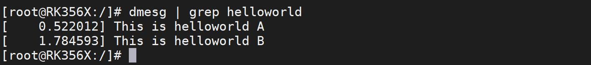

# 第009章 让驱动快一点被加载

```c
// 检查抢占计数是否发生变化
if (preempt_count() != count) {
    // 如果抢占计数发生变化，将警告信息写入消息缓冲区
    sprintf(msgbuf, "preemption imbalance ");
    // 恢复抢占计数到原始值
    preempt_count_set(count);
}
// 检查中断是否被禁用
if (irqs_disabled()) {
    // 如果中断被禁用，将警告信息写入消息缓冲区
    strlcat(msgbuf, "disabled interrupts ", sizeof(msgbuf));
    // 启用中断
    local_irq_enable();
}
// 如果消息缓冲区中有警告信息，则输出警告信息
WARN(msgbuf[0], "initcall %pF returned with %s\n", fn, msgbuf);
// 增加潜在熵
add_latent_entropy();
// 返回初始化调用函数的返回值
return ret;
}
```
本章为驱动基础中的进阶部分。本章会利用上一章中学习到的知识让编译进内核的驱动可以更快的被加载。
## 9.1 实验程序的编写
由于本章节测试的是驱动的加载速度，这里使用helloworld_a.c 和helloworld_b.c 驱动程序作为实验代码。helloworld_a.c 程序如代码清单9.1 所示。代码清单9.1
```c
#include <linux/module.h>
#include <linux/kernel.h>
static int __init helloworld_init(void) //驱动入口函数
```

```c
{
    printk(KERN_EMERG "This is helloworld A\r\n");//注意：内核打印用printk 而不是printf
    return 0;
}
static void __exit helloworld_exit(void) //驱动出口函数
{
    printk(KERN_EMERG "helloworld_exit\r\n");
}
arch_initcall(helloworld_init); //注册入口函数
module_exit(helloworld_exit); //注册出口函数
MODULE_LICENSE("GPL v2"); //同意GPL 开源协议
MODULE_AUTHOR("topeet"); //作者信息
```
helloworld_b.c 程序如代码清单9.2 所示。代码清单9.2
```c
#include <linux/module.h>
#include <linux/kernel.h>
static int __init helloworld_init(void) //驱动入口函数
{
    printk(KERN_EMERG "This is helloworld B\r\n");//注意：内核打印用printk 而不是printf
    return 0;
}
static void __exit helloworld_exit(void) //驱动出口函数
{
    printk(KERN_EMERG "helloworld_exit\r\n");
}
module_init(helloworld_init); //注册入口函数
module_exit(helloworld_exit); //注册出口函数
MODULE_LICENSE("GPL v2"); //同意GPL 开源协议
MODULE_AUTHOR("topeet"); //作者信息
```
代码清单9.1 和代码清单9.2 中两个驱动程序只有第15 行驱动入口函数有些区别，其中helloworld_a.c 使用的宏arch_initcall，helloworld_b.c 使用宏module_init，可以根据代码清单9.3 中数字大小来确定优先级，数字越小优先级越高，相同数字带s 的优先级小于不带s 的优先级，优先级高的驱动先被加载。代码清单9.3

```c
#define pure_initcall(fn)__define_initcall(fn, 0)
#define core_initcall(fn)__define_initcall(fn, 1)
#define core_initcall_sync(fn)__define_initcall(fn, 1s)
#define postcore_initcall(fn)__define_initcall(fn, 2)
#define postcore_initcall_sync(fn)__define_initcall(fn, 2s)
#define arch_initcall(fn)__define_initcall(fn, 3)
#define arch_initcall_sync(fn)__define_initcall(fn, 3s)
#define subsys_initcall(fn)__define_initcall(fn, 4)
#define subsys_initcall_sync(fn)__define_initcall(fn, 4s)
#define fs_initcall(fn)__define_initcall(fn, 5)
#define fs_initcall_sync(fn)__define_initcall(fn, 5s)
#define rootfs_initcall(fn)__define_initcall(fn, rootfs)
#define device_initcall(fn)__define_initcall(fn, 6)
#define device_initcall_sync(fn)__define_initcall(fn, 6s)
#define late_initcall(fn)__define_initcall(fn, 7)
#define late_initcall_sync(fn)__define_initcall(fn, 7s)
#define module_init(x)__initcall(x);
#define__initcall(fn)device_initcall(fn)
```
宏arch_initcall 的优先级为3，宏device_initcall 的优先级为6，所以helloworld_a.c 驱动会比helloworld_b.c 驱动先加载，然后将两个驱动编译进内核，得到boot.img 镜像之后，重新烧写到开发板即可（由于在前面的章节中已经学习了如何将驱动编译进内核，所以这里省略了相应的步骤）。
## 9.2 运行测试
首先需要确保开发板烧写的内核为上一小节编译的包含helloworld_a.c 和helloworld_b.c 驱动的boot.img，然后启动开发板，在串口终端输入dmesg | grep helloworld 命令查找helloworld打印，如图9.1 所示。

图9.1通过图9.1 中的打印可以看到驱动A 的加载时间为内核启动后的0.52 秒左右，驱动B 的加载时间为内核启动后的1.78 秒左右，驱动A 加载速度比驱动B 加载速度快。与我们分析的实验现象相同。

