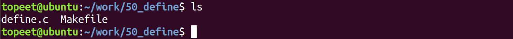
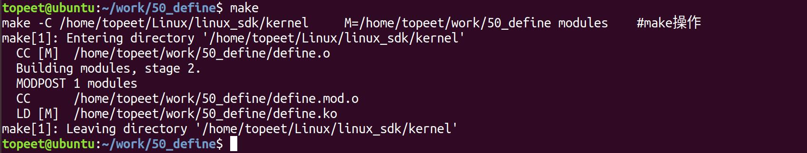
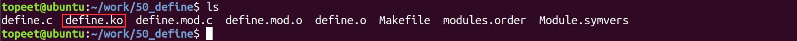
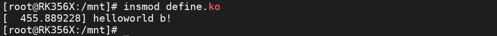

# 第010章 驱动代码使用Makefile的宏

本章为驱动基础中的进阶部分。module_init 宏定义在内核源码目录下的include/linux/module.h 文件中，如代码清单10.1 所示。代码清单10.1
```c
#ifndef MODULE
#define module_init(x)__initcall(x);
#define module_exit(x)__exitcall(x);
#else /* MODULE */
..........
#define module_init(initfn)\
    static inline initcall_t __maybe_unused __inittest(void)\
    { return initfn; }\
    int init_module(void) __copy(initfn) __attribute__((alias(#initfn)));
..........
#endif
```
module_init 宏的具体实现由MODULE 宏定义来决定，该宏定义在内核源码的顶层Makefile中，在本节课中将对内核源码的顶层Makefile 中的宏进行进一步探究。
## 10.1 内核模块编译选项的变量
在Makefile 中KBUILD_CFLAGS_MODULE 和EXTRA_CFLAGS 都是用于指定编译内核模块时的编译选项的变量，下面是两个变量的详细介绍。（1）KBUILD_CFLAGS_MODULE：KBUILD_CFLAGS_MODULE 是一个Makefile 变量，用于指定编译内核模块时的编译选项。如使用KBUILD_CFLAGS_MODULE 变量添加宏定义、优化选项、警告选项等。在给KBUILD_CFLAGS_MODULE 变量赋值时，可以使用+=操作符来追加编译选项，以确保不覆盖已有的编译选项。例如，代码KBUILD_CFLAGS_MODULE += -DDEBUG 表示添加DEBUG 宏用来控制源码编译。-D 为选项。（2）EXTRA_CFLAGS：EXTRA_CFLAGS 也是一个Makefile 变量，用于指定额外的编译选项。与KBUILD_CFLAGS_MODULE 类似，也可以使用EXTRA_CFLAGS 变量来添加编译选项。同样地，在给EXTRA_CFLAGS 赋值时，也可以使用+=操作符来追加编译选项，以确保不覆

盖已有的编译选项。例如，EXTRA_CFLAGS += -DDEBUG 表示添加DEBUG 宏用来控制源码编译。-D 为选项。注：两个变量的最终效果是相同的，在目前的内核中主要使用KBUILD_CFLAGS_MODULE变量的方式，EXTRA_CFLAGS 已经弃之不用了，但仍旧支持这种方法。
## 10.2 实验程序的编写
本实验代码存放在网盘iTOP-RK3568 开发板\07_学习教程配套资料\03_Linux 驱动配套资料\04_Linux 驱动例程\50_define 路径下。本实验将通过KBUILD_CFLAGS_MODULE 参数来添加特定于模块的编译选项，根据编译选项的内容来打印不同的值。其实验代码define.c 如代码清单10.2 所示。代码清单10.2
```c
#include <linux/module.h>
#include <linux/kernel.h>
static int __init helloworld_init(void) //驱动入口函数
{
#ifndef DEBUG
    printk("helloworld a!\n");
#else
    printk("helloworld b!\n");
#endif
    return 0;
}
static void __exit helloworld_exit(void) //驱动出口函数
{
    printk(KERN_EMERG "helloworld_exit\r\n");
}
module_init(helloworld_init); //注册入口函数
module_exit(helloworld_exit); //注册出口函数
MODULE_LICENSE("GPL v2"); //同意GPL 开源协议
MODULE_AUTHOR("topeet"); //作者信息
```

## 10.3 运行测试
### 10.3.1 编译驱动程序
在上一小节中的define.c 代码同一目录下创建Makefile 文件，如图10.1 所示。

图10.1Makefile 文件内容如代码清单10.3 所示。代码清单10.3
```c
KBUILD_CFLAGS_MODULE += -DDEBUG
export ARCH=arm64#设置平台架构
export CROSS_COMPILE=aarch64-linux-gnu-#交叉编译器前缀
obj-m +=define.o#此处要和你的驱动源文件同名
KDIR :=/home/topeet/Linux/linux_sdk/kernel#这里是你的内核目录
PWD ?= $(shell pwd)
all:
    make -C $(KDIR) M=$(PWD) modules#make 操作
clean:
    make -C $(KDIR) M=$(PWD) clean#make clean 操作
```
接着来到存放define.c 和Makefile 文件目录下，使用命令make 进行驱动的编译，编译完成如图10.2 所示：

图10.2编译完生成define.ko 目标文件，如图10.3 所示：

图10.3至此驱动模块就编译成功了。
### 10.3.2 运行测试
开发板启动之后，使用insmod define.ko 命令进行驱动模块的加载。加载成功如图10.4 所示

图10.4

