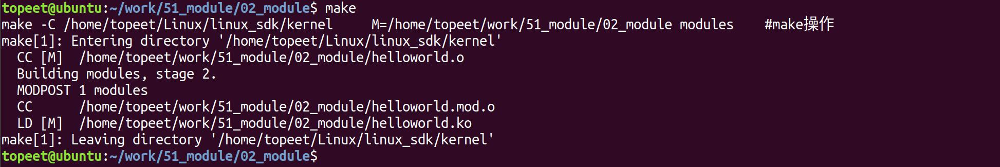
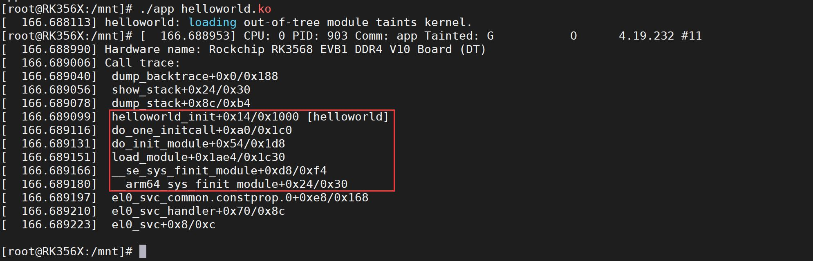
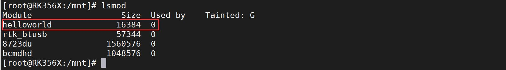

# 第011章 内核是如何运行ko文件的_insmod

根据打印信息可以确定DEBUG 宏定义已经被定义了，所以才会打印“helloworld b!”，如果删除Makefile 文件中的第一行内容之后，重新加载内核就会打印“helloworld a!”。实验现象如图10.5 所示。

图10.5使用rmmod define.ko 命令对该内核进行卸载，如图10.6 所示。

图10.6至此，驱动代码使用Makefile 的宏实验就完成了。
本章为驱动基础中的进阶部分。加载内核模块使用insmod 命令，本章学习insmod 命令是如何加载内核模块的。
## 11.1 insmod 源码分析
北京迅为开发板的所有系统都默认支持insmod 命令，命令本质上是一个可执行程序,因此也有着对应的源码，不管是何种系统，insmod 命令的源码是相同的（可能会因为版本不同，存在细微的差别）。本章节使用busybox 文件系统中的insmod 命令源码进行讲解。busybox 文件系统源码存放在在网盘iTOP-RK3568 开发板\07_学习教程配套资料\03_Linux 驱动配套资料\04_Linux 驱动例程\58_module\01_busybox 源码目录下，如图11.1 所示：

图11.1将busybox 源码拷贝到虚拟机Ubuntu 上并解压，解压完成如图11.2 所示：

图11.2

insmod 的源码位于busybox-1.34.1/modutils/insmod.c 目录下，该源码的主要内容如代码清单11.1 所示。代码清单11.1
```c
int insmod_main(int argc UNUSED_PARAM, char **argv)
{
    char *filename;
    int rc;
    // 如果是2.4 风格的insmod，解析命令行选项
    IF_FEATURE_2_4_MODULES(
        getopt32(argv, INSMOD_OPTS INSMOD_ARGS);
        argv += optind - 1;
    );
    // 获取模块文件名
    filename = *++argv;
    if (!filename)
        bb_show_usage();
    // 调用bb_init_module 函数加载模块
    rc = bb_init_module(filename, parse_cmdline_module_options(argv, /*quote_spaces:*/ 0));
    // 如果加载失败，显示错误信息
    if (rc)
        bb_error_msg("can't insert '%s': %s", filename, moderror(rc));
    return rc;
}
```
其中最重要的是第18 行的bb_init_module 函数，该函数会加载内核模块。该函数定义在busybox-1.34.1/modutils/modutils.c 文件中，如代码清单11.2 所示。代码清单11.2
```c
int FAST_FUNC bb_init_module(const char *filename, const char *options)
{
    size_t image_size;
    char *image;
    int rc;
    bool mmaped;
    if (!options)
        options = "";
    // TODO: 审查bb_init_module_24 以符合错误代码约定
#if ENABLE_FEATURE_2_4_MODULES
```

```c
if (get_linux_version_code() < KERNEL_VERSION(2,6,0))
    return bb_init_module_24(filename, options);
#endif
// 首先尝试使用finit_module 函数加载模块
// 如果finit_module 函数可用，则尝试使用它加载模块
#ifdef __NR_finit_module
{
    // 打开模块文件
    int fd = open(filename, O_RDONLY | O_CLOEXEC);
    if (fd >= 0) {
        // 调用finit_module 函数加载模块，返回值为0 表示加载成功
        rc = finit_module(fd, options, 0) != 0;
        close(fd);
        if (rc == 0)
            return rc;
    }
}
#endif
// 如果finit_module 函数不可用，或者调用finit_module 失败，则使用其他方式加载模块
// 初始化image_size 为INT_MAX-4095，作为映射模块的内存大小
image_size = INT_MAX - 4095;
mmaped = 0;
// 尝试将模块文件映射到内存中
image = try_to_mmap_module(filename, &image_size);
if (image) {
    mmaped = 1;
} else {
    errno = ENOMEM;
    image = xmalloc_open_zipped_read_close(filename, &image_size);
    if (!image)
        return -errno;
}
errno = 0;
// 调用init_module 函数加载模块，将模块的映像和大小以及选项传递给它
init_module(image, image_size, options);
rc = errno;
if (mmaped)
    munmap(image, image_size);
else
    free(image);
```

```c
return rc;
}
```
该函数中有着两种模块加载方式，19-31 行代码为第一种使用finit_module 系统调用的加载方式，33-57 行代码为第二种使用init_module 系统调用的加载方式，默认情况会先使用第一种方式进行模块的加载，如果加载失败会使用第二种方式进行加载。两种加载方式的最终实现效果是相同的，而为了加深大家对insmod 的理解，我们将分别使用第一种方法和第二种方法来加载相应的ko 文件，从而验证方法一和方法二。
## 11.2 实验程序的编写
由于章节篇幅的原因，本章节只会实现第一种方法，在下个章节将会实现第二种方法。
### 11.2.1 驱动程序编写
本实验代码存放在网盘iTOP-RK3568 开发板\07_学习教程配套资料\03_Linux 驱动配套资料\04_Linux 驱动例程\58_module\02_module 路径下。实验代码helloworld.c 其代码如代码清单11.3 所示。代码清单11.3
```c
#include <linux/module.h>
#include <linux/kernel.h>
static int __init helloworld_init(void) //驱动入口函数
{
    dump_stack();
    return 0;
}
static void __exit helloworld_exit(void) //驱动出口函数
{
    printk(KERN_EMERG "helloworld_exit\r\n");
}
module_init(helloworld_init); //注册入口函数
module_exit(helloworld_exit); //注册出口函数
MODULE_LICENSE("GPL v2"); //同意GPL 开源协议
MODULE_AUTHOR("topeet"); //作者信息
```
该驱动程序在helloworld 驱动程序基础上添加了dump_stack()函数，dump_stack()用来在内核中输出当前调用堆栈信息，在这里使用该函数的目的是验证在app 中的finit_module 系统调用是否生效。

### 11.2.2 编写测试APP
本实验代码存放在网盘iTOP-RK3568 开发板\07_学习教程配套资料\03_Linux 驱动配套资料\04_Linux 驱动例程\58_module\03_app 路径下。实验代码app.c 如代码清单11.4 所示。app.c 为应用程序。app.c 是insmod 应用程序的简化版本。代码清单11.4
```c
#include <stdio.h>
#include <sys/syscall.h>
#include <fcntl.h>
#include <unistd.h>
#define finit_module(fd, uargs, flags) syscall(__NR_finit_module, fd, uargs, flags)
int main(int argc, char **argv)
{
    int fd;// 文件描述符
    int ret;// 返回值
    fd = open(argv[1], O_RDONLY | O_CLOEXEC);// 打开文件，以只读方式打开并设置O_CLOEXEC 标
志
    if (fd < 0) {// 打开文件失败
        printf("open error\n");
        return -1;
    }
    ret = finit_module(fd, "", 0);// 调用finit_module 系统调用加载模块
    return ret;// 返回加载结果
}
```
该应用程序重点在20 行，使用finit_module 系统调用加载模块到内核。
## 11.3 运行测试
### 11.3.1 编译驱动程序
在上一小节中的helloworld.c 代码同一目录下创建Makefile 文件，如图11.3 所示。


图11.3Makefile 文件内容如代码清单11.5 所示。代码清单11.5
```c
export ARCH=arm64#设置平台架构
export CROSS_COMPILE=aarch64-linux-gnu-#交叉编译器前缀
obj-m += helloworld.o#此处要和你的驱动源文件同名
KDIR :=/home/topeet/Linux/linux_sdk/kernel#这里是你的内核目录
PWD ?= $(shell pwd)
all:
    make -C $(KDIR) M=$(PWD) modules#make 操作
clean:
    make -C $(KDIR) M=$(PWD) clean#make clean 操作
```
在存放helloworld.c 和Makefile 文件目录下使用命令“make”编译命令，编译完成如图11.4所示。

图11.4编译完生成helloworld.ko 目标文件，如图11.5 所示：

图11.5至此驱动模块就编译成功了。
### 11.3.2 编译应用程序
使用aarch64-linux-gnu-gcc app.c -o app 命令交叉应用程序，如代码清单11.5 所示。编译成功如图11.6 所示。

图11.6
### 11.3.2 运行测试
将本章节编译好的helloworld.ko 驱动文件和app 可执行文件拷贝到开发板上。开发板启动之后，使用./app helloworld.ko 命令加载helloworld.ko 驱动，如图11.7 所示。


图11.7图11.7 红色框中是dump_stack 函数打印的函数调用关系，这些函数的具体调用已经在进阶第一章讲解过了，这里的重点为红色框中的倒数第二行，倒数第二行调用finit_module 函数加载了helloworld 驱动。
然后使用lsmod 命令查看驱动的加载情况，如图11.8 所示。

图11.8通过图11.8 可以看到helloworld 驱动成功加载上了，使用rmmod helloworld.ko 命令可以下载helloworld 驱动，如图11.9 所示。

图11.9通过此实验可以验证在应用程序中调用finit_module 系统调用函数可以加载驱动程序。

