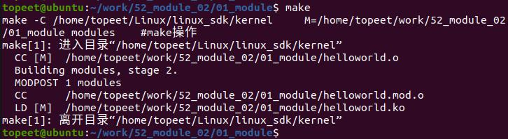
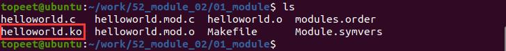
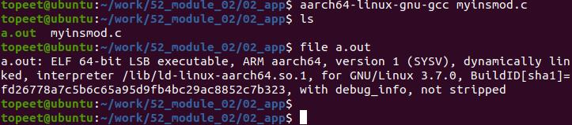
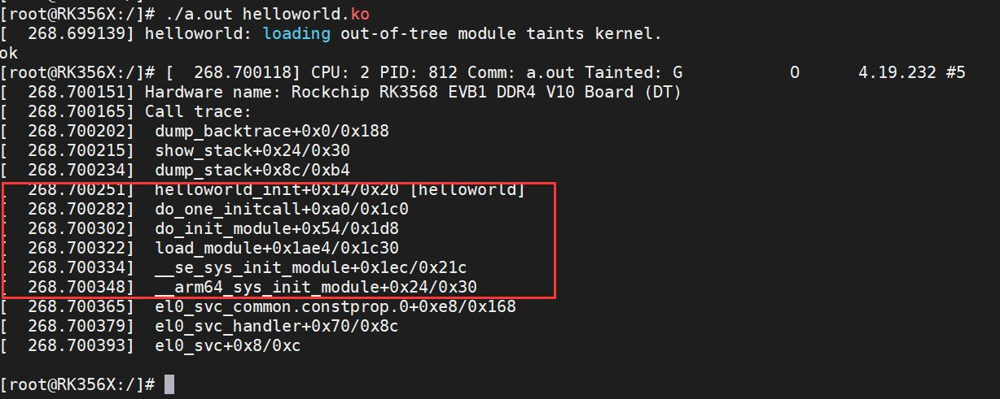
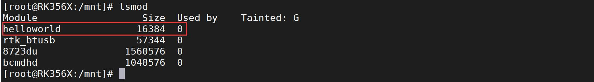

# 第012章自定义实现insmod命令

本章为驱动基础中的进阶部分。本章讲解如何自定义一个insmod 命令。
## 12.1 实验程序的编写
在本章节使用第二种方法实现insmod 命令。
### 12.1.1 驱动程序编写
本实验对应的驱动程序存放在网盘iTOP-RK3568 开发板\07_学习教程配套资料\03_Linux驱动配套资料\04_Linux 驱动例程\52_module02\01_module 路径下。实验代码helloworld.c 代码如代码清单12.1 所示。代码清单12.1
```c
#include <linux/module.h>
#include <linux/kernel.h>
static int __init helloworld_init(void) //驱动入口函数
{
    dump_stack();
    return 0;
}
static void __exit helloworld_exit(void) //驱动出口函数
{
    printk(KERN_EMERG "helloworld_exit\r\n");
}
module_init(helloworld_init); //注册入口函数
module_exit(helloworld_exit); //注册出口函数
MODULE_LICENSE("GPL v2"); //同意GPL 开源协议
MODULE_AUTHOR("topeet"); //作者信息
```
该驱动程序在helloworld 驱动程序基础上添加了dump_stack()函数，dump_stack()用来在内核中输出当前调用堆栈信息，在这里使用该函数的目的是验证在app 中的init_module 系统调用是否生效。
### 12.1.2 编写测试APP
本实验代码存放在iTOP-RK3568 开发板\07_学习教程配套资料\03_Linux 驱动配套资料

\04_Linux 驱动例程\52_module02\02_app 路径下。实验代码myinsmod.c 如代码清单12.2 所示。myinsmod.c 为应用程序。代码清单12.2
```c
#include <stdio.h>
#include <sys/syscall.h>
#include <fcntl.h>
#include <unistd.h>
#include <sys/types.h>
#include <sys/stat.h>
#include <stdlib.h>
#define init_module(mod, len, opts) syscall(__NR_init_module, mod, len, opts)
int main(int argc, char **argv)
{
    int fd;// 文件描述符
    int ret;// 返回值
    struct stat statbuf;// 存储文件信息的结构体
    size_t image_size;// 文件大小
    char *image;// 文件内容缓冲区
    fd = open(argv[1], O_RDONLY | __O_CLOEXEC);// 以只读方式打开文件
    if (fd < 0)
    {
        printf("open error \n");// 打开文件失败
        return -1;
    }
    fstat(fd, &statbuf);// 获取文件信息
    image_size = statbuf.st_size;// 获取文件大小
    image = malloc(image_size);// 为文件内容分配内存空间
    read(fd, image, image_size);// 读取文件内容到缓冲区
    ret = init_module(image, image_size, "");// 调用系统调用初始化内核模块
    if (ret < 0)
    {
        printf("error \n");// 内核模块初始化失败
    }
    else
    {
        printf("ok \n");// 内核模块初始化成功
    }
    free(image);// 释放内存空间
```

```c
return ret;// 返回结果
}
```
该应用程序的重点在30 行，使用init_module 系统调用加载模块到内核。
## 12.2 运行测试
### 12.2.1 编译驱动程序
在helloworld.c 代码同一目录下创建Makefile 文件，如图12.1 所示。

图12.1Makefile 文件内容如代码清单12.3 所示。代码清单12.3
```c
export ARCH=arm64#设置平台架构
export CROSS_COMPILE=aarch64-linux-gnu-#交叉编译器前缀
obj-m += helloworld.o#此处要和你的驱动源文件同名
KDIR :=/home/topeet/Linux/linux_sdk/kernel#这里是你的内核目录
PWD ?= $(shell pwd)
all:
    make -C $(KDIR) M=$(PWD) modules#make 操作
clean:
    make -C $(KDIR) M=$(PWD) clean#make clean 操作
```
在存放helloworld.c 和Makefile 文件目录下使用命令mak”进行驱动的编译，编译完成如图12.2 所示。

图12.2编译完生成helloworld.ko 目标文件如图12.3 所示。

图12.3

至此驱动模块就编译成功了。
### 12.2.2 编译应用程序
使用aarch64-linux-gnu-gcc myinsmod.c 命令交叉编译应用程序，编译成功会得到a.out 可执行文件，如图12.4 所示

图12.4下面进行驱动程序的测试。
### 12.2.3 运行测试
本次测试要将本章编译的helloworld.ko 驱动和a.out 可执行文件拷贝到开发板上。开发板启动之后，使用./a.out helloworld.ko 命令加载helloworld.ko 驱动，如图12.5 所示。

图12.5这里的重点为红色框中的倒数第二行，倒数第二行调用了init_module 函数加载了helloworld 驱动。然后使用lsmod 命令查看驱动的加载情况，如图12.6 所示。


