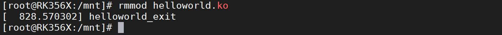
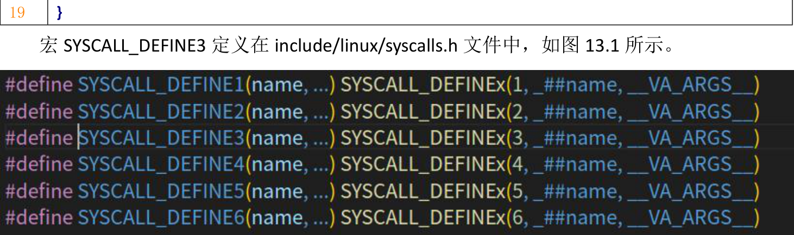

# 第013章 内核运行ko文件实验——系统调用

图12.6可以看到helloworld 驱动成功加载上了，可以使用rmmod helloworld.ko 命令卸载驱动，如图12.7 所示

图12.7至此，内核是如何运行KO 文件的_insmod 实验就完成了。
本章为驱动基础中的进阶部分。当使用insmod 命令加载ko 文件时，会调用系统调用init_module 或finit_module。那么，什么是系统调用呢？接下来我们来进一步探索系统调用。
## 13.1 什么是系统调用
系统调用（system call）是操作系统提供给应用程序的编程接口，用于访问操作系统的服务和功能。它是应用程序与操作系统之间的桥梁，允许应用程序请求操作系统执行特定的操作，例如文件操作，进程管理，网络通信等。在计算机系统中，应用程序运行在用户态下，而操作系统运行在内核态下。用户态的应用程序无法直接访问操作系统的内核功能和资源，只能通过系统调用来向操作系统发出请求。当应用程序需要执行操作系统提供的服务或访问底层资源时，它会通过系统调用接口向操作系统发送请求，并传递必要的参数。操作系统接收到请求后，会在内核态下执行相应的操作，并将结果返回给应用程序。举个例子来说，假设A 同学去饭店吃饭。饭店提供了菜单，厨师会根据顾客点的菜来准备食物。在这个例子中，顾客相当于上层应用程序，顾客想要吃鱼香肉丝，可以通过服务员（类比系统调用）点这道菜。服务员接收到顾客的点菜请求后，将其传达给厨师（类比操作系统）。厨师根据订单准备食物，最后将食物交给服务员，服务员再将食物送到顾客面前（内核态执行相应请求）。回到init_module 和finit_module 这俩个系统调用，它们是应用程序调用的系统调用。当应用程序调用这些系统调用时，操作系统内核会执行加载和运行ko 文件的操作。这样，应用程序就能通过系统调用向操作系统请求加载内核模块的功能。

## 13.2 系统调用的流程
以init_module()函数为例，init_module()函数定义在busybox/modutils/modutils.c 文件中，函数原型如代码清单13.1 所示：代码清单13.1#define init_module(mod, len, opts) syscall(__NR_init_module, mod, len, opts)通过代码清单13.1 可知，init_module()函数是对syscall()函数的进一步封装，syscall()函数原型如代码清单13.2 所示。代码清单13.2long syscall(long number, ...);参数说明：number：系统调用的编号。不同的系统调用有不同的编号，可以在系统调用的文档或头文件中找到相应的编号。...：可变参数，用于传递系统调用的参数。具体的参数个数和类型取决于不同的系统调用。返回值：系统调用执行成功时，返回系统调用的结果或返回值。系统调用执行失败时，返回负数值，表示错误代码。错误代码的具体含义可以在系统调用的文档或头文件中找到相应的定义。函数作用：根据系统调用号，调用相应的系统调用重点看函数参数__NR_init_module，即number。该函数参数是系统调用编号，系统调用编号会和函数进行绑定，打开include/uapi/asm-generic/unistd.h 文件，找到如代码代码清单13.3中的代码。代码清单13.3/* kernel/module.c */#define __NR_init_module 105__SYSCALL(__NR_init_module, sys_init_module)#define __NR_delete_module 106__SYSCALL(__NR_delete_module, sys_delete_module)__SYSCALL 将系统调用号105 与sys_init_module 函数绑定。这里有一个规律，在用户空间我们使用xxx 函数，对应的系统调用的函数就是sys_xxx，如用户空间使用init_module()函数，则对应的系统调用函数为sys_init_module()函数。

sys_init_module 函数定义在kernel/module.c 文件中。sys_init_module 函数定义是一个宏定义。如代码清单13.4 所示。代码清单13.4
```c
SYSCALL_DEFINE3(init_module, void __user *, umod,
    unsigned long, len, const char __user *, uargs)
{
int err;
struct load_info info = { };
err = may_init_module();
if (err)
    return err;
pr_debug("init_module: umod=%p, len=%lu, uargs=%p\n",
       umod, len, uargs);
err = copy_module_from_user(umod, len, &info);
if (err)
    return err;
return load_module(&info, uargs, 0);
```

图13.1SYSCALL_DEFINE3 宏定义中的3 代表有3 个参数，因为在syscall(__NR_init_module, mod, len,opts)函数有3 个函数参数，所以这里使用宏SYSCALL_DEFINE3。这里一共是6 个宏定义，所以函数最多可以带6 个参数，也可以不带参数，不带参数使用宏SYSCALL_DEFINE0。这个宏定义还会给sys_init_module()函数起一个别名__se_sys_init_module。这也就解释了为什么当我调用这个系统调用的时候会调用__se_sys_init_module 函数。如图13.2 所示。

