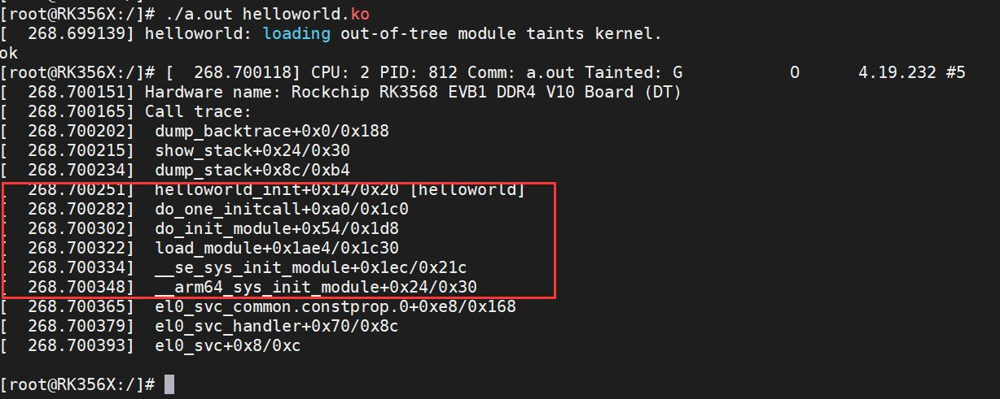
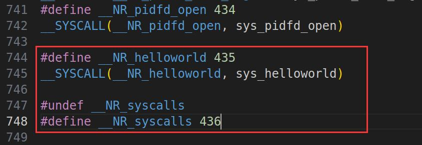

# 第014章 向系统中添加一个系统调用


图13.2
代码清单13.5中系统调用函数将用户空间的模块数据复制到内核空间后调用load_module()函数加载内核模块。在load_module()函数中会调用do_init_module()函数，在do_init_module()函数中如果模块的init 函数不为空，则调用do_one_initcall()函数执行模块的入口函数。调用关系如下所示。
```c
代码SYSCALL_DEFINE3(init_module, ...)
清单|
13.51-->load_module
                |
                --> do_init_module(mod)
                    |
                --> do_one_initcall(mod->init);
```
=本章为驱动基础中的进阶部分。本章节学习如何向系统中添加一个系统调用。
## 14.1 内核添加自定义服务
修改helloworld.c 驱动程序，修改完后如代码清单14.1 所示。并确保改好后的helloworld驱动编译进了内核源码中。

代码清单14.1
```c
#include <linux/kernel.h>
#include <linux/syscalls.h>
SYSCALL_DEFINE0(helloworld){
printk("This is helloworld syscall\n");
return 0;
}
```
## 14.2 添加系统调用号
在Linux 源码kernel/include/uapi/asm-generic/unistd.h 文件中添加系统调用号435。添加完后如图14.1 所示。

图14.1添加完成后重新编译内核源码，并烧写内核镜像到开发板。编译好的内核镜像boot.img 在网盘“iTOP-RK3568 开发板\07_学习教程配套资料\03_Linux驱动配套资料\04_Linux 驱动例程\53_SYSCALL”目录下。
## 14.3 系统调用测试
本实验代码存放在网盘“iTOP-RK3568 开发板\07_学习教程配套资料\03_Linux 驱动配套资料\04_Linux 驱动例程\53_SYSCALL”路径下。实验代码syscall.c 应用程序如代码清单14.2 所示。代码清单14.2
```c
#include <stdio.h>
#include <sys/syscall.h>
#include <fcntl.h>
#include <unistd.h>
```

