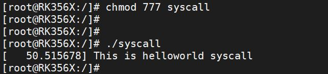
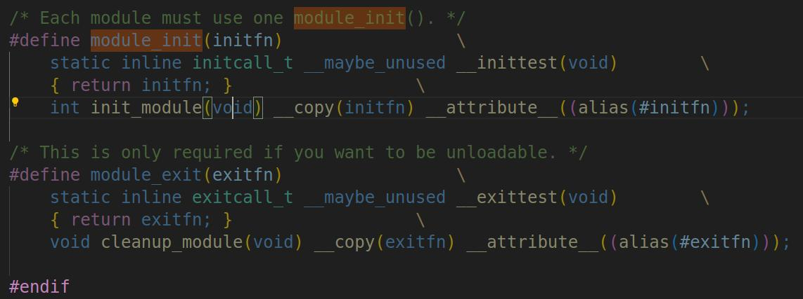
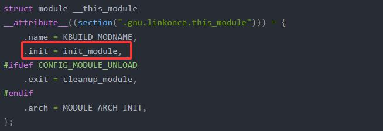

# 第015章 内核运行ko文件总结

```c
#include <sys/types.h>
#include <sys/stat.h>
#include <stdlib.h>
#define __NR_helloworld 435
int main(int argc,char **argv){
  syscall(__NR_helloworld);
  return 0;
}
```
使用aarch64-linux-gnu-gcc syscall.c -o syscall 命令交叉编译应用程序，如图14.2 所示。

图14.2然后将编译好的syscall 程序拷贝到开发板上，输入命令chmod 777 syscall 修改权限为777，修改权限完成以后输入命令./syscall 运行应用程序，如图14.3 所示。

图14.3在运行应用程序之后，打印“This is helloworld syscall”说明已经成功调用自定义的系统调用，至此，向系统中添加一个系统调用实验结束。
本章为驱动基础中的进阶部分。本章对内核如何运行ko 文件进行总结。
## 15.1 内核运行ko 流程分析
当使用系统调用时，内核会执行SYSCALL_DEFINE3 宏定义的函数，如SYSCALL_DEFINE3(finit_module,int,fd,constchar__user*,uargs,int,flags)或

SYSCALL_DEFINE3(init_module, void __user *, umod, unsigned long, len, const char __user *,uargs)。这些函数最终都会调用load_module 函数，而在load_module 函数中，会通过do_one_initcall(mod->init)来执行驱动程序的入口函数。为什么mod->init 就是驱动的入口函数呢？打开include/linux/module.h 文件，找到以下代码，如图15.1 所示：

图15.1图15.1 中代码中module_init 宏和module_exit 宏可以指定模块的入口函数和出口函数。intinit_module(void) __copy(initfn) __attribute__((alias(#initfn)))定义一个名为init_module 的函数，用于作为模块的入口函数。__copy(initfn) 表示复制用户定义的初始化函数，__attribute__((alias(#initfn)))表示将init_module 函数与用户定义的初始化函数initfn 关联起来。并将init_module 作为函数initfn 的别名。如代码module_init(hello_init)会把驱动入口函数hello_init 重命名成init_module当我们编译ko 文件的时候，会生成一个以.mod.c 为后缀的文件。关键内容如图15.2 所示。

图15.2图15.2 中定义了一个类型为module 的全局变量__this_module，成员init 为init_module

