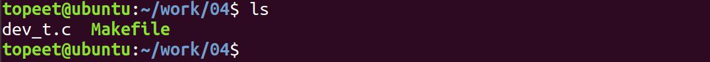
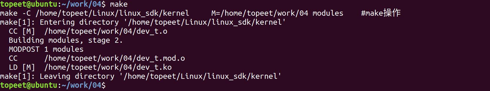
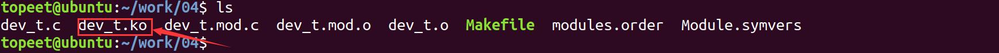
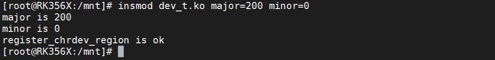
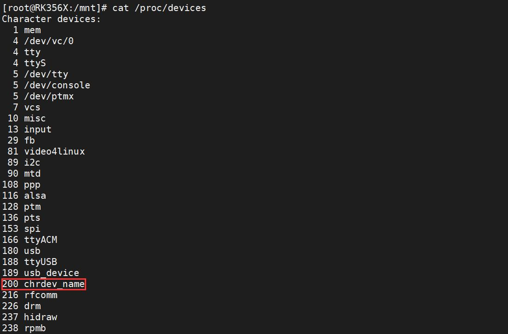
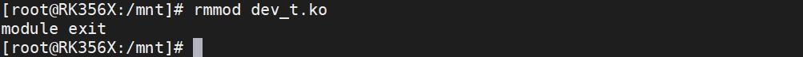
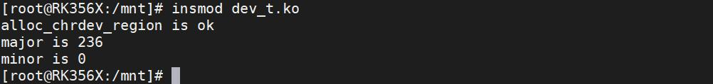

# 第016章 申请设备号实验

（即hello_init），且该变量链接到.gnu.linkonce.this_module 段中。所以mod->init 即驱动的入口函数。通过insmod 命令加载进内核模块时，insmod 命令会调用系统调用加载module 结构体中init成员指向的驱动入口函数。调用关系代码清单15.1 所示代码清单15.1
```c
SYSCALL_DEFINE3(init_module, ...)
    |
    -->load_module
        |
        --> do_init_module(mod)
            |
        --> do_one_initcall(mod->init);
在Linux 系统中每一个设备都有相应的设备号，设备号有主设备号与次设备号之分，主设备号用来表
示一个特定的驱动，次设备号用来管理下面的设备。在注册字符设备驱动之前需要先申请设备号。
```
## 16.1 申请设备号
### 16.1.1 设备号申请函数
在Linux 驱动中可以使用以下两种方法进行设备号的申请。1.通过register_chrdev_region(dev_t from, unsigned count, const char *name)函数进行静态申请设备号。函数原型：register_chrdev_region(dev_t from, unsigned count, const char *name)函数作用：静态申请设备号，对指定好的设备号进行申请。参数含义：from: 自定义的dev_t 类型设备号

count: 申请设备的数量name: 申请的设备名称函数返回值：申请成功返回0，申请失败返回负数
2. 通过alloc_chrdev_region(dev_t *dev, unsigned baseminor, unsigned count,const char*name)函数进行动态申请设备号。函数原型：alloc_chrdev_region(dev_t *dev, unsigned baseminor, unsigned count,const char *name)函数作用：动态申请设备号，内核会自动分配一个未使用的设备号，相较于静态申请设备号，动态申请会避免注册设备号相同引发冲突的问题。参数含义：dev *: 会将申请完成的设备号保存在dev 变量中baseminor: 次设备号可申请的最小值count: 申请设备的数量name: 申请的设备名称函数返回值：申请成功返回0，申请失败返回负数
两个函数在“内核源码/include/linux/fs.h”文件中引用(在编写驱动程序的时候要加入该文件的引用)，如代码清单16.1代码清单16.1
```c
2693extern int alloc_chrdev_region(dev_t *, unsigned, unsigned, const char *);
2694extern int register_chrdev_region(dev_t, unsigned, const char *);
```
### 16.1.2 设备号类型
设备号类型为dev_t ，dev_t 类型定义在内核源码/include/linux/types.h”文件中，如代码清单16.2 所示。代码清单16.2
```c
typedef u32 __kernel_dev_t;
........
typedef __kernel_dev_tdev_t;
```
dev_t 为u32 类型，而u32 定义在内核源码/include/uapi/asm-generic/int-ll64.h 文件中，如代码清单16.3 所示。

代码16.3 所示
```c
typedef unsigned int __u32;
```
__u32 为unsigned int 类型，因此dev_t 是一个无符号的32 位整形类型。其中高12 位表示主设备号，低20 位表示次设备号。在内核源码/include/linux/kdev_t.h 中提供了设备号相关的宏定义，如代码清单16.4 所示。代码清单16.4
```c
#define MINORBITS/*次设备号位数*/
#define MINORMASK((1U << MINORBITS) - 1)/*次设备号掩码*/
#define MAJOR(dev)((unsigned int) ((dev) >> MINORBITS))/*dev 右移20 位得到主设备号*/
#define MINOR(dev)((unsigned int) ((dev) & MINORMASK))/*与次设备掩码与，得到次设备号*/
#define MKDEV(ma,mi)(((ma) << MINORBITS) | (mi))/*MKDEV 宏将主设备号（ma）左移20 位，然后与
次设备号（mi）相与，得到设备号*/
```
在稍后的实验中不论是静态申请设备号还是动态申请设备号都会用到上述宏，例如在静态申请设备号时需要将指定的主设备号和从设备号通过MKDEV(ma,mi)宏进行设备号的转换，在动态申请设备号时可以用MAJOR(dev) 和MINOR(dev)宏将动态申请的设备号转化为主设备号和从设备号。
## 16.2 实验程序的编写
本实验代码存储在网盘iTOP-RK3568开发板\07_学习教程配套资料\03_Linux驱动配套资料\04_Linux 驱动例程\04 路径下。本实验代码如果在加载驱动模块时传入了主设备号，则通过静态的方式进行设备号的申请，如果不传入任何参数则通过动态的方式进行设备号申请。实验代码dev_t.c 如代码清单16.5 所示。代码清单16.5
```c
#include <linux/init.h>
#include <linux/module.h>
#include <linux/fs.h>
#include <linux/kdev_t.h>
static int major;//定义静态加载方式时的主设备号参数major
static int minor;//定义静态加载方式时的次设备号参数minor
module_param(major,int,S_IRUGO);//通过驱动模块传参的方式传递主设备号参数major
module_param(minor,int,S_IRUGO);//通过驱动模块传参的方式传递次设备号参数minor
static dev_t dev_num;//定义dev_t 类型(32 位大小)的变量dev_num
static int __init dev_t_init(void)//驱动入口函数
{
    int ret;//定义int 类型的变量ret，用来判断函数返回值
```

```c
/*以主设备号进行条件判断，即如果通过驱动传入了major 参数则条件成立，进入以下分支*/
if(major){
    dev_num = MKDEV(major,minor);//通过MKDEV 函数将驱动传参的主设备号和次设备号转换成
dev_t 类型的设备号
    printk("major is %d\n",major);
    printk("minor is %d\n",minor);
    ret = register_chrdev_region(dev_num,1,"chrdev_name");//通过静态方式进行设备号册
    if(ret < 0){
        printk("register_chrdev_region is error\n");
    }
    printk("register_chrdev_region is ok\n");
}
/*如果没有通过驱动传入major 参数，则条件成立，进入以下分支*/
else{
    ret = alloc_chrdev_region(&dev_num,0,1,"chrdev_num");//通过动态方式进行设备号注册
    if(ret < 0){
        printk("alloc_chrdev_region is error\n");
    }
    printk("alloc_chrdev_region is ok\n");
    major=MAJOR(dev_num);//通过MAJOR()函数进行主设备号获取
    minor=MINOR(dev_num);//通过MINOR()函数进行次设备号获取
    printk("major is %d\n",major);
    printk("minor is %d\n",minor);
}
return 0;
}
static void __exit dev_t_exit(void)//驱动出口函数
{
unregister_chrdev_region(dev_num,1);//释放字符驱动设备号
printk("module exit \n");
}
module_init(dev_t_init);//注册入口函数
module_exit(dev_t_exit);//注册出口函数
MODULE_LICENSE("GPL v2");//同意GPL 开源协议
MODULE_AUTHOR("topeet");//作者信息
```
代码清单16.5 中通过对传入参数的判断选择设备号申请方式。

## 16.3 运行测试
### 16.3.1 编译驱动程序
在的dev_t.c 代码同一目录下创建Makefile 文件，如图16.1 所示。

图16.1Makefile 文件内容如代码清单16.6 所示。代码清单16.6
```c
export ARCH=arm64#设置平台架构
export CROSS_COMPILE=aarch64-linux-gnu-#交叉编译器前缀
obj-m += dev_t.o#此处要和你的驱动源文件同名
KDIR :=/home/topeet/Linux/linux_sdk/kernel#这里是你的内核目录
PWD ?= $(shell pwd)
all:
    make -C $(KDIR) M=$(PWD) modules#make 操作
clean:
    make -C $(KDIR) M=$(PWD) clean#make clean 操作
```
回到存放dev_t.c 和Makefile 文件目录下，使用命令make 编译驱动程序，编译完成如图16.2所示。

图16.2编译完生成dev_t.ko 目标文件，如图16.3 所示。

图16.3至此我们的驱动模块就编译成功了，下面对驱动进行加载测试。
### 16.3.2 运行测试
开发板上电启动之后，使用insmod dev_t.ko major=200 minor=0 命令加载dev_t.ko 驱动，加载完成之后的打印信息如图16.4 所示。


图16.4通过图16.4 可以看出传入的主设备号和次设备号都被打印了出来，使用cat /proc/devices 命令查看注册的设备号，如图16.5 所示。

图16.5通过图16.5 可以看到主设备号200 的设备名为chrdev_name，与驱动程序一致，由此证明设备号已经注册成功，使用rmmod dev_t.ko 命令卸载驱动程序，如图16.6 所示。

图16.6下面进行动态申请设备号实验，使用insmod dev_t.ko 命令进行驱动模块的加载，如图16.7所示。

图16.7通过图16.7 可以看出动态申请设备号已经成功，主设备号为236，次设备号为0，使用cat

