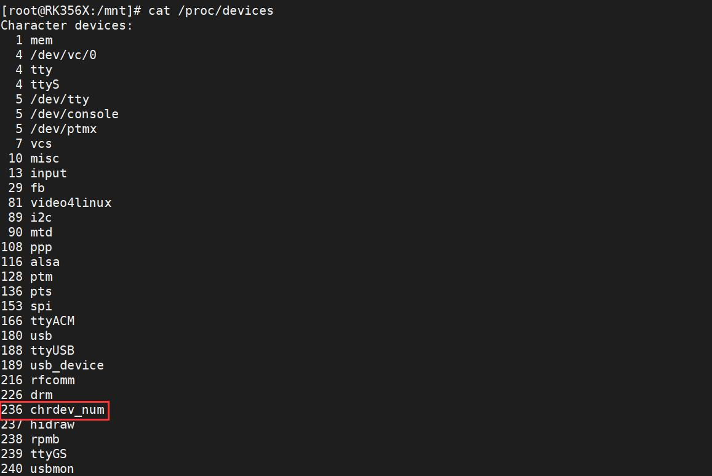
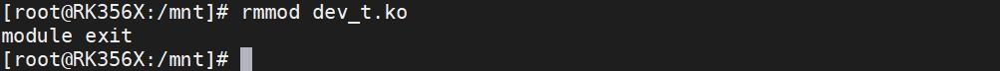
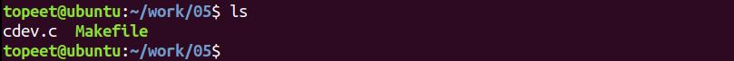
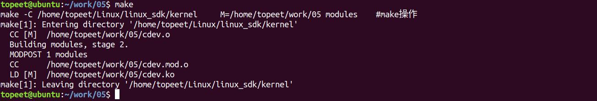
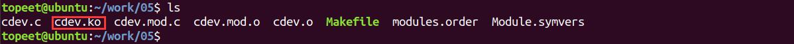
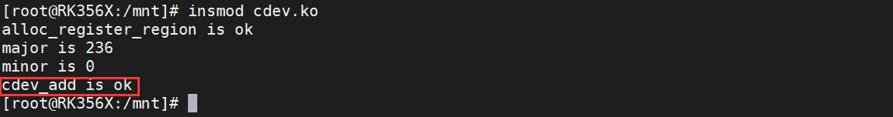
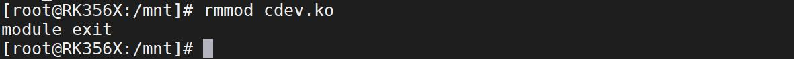

# 第017章 注册字符设备实验

/proc/devices 命令查看注册的设备号，如图16.8 所示。

图16.8通过图16.8 可以看到主设备号236 的设备名为chrdev_name，与驱动程序一致。输入rmmoddev_t.ko 命令卸载驱动，卸载完成如图16.9 所示。

图16.9
本章节学习如何注册字符设备。
## 17.1 注册字符设备
注册字符设备可以分为初始化字符设备和注册字符设备俩个步骤。

### 17.1.1 初始化字符设备
Linux 内核中使用struct cdev 结构体表示字符设备，cdev 结构体中记录了设备号、内核对象、文件操作file_operations 结构体（设备的打开、读写、关闭等操作接口）等信息，structcdev 结构体定义在内核源码/include/linux/cdev.h 文件中（在编写驱动程序的时候要加入该文件的引用），如代码清单17.1 所示。代码清单17.1
```c
struct cdev {
    struct kobject kobj;//内嵌的内核对象.
    struct module *owner;//该字符设备所在的内核模块的对象指针.
    const struct file_operations *ops;//该结构描述了字符设备所能实现的方法，是极为关键的一个结
构体.
    struct list_head list;//用来将已经向内核注册的所有字符设备形成链表.
    dev_t dev;//字符设备的设备号，由主设备号和次设备号构成.
    unsigned int count;//隶属于同一主设备号的次设备号的个数.
};
```
初始化字符设备使用cdev_init()函数,该函数原型同样在内核源码/include/linux/cdev.h 文件中，如代码清单17.2 所示。代码清单17.2
```c
void cdev_init(struct cdev *, const struct file_operations *);
```
cdev_init()函数详细介绍如下：函数作用：初始化传入的cdev 类型的结构体，并与自定义的file_operations * 类型的结构体进行链接。参数含义：cdev: 要传入的cdev 类型结构体，为要初始化的字符设备。fops：要传入的file_operations * 类型结构体，关于file_operations 结构体的相关的知识会在下一章节进行讲解。函数返回值：无返回值。
该函数定义在内核源码/include/fs/char_dev.c 文件中，核心作用是建立cdev 结构体和file_operations 结构体之间的连接。如代码清单17.3 所示代码清单17.3
```c
void cdev_init(struct cdev *cdev, const struct file_operations *fops)
{
    memset(cdev, 0, sizeof *cdev);//将整个结构体清零；
    INIT_LIST_HEAD(&cdev->list);//初始化list 成员使其指向自身；
    kobject_init(&cdev->kobj, &ktype_cdev_default);//初始化kobj 成员；
```

```c
cdev->ops = fops;//初始化ops 成员，建立cdev 和file_operations 之间的连接
}
```
### 17.1.2 注册字符设备
注册字符设备所用到的函数为cdev_add()，该函数在内核源码/include/linux/cdev.h 文件中。如代码清单17.4 所示。代码清单17.4
```c
int cdev_add(struct cdev *, dev_t, unsigned);
```
cdev_add()函数详细介绍如下：函数原型：int cdev_add(struct cdev *p, dev_t dev, unsigned count)函数作用：该函数向内核注册一个struct cdev 结构体参数含义：(1)第一个参数为要添加的struct cdev 类型的结构体(2)第二个参数为申请的设备号(3)第三个参数为和该设备关联的设备编号的数量。这两个参数直接赋值给struct cdev 的dev 成员和count 成员。函数返回值：添加成功返回0，添加失败返回负数。
字符设备删除所用到的函数为cdev_del()，该函数同样在内核源码/include/linux/cdev.h 文件中，如代码清单17.5 所示。代码清单17.5
```c
void cdev_del(struct cdev *);
```
cdev_del()详细介绍如下：函数原型：void cdev_del(struct cdev *p)函数作用：该函数会向内核删除一个struct cdev 类型结构体参数含义：该函数只有一个参数，为要删除的struct cdev 类型的结构体函数返回值：无返回值

## 17.2 实验程序的编写
本实验代码存放在网盘iTOP-RK3568开发板\07_学习教程配套资料\03_Linux驱动配套资料\04_Linux 驱动例程\05 路径下。本实验采用动态申请设备号的方式进行设备号的申请，然后注册字符设备，并将申请到的主设备号和次设备号以及字符设备注册情况打印到终端上。实验代码cdev.c 如代码清单17.6 所示。代码清单17.6
```c
#include <linux/init.h>
#include <linux/module.h>
#include <linux/fs.h>
#include <linux/kdev_t.h>
#include <linux/cdev.h>
static dev_t dev_num;//定义dev_t 类型（32 位大小）的变量dev_num,用来存放设备号
struct cdev cdev_test;//定义cdev 结构体类型的变量cdev_test
struct file_operations cdev_test_ops = {
    .owner=THIS_MODULE//将owner 字段指向本模块，可以避免在模块的操作正在被使用时卸载该模块
};//定义file_operations 结构体类型的变量cdev_test_ops
static int __init module_cdev_init(void)//驱动入口函数
{
    int ret;//定义int 类型变量ret，进行函数返回值判断
    int major,minor;//定义int 类型的主设备号major 和次设备号minor
    ret = alloc_chrdev_region(&dev_num,0,1,"chrdev_name");//自动获取设备号，设备名chrdev_name
    if (ret < 0){
        printk("alloc_chrdev_region is error\n");
    }
    printk("alloc_register_region is ok\n");
    major = MAJOR(dev_num);//使用MAJOR()函数获取主设备号
    minor = MINOR(dev_num);//使用MINOR()函数获取次设备号
    printk("major is %d\n",major);
    printk("minor is %d\n",minor);
    cdev_init(&cdev_test,&cdev_test_ops);//使用cdev_init()函数初始化cdev_test 结构体，并链接到
cdev_test_ops 结构体
    cdev_test.owner = THIS_MODULE;//将owner 字段指向本模块，可以避免在模块的操作正在被使用时卸
载该模块
    ret = cdev_add(&cdev_test,dev_num,1);//使用cdev_add()函数进行字符设备的添加
    if(ret < 0 ){
        printk("cdev_add is error\n");
    }
    printk("cdev_add is ok\n");
```

```c
return 0;
}
static void __exit module_cdev_exit(void)//驱动出口函数
{
cdev_del(&cdev_test);//使用cdev_del()函数进行字符设备的删除
unregister_chrdev_region(dev_num,1);//释放字符驱动设备号
printk("module exit \n");
}
module_init(module_cdev_init);//注册入口函数
module_exit(module_cdev_exit);//注册出口函数
MODULE_LICENSE("GPL v2");//同意GPL 开源协议
MODULE_AUTHOR("topeet");//作者信息
```
相较于上一章节实验，本章节的代码去掉了静态申请设备号部分代码，并在申请设备号完成之后注册了字符设备，并在驱动出口函数中添加了相应的字符设备删除代码（相关代码已加粗）。需要注意的是，字符设备的注册要放在申请字符设备号之后，字符设备的删除要放在释放字符驱动设备号之前。
## 17.3 运行测试
### 17.3.1 编译驱动程序
在cdev.c 代码同一目录下创建Makefile 文件，如图17.1 所示。

图17.1Makefile 文件内容如代码清单17.7 所示。代码清单17.7
```c
export ARCH=arm64#设置平台架构
export CROSS_COMPILE=aarch64-linux-gnu-#交叉编译器前缀
obj-m += cdev.o#此处要和你的驱动源文件同名
KDIR :=/home/topeet/Linux/linux_sdk/kernel#这里是你的内核目录
PWD ?= $(shell pwd)
all:
    make -C $(KDIR) M=$(PWD) modules#make 操作
clean:
    make -C $(KDIR) M=$(PWD) clean#make clean 操作
```
回到存放parameter.c 和Makefile 文件目录下，使用命令make 编译驱动程序，编译完成如图17.2 所示。


图17.2编译完会生成cdev.ko 目标文件，如图17.3 所示。

### 17.3.2 运行测试
开发板启动之后，使用insmod cdev.ko 命令加载驱动程序，如图17.4 所示。

图17.4通过图17.4 可以看到动态申请设备号成功，主设备号为236，次设备号为0，并打印”cdev_add is ok”，说明字符设备已经注册成功。可以使用rmmod cdev.ko 命令卸载驱动程序，如图17.5 所示。

图17.5

