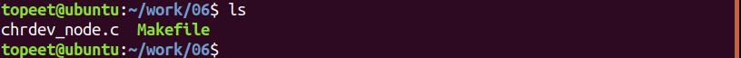
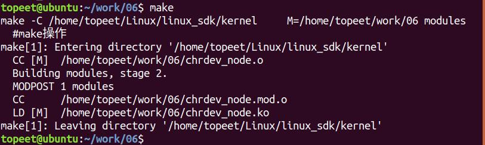
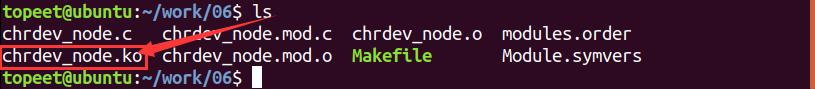

# 第018章 创建设备节点实验

## 18.1 创建设备节点
在本章节将学习如何创建设备节点。在Linux 操作系统中一切皆文件，对于用来进行设备访问的文件称之为设备节点，设备节点被创建在/dev 目录下，根据设备节点的创建方式不同，分为了手动创建设备节点和自动创建设备节点，下面分别对两种设备节点创建方式进行介绍。
### 18.1.1 手动创建设备节点
使用mknod 命令手动创建设备节点，mknod 命令格式为：mknod NAME TYPE MAJOR MINOR参数含义：NAME: 要创建的节点名称TYPE: b 表示块设备，c 表示字符设备，p 表示管道MAJOR：要链接设备的主设备号MINOR: 要链接设备的从设备号例如使用以下命令创建一个名为device_test 的字符设备节点，设备的主设备号和从设备号分别为236 和0。mknod /dev/device_test c 236 0
### 18.1.2 自动创建设备节点
自动创建设备节点是利用udev 机制来实现的。udev 通过检测系统中硬件设备状态，可以根据系统中硬件设备状态来创建或者删除设备文件。自动创建设备节点需要在驱动中首先使用class_create()函数创建一个类，创建的类位于于/sys/class/ 目录下，之后使用device_create()函数在这个类下创建相应的设备，在加载驱动模块时，用户空间中的udev 会自动响应根据并/sys/class/ 下的信息创建设备节点。下面对于自动创建节点中所用到的函数进行解释说明：class_create()函数该函数在定义在内核源码/include/linux/device.h 文件中，如代码清单18.1 所示。代码清单18.1
```c
#define class_create(owner, name)\
({\
   static struct lock_class_key __key; \
    __class_create(owner, name, &__key);\
```

```c
})
```
class_create()函数详细介绍如下:函数作用：用于动态创建设备类。参数含义：owner：struct module 结构体类型的指针。一般赋值为THIS_MODULE。name：char 类型的指针，代表即将创建的struct class 变量的名字。返回值：struct class * 类型的结构体。class_destroy()函数该函数定义在内核源码/include/linux/device.h 文件中，如代码清单18.2 所示。代码清单18.2
```c
extern void class_destroy(struct class *cls);
```
class_destroy()函数详细介绍如下：函数作用：用于删除设备类。参数含义：owner：struct module 结构体类型的指针，一般赋值为THIS_MODULE。name：char 类型的指针，代表即将创建的struct class 变量的名字。返回值：无
device_create()函数该函数定义在内核源码/include/linux/device.h 文件中，如代码清单18.3 所示。代码清单18.3
```c
1378struct device *device_create(struct class *cls, struct device *parent,
1379dev_t devt, void *drvdata,
1380const char *fmt, ...);
```
device_create()函数详细介绍如下：函数作用：用来在class 类下创建一个设备文件。参数含义：cls：指定所要创建的设备所从属的类。parent:指定该设备的父设备，如果没有就指定为NULL。devt:指定创建设备的设备号。drvdata:被添加到该设备回调的数据，没有则指定为NULL。fmt：添加到系统的设备节点名称。返回值：struct device * 类型结构体

device_destroy()函数该函数在内核源码/include/linux/device.h 文件中引用，如代码清单18.4 所示。代码清单18.4
```c
1386extern void device_destroy(struct class *cls, dev_t devt);
```
device_destroy()函数详细介绍如下：函数作用：用来删除class 类中的设备。参数含义：cls：指定所要创建的设备所从属的类。devt:指定创建设备的设备号。返回值：无至此，关于自动创建节点相关的函数就介绍完成了，会在下一小节中对于设备节点的自动创建进行相应实验程序的编写。
## 18.2 实验程序的编写
本实验代码存放在网盘iTOP-RK3568开发板\07_学习教程配套资料\03_Linux驱动配套资料\04_Linux 驱动例程\06 路径下。本实验采用自动申请设备号的方式进行设备号的申请，并对获取的主设备号与次设备号进行打印，之后对字符设备进行注册(file_operations 结构体只填充owner 字段即可，会在下个章节对file_operations 结构体进行讲解)，最后自动创建设备节点。实验代码chrdev_node.c 如代码清单18.5 所示。代码清单18.5
```c
#include <linux/init.h>
#include <linux/module.h>
#include <linux/fs.h>
#include <linux/kdev_t.h>
#include <linux/cdev.h>
static dev_t dev_num;//定义dev_t 类型变量dev_num 来表示设备号
struct cdev cdev_test;//定义struct cdev 类型结构体变量cdev_test，表示要注册的字符设备
struct file_operations cdev_fops_test = {
    .owner = THIS_MODULE,//将owner 字段指向本模块，可以避免在模块的操作正在被使用时卸载该模块
};//定义file_operations 结构体类型的变量cdev_test_ops
struct class *class_test;//定于struct class *类型结构体变量class_test，表示要创建的类
static int __init chrdev_fops_init(void)//驱动入口函数
{
    int ret;//定义int 类型的变量ret，用来对函数返回值进行判断
    int major,minor;//定义int 类型的主设备号major 和次设备号minor
```

```c
ret = alloc_chrdev_region(&dev_num,0,1,"chrdev_name");//自动获取设备号，设备名chrdev_name
if (ret< 0){
    printk("alloc_chrdev_region is error \n");
}
printk("alloc_chrdev_region is ok \n");
major = MAJOR(dev_num);//使用MAJOR()函数获取主设备号
minor = MINOR(dev_num);//使用MINOR()函数获取次设备号
printk("major is %d\n minor is %d \n",major,minor);
cdev_init(&cdev_test,&cdev_fops_test);//使用cdev_init()函数初始化cdev_test 结构体，并链接到
cdev_test_ops 结构>体
cdev_test.owner = THIS_MODULE;//将owner 字段指向本模块，可以避免在模块的操作正在被使用时卸
载该模块
ret = cdev_add(&cdev_test,dev_num,1); //使用cdev_add()函数进行字符设备的添加
if (ret < 0){
     printk("cdev_add is error \n");
}
printk("cdev_add is ok \n");
class_test= class_create(THIS_MODULE,"class_test");//使用class_create 进行类的创建，类名称为
class_test
device_create(class_test,NULL,dev_num,NULL,"device_test");//使用device_create 进行设备的创建，设备
名称为device_test
return 0;
}
static void __exit chrdev_fops_exit(void)//驱动出口函数
{
cdev_del(&cdev_test);//删除添加的字符设备cdev_test
unregister_chrdev_region(dev_num,1);//释放字符设备所申请的设备号
device_destroy(class_test,dev_num);//删除创建的设备
class_destroy(class_test);//删除创建的类
printk("module exit \n");
}
module_init(chrdev_fops_init);//注册入口函数
module_exit(chrdev_fops_exit);//注册出口函数
MODULE_LICENSE("GPL v2");//同意GPL 开源协议
MODULE_AUTHOR("topeet");//作者信息
```
代码清单18.5 在入口函数中添加了自动创建设备节点相关代码，在驱动出口函数中添相应的删除设备节点相关代码(相关代码已加粗)。需要注意的是，在进行设备节点添加时，类的创建要放在设备创建之前；在进行设备节点删除时，类的删除要放在设备删除之后。

## 18.3 运行测试
### 18.3.1 编译驱动程序
在chrdev_node.c 代码同一目录下创建Makefile 文件，如图18.1 所示。

图18.1Makefile 文件内容如代码清单18.6 所示。代码清单18.6
```c
export ARCH=arm64#设置平台架构
export CROSS_COMPILE=aarch64-linux-gnu-#交叉编译器前缀
obj-m += chrdev_node.o#此处要和你的驱动源文件同名
KDIR :=/home/topeet/Linux/linux_sdk/kernel#这里是你的内核目录
PWD ?= $(shell pwd)
all:
    make -C $(KDIR) M=$(PWD) modules#make 操作
clean:
    make -C $(KDIR) M=$(PWD) clean#make clean 操作
```
回到存放chrdev_node.c 和Makefile 文件目录下，使用命令make 编译驱动程序，编译完成如图18.2 所示。

图18.2编译完生成chrdev_node.ko 目标文件，如图18.3 所示

图18.3至此我们的驱动模块就编译成功了，下面进行驱动的运行测试。
### 18.3.2 运行测试
开发板启动之后，使用insmod cdev.ko 命令编译驱动程序，编译成如图18.4 所示：

