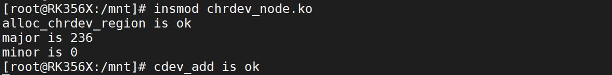
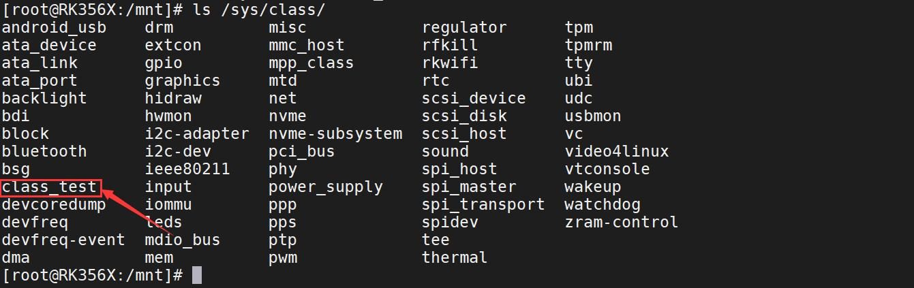
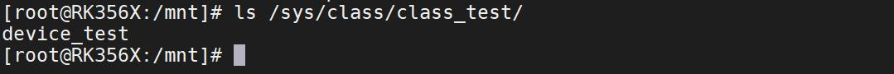
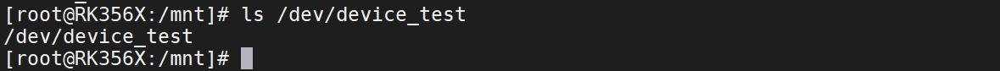
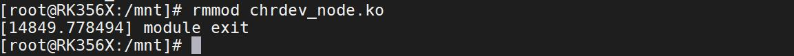
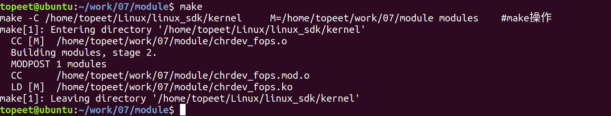
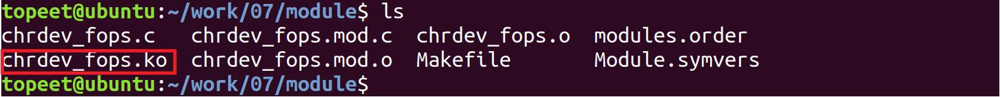
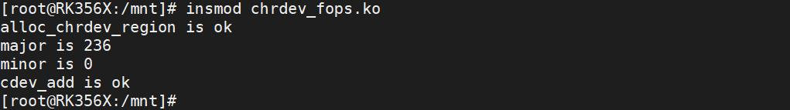

# 第019章 字符设备驱动框架实验


图18.4使用ls /sys/class/命令查看在class 目录下有无创建的class_test 类。如图18.5 所示：

图18.5通过图18.5 可以看出在驱动程序中创建的class_test 类已经被成功创建了，然后使用ls/sys/class/class_test/命令查看class 目录下的设备。如图18.6 所示。

图18.6可以看到在驱动程序中创建的名为device_test 的设备文件夹已经被成功创建，使用命令ls/dev/device_test 对查看/dev 目录，相应的设备节点也已经被自动创建了，如图18.7 所示。

图18.7使用rmmod chrdev_node.ko 命令可以卸载驱动，卸载完成如图18.8 所示。

图18.8

注册字符设备需要首先向Linux 内核申请设备号，接着使用cdev_init()函数和cdev_add()函数初始化并注册字符设备。字符设备注册成功之后，可以使用class_create()函数和device_create()函数实现自动创建设备节点。在此基础上，本章节继续对字符设备框架进行完善，主要内容为完善文件操作集中的成员。
## 19.1 文件操作集简介
struct file_operations 结构体又叫文件操作集，struct file_operations 结构体中的每一个成员都对应着一个操作函数，file_operations 结构体定义在内核源码/include/linux/fs.h 文件中，关键成员如代码清单19.1 所示。代码清单19.1
```c
struct file_operations {
    ...
    //read 函数指针用来从设备读取数据，读取成功返回读取的字节数。
    ssize_t (*read) (struct file *, char __user *, size_t, loff_t *);
    struct module *owner;
    //write 函数指针用来发送数据给设备. 写入成功返回写入的字节数。
    ssize_t (*write) (struct file *, const char __user *, size_t, loff_t *);
    //unlocked_ioctl 函数指针主要提供对于设备的控制功能。也可以实现少量的数据传输
    long (*unlocked_ioctl) (struct file *, unsigned int, unsigned long);
    //open 函数指针用于打开设备。
    int (*open) (struct inode *, struct file *);
    //执行与open 函数相反的操作
    int (*release) (struct inode *, struct file *);
    ...
}
```
下面对关键成员进行介绍。1.struct module *ownerowner 是一个指向拥有该结构的模块的指针，避免正在操作时被卸载，一般为初始化为THIS_MODULES (在<linux/module.h> 中定义的宏)2.ssize_t (*read) (struct file *, char __user *, size_t, loff_t *)read 函数指针用来从设备中同步读取数据，读取成功返回读取的字节数。当应用程序中使用read()函数操作设备节点时最终会执行驱动中file_operations 结构体里指向的read()函数。3.ssize_t (*write) (struct file *, const char __user *, size_t, loff_t *)write 函数指针用来发送数据给设备. 写入成功返回写入的字节数。当应用程序中使用write()函数操作设备节点时最终会执行驱动中file_operations 结构体里指向的write()函数。4.long (*unlocked_ioctl) (struct file *, unsigned int, unsigned long)unlocked_ioctl 函数指针提供对于设备的控制功能，当应用程序中使用ioctl()函数操作设备

节点时最终会执行驱动中file_operations 结构体里指向的ioctl()函数。5.int (*open) (struct inode *, struct file *)open 函数指针用于打开设备,与应用程序中的open 函数对应。当应用程序中使用open()函数操作设备节点时最终会执行驱动中file_operations 结构体里指向的open()函数。6.int (*release) (struct inode *, struct file *)release 函数指针在file 结构体释放时被调用。当应用程序中使用close()函数操作设备节点时最终会执行驱动中file_operations 结构体里指向的release()函数。代码清单19.2 填充了file_operations 结构体中的常用成员。代码清单19.2
```c
static struct file_operations cdev_fops_test = {
   .owner = THIS_MODULE,//将owner 字段指向本模块，可以避免在模块的操作正在被使用时卸载该模块
   .open = chrdev_open,//将open 字段指向chrdev_open(...)函数
   .read = chrdev_read,//将open 字段指向chrdev_read(...)函数
   .write = chrdev_write,//将open 字段指向chrdev_write(...)函数
   .release = chrdev_release,//将open 字段指向chrdev_release(...)函数
};//定义file_operations 结构体类型的变量cdev_test_ops
```
接下来在上一章节实验的基础上加入file_operations 结构体，并通过应用程序对字符设备驱动进行文件操作实验。
## 19.2 实验程序的编写
### 19.2.1 驱动程序编写
本实验代码存放在网盘iTOP-RK3568开发板\07_学习教程配套资料\03_Linux驱动配套资料\04_Linux 驱动例程\07\module 路径下。本章采用自动申请设备号的方式进行设备号的申请，然后对获取的主设备号与次设备号进行打印，之后对字符设备进行注册，并填充file_openration 结构体中的成员，最后自动创建设备节点。实验代码chrdev_fops.c 如代码清单19.3 所示。代码清单19.3
```c
#include <linux/init.h>
#include <linux/module.h>
#include <linux/fs.h>
#include <linux/kdev_t.h>
#include <linux/cdev.h>
static int chrdev_open(struct inode *inode, struct file *file)
{
    printk("This is chrdev_open \n");
    return 0;
```

```c
}
static ssize_t chrdev_read(struct file *file,char __user *buf, size_t size, loff_t *off)
{
    printk("This is chrdev_read \n");
    return 0;
}
static ssize_t chrdev_write(struct file *file,const char __user *buf,size_t size,loff_t *off)
{
    printk("This is chrdev_write \n");
    return 0;
}
static int chrdev_release(struct inode *inode, struct file *file)
{
    return 0;
}
static dev_t dev_num;//定义dev_t 类型变量dev_num 来表示设备号
static struct cdev cdev_test;//定义struct cdev 类型结构体变量cdev_test，表示要注册的字符设备
static struct file_operations cdev_fops_test = {
    .owner = THIS_MODULE,//将owner 字段指向本模块，可以避免在模块的操作正在被使用时卸载该模块
    .open = chrdev_open,//将open 字段指向chrdev_open(...)函数
    .read = chrdev_read,//将open 字段指向chrdev_read(...)函数
    .write = chrdev_write,//将open 字段指向chrdev_write(...)函数
    .release = chrdev_release,//将open 字段指向chrdev_release(...)函数
};//定义file_operations 结构体类型的变量cdev_test_ops
static struct class *class_test;//定于struct class *类型结构体变量class_test，表示要创建的类
static int __init chrdev_fops_init(void)//驱动入口函数
{
    int ret;//定义int 类型的变量ret，用来对函数返回值进行判断
    int major,minor;//定义int 类型的主设备号major 和次设备号minor
    ret = alloc_chrdev_region(&dev_num,0,1,"chrdev_name");//自动获取设备号，设备名chrdev_name
    if (ret< 0){
        printk("alloc_chrdev_region is error \n");
    }
    printk("alloc_chrdev_region is ok \n");
    major = MAJOR(dev_num);//使用MAJOR()函数获取主设备号
    minor = MINOR(dev_num);//使用MINOR()函数获取次设备号
    printk("major is %d\n minor is %d \n",major,minor);
    cdev_init(&cdev_test,&cdev_fops_test);//使用cdev_init()函数初始化cdev_test 结构体，并链接到
cdev_test_ops 结构体
```

```c
cdev_test.owner = THIS_MODULE;//将owner 字段指向本模块，可以避免在模块的操作正在被使用时卸
载该模块
ret = cdev_add(&cdev_test,dev_num,1); //使用cdev_add()函数进行字符设备的添加
if (ret < 0){
     printk("cdev_add is error \n");
}
printk("cdev_add is ok \n");
class_test= class_create(THIS_MODULE,"class_test");//使用class_create 进行类的创建，类名称为
class_test
device_create(class_test,NULL,dev_num,NULL,"device_test");//使用device_create 进行设备的创建，设备
名称为device_test
return 0;
}
static void __exit chrdev_fops_exit(void)//驱动出口函数
{
device_destroy(class_test,dev_num);//删除创建的设备
class_destroy(class_test);//删除创建的类
cdev_del(&cdev_test);//删除添加的字符设备cdev_test
unregister_chrdev_region(dev_num,1);//释放字符设备所申请的设备号
printk("module exit \n");
}
module_init(chrdev_fops_init);//注册入口函数
module_exit(chrdev_fops_exit);//注册出口函数
MODULE_LICENSE("GPL v2");//同意GPL 开源协议
MODULE_AUTHOR("topeet");//作者信息
```
### 19.2.2 编写测试APP
本实验实验代码存放在网盘iTOP-RK3568开发板\07_学习教程配套资料\03_Linux驱动配套资料\04_Linux 驱动例程\07\app 路径下。测试应用程序app.c 内容如代码清单19.4 所示。代码清单19.4
```c
#include <stdio.h>
#include <stdlib.h>
#include <sys/types.h>
#include <sys/stat.h>
#include <fcntl.h>
#include <unistd.h>
#include <string.h>
int main(int argc,char *argv[])
```

```c
{
    int fd;//定义int 类型的文件描述符
    char buf[32];//定义读取缓冲区buf
    fd=open(argv[1],O_RDWR,0666);//调用open 函数，打开输入的第一个参数文件，权限为可读可写
    if(fd<0){
        printf("open is error\n");
        return -1;
    }
    printf("open is ok\n");
    /*如果第二个参数为read，条件成立，调用read 函数，对文件进行读取*/
    if(!strcmp(argv[2], "read")){
        read(fd,buf,32);
        }
    /*如果第二个参数为write，条件成立，调用write 函数，对文件进行写入*/
    else if(!strcmp(argv[2], "write")){
        write(fd,"hello\n",6);
    }
    close(fd);//调用close 函数，对取消文件描述符到文件的映射
    return 0;
}
```
代码清单19.4 中第一个参数为要进行读写操作的设备节点，第二个参数为read 时，对设备节点进行读操作，第二个参数为write 时，对设备节点进行写操作。
## 19.3 运行测试
### 19.3.1 编译驱动程序
在hrdev_fops.c 代码同一目录下创建Makefile 文件，如图19.1 所示。

图19.1Makefile 文件内容如代码清单19.5 所示。代码清单19.5
```c
export ARCH=arm64#设置平台架构
export CROSS_COMPILE=aarch64-linux-gnu-#交叉编译器前缀
obj-m += chrdev_fops.o#此处要和你的驱动源文件同名
KDIR :=/home/topeet/Linux/linux_sdk/kernel#这里是你的内核目录
PWD ?= $(shell pwd)
all:
    make -C $(KDIR) M=$(PWD) modules#make 操作
clean:
    make -C $(KDIR) M=$(PWD) clean#make clean 操作
```

回到到存放chrdev_fops.c 和Makefile 文件目录下，使用命令make 编译驱动程序，编译完成图19.2 所示。

图19.2编译完生成chrdev_fops.ko 目标文件，如图19.3 所示：

图19.3至此我们的驱动模块就编译成功了，下面进行驱动的运行测试。
### 19.3.2 编译应用程序
使用aarch64-linux-gnu-gcc -o app app.c -static 命令交叉编译应用程序，编译完成如图19.4所示。

图19.4
### 19.3.3 运行测试
开发板启动之后，使用insmod chrdev_fops.ko 命令加载驱动程序，加载成功如图19.5 所示：

图19.5使用ls /dev/device_test 代码检查设备节点device_test 是否自动创建成功，创建成功如图19.6 所示。

图19.6使用./app /dev/device_test 命令运行应用程序对设备进行打开测试，如图19.7 所示：

