# 第020章 杂项设备驱动实验

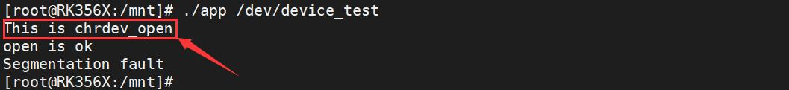
图19.7在图19.7 中可以看到“This is chrdev_open”和“open is ok”打印信息，说明应用程序运行成功，且调用了驱动程序中的open()函数，而“Segmentation fault”错误打印是因为没有对第二个参数进行传入，这里忽略即可，随后使用./app /dev/device_test read 命令对设备进行读测试，如图19.8 所示。
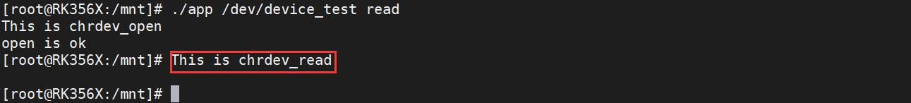
图19.8在图19.8 中可以看到“This is chrdev_read”打印信息，证明驱动程序中的read()函数被调用了,然后使用./app /dev/device_test write 命令对设备进行写测试，如图19.9 所示。
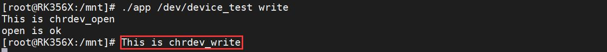
图19.9在图19.9 中可以看到“This is chrdev_write”打印信息，证明驱动程序中的write()函数被调用了。最后可以使用rmmod chrdev_fops.ko 命令卸载驱动程序，如图19.10 所示。
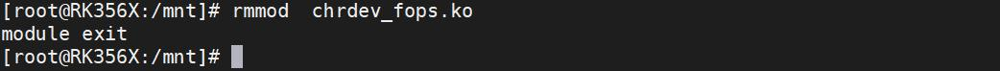
图19.10通过字符设备驱动框架，应用程序通过设备节点可以与字符设备驱动进行交互，从而实现对硬件的操作。
杂项设备属于特殊的一种字符型设备，是对字符设备的一种封装，本质也是字符设备。
## 20.1 杂项设备驱动简介
在Linux 中，把无法归类的五花八门的设备定义成杂项设备。相较于字符设备，杂项设备有以下两个优点:(1)节省主设备号:杂项设备的主设备号固定为10，当系统中注册了多个杂项设备驱动时，只需使用子设备号进行区分即可。而字符设备不管是动态分配还是静态分配设备号，都会消耗

一个主设备号，进而造成了主设备号浪费。(2)使用简单：杂项设备驱动本身包含创建设备节点操作，不需要额外使用class_create()函数和device_create()函数实现自动创建设备节点操作。只需要填充驱动中的file_operations 结构体中的成员即可。在驱动中使用miscdevice 结构体描杂项设备，该结构体定义在内核源码/include/linux/miscdevice.h 文件中（在下面的实验代码中需要加入该头文件的引用），如代码清单20.1 所示。代码清单20.1
```c
struct miscdevice{
    int minor; /* 子设备号需要用户填写*/
    const char *name;/* 设备名需要用户填写*/
    const struct file_operations *fops;/* 设备操作集需要用户填写*/
    struct list_head list;
    struct device *parent;
    struct device *this_device;
    const struct attribute_group **groups;
    const char *nodename;
    umode_t mode;
};
```
定义一个杂项设备，一般只需要填充miscdevice 结构体中minor、name、fops 这三个成员变量。其中杂项指次设备号，可以从内核源码/include/linux/miscdevice.h 文件中预定义的次设备号挑选，也可以自行定义子设备号（没有被其他设备使用即可），通常情况下将该参数设置为MISC_DYNAMIC_MINOR，表示自动分配子设备号。name 表示杂项设备的名字。也就是杂项设备驱动注册成功之后，会在dev 目录下生成名为name 的设备节点。fops 指向了file_operations 的结构体，表示文件操作集。
## 20.2 杂项设备的注册和卸载
不同于字符设备的注册和卸载的繁琐，杂项设备的注册可以直接使用函数misc_register()函数来完成，杂项设备的卸载可以直接使用misc_deregister()函数来完成。上述两个函数均定义在内核源码/include/linux/miscdevice.h 文件当中。1.杂项设备注册函数介绍函数原型：int misc_register(struct miscdevice *misc)函数作用：基于misc_class 构造一个设备，将miscdevice 结构挂载到misc_list 列表上，并初始化与linux设备模型相关的结构。进而起到杂项设备注册的作用。

参数含义：misc: 杂项设备的结构体指针函数返回值：申请成功返回0，申请失败返回负数2.杂项设备卸载函数介绍函数原型：int misc_deregister(struct miscdevice *misc)函数作用：从mist_list 中删除miscdevice，进而起到杂项设备卸载的作用。参数含义：misc: 杂项设备的结构体指针函数返回值：卸载成功返回0，申请失败返回负数
## 20.3 杂项设备驱动框架
杂项驱动驱动框架如代码清单20.2 所示。代码清单20.2
```c
static struct file_operations xxx_fops{
    .owner = THIS_MODULE,
    .read = xxx_read,
......
};
struct miscdevice xxx_dev{
    .minor = MISC_DYNAMIC_MINOR,
    .name = "xxx",
    .fops = &xxx_fops
};
static int __init xxx_init(void)//驱动入口函数
{
    int ret;
    printk(KERN_EMERG "xxx_init\r\n");
    ret = misc_register(&xxx_dev);//注册杂项设备
    if(ret<0)
    {
         printk( "misc_register failed\r\n");
    }
    printk( "misc_register ok\r\n");
    return 0;
```

```c
}
static void __exit xxx_exit(void)//驱动出口函数
{
    printk(KERN_EMERG "xxx_exit\r\n");
    misc_deregister(&xxx_dev);//卸载杂项设备
}
module_init(xxx_init);//注册入口函数
module_exit(xxx_exit);
MODULE_LICENSE("GPL");
MODULE_AUTHOR("topeet");
```
## 20.4 实验程序的编写
本实验代码存放在网盘iTOP-RK3568开发板\07_学习教程配套资料\03_Linux驱动配套资料\04_Linux 驱动例程\08 路径下。本小节将编写最简单的杂项设备驱动，在驱动入口函数中通过misc_register()函数注册杂项设备驱动，在驱动出口函数中通过misc_deregister()函数注销杂项设备驱动。实验代码miscdevice.c 内容如代码清单20.3 所示。代码清单20.3
```c
#include <linux/init.h>//初始化头文件
#include <linux/module.h>//最基本的文件，支持动态添加和卸载模块。
#include <linux/miscdevice.h>//注册杂项设备头文件
#include <linux/fs.h>//注册设备节点的文件结构体
struct file_operations misc_fops = { //文件操作集
    .owner = THIS_MODULE ////将owner 字段指向本模块，可以避免在模块的操作正在被使用时卸载该模
};
struct miscdevice misc_dev = {//杂项设备结构体
    .minor = MISC_DYNAMIC_MINOR,//动态申请的次设备号
    .name = "test",//杂项设备名字是test
    .fops = &misc_fops,//文件操作集
    };
static int __init misc_init(void)
{
    int ret;
    ret = misc_register(&misc_dev); //在初始化函数中注册杂项设备
    if (ret < 0)
    {
        printk("misc registe is error \n"); //打印注册杂项设备失败
    }
    printk("misc registe is succeed \n");//打印注册杂项设备成功
```

```c
return 0;
}
static void __exit misc_exit(void)
{
misc_deregister(&misc_dev);//在卸载函数中注销杂项设备
printk(" misc goodbye! \n");
}
module_init(misc_init);
module_exit(misc_exit);
MODULE_LICENSE("GPL");
MODULE_AUTHOR("topeet");
```
## 20.5 运行测试
### 20.5.1 编译驱动程序
在miscdevice.c 代码同一目录下创建Makefile 文件，如图20.1 所示。
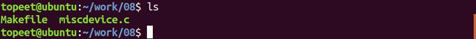
图20.1Makefile 文件内容如代码清单20.4 所示代码清单20.4
```c
export ARCH=arm64#设置平台架构
export CROSS_COMPILE=aarch64-linux-gnu-#交叉编译器前缀
obj-m += miscdevice.o#此处要和你的驱动源文件同名
KDIR :=/home/topeet/Linux/linux_sdk/kernel#这里是你的内核目录
PWD ?= $(shell pwd)
all:
    make -C $(KDIR) M=$(PWD) modules#make 操作
clean:
    make -C $(KDIR) M=$(PWD) clean#make clean 操作
```
回到存放miscdevice.c 和Makefile 文件目录下使用命令make 编译驱动程序，编译完成如图20.2 所示。

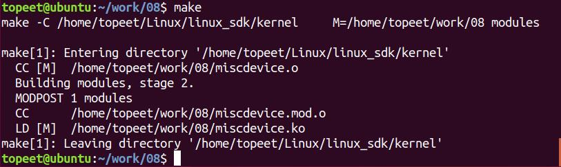
图20.2编译完生成miscdevice.ko 目标文件，如图20.3 所示。
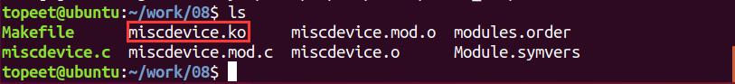
图20.3至此我们的驱动模块就编译成功了，下面进行驱动的运行测试。
### 20.5.2 运行测试
将编译生成的驱动模块miscdevice.ko 拷贝到开发板上，输入insmod miscdevice.ko 命令加载驱动模块。
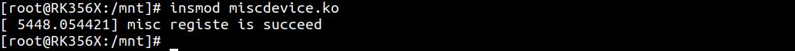
图20.4在图20.4 中可以看到驱动加载之后，打印“misc registe is succeed”,说明杂项设备驱动注册成功。输入lsmod 命令查看加载的驱动模块，驱动加载成功如图20.5 所示。
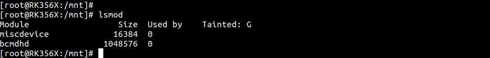
图20.5然后来到/sys/class/misc 目录下，可以看到名为test 的设备已经被创建了，在/sys/class/misc目录下有杂项类的所有设备，每个注册的杂项设备在路径下对应一个文件夹目录，如图20.6、20.7 所示。
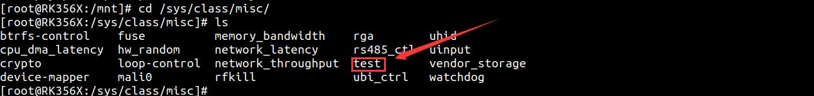
图20.6

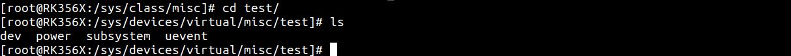
图20.7驱动加载成功之后会生成/dev/test 设备驱动文件，输入ls /dev/test -al 命令可以查看是否有该设备节点以及杂项设备的主次设备号。如图20.8 所示。
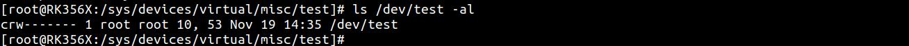
图20.8从图20.8 中可以看出，/dev/test 设备节点已经创建成功，并且杂项设备的主设备号为10，次设备号为53。最后使用rmmod miscdevice.ko 命令可以卸载驱动程序，卸载完成如图20.9 所示。
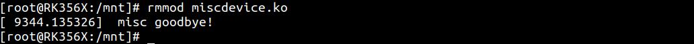
图20.9

