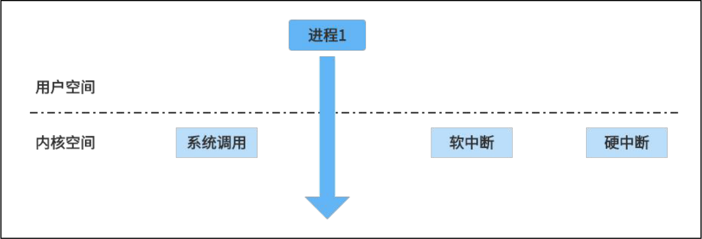
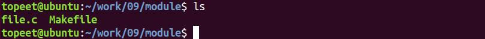
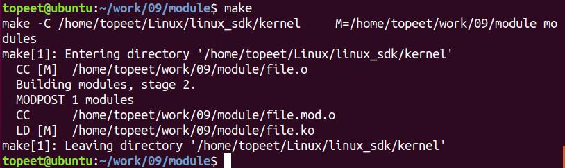
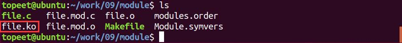
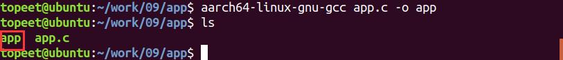
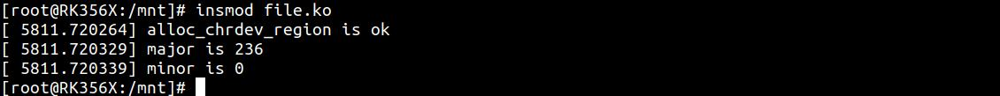
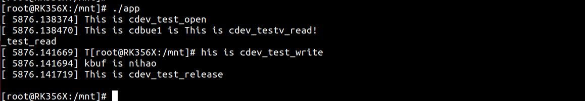

# 第021章 内核空间与用户空间数据交互实验

在字符设备驱动框架实验中对file_operations 结构体的进行了填充，例如read()、write()函数等，不过并没有真正实现读写功能，只是打印了相应信息，本章节学习内核空间与用户空间的数据交换，从而实现应用空间与内核空间数据交互功能。
## 21.1 内核空间与用户空间
Linux 系统将虚拟地址分成了两个部分，一部分是内核空间，一部分是用户空间。操作系统和驱动程序运行在内核空间，应用程序运行在用户空间。当进程运行在内核空间时就处于内核态，当进程运行在用户空间就处于用户态。那么为什么要区分用户空间和内核空间呢？（1）内核空间中的代码控制了硬件资源，用户空间中的代码只能通过内核暴露的系统调用接口来使用系统中的硬件资源，这样的设计可以保证操作系统自身的安全性和稳定性。（2）从另一方面来说，内核空间的代码更偏向于系统管理，而用户空间中的代码更偏重业务逻辑实现，俩者的分工不同。硬件资源管理都是在内核空间完成的，应用程序无法直接对硬件进行操作，只能通过调用相应的内核接口来完成相应的操作。比如应用程序要对磁盘上的一个文件进行读取，应用程序可以向内核发起一个“系统调用”申请——我要读取磁盘上的文件。这个过程其实是通过一个特殊的指令让进程从用户态进入到了内核态。在内核空间中，CPU 可以执行任何命令，包括从磁盘上读取数据，具体过程是先把数据读取到内核空间中，然后再把数据拷贝到用户空间并从内核态切换到用户态。此时应用程序已经从系统调用中返回并拿到了想要的数据，可以继续往下执行了。进程只有从用户空间切换到内核空间才可以使用系统的硬件资源，切换的方式有三种：系统调用，软中断，硬中断，如图21.1 所示所示。


图21.1
## 21.2 用户空间和内核空间数据交换
内核空间和用户空间的内存是不能互相访问的。但是很多应用程序都需要和内核进行数据的交换，例如应用程序使用read()函数从驱动中读取数据，使用write()函数向驱动中写数据，上述功能就需要使用copy_from_user()和copy_to_user()俩个函数来完成。copy_from_user()函数是将用户空间的数据拷贝到内核空间。copy_to_user()函数是将内核空间的数据拷贝到用户空间。这俩个函数定义在了kernel/include/linux/uaccess.h 文件下，如下所示：1.copy_to_user()函数函数原型：unsigned long copy_to_user_inatomic(void __user *to, const void *from, unsigned long n);函数作用：把内核空间的数据复制到用户空间。参数含义：*to 是用户空间的指针*from 是内核空间的指针n 是从内核空间向用户空间拷贝的字节数2.copy_from_user()函数函数原型：unsigned long copy_from_user(void *to, const void __user *from, unsigned long n)函数作用：把用户空间的数据复制到内核空间。参数含义：

*to 是内核空间的指针*from 是用户空间的指针n 是从用户空间向内核空间拷贝的字节数
## 21.3 实验程序编写
### 21.3.1 驱动程序编写
本实验代码存放在网盘iTOP-RK3568 开发板\07_学习教程配套资料\03_Linux 驱动配套资料\04_Linux 驱动例程\09\module 路径下。本实验以字符设备驱动框架实验为基础，使用copy_to_user()函数和copy_from_user()函数实现内核空间和用户空间互传数据的功能，实验代码file.c 如代码清单21.1 所示。代码清单21.1
```c
#include <linux/init.h>
#include <linux/module.h>
#include <linux/kdev_t.h>
#include <linux/fs.h>
#include <linux/cdev.h>
#include <linux/uaccess.h>
static dev_t dev_num;//设备号
static int major = 0;//主设备号
static int minor = 0;//次设备号
struct cdev cdev_test; // cdev
struct class *class;//类
struct device *device;//设备
    /*打开设备函数*/
static int cdev_test_open(struct inode *inode, struct file *file)
{
    printk("This is cdev_test_open\r\n");
    return 0;
}
/*向设备写入数据函数*/
static ssize_t cdev_test_write(struct file *file, const char __user *buf, size_t size, loff_t *off)
{
    /*本章实验重点******/
    char kbuf[32] = {0};//定义写入缓存区kbuf
    if (copy_from_user(kbuf, buf, size) != 0) // copy_from_user:用户空间向内核空间传数据
    {
```

```c
printk("copy_from_user error\r\n");//打印copy_from_user 函数执行失败
return -1;
}
printk("This is cdev_test_write\r\n");
printk("kbuf is %s\r\n", kbuf);
return 0;
}
/*从设备读取数据*/
static ssize_t cdev_test_read(struct file *file, char __user *buf, size_t size, loff_t *off)
{
/*本章实验重点******/
char kbuf[32] = "This is cdev_test_read!";//定义内核空间数据
// copy_to_user:内核空间向用户空间传数据
if (copy_to_user(buf, kbuf, strlen(kbuf)) != 0){
printk("copy_to_user error\r\n"); //打印copy_to_user 函数执行失败
return -1;
}
printk("This is cdev_test_read\r\n");
return 0;
}
static int cdev_test_release(struct inode *inode, struct file *file)
{
printk("This is cdev_test_release\r\n");
return 0;
}
/*设备操作函数，定义file_operations 结构体类型的变量cdev_test_fops*/
struct file_operations cdev_test_fops = {
.owner = THIS_MODULE, //将owner 字段指向本模块，可以避免在模块的操作正在被使用时卸载该模
块
.open = cdev_test_open, //将open 字段指向chrdev_open(...)函数
.read = cdev_test_read,//将open 字段指向chrdev_read(...)函数
.write = cdev_test_write, //将open 字段指向chrdev_write(...)函数
.release = cdev_test_release, //将open 字段指向chrdev_release(...)函数
};
static int __init chr_fops_init(void) //驱动入口函数
{
/*注册字符设备驱动*/
int ret;
/*1 创建设备号*/
//动态分配设备号
```

```c
ret = alloc_chrdev_region(&dev_num, 0, 1, "alloc_name");if (ret < 0)
{
    printk("alloc_chrdev_region is error\n");//打印动态分配设备号失败
}
printk("alloc_chrdev_region is ok\n");
major = MAJOR(dev_num); //获取主设备号
minor = MINOR(dev_num); //获取次设备号
printk("major is %d \r\n", major); //打印主设备号
printk("minor is %d \r\n", minor); //打印次设备号
 /*2 初始化cdev*/
cdev_test.owner = THIS_MODULE;
cdev_init(&cdev_test, &cdev_test_fops);
/*3 添加一个cdev,完成字符设备注册到内核*/
cdev_add(&cdev_test, dev_num, 1);
/*4 创建类*/
class = class_create(THIS_MODULE, "test");
/*5创建设备*/
device = device_create(class, NULL, dev_num, NULL, "test");
return 0;
}
static void __exit chr_fops_exit(void) //驱动出口函数
{
/*注销字符设备*/
unregister_chrdev_region(dev_num, 1); //注销设备号
cdev_del(&cdev_test);//删除cdev
device_destroy(class, dev_num);//删除设备
class_destroy(class);//删除类
}
module_init(chr_fops_init);//注册入口函数
module_exit(chr_fops_exit);//注册出口函数
MODULE_LICENSE("GPL v2");
MODULE_AUTHOR("topeet");
```
代码清单21.1 中在cdev_test_read()函数中使用copy_to_user()函数将内核数据拷贝到用户空间，在cdev_test_write()函数中使用copy_from_user()函数将用户空间数据拷贝到内核空间。
### 21.3.2 编写测试APP
本实验代码存放在iTOP-RK3568 开发板\07_学习教程配套资料\03_Linux 驱动配套资料

\04_Linux 驱动例程\09\app 路径下。实验代码app.c 应用程序如代码清单21.2 所示。代码清单21.2
```c
#include <stdio.h>
#include <sys/types.h>
#include <sys/stat.h>
#include <fcntl.h>
#include <unistd.h>
int main(int argc, char *argv[])//主函数
{
    int fd;//定义int 类型的文件描述符
    char buf1[32] = {0}; //定义读取缓存区buf1
    char buf2[32] = "nihao"; //定义写入缓存区buf2
    fd = open("/dev/test", O_RDWR);//打开字符设备驱动
    if (fd < 0)
    {
        perror("open error \n");
        return fd;
    }
    read(fd, buf1, sizeof(buf1));//从/dev/test 文件读取数据
    printf("buf1 is %s \r\n", buf1); //打印读取的数据
    write(fd,buf2,sizeof(buf2));//向/dev/test 文件写入数据
    close(fd);
    return 0;
}
```
## 21.4 运行测试
### 21.4.1 编译驱动程序
在file.c 代码同一目录下创建Makefile 文件，如图21.2 所示。

图21.2Makefile 文件内容如代码清单21.3 所示。代码清单21.3
```c
export ARCH=arm64#设置平台架构
export CROSS_COMPILE=aarch64-linux-gnu-#交叉编译器前缀
obj-m +=file.o#此处要和你的驱动源文件同名
```

```c
KDIR :=/home/topeet/Linux/linux_sdk/kernel#这里是你的内核目录
PWD ?= $(shell pwd)
all:
    make -C $(KDIR) M=$(PWD) modules#make 操作
clean:
    make -C $(KDIR) M=$(PWD) clean#make clean 操作
```
回到存放file.c 和Makefile 文件目录下，使用命令make 编译驱动程序，编译完成如图21.3所示。

图21.3编译完生成file.ko 目标文件，如图21.4 所示：

图21.4至此我们的驱动模块就编译成功了，下面进行应用程序编译.
### 21.4.2 编译应用程序
使用aarch64-linux-gnu-gcc app.c -o app 命令交叉编译应用程序，编译成功如图21.5 所示。

图21.5下面进行驱动程序的测试。
### 21.4.3 运行测试
驱动模块file.ko 和测试程序app 拷贝到开发板上以后，输入insmod file.ko 命令加载驱动程序，如图21.6 所示。


图21.6运行应用程序，如果运行成功打印信息如图21.7 所示。

图21.7由图21.7 可知，打印“This is cdev_test_open”信息说明成功打开了字符设备驱动。打印“ This is cdev_test_read”和“buf1 is This is cdev_test_read!”说明应用程序成功读取到内核的数据。打印“This is cdev_test_write”和“kbuf is nihao”说明应用程序向内核写数据成功。最后打印“This is cdev_test_release”执行了驱动中release 函数。

