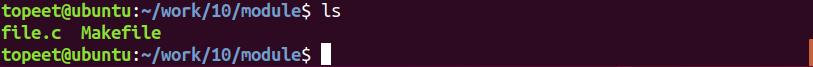
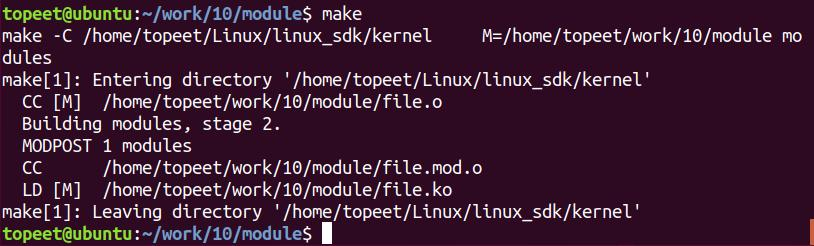
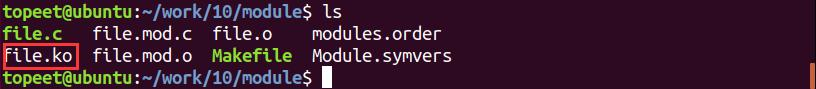
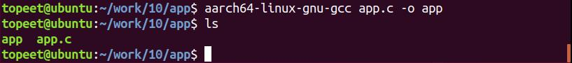
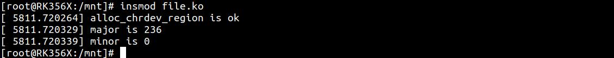
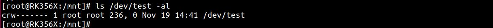
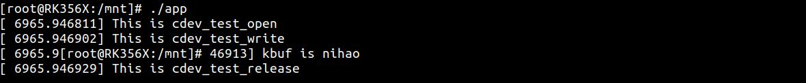

# 第022章 文件私有数据实验

通常在驱动开发中会为设备自定义设备结构体并将设备结构体设置为文件私有数据。设备结构体用来存放硬件相关信息，如设备号、类、设备名称等。
## 22.1 文件私有数据简介
Linux 中并没有明确规定要必须要使用文件私有数据，但是在linux 驱动源码中随处可见文件私有数据，因此可以认为使用文件私有数据是Linux 驱动遵循的“潜规则”，实际上文件私有数据也体现了Linux 面向对象的思想。在struct file 结构体中专门为用户留了一个成员用于定义私有数据。如代码清单22.1 所示。代码清单22.1
```c
struct file {
    union {
        struct llist_nodefu_llist;
        struct rcu_headfu_rcuhead;
    } f_u;
    struct pathf_path;
    struct inode*f_inode; /* cached value */
    const struct file_operations*f_op;
    /*
     * Protects f_ep_links, f_flags.
     * Must not be taken from IRQ context.
     */
    spinlock_tf_lock;
    enum rw_hintf_write_hint;
    atomic_long_tf_count;
    unsigned intf_flags;
    fmode_tf_mode;
    struct mutexf_pos_lock;
    loff_tf_pos;
    struct fown_structf_owner;
    const struct cred*f_cred;
    struct file_ra_state f_ra;
    u64f_version;
#ifdef CONFIG_SECURITY
    void*f_security;
#endif
    /* needed for tty driver, and maybe others */
```

void*private_data;//私有数据
```c
#ifdef CONFIG_EPOLL
    /* Used by fs/eventpoll.c to link all the hooks to this file */
    struct list_headf_ep_links;
    struct list_headf_tfile_llink;
#endif /* #ifdef CONFIG_EPOLL */
    struct address_space*f_mapping;
    errseq_tf_wb_err;
}
```
在使用时一般将设备结构体指向file 结构体中private_data 成员，此时设备结构体就变成了文件私有数据。对file 结构体中private_data 成员赋值一般是在文件操作集中的open() 函数中赋值。然后通file 结构体可以将私有数据一路从open()函数带到read(), write()函数。接着就是可以在read()、write()函数中使用文件私有数据。代码清单22.2 是在文件操作集中的open()函数中把设备结构体dev1 作为私有数据指向file结构体中private_data 成员。代码清单22.2
```c
struct device_test dev1;
static int cdev_test_open(struct inode *inode,struct file *file){
    file->private_data=&dev1;
    return 0;
};
```
接着在在read() write()函数中便可以通过private_data 成员访问设备结构体，如代码清单22.3 所示。代码清单22.3
```c
static ssize_t cdev_test_write(struct file *file,const char _user *buf, size_t size,loff_t *off_t){
  struct device_test *test_dev=(struct device_test *)file->private_data;
  return 0;
}
```
有的同学可能会有疑问，直接把设备结构体定义成全局变量不就可以了，使用文件私有数据不是多此一举吗？多个相同类型的设备经常会共用同一个驱动。如果使用全局变量存储设备结构体则会导致不同进程间数据冲突。这时使用文件私有数据可以防止不同设备间的数据互相干扰，即在对每个设备进行操作时，每个设备都申请自己的私有数据。这样在操作设备时不会产生数据冲突。

## 22.2 实验程序编写
### 22.2.1 驱动程序编写
本实验代码存放在网盘iTOP-RK3568 开发板\07_学习教程配套资料\03_Linux 驱动配套资料\04_Linux 驱动例程\10\module 路径下。本实验在open()函数中对私有数据结构体赋值，在write()函数中使用文件私有数据。如代码清单22.4 所示。代码清单22.4
```c
#include <linux/init.h>
#include <linux/module.h>
#include <linux/kdev_t.h>
#include <linux/fs.h>
#include <linux/cdev.h>
#include <linux/uaccess.h>
struct device_test{
    dev_t dev_num;//设备号
     int major ;//主设备号
    int minor ;//次设备号
    struct cdev cdev_test;// cdev
    struct class *class;//类
    struct device *device;//设备
    char kbuf[32];//缓存区buf
};
structdevice_test dev1;//定义一个device_test 结构体变量
/*打开设备函数*/
static int cdev_test_open(struct inode *inode, struct file *file)
{
    file->private_data=&dev1;//设置私有数据
    printk("This is cdev_test_open\r\n");
    return 0;
}
    /*向设备写入数据函数*/
static ssize_t cdev_test_write(struct file *file, const char __user *buf, size_t size, loff_t *off)
{
     struct device_test *test_dev=(struct device_test *)file->private_data; //在write 函数中读取
```

```c
private_data
    if (copy_from_user(test_dev->kbuf, buf, size) != 0) // copy_from_user:用户空间向内核空间传数据
    {
        printk("copy_from_user error\r\n");
        return -1;
    }
    printk("This is cdev_test_write\r\n");
    printk("kbuf is %s\r\n", test_dev->kbuf); //打印kbuf 的值
    return 0;
}
/**从设备读取数据*/
static ssize_t cdev_test_read(struct file *file, char __user *buf, size_t size, loff_t *off)
{
    struct device_test *test_dev=(struct device_test *)file->private_data;
    if (copy_to_user(buf, test_dev->kbuf, strlen( test_dev->kbuf)) != 0) // copy_to_user:内核空间向用户空
间传数据
    {
        printk("copy_to_user error\r\n");
        return -1;
    }
    printk("This is cdev_test_read\r\n");
    return 0;
}
static int cdev_test_release(struct inode *inode, struct file *file)
{
    printk("This is cdev_test_release\r\n");
    return 0;
}
/*设备操作函数*/
struct file_operations cdev_test_fops = {
    .owner = THIS_MODULE,//将owner 字段指向本模块，可以避免在模块的操作正在被使用
时卸载该模块
    .open = cdev_test_open,//将open 字段指向chrdev_open(...)函数
    .read = cdev_test_read,//将open 字段指向chrdev_read(...)函数
    .write = cdev_test_write,//将open 字段指向chrdev_write(...)函数
    .release = cdev_test_release,//将open 字段指向chrdev_release(...)函数
};
```

```c
static int __init chr_fops_init(void) //驱动入口函数
{
    /*注册字符设备驱动*/
    int ret;
    /*1 创建设备号*/
    ret = alloc_chrdev_region(&dev1.dev_num, 0, 1, "alloc_name"); //动态分配设备号
    if (ret < 0)
    {
        printk("alloc_chrdev_region is error\n");
    }
    printk("alloc_chrdev_region is ok\n");
    dev1.major = MAJOR(dev1.dev_num); //获取主设备号
    dev1.minor = MINOR(dev1.dev_num); //获取次设备号
    printk("major is %d \r\n", dev1.major); //打印主设备号
    printk("minor is %d \r\n", dev1.minor); //打印次设备号
     /*2 初始化cdev*/
    dev1.cdev_test.owner = THIS_MODULE;
    cdev_init(&dev1.cdev_test, &cdev_test_fops);
    /*3 添加一个cdev,完成字符设备注册到内核*/
    cdev_add(&dev1.cdev_test, dev1.dev_num, 1);
    /*4 创建类*/
    dev1. class = class_create(THIS_MODULE, "test");
    /*创建设备*/
    dev1.device = device_create(dev1.class, NULL, dev1.dev_num, NULL, "test");
    return 0;
}
static void __exit chr_fops_exit(void) //驱动出口函数
{
    /*注销字符设备*/
    unregister_chrdev_region(dev1.dev_num, 1); //注销设备号
    cdev_del(&dev1.cdev_test);//删除cdev
    device_destroy(dev1.class, dev1.dev_num);//删除设备
    class_destroy(dev1.class);//删除类
}
module_init(chr_fops_init);
module_exit(chr_fops_exit);
MODULE_LICENSE("GPL v2");
```

```c
MODULE_AUTHOR("topeet");
```
### 22.2.2 编写测试APP
本实验代码存放在网盘iTOP-RK3568 开发板\07_学习教程配套资料\03_Linux 驱动配套资料\04_Linux 驱动例程\10\app 路径下。在应用程序中通过设备节点向设备写入数据，应用程序app.c 如代码清单22.5 所示：代码清单22.5
```c
#include <stdio.h>
#include <sys/types.h>
#include <sys/stat.h>
#include <fcntl.h>
#include <unistd.h>
int main(int argc, char *argv[]) //主函数
{
    int fd;
    char buf1[32] = "nihao";//定义写入缓存区buf1
    fd = open("/dev/test", O_RDWR); //打开/dev/test 设备
    if (fd < 0)
    {
        perror("open error \n");
        return fd;
    }
    write(fd,buf1,sizeof(buf1)); //向/dev/test 设备写入数据
    close(fd);
    return 0;
}
```
## 22.3 运行测试
### 22.3.1 编译驱动程序
在上一小节中的file.c 代码同一目录下创建Makefile 文件，如图22.1 所示。


图22.1Makefile 文件内容如下代码清单22.6 所示：代码清单22.6
```c
export ARCH=arm64#设置平台架构
export CROSS_COMPILE=aarch64-linux-gnu-#交叉编译器前缀
obj-m += file.o#此处要和你的驱动源文件同名
KDIR :=/home/topeet/Linux/linux_sdk/kernel#这里是你的内核目录
PWD ?= $(shell pwd)
all:
    make -C $(KDIR) M=$(PWD) modules#make 操作
clean:
    make -C $(KDIR) M=$(PWD) clean#make clean 操作
```
然后使用命令make 编译驱动程序，编译完成如图22.2 所示。

图22.2编译完生成file.ko 目标文件，如图22.3 所示

图22.3至此我们的驱动模块就编译成功了，下面进行应用程序编译，
### 22.3.2 编译应用程序
使用命令aarch64-linux-gnu-gcc app.c -o app 交叉编译应用程序，编译完成以后会生成一个名为app 的可执行程序，如图22.4 所示。


图22.4下面进行驱动程序的测试。
### 22.3.3 运行测试
把驱动模块file.ko 和测试程序app 拷贝到开发板上，输入insmod file.ko 命令加载驱动程序。如图22.5 所示。

图22.5驱动加载成功之后使用命令ls /dev/test -al 可以看到生成的/dev/test 设备节点，如图22.6 所示。

图22.6接着运行应用程序，如图22.7 所示：

图22.7通过图22.7 中打印信息可看出将硬件属性的信息全部放在设备结构体并将其设置成私有数据后，在write()中通过文件私有数据获取设备设依然可以实现字符设备的写操作。

