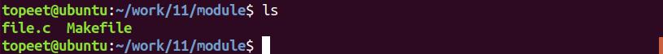
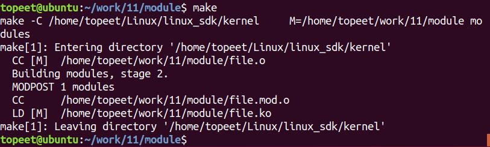
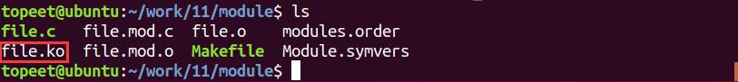
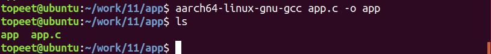
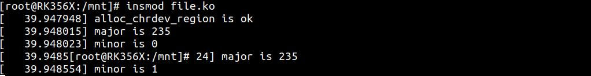
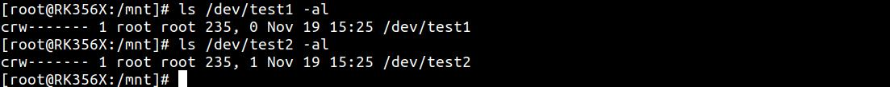
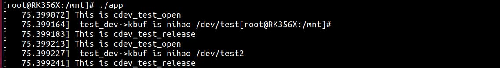

# 第023章 一个驱动兼容不同设备实验

在Linux 中，使用主设备号来表示某一类驱动，使用次设备号来表示这类驱动下的各个设备。假如现在驱动要支持主设备号相同，但是次设备号不同的设备。驱动程序要怎样编写呢，此时文件私有数据就派上了用场，具体是怎样使用的呢，多个设备是如何在一个驱动中兼容的呢，带着疑问，让我们开始本章节的学习吧。
## 23.1 container_of 函数简介
container_of()函数可以通过结构体变量中某个成员的首地址进而获得整个结构体变量的首地址。container_of()函数介绍如下：函数原型：container_of(ptr,type,member)函数作用：通过结构体变量中某个成员的首地址获取到整个结构体变量的首地址。参数含义：ptr 是结构体变量中某个成员的地址。type 是结构体的类型member 是该结构体变量的具体名字
## 23.2 实验程序编写
### 23.2.1 驱动程序编写
本实验程序存放在网盘iTOP-RK3568 开发板\07_学习教程配套资料\03_Linux 驱动配套资料\04_Linux 驱动例程\11\module 路径下。本章实验编写一个驱动兼容不同设备的实例代码，其代码如代码清单23.1 所示：

代码清单23.1
```c
#include <linux/init.h>
#include <linux/module.h>
#include <linux/kdev_t.h>
#include <linux/fs.h>
#include <linux/cdev.h>
#include <linux/uaccess.h>
//设备结构体
struct device_test
{
    dev_t dev_num;//设备号
    int major;//主设备号
    int minor;//次设备号
    struct cdev cdev_test;// cdev
    struct class *class;//类
    struct device *device;//设备
    char kbuf[32];//定义缓冲区kbuf
};
struct device_test dev1;//定义一个device_test 结构体变量dev1
struct device_test dev2;//定义一个device_test 结构体变量dev2
/*打开设备函数*/
static int cdev_test_open(struct inode *inode, struct file *file)
{
    dev1.minor = 0;//设置dev1 的次设备号为0
    dev2.minor = 1;//设置dev2 的次设备号为1
//inode->i_rdev 为该inode 的设备号，使用container_of 函数找到结构体变量dev1 dev2 的地址
//然后设置私有数据
    file->private_data = container_of(inode->i_cdev, struct device_test, cdev_test);
    printk("This is cdev_test_open\r\n");
    return 0;
}
/*向设备写入数据函数*/
static ssize_t cdev_test_write(struct file *file, const char __user *buf, size_t size, loff_t *off)
{
    struct device_test *test_dev = (struct device_test *)file->private_data;
    //如果次设备号是0，则为dev1
    if (test_dev->minor == 0)
    {
```

```c
if (copy_from_user(test_dev->kbuf, buf, size) != 0) // copy_from_user:用户空间向内核空间传数据
{
    printk("copy_from_user error\r\n");
    return -1;
}
printk(" test_dev->kbuf is %s\r\n", test_dev->kbuf);
}
//如果次设备号是1，则为dev2
else if(test_dev->minor == 1)
{
if (copy_from_user(test_dev->kbuf, buf, size) != 0) // copy_from_user:用户空间向内核空间传数据
{
    printk("copy_from_user error\r\n");
    return -1;
}
printk(" test_dev->kbuf is %s\r\n", test_dev->kbuf);
}
return 0;
}
/**从设备读取数据*/
static ssize_t cdev_test_read(struct file *file, char __user *buf, size_t size, loff_t *off)
{
struct device_test *test_dev = (struct device_test *)file->private_data;
if (copy_to_user(buf, test_dev->kbuf, strlen(test_dev->kbuf)) != 0) // copy_to_user:内核空间向用户空间
传数据
{
printk("copy_to_user error\r\n");
return -1;
}
printk("This is cdev_test_read\r\n");
return 0;
}
static int cdev_test_release(struct inode *inode, struct file *file)
{
printk("This is cdev_test_release\r\n");
return 0;
}
/*设备操作函数,定义file_operations 结构体类型的变量cdev_test_fops*/
struct file_operations cdev_test_fops = {
```

```c
.owner = THIS_MODULE, //将owner 字段指向本模块，可以避免在模块的操作正在被使用时卸载该模
块
.open = cdev_test_open, //将open 字段指向chrdev_open(...)函数
.read = cdev_test_read, //将open 字段指向chrdev_read(...)函数
.write = cdev_test_write, //将open 字段指向chrdev_write(...)函数
.release = cdev_test_release, //将open 字段指向chrdev_release(...)函数
};
static int __init chr_fops_init(void) //驱动入口函数
{
/*注册字符设备驱动*/
int ret;
/*1 创建设备号,,这里注册2 个设备号*/
ret = alloc_chrdev_region(&dev1.dev_num, 0, 2, "alloc_name"); //动态分配设备号
if (ret < 0)
{
    printk("alloc_chrdev_region is error\n");
}
printk("alloc_chrdev_region is ok\n");
dev1.major = MAJOR(dev1.dev_num); //获取主设备号
dev1.minor = MINOR(dev1.dev_num); //获取次设备号
printk("major is %d \r\n", dev1.major); //打印主设备号
printk("minor is %d \r\n", dev1.minor); //打印次设备号
//对设备1 进行操作
/*2 初始化cdev*/
dev1.cdev_test.owner = THIS_MODULE;
cdev_init(&dev1.cdev_test, &cdev_test_fops);
/*3 添加一个cdev,完成字符设备注册到内核*/
cdev_add(&dev1.cdev_test, dev1.dev_num, 1);
/*4 创建类*/
dev1.class = class_create(THIS_MODULE, "test1");
/*5 创建设备*/
dev1.device = device_create(dev1.class, NULL, dev1.dev_num, NULL, "test1");
dev2.major = MAJOR(dev1.dev_num + 1); //获取主设备号
dev2.minor = MINOR(dev1.dev_num + 1); //获取次设备号
printk("major is %d \r\n", dev2.major); //打印主设备号
```

```c
printk("minor is %d \r\n", dev2.minor); //打印次设备号
//对设备2 进行操作
/*2 初始化cdev*/
dev2.cdev_test.owner = THIS_MODULE;
cdev_init(&dev2.cdev_test, &cdev_test_fops);
/*3 添加一个cdev,完成字符设备注册到内核*/
cdev_add(&dev2.cdev_test, dev1.dev_num + 1, 1);
/*4 创建类*/
dev2.class = class_create(THIS_MODULE, "test2");
/*5创建设备*/
dev2.device = device_create(dev2.class, NULL, dev1.dev_num + 1, NULL, "test2");
return 0;
}
static void __exit chr_fops_exit(void) //驱动出口函数
{
/*注销字符设备*/
unregister_chrdev_region(dev1.dev_num, 1);//注销设备号
unregister_chrdev_region(dev1.dev_num + 1, 1);//注销设备号
cdev_del(&dev1.cdev_test);//删除cdev
cdev_del(&dev2.cdev_test);//删除cdev
device_destroy(dev1.class, dev1.dev_num);//删除设备
device_destroy(dev2.class, dev1.dev_num + 1);//删除设备
class_destroy(dev1.class);//删除类
class_destroy(dev2.class);//删除类
}
module_init(chr_fops_init);
module_exit(chr_fops_exit);
MODULE_LICENSE("GPL v2");
MODULE_AUTHOR("topeet");
```
本实验创建了俩个设备分别对应/dev 目录下的设备节点test1 和test2。并且每个设备都有自己的私有数据。在写函数中通过次设备号区分要操作的设备。
### 23.2.2 编写测试APP
本实验代码存放在网盘iTOP-RK3568 开发板\07_学习教程配套资料\03_Linux 驱动配套资料\04_Linux 驱动例程\11\app 路径下。实验代码app.c 应用程序如代码清单23.2 所示。

代码清单23.2
```c
#include <stdio.h>
#include <sys/types.h>
#include <sys/stat.h>
#include <fcntl.h>
#include <unistd.h>
int main(int argc, char *argv[])
{
    int fd1;//定义设备1 的文件描述符
    int fd2;//定义设备2 的文件描述符
    char buf1[32] = "nihao /dev/test1";//定义写入缓存区buf1
    char buf2[32] = "nihao /dev/test2";//定义写入缓存区buf2
    fd1 = open("/dev/test1", O_RDWR);//打开设备1：test1
    if (fd1 < 0)
    {
        perror("open error \n");
        return fd1;
    }
    write(fd1,buf1,sizeof(buf1));//向设备1 写入数据
    close(fd1); //取消文件描述符到文件的映射
    fd2= open("/dev/test2", O_RDWR); //打开设备2：test2
    if (fd2 < 0)
    {
        perror("open error \n");
        return fd2;
    }
    write(fd2,buf2,sizeof(buf2));//向设备2 写入数据
    close(fd2);//取消文件描述符到文件的映射
    return 0;
}
```
在代码清单23.2 中通过设备节点分别向test1 和test2 设备写入数据。
## 23.3 运行测试
### 23.3.1 编译驱动程序
在上一小节中的file.c 代码同一目录下创建Makefile 文件，如图23.1 所示。


图23.1Makefile 文件内容如代码清单23.3 所示。代码清单23.3
```c
export ARCH=arm64#设置平台架构
export CROSS_COMPILE=aarch64-linux-gnu-#交叉编译器前缀
obj-m += file.o#此处要和你的驱动源文件同名
KDIR :=/home/topeet/Linux/linux_sdk/kernel#这里是你的内核目录
PWD ?= $(shell pwd)
all:
    make -C $(KDIR) M=$(PWD) modules#make 操作
clean:
    make -C $(KDIR) M=$(PWD) clean#make clean 操作
```
回到存放file.c 和Makefile 文件目录下，使用命令make 编译驱动程序，编译完成如图23.2 所示。

图23.2编译完生成file.ko 目标文件，如图23.3 所示。

图23.3至此我们的驱动模块就编译成功了，下面进行应用程序编译
### 23.3.2 编译应用程序
使用aarch64-linux-gnu-gcc app.c -o app 命令交叉编译应用程序，编译完成以后会生成一个app 的可执行程序，如图23.4 所示。

图23.4下面进行驱动程序的测试。

### 23.3.2 运行测试
把驱动模块file.ko 和测试程序app 都拷贝到开发板上，输入insmod file.ko 命令加载驱动模块，如图23.5 所示。

图23.5驱动加载成功输入ls /dev/test1 -al 和ls /dev/test2 -al 命令查看是否生成/dev/test1 和/dev/test2设备节点，如图23.6 所示

图23.6运行应用程序，如图23.7 所示:

图23.7通过图23.7 可以看出应用程序顺利向俩个设备写入数据，写数据时数据缓冲区buf 并且没有互相干扰。说明一个驱动兼容不同设备实验成功。通过本实验，也在次理解了私有数据的作用。

