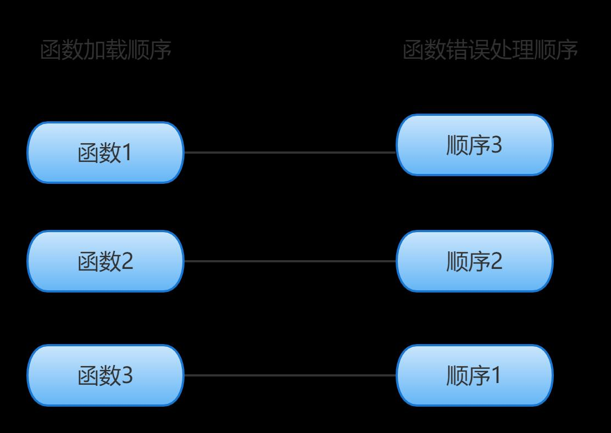
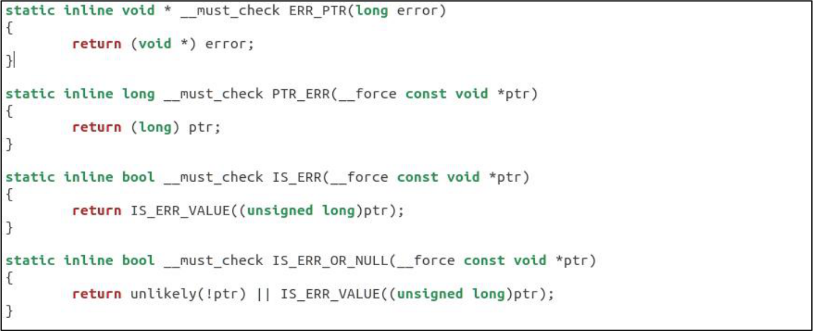
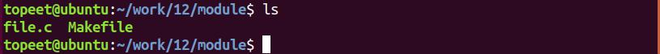
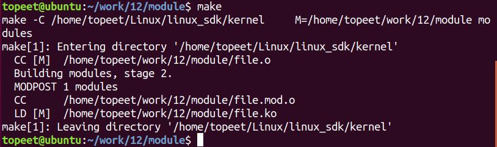
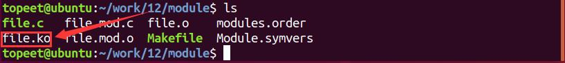
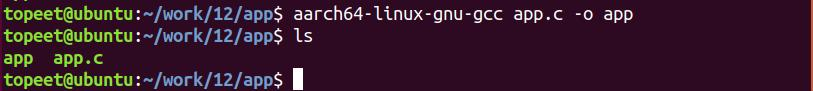
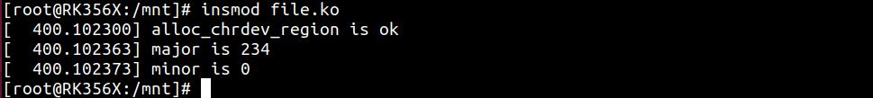
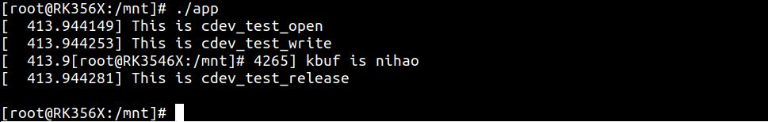
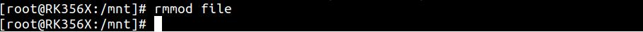

# 第024章 Linux错误处理实验

在前面章节进行的字符设备驱动实验中，即使是最简单的注册字符设备，也存在注册失败的可能性，因此在编写的驱动代码中采用检查函数返回值的方式来确认函数是否成功执行尤为重要，如当函数执行失败后可以采用goto 语句对错误进行更进一步的处理。
## 24.1 goto 语句简介
在编写驱动程序时，驱动程序应该提供函数执行失败后处理的能力。如果驱动程序中函数执行失败了，则必须取消掉所有失败前的注册，否则内核会处于一个不稳定的状态，在处理Linux 错误时，一般使用goto 语句，如代码清单24.1 所示。代码清单24.1
```c
intinit my_init_function(void)
{
    int err;
    err = register_this(ptr1, "skull");
if (err)
    goto fail_this;
err = register_that(ptr2, "skull");
if (err)
    goto fail_that;
err = register_those(ptr3, "skull");
if (err)
    goto fail_those;
return 0;
fail_those:
    unregister_that(ptr2, "skull");
fail_that:
    unregister_this(ptr1, "skull");
fail_this:
    return err;
}
```
在代码清单24.1 中试图注册3 个设备，goto 语句在注册失败情况下对之前已经成功注册的

设备进行注销。使用goto 语句处理的时候，应该遵循“先进后出”的原则，如图24.1 所示。

图24.1
## 24.2 IS_ERR()简介
如果一个函数返回值是指针类型，在调用出错的情况下会返回NULL 指针，但是返回NULL不能知道问题的确切性，一些函数需要返回一个实际的错误码以便于工程师能够基于返回值作出正确的判断。对于任何一个指针来说，必然存在三种情况，一种是合法指针，一种是NULL(也就是空指针)，一种是错误指针(也就是无效指针)。在Linux 内核中，所谓的错误指针指向了内核空间的最后一页，例如，对于一个64 位系统来说，最后一页的地址是0xfffffffffffff000~0xffffffffffffffff，最后一页地址是被保留的，并这段地址与内核定义的错误码相关联，因此可以使用错误码用来指明对应出错的情况，如果一个指针指向了该页的地址范围就被定义为错误指针。在Linux 内核源码中提供了错误指针相关的API 函数，主要有IS_ERR()、PTR_ERR()、ERR_PTR()函数等，其函数的源码在include/linux/err.h 文件中，如代码清单24.2 所示。代码清单24.2


通过代码清单24.3 中IS_ERR()函数可以判断指针是错误指针，如果指针指向了内核空间的最后一页，就说明指针是一个无效指针，如果指针并不是落在内核空间的最后一页，就说明这指针是有效的。错误指针可以使用PTR_ERR()函数转化成错误码。内核错误码保存在errno-base.h 文件中。如代码清单24.3 所示。代码清单24.3
```c
/* SPDX-License-Identifier: GPL-2.0 WITH Linux-syscall-note */
#ifndef _ASM_GENERIC_ERRNO_BASE_H
#define _ASM_GENERIC_ERRNO_BASE_H
#defineEPERM/* Operation not permitted */
#defineENOENT/* No such file or directory */
#defineESRCH/* No such process */
#defineEINTR/* Interrupted system call */
#defineEIO/* I/O error */
#defineENXIO/* No such device or address */
#defineE2BIG/* Argument list too long */
#defineENOEXEC/* Exec format error */
#defineEBADF/* Bad file number */
#defineECHILD/* No child processes */
#defineEAGAIN/* Try again */
#defineENOMEM/* Out of memory */
#defineEACCES/* Permission denied */
#defineEFAULT/* Bad address */
#defineENOTBLK/* Block device required */
#defineEBUSY/* Device or resource busy */
#defineEEXIST/* File exists */
#defineEXDEV/* Cross-device link */
#defineENODEV/* No such device */
#defineENOTDIR/* Not a directory */
```

```c
#defineEISDIR/* Is a directory */
#defineEINVAL/* Invalid argument */
#defineENFILE/* File table overflow */
#defineEMFILE/* Too many open files */
#defineENOTTY/* Not a typewriter */
#defineETXTBSY/* Text file busy */
#defineEFBIG/* File too large */
#defineENOSPC/* No space left on device */
#defineESPIPE/* Illegal seek */
#defineEROFS/* Read-only file system */
#defineEMLINK/* Too many links */
#defineEPIPE/* Broken pipe */
#defineEDOM/* Math argument out of domain of func */
#defineERANGE/* Math result not representable */
#endif
```
代码清单24.4 是使用IS_ERR()函数判断返回的指针是有效地址还是错误指针。代码清单24.4
```c
myclass = class_create(THIS_MODULE, "myclass");
if (IS_ERR(myclass)) {
    ret = PTR_ERR(myclass);
   goto fail;
}
mydevice = device_create(myclass, NULL, MKDEV(major, 0), NULL, "simple-device");
if (IS_ERR(mydevice)) {
    class_destroy(myclass);
    ret = PTR_ERR(mydevice);
    goto fail;
}
```
在上述代码中，调用了class_create()和device_create()函数后使用IS_ERR()函数判断返回的指针是否是正确的，如果是错误指针，需要调用PTR_ERR()函数将错误指针转换为错误码，并进行错误码的返回。这样工程师就可以根据错误码来确定发生错误的原因。
## 24.3 实验程序编写
### 24.3.1 驱动程序编写
本实验代码存储在网盘iTOP-RK3568 开发板\07_学习教程配套资料\03_Linux 驱动配套资料\04_Linux 驱动例程\12\module 路径下。

本实验文件私有数据实验代码基础上添加Linux 错误处理。当创建设备号，初始化cdev，注册字符设备，创建类，创建设备的这些函数执行失败时，对错误进行处理。实验代码如代码清单24.5 所示。代码清单24.5
```c
#include <linux/init.h>
#include <linux/module.h>
#include <linux/kdev_t.h>
#include <linux/fs.h>
#include <linux/cdev.h>
#include <linux/uaccess.h>
struct device_test{
    dev_t dev_num;//设备号
     int major ;//主设备号
    int minor ;//次设备号
    struct cdev cdev_test; // cdev
    struct class *class;//类
    struct device *device; //设备
    char kbuf[32];//定义缓存区kbuf
};
structdevice_test dev1;//定义一个device_test 结构体变量
    /*打开设备函数*/
static int cdev_test_open(struct inode *inode, struct file *file)
{
    file->private_data=&dev1;//设置私有数据
    printk("This is cdev_test_open\r\n");
    return 0;
}
/*向设备写入数据函数*/
static ssize_t cdev_test_write(struct file *file, const char __user *buf, size_t size, loff_t *off)
{
     struct device_test *test_dev=(struct device_test *)file->private_data;
    if (copy_from_user(test_dev->kbuf, buf, size) != 0) // copy_from_user:用户空间向内核空间传数据
    {
        printk("copy_from_user error\r\n");
        return -1;
```

```c
}
printk("This is cdev_test_write\r\n");
printk("kbuf is %s\r\n", test_dev->kbuf);
return 0;
}
/**从设备读取数据*/
static ssize_t cdev_test_read(struct file *file, char __user *buf, size_t size, loff_t *off)
{
struct device_test *test_dev=(struct device_test *)file->private_data;
if (copy_to_user(buf, test_dev->kbuf, strlen( test_dev->kbuf)) != 0) // copy_to_user:内核空间向用户空
间传数据
{
    printk("copy_to_user error\r\n");
    return -1;
}
printk("This is cdev_test_read\r\n");
return 0;
}
static int cdev_test_release(struct inode *inode, struct file *file)
{
printk("This is cdev_test_release\r\n");
return 0;
}
/*设备操作函数*/
struct file_operations cdev_test_fops = {
.owner = THIS_MODULE, //将owner 字段指向本模块，可以避免在模块的操作正在被使用时卸载该模
块
.open = cdev_test_open, //将open 字段指向chrdev_open(...)函数
.read = cdev_test_read, //将open 字段指向chrdev_read(...)函数
.write = cdev_test_write, //将open 字段指向chrdev_write(...)函数
.release = cdev_test_release, //将open 字段指向chrdev_release(...)函数
};
static int __init chr_fops_init(void) //驱动入口函数
{
    /*注册字符设备驱动*/
int ret;
/*1 创建设备号*/
ret = alloc_chrdev_region(&dev1.dev_num, 0, 1, "alloc_name"); //动态分配设备号
if (ret < 0)
```

```c
{
   goto err_chrdev;
}
printk("alloc_chrdev_region is ok\n");
dev1.major = MAJOR(dev1.dev_num); //获取主设备号
dev1.minor = MINOR(dev1.dev_num); //获取次设备号
printk("major is %d \r\n", dev1.major); //打印主设备号
printk("minor is %d \r\n", dev1.minor); //打印次设备号
 /*2 初始化cdev*/
dev1.cdev_test.owner = THIS_MODULE;
cdev_init(&dev1.cdev_test, &cdev_test_fops);
/*3 添加一个cdev,完成字符设备注册到内核*/
ret =cdev_add(&dev1.cdev_test, dev1.dev_num, 1);
if(ret<0)
{
    gotoerr_chr_add;
}
/*4 创建类*/
dev1. class = class_create(THIS_MODULE, "test");
if(IS_ERR(dev1.class))
{
   ret=PTR_ERR(dev1.class);
    goto err_class_create;
}
/*5 创建设备*/
dev1.device = device_create(dev1.class, NULL, dev1.dev_num, NULL, "test");
if(IS_ERR(dev1.device))
{
    ret=PTR_ERR(dev1.device);
    goto err_device_create;
}
return 0;
err_device_create:
    class_destroy(dev1.class);//删除类
err_class_create:
   cdev_del(&dev1.cdev_test);//删除cdev
err_chr_add:
```

```c
unregister_chrdev_region(dev1.dev_num, 1); //注销设备号
err_chrdev:
return ret;
}
static void __exit chr_fops_exit(void) //驱动出口函数
{
/*注销字符设备*/
unregister_chrdev_region(dev1.dev_num, 1); //注销设备号
cdev_del(&dev1.cdev_test);//删除cdev
device_destroy(dev1.class, dev1.dev_num);//删除设备
class_destroy(dev1.class);//删除类
}
module_init(chr_fops_init);
module_exit(chr_fops_exit);
MODULE_LICENSE("GPL v2");
MODULE_AUTHOR("topeet");
```
### 24.3.2 编写测试APP
本实验代码存储在网盘iTOP-RK3568 开发板\07_学习教程配套资料\03_Linux 驱动配套资料\04_Linux 驱动例程\12\app 路径下。测试程序app.c 如代码清单24.6 所示。代码清单24.6
```c
#include <stdio.h>
#include <sys/types.h>
#include <sys/stat.h>
#include <fcntl.h>
#include <unistd.h>
int main(int argc, char *argv[]) //主函数
{
    int fd;
    char buf1[32] = "nihao";//定义写入缓存区buf1
    fd = open("/dev/test", O_RDWR); //打开/dev/test 设备
    if (fd < 0)
    {
        perror("open error \n");
        return fd;
    }
    write(fd,buf1,sizeof(buf1)); //向/dev/test 设备写入数据
    close(fd);
```

```c
return 0;
}
```
## 24.4 运行测试
### 24.4.1 编译驱动程序
在上一小节中的file.c 代码同一目录下创建Makefile 文件，如图24.2 所示。

图24.2Makefile 文件内容如代码清单24.7 所示。代码清单24.7
```c
export ARCH=arm64#设置平台架构
export CROSS_COMPILE=aarch64-linux-gnu-#交叉编译器前缀
obj-m += chrdev_fops.o#此处要和你的驱动源文件同名
KDIR :=/home/topeet/Linux/linux_sdk/kernel#这里是你的内核目录
PWD ?= $(shell pwd)
all:
    make -C $(KDIR) M=$(PWD) modules#make 操作
clean:
    make -C $(KDIR) M=$(PWD) clean#make clean 操作
```
回到存放file.c 和Makefile 文件目录下，使用命令make 编译驱动程序，编译完成图24.3所示。

图24.3编译完生成file.ko 目标文件，如图24.4 所示

图24.4至此我们的驱动模块就编译成功了。

### 24.4.2 编译应用程序
使用aarch64-linux-gnu-gcc app.c -o app 交叉编译应用程序，编译完成以后会生成一个app的可执行程序，如图24.5 所示。

图24.5下面进行驱动程序的测试。
### 24.4.3 运行测试
将驱动模块file.ko 和测试程序app 拷贝到开发板上，输入insmod file.ko 命令加载驱动程序，如图24.6 所示。

图24.6运行应用程序如图24.7 所示。

图24.7卸载驱动程序，如图24.8 所示。

图24.8

