# 第025章 点亮LED灯实验

本节将通过字符设备驱动及相关的应用程序实现对LED 灯的控制，通过对LED 灯硬件操作，从而对之前学习到的知识进行整合与回顾。
## 25.1 查看原理图
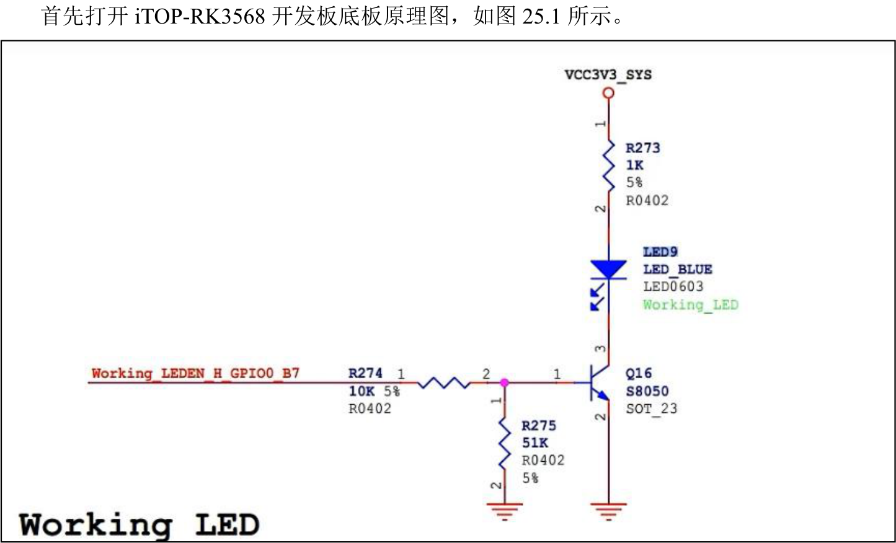
图25.1通过图25.1 可知LED 灯由GPIO0_B7 控制的。当GPIO0_B7 为高电平时，三极管Q16 导通，LED9 点亮。当GPIO0_B7 为低电平时，三极管Q16 截止，LED9 不亮。
## 25.2 查询寄存器地址
控制LED 灯的GPIO 为GPIO0_B7。接下来需要对GPIO 的复用寄存器，方向寄存器，数据寄存器进行配置。打开RK3568 的参考手册part1 分别查找这几个寄存器的地址。1.查找复用寄存器打开参考手册part1 的第三章，GPIOB 的复用寄存器PMU_GRF_GPIO0B_IOMUX_L 偏移地址为0x0008，PMU_GRF_GPIO0B_IOMUX_H 偏移地址为0x000c。如图25.2 所示。

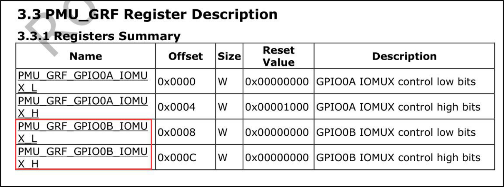
图25.2GPIO0_B7 引脚复用配置使用PMU_GRF_GPIO0B_IOMUX_H 寄存器的bit12-bit14 配置，如图25.3 所示，所以复用寄存器偏移地址为0x000C。GPIO0_B7 引脚复用功能有GPIO0_B7、PWM0_M0 和CPU_AVS 。控制LED 灯需要将引脚复用设置为GPIO0_B7 ，即把
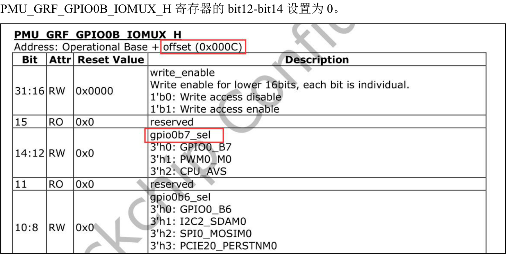
图25.3复用寄存器的基地址为0XFDC20000，如图25.4 所示。

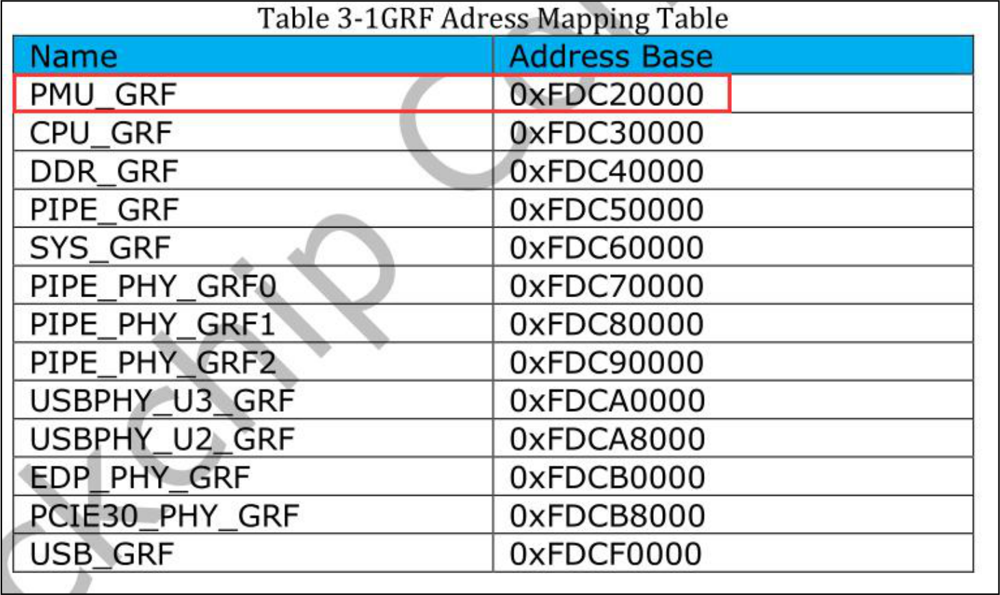
图25.4复用寄存器地址=基地址+偏移地址,所以GPIO0_B7 对应的复用寄存器地址为0xFDC2000C 。使用io -r -4 0xFDC2000C 命令可以查看此寄存器的默认值。如图25.5 所示。

图25.5通过图25.5 可以看出复用寄存器值为00000001，此时[14:12]位为000，如图25.6 所示，此时GPIO0_B7 引脚默认为gpio 功能。因此无需在设置引脚复用为gpio 功能。

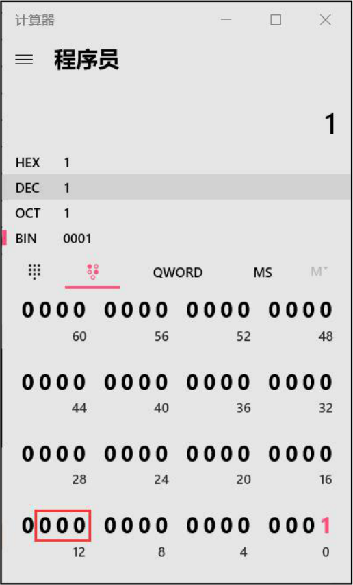
图25.62.查找方向寄存器
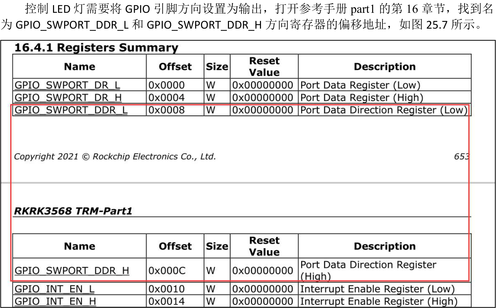
图25.7如何确定GPIO0_B7 引脚方向寄存器的偏移地址是GPIO_SWPORT_DDR_L 还是GPIO_SWPORT_DDR_H 呢？

RK3568 处理器的GPIO 有GPIOA，GPIOB，GPIOC，GPIOD 四组GPIO，每组中又有GPIOA0~GPIOA7,GPIOB0~GPIOB7,GPIOC0~GPIOC7,GPIOD0~GPIOD7。其中GPIOA0~GPIOA7, GPIOB0~GPIOB7 对应的方向寄存器偏移地址为GPIO_SWPORT_DDR_L，GPIOC0~GPIOC7, GPIOD0~GPIOD7 对应的方向寄存器偏移地址为GPIO_SWPORT_DDR_H。
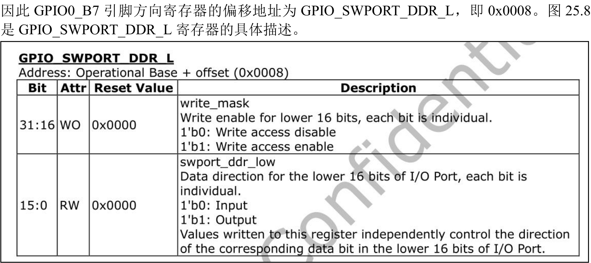
图25.8图25.8 中bit16-bit31 对应GPIOA0~GPIOA7、GPIOB0~GPIOB7 引脚方向控制位的写使能。bit0-bit15 对应GPIOA0~GPIOA7, GPIOB0~GPIOB7 方向控制位。如果要设置GPIO0_B7 引脚方向，需要先将GPIO0_B7 引脚对应的写使能为bit31 写1 使能，然后对bit15 写入0 即将GPIO0_B7 引脚方向设置为输入，写入1 则设置成输出。
接着打开参考手册part1 的1.1 小节Address Mapping，找到GPIO0 的基地址。如图25.9
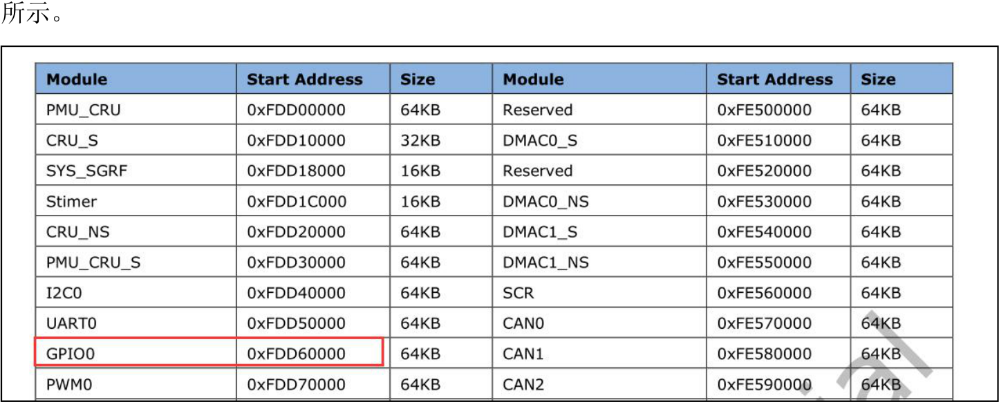
图25.9通过图25.9 可知GPIO0 的基地址为0xFDD60000。因此方向寄存器的地址=基地址+偏移地址=0xFDD60000+0x0008=0xFDD60008

使用io -r -4 0xfdd60008 命令查看方向寄存器的默认值，如图25.10 所示。

图25.10通过图25.10 与25.11 可知，方向寄存器第15 位默认为1，因此GPIO0_B7 默认输出。所以无需在设置GPIO0_B7 方向。
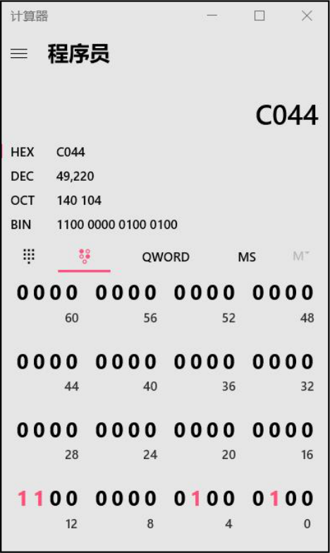
图25.11
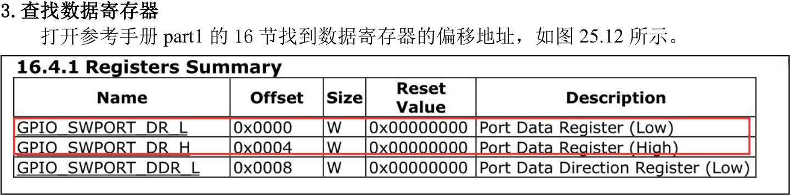
图25.12同理，GPIO0_B7 对应的数据寄存器偏移地址为GPIO_SWPORT_DR_L，即0x0000。所以GPIO0B_7 数据寄存器的地址为基地址+偏移地址=0xFDD60000。使用io -r-40xfdd60000命令查看该寄存器的默认值，如图25.13 所示。该寄存器默认值为0x0000c040，接下来控制GPIO0_B7 高低电平需要在此寄存器默认值的基础上进行控制。


图25.13图25.14 是数据寄存器的描述。其中bit16-bit31 对应GPIOA0~GPIOA7、GPIOB0~GPIOB7 引
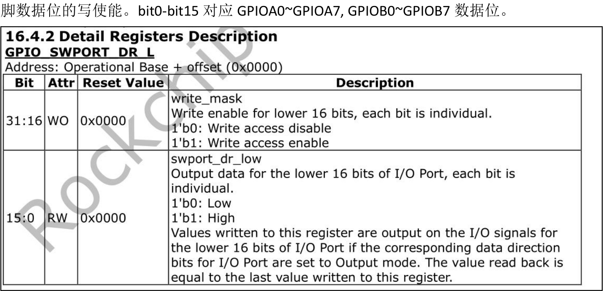
图25.14如果要设置GPIO0_B7 输出电平，需要先将GPIO0_B7 引脚对应的写使能为bit31 写1 使能，然后对bit15 写入0 即将GPIO0_B7 引脚输出低电平，写入1 则输出高电平。因此如果让GPIO0_B7 输出高电平则需要向数据寄存器写入0x8000c040，如图25.15 所示。
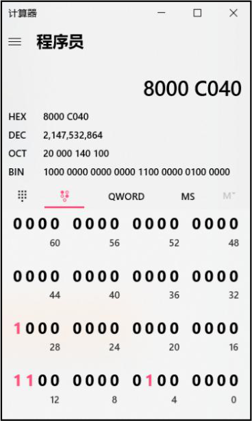
图25.15如果输出低电平，需要设置第15 位为0 ，第31 位为1，那么向数据寄存器中写入0x80004040，如图25.16 所示。

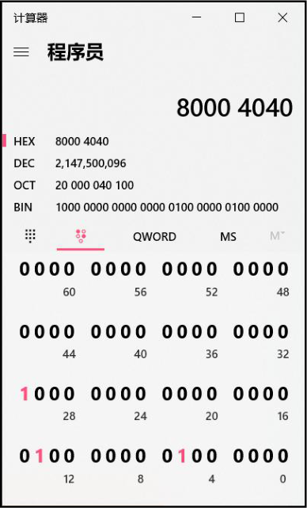
图25.16
## 25.3 实验程序编写
### 25.3.1 驱动程序编写
本实验代码存放在iTOP-RK3568 开发板\07_学习教程配套资料\03_Linux 驱动配套资料\04_Linux 驱动例程\13\module 路径下。本实验通过在应用层传入0 和1 来控制LED 灯亮灭，即传入数据1，设置GPIO 的数据寄存器值为0x8000c040，传入0，设置GPIO 的数据寄存器值为0x80004040，实验程序file.c 如代码清单25.1 所示。代码清单25.1
```c
#include <linux/init.h>
#include <linux/module.h>
#include <linux/kdev_t.h>
#include <linux/fs.h>
#include <linux/cdev.h>
#include <linux/uaccess.h>
#include <linux/io.h>
#defineGPIO_DR 0xFDD60000
struct device_test{
    dev_t dev_num;//设备号
    int major ;//主设备号
    int minor ;//次设备号
    struct cdev cdev_test; // cdev
```

```c
struct class *class;//类
struct device *device; //设备
char kbuf[32];
unsigned int *vir_gpio_dr;
};
structdevice_test dev1;
/*打开设备函数*/
static int cdev_test_open(struct inode *inode, struct file *file)
{
file->private_data=&dev1;//设置私有数据
printk("This is cdev_test_open\r\n");
return 0;
}
/*向设备写入数据函数*/
static ssize_t cdev_test_write(struct file *file, const char __user *buf, size_t size, loff_t *off)
{
 struct device_test *test_dev=(struct device_test *)file->private_data;
if (copy_from_user(test_dev->kbuf, buf, size) != 0) // copy_from_user:用户空间向内核空间传数据
{
    printk("copy_from_user error\r\n");
    return -1;
}
if(test_dev->kbuf[0]==1){//如果应用层传入的数据是1，则打开灯
        *(test_dev->vir_gpio_dr) = 0x8000c040;//设置数据寄存器的地址
        printk("test_dev->kbuf [0]is %d\n",test_dev->kbuf[0]);//打印传入的数据
}
else if(test_dev->kbuf[0]==0){//如果应用层传入的数据是0，则关闭灯
        *(test_dev->vir_gpio_dr) = 0x80004040; //设置数据寄存器的地址
        printk("test_dev->kbuf [0]is %d\n",test_dev->kbuf[0]); //打印传入的数据
}
return 0;
}
/**从设备读取数据*/
static ssize_t cdev_test_read(struct file *file, char __user *buf, size_t size, loff_t *off)
{
struct device_test *test_dev=(struct device_test *)file->private_data;
if (copy_to_user(buf, test_dev->kbuf, strlen( test_dev->kbuf)) != 0) // copy_to_user:内核空间向用户空
```

```c
间传数据
    {
        printk("copy_to_user error\r\n");
        return -1;
    }
    printk("This is cdev_test_read\r\n");
    return 0;
}
static int cdev_test_release(struct inode *inode, struct file *file)
{
    printk("This is cdev_test_release\r\n");
    return 0;
}
    /*设备操作函数*/
struct file_operations cdev_test_fops = {
    .owner = THIS_MODULE, //将owner 字段指向本模块，可以避免在模块的操作正在被使用时卸载该
模块
    .open = cdev_test_open, //将open 字段指向chrdev_open(...)函数
    .read = cdev_test_read, //将open 字段指向chrdev_read(...)函数
    .write = cdev_test_write, //将open 字段指向chrdev_write(...)函数
    .release = cdev_test_release, //将open 字段指向chrdev_release(...)函数
};
static int __init chr_fops_init(void) //驱动入口函数
{
    /*注册字符设备驱动*/
    int ret;
    /*1 创建设备号*/
    ret = alloc_chrdev_region(&dev1.dev_num, 0, 1, "alloc_name"); //动态分配设备号
    if (ret < 0)
    {
       goto err_chrdev;
    }
    printk("alloc_chrdev_region is ok\n");
    dev1.major = MAJOR(dev1.dev_num); //获取主设备号
   dev1.minor = MINOR(dev1.dev_num); //获取次设备号
    printk("major is %d \r\n", dev1.major); //打印主设备号
    printk("minor is %d \r\n", dev1.minor); //打印次设备号
     /*2 初始化cdev*/
```

```c
dev1.cdev_test.owner = THIS_MODULE;
cdev_init(&dev1.cdev_test, &cdev_test_fops);
/*3 添加一个cdev,完成字符设备注册到内核*/
ret =cdev_add(&dev1.cdev_test, dev1.dev_num, 1);
if(ret<0)
{
    gotoerr_chr_add;
}
/*4 创建类*/
dev1. class = class_create(THIS_MODULE, "test");
if(IS_ERR(dev1.class))
{
    ret=PTR_ERR(dev1.class);
    goto err_class_create;
}
/*5创建设备*/
dev1.device = device_create(dev1.class, NULL, dev1.dev_num, NULL, "test");
if(IS_ERR(dev1.device))
{
    ret=PTR_ERR(dev1.device);
    goto err_device_create;
}
/*本实验重点*****/
dev1.vir_gpio_dr=ioremap(GPIO_DR,4);//将物理地址转化为虚拟地址
if (IS_ERR(dev1.vir_gpio_dr))
{
    ret=PTR_ERR(dev1.vir_gpio_dr);//PTR_ERR()来返回错误代码
    goto err_ioremap;
}
return 0;
err_ioremap:
    iounmap(dev1.vir_gpio_dr);
err_device_create:
    class_destroy(dev1.class);//删除类
err_class_create:
   cdev_del(&dev1.cdev_test);//删除cdev
err_chr_add:
    unregister_chrdev_region(dev1.dev_num, 1); //注销设备号
```

```c
err_chrdev:
        return ret;
}
static void __exit chr_fops_exit(void) //驱动出口函数
{
    /*注销字符设备*/
    unregister_chrdev_region(dev1.dev_num, 1); //注销设备号
    cdev_del(&dev1.cdev_test);//删除cdev
    device_destroy(dev1.class, dev1.dev_num);//删除设备
    class_destroy(dev1.class);//删除类
}
module_init(chr_fops_init);
module_exit(chr_fops_exit);
MODULE_LICENSE("GPL v2");
MODULE_AUTHOR("topeet");
```
### 25.3.2 编写测试APP
本实验代码存放在网盘iTOP-RK3568 开发板\07_学习教程配套资料\03_Linux 驱动配套资料\04_Linux 驱动例程\13\app 路径下。当驱动加载成功之后会生成/dev/test 节点，应用程序通过操作/dev/test 设备节点对LED 进行控制。向/dev/test 文件写入0 表示关闭LED 灯，写入1 表示打开LED 灯。应用程序app.c如代码清单25.2 所示。代码清单25.2
```c
#include <stdio.h>
#include <sys/types.h>
#include <sys/stat.h>
#include <fcntl.h>
#include <unistd.h>
#include <stdlib.h>
int main(int argc, char *argv[])
{
    int fd;
    char buf[32] = {0};
    fd = open("/dev/test", O_RDWR);//打开led 驱动
    if (fd < 0)
    {
        perror("open error \n");
        return fd;
    }
```

```c
// atoi()将字符串转为整型，这里将第一个参数转化为整型后，存放在buf[0]中
   buf[0] =atoi(argv[1]);
   write(fd,buf,sizeof(buf));//向/dev/test 文件写入数据
   close(fd);//关闭文件
   return 0;
}
```
## 25.4 运行测试
### 25.4.1 编译驱动程序
在上一小节中的file.c 代码同一目录下创建Makefile 文件，如图25.17 所示。

图25.17Makefile 文件内容如代码清单25.3 所示。代码清单25.3
```c
export ARCH=arm64#设置平台架构
export CROSS_COMPILE=aarch64-linux-gnu-#交叉编译器前缀
obj-m += file.o#此处要和你的驱动源文件同名
KDIR :=/home/topeet/Linux/linux_sdk/kernel#这里是你的内核目录
PWD ?= $(shell pwd)
all:
    make -C $(KDIR) M=$(PWD) modules#make 操作
clean:
    make -C $(KDIR) M=$(PWD) clean#make clean 操作
```
回到存放file.c 和Makefile 文件目录下，使用命令make 编译驱动程序，编译成功如图25.18所示。
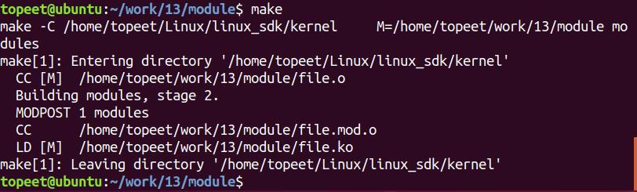
图25.18编译完生成file.ko 目标文件，如图25.19 所示。


图25.19
### 25.4.2 编译应用程序
使用aarch64-linux-gnu-gcc app.c -o app 命令交叉编译应用程序，编译完成以后会生成一个app 的可执行程序，如图25.20 所示。

图25.20下面进行驱动程序的测试。
### 25.4.3 运行测试
将驱动模块file.ko 和测试程序app 拷贝到开发板上，输入insmod file.ko 命令加载驱动程序，如图25.21 所示。
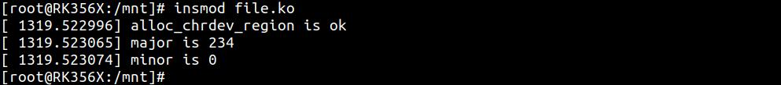
图25.21运行测试程序，输入命令“./app 1”，如果LED 灯点亮则实验成功，如图25.8 所示，打印信息如图25.22 所示。
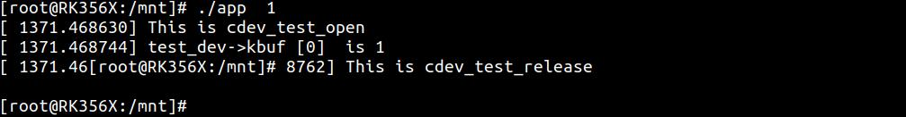
图25.22

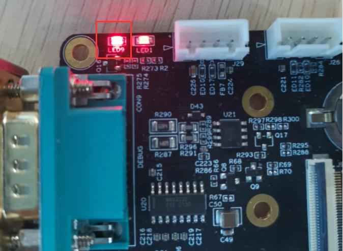
图25.23输入命令“./app 0”,如果LED 灯熄灭则实验成功，如图25.23 所示，打印信息如图25.24所示。
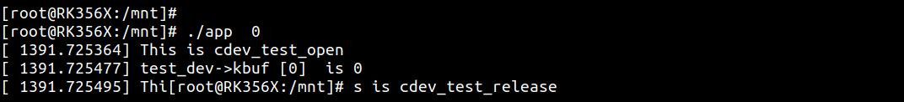
图25.24
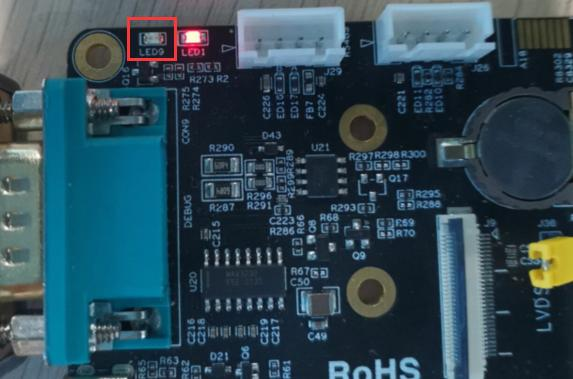
图25.25

