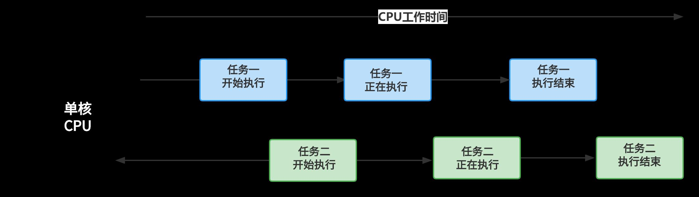
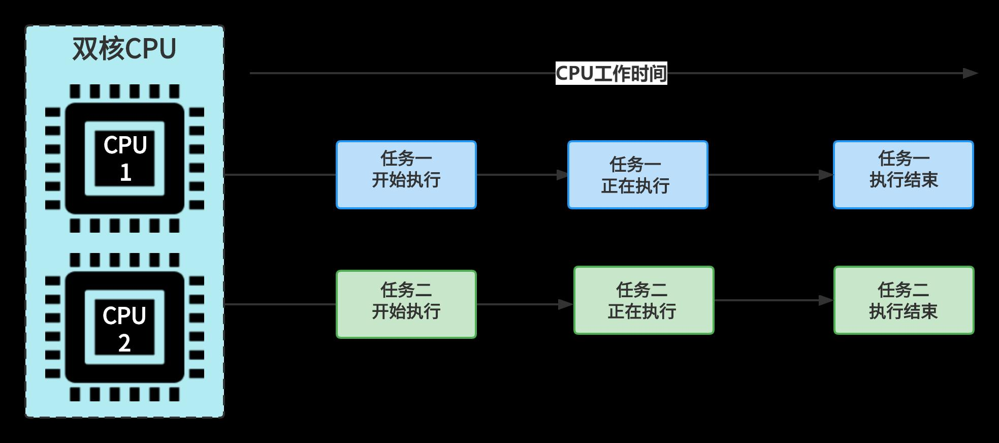
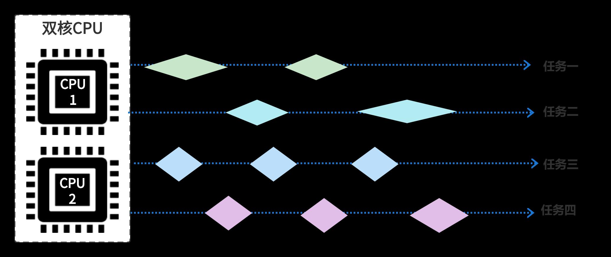
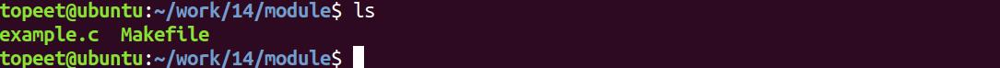
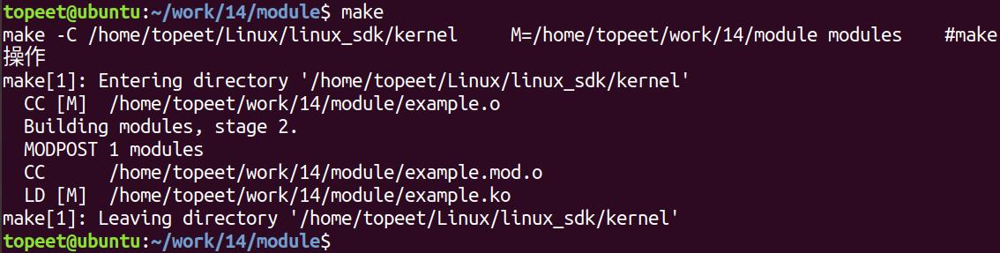
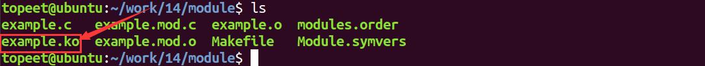
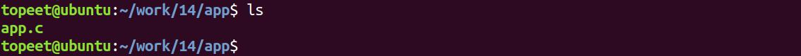
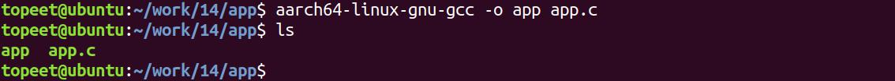
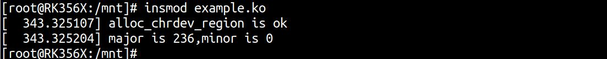
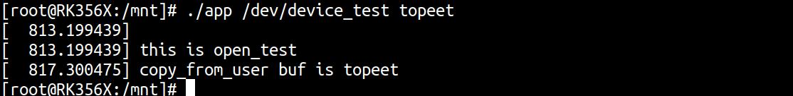

# 第026章 并发与竞争实验

在本章节中首先会对并发与并行的概念进行讲解，随后对竞争产生的原因进行总结，最后以一个实际的竞争实验加深大家的理解。
## 26.1 并发与竞争
### 26.1.1 并发
早期计算机大多只有一个CPU 核心，一次只能处理一个任务。当多个任务同时存在时，CPU 只能依次处理，效率较低。为了提升处理效率，提出了并发的概念。所谓并发，就是指通过合理调度，让CPU 在多个任务之间快速切换。虽然同一时刻只能执行一个任务，但切换速度非常快，多个任务看起来就像在同时运行一样。图26.1 展示了两个任务并发执行的过程（为了容易理解，这里以两个任务并发执行为例，实际任务数量可以更多）。

图26.1
### 26.1.2 并行
并发是针对单核CPU 提出的，而并行则是针对多核CPU 提出的。和单核CPU 不同，多核CPU 真正实现了“同时执行多个任务”。多核CPU 的每个核心都可以独立地执行一个任务，而且多个核心之间不会相互干扰。在不同核心上执行的多个任务，是真正地同时运行，这种状态就叫做并行。双核CPU 的工作状态如图26.2 所示。


图26.2
### 26.1.3 并发+并行
在并行的工作状态中，两个CPU 分别执行两个任务，是一种理想状态。在实际场景中，处于运行状态的任务是非常多的，以实际办公电脑为例，windows 系统在开机之后会运行几十个任务，而CPU 往往只有4 核、8 核等，远远低于任务的数量，这个时候就会同时存在并发和并行两种情况，即所有核心在并行工作的同时，每个核心还要并发工作。例如一个双核CPU 要执行四个任务，它的工作状态如图26.3 所示。

图26.3
### 26.1.4 竞争
在并发执行的环境中，多个程序可能同时访问同一个共享资源。当多个任务试图同时操作

这类资源时，可能会出现执行异常或数据错误，这类问题被称为竞争。竞争产生的常见原因包括：（1）多线程访问。由于Linux 是一个多任务操作系统，多个线程可能同时访问同一共享资源，这是竞争产生的基本原因。（2）中断访问。当进程正在访问某一共享资源，而中断打断了正在执行的进程，而发出中断的进程与被打断的进程之间也可能发生竞争。（3）抢占访问。linux2.6 及更高版本引入了抢占式内核，高优先级的任务可以打断低优先级的任务。如果正在访问共享资源的任务被打断，另一个任务接着访问相同资源，就可能引发竞争。（4）多核并发访问(SMP）。在多核处理器系统中，不同CPU 核心之间可能并发访问同一共享资源，形成核间竞争。
### 26.1.5 什么是共享资源？如何保护？
竞争是由于并发访问同一个共享资源产生的。为了防止“竞争”的产生就要对共享资源进行保护，这里提到的共享资源又是什么呢？又如何保护呢？以实际生活中的共享资源为例，可以是公共电话、共享单车和共享充电宝等公共物品，以上都属于共享资源的范畴。这些资源每个人都可以使用，但在同一时间内只能由一个人使用，否则就会产生竞争。在操作系统中，共享资源指的是多个任务可能同时访问的内容，例如全局变量、内核缓冲区、设备结构体等，这些资源如果不加限制地被多个任务同时访问，就容易导致数据错乱或系统异常。那么如何保护共享资源，避免竞争的发生呢？Linux 内核提供了多种机制来应对这一问题，常用的方法包括原子操作、自旋锁、互斥锁、信号量等。通过这些机制，可以确保某一时刻只有一个任务能够访问共享资源，从而实现对其的有效保护。
## 26.2 实验程序的编写
### 26.2.1 驱动程序编写
本实验代码存储在网盘iTOP-RK3568 开发板\07_学习教程配套资料\03_Linux 驱动配套资料\04_Linux 驱动例程\14\module 路径下。本实验编写并发与竞争的驱动代码，首先完善字符设备驱动框架，然后通过copy_from_user(...)函数接收用户空间传递到内核空间的数据并进行判断，如果接收到的字符串数据为“topeet”会在睡眠4 秒钟后打印接收到的数据，如果接收到的字符串数据为“itop”会在睡眠2 秒钟后打印接收到的数据。

实验代码example.c 如代码清单26.1 所示。代码清单26.1
```c
#include <linux/init.h>
#include <linux/module.h>
#include <linux/fs.h>
#include <linux/cdev.h>
#include <linux/kdev_t.h>
#include <linux/uaccess.h>
#include <linux/delay.h>
static int open_test(struct inode *inode,struct file *file)
{
    printk("\nthis is open_test \n");
    return 0;
}
static ssize_t read_test(struct file *file,char __user *ubuf,size_t len,loff_t *off)
{
    int ret;
    char kbuf[10] = "topeet";//定义char 类型字符串变量kbuf
    printk("\nthis is read_test \n");
    ret = copy_to_user(ubuf,kbuf,strlen(kbuf));//使用copy_to_user 内核空间向用户空间传数据
    if (ret != 0){
        printk("copy_to_user is error \n");
    }
    printk("copy_to_user is ok \n");
    return 0;
}
static char kbuf[10] = {0};//定义char 类型字符串全局变量kbuf
static ssize_t write_test(struct file *file,const char __user *ubuf,size_t len,loff_t *off)
{
    int ret;
    ret = copy_from_user(kbuf,ubuf,len);//使用copy_from_user 接收用户空间传递的数据
    if (ret != 0){
        printk("copy_from_user is error\n");
    }
    if(strcmp(kbuf,"topeet") == 0 ){//如果传递的kbuf 是topeet 就睡眠四秒钟
        ssleep(4);
    }
    else if(strcmp(kbuf,"itop") == 0){//如果传递的kbuf 是itop 就睡眠两秒钟
        ssleep(2);
    }
    printk("copy_from_user buf is %s \n",kbuf);
```

```c
return 0;
}
static int release_test(struct inode *inode,struct file *file)
{
//printk("\nthis is release_test \n");
return 0;
}
struct chrdev_test {
   dev_t dev_num;//定义dev_t 类型变量dev_num 来表示设备号
   int major,minor;//定义int 类型的主设备号major 和次设备号minor
   struct cdev cdev_test;//定义struct cdev 类型结构体变量cdev_test，表示要注册的字符设备
   struct class *class_test;//定于struct class *类型结构体变量class_test，表示要创建的类
};
struct chrdev_test dev1;//创建chrdev_test 类型的
struct file_operations fops_test = {
  .owner = THIS_MODULE,//将owner 字段指向本模块，可以避免在模块的操作正在被使用时卸载
该模块
  .open = open_test,//将open 字段指向open_test(...)函数
  .read = read_test,//将read 字段指向read_test(...)函数
  .write = write_test,//将write 字段指向write_test(...)函数
  .release = release_test,//将release 字段指向release_test(...)函数
};
static int __init atomic_init(void)
{
if(alloc_chrdev_region(&dev1.dev_num,0,1,"chrdev_name") < 0 ){//自动获取设备号，设备名
chrdev_name
    printk("alloc_chrdev_region is error \n");
}
printk("alloc_chrdev_region is ok \n");
dev1.major = MAJOR(dev1.dev_num);//使用MAJOR()函数获取主设备号
dev1.minor = MINOR(dev1.dev_num);//使用MINOR()函数获取次设备号
printk("major is %d,minor is %d\n",dev1.major,dev1.minor);
cdev_init(&dev1.cdev_test,&fops_test);//使用cdev_init()函数初始化cdev_test 结构体，并链接到
fops_test 结构体
dev1.cdev_test.owner = THIS_MODULE;//将owner 字段指向本模块，可以避免在模块的操作正在被
使用时卸载该模块
cdev_add(&dev1.cdev_test,dev1.dev_num,1);//使用cdev_add()函数进行字符设备的添加
dev1.class_test = class_create(THIS_MODULE,"class_test");//使用class_create 进行类的创建，类名称
为class_test
device_create(dev1.class_test,0,dev1.dev_num,0,"device_test");//使用device_create 进行设备的创
建，设备名称为device_test
return 0;
```

```c
}
static void __exit atomic_exit(void)
{
    device_destroy(dev1.class_test,dev1.dev_num);//删除创建的设备
    class_destroy(dev1.class_test);//删除创建的类
    cdev_del(&dev1.cdev_test);//删除添加的字符设备cdev_test
    unregister_chrdev_region(dev1.dev_num,1);//释放字符设备所申请的设备号
    printk("module exit \n");
}
module_init(atomic_init);
module_exit(atomic_exit)
MODULE_LICENSE("GPL v2");
MODULE_AUTHOR("topeet");
```
对于重要逻辑部分已经加粗，后续章节的实验都是对上述并发与竞争实验的改进，以不同的方式来避免竞争的产生。
### 26.2.2 编写测试APP
本实验代码存储在网盘iTOP-RK3568 开发板\07_学习教程配套资料\03_Linux 驱动配套资料\04_Linux 驱动例程\14\app 路径下。本测试app 较为简单，需要输入两个参数，第一个参数为对应的设备节点，第二个参数为topeet 或者itop，代表向设备写入的数据，实验代码app.c 内容如代码清单26.2 所示。代码清单26.2
```c
#include <stdio.h>
#include <sys/types.h>
#include <sys/stat.h>
#include <fcntl.h>
#include <string.h>
 #include <unistd.h>
int main(int argc, char *argv[])
{
    int fd;//定义int 类型的文件描述符
    char str1[10] = {0};//定义读取缓冲区str1
    fd = open(argv[1],O_RDWR);//调用open 函数，打开输入的第一个参数文件，权限为可读可写
    if(fd < 0 ){
        printf("file open failed \n");
        return -1;
    }
    /*如果第二个参数为topeet，条件成立，调用write 函数，写入topeet*/
    if (strcmp(argv[2],"topeet") == 0 ){
        write(fd,"topeet",10);
    }
```

```c
/*如果第二个参数为itop，条件成立，调用write 函数，写入itop*/
else if (strcmp(argv[2],"itop") == 0 ){
    write(fd,"itop",10);
}
close(fd);
return 0;
}
```
## 26.3 运行测试
### 26.3.1 编译驱动程序
在example.c 代码同一目录下创建Makefile 文件，如图26.4 所示。

图26.4Makefile 文件内容如代码清单26.3 所示。代码清单26.3
```c
export ARCH=arm64#设置平台架构
export CROSS_COMPILE=aarch64-linux-gnu-#交叉编译器前缀
obj-m += example.o#此处要和你的驱动源文件同名
KDIR :=/home/topeet/Linux/linux_sdk/kernel#这里是你的内核目录
PWD ?= $(shell pwd)
all:
    make -C $(KDIR) M=$(PWD) modules#make 操作
clean:
    make -C $(KDIR) M=$(PWD) clean#make clean 操作
```
在存放example.c 和Makefile 文件目录下使用make 命令编译驱动程序，编译完成如图26.5所示。

图26.5编译完生成example.ko 目标文件，如图26.6 所示。


图26.6
### 26.3.2 编译应用程序
来到应用程序app.c 文件的存放路径如图26.7 所示。

图26.7使用aarch64-linux-gnu-gcc -o app app.c -static 命令对app.c 进行交叉编译，编译完成如图26.8 所示。

图26.8
### 26.3.3 运行测试
将本章节编译好的example.ko 驱动文件和app 可执行文件拷贝到开发板上。开发板启动之后，使用insmod example.ko 命令进行驱动模块的加载，如图26.9 所示。

图26.9可以看到申请的主设备号和次设备号就被打印了出来，然后使用ls /dev/device_test 命令对自动生成的设备节点device_test 进行查看，如图26.10 所示。

图26.10可以看到device_test 节点已经被自动创建了，然后使用./app /dev/device_test topeet 命令运行测试app，运行结果如图26.11 所示。

图26.11可以看到传递的buf 值为topeet，然后输入./app /dev/device_test topeet &和./app /dev/device_testitop &两个命令在后台运行两个app，来进行竞争测试，运行结果如图26.12 所示。

