# 第027章 原子操作实验

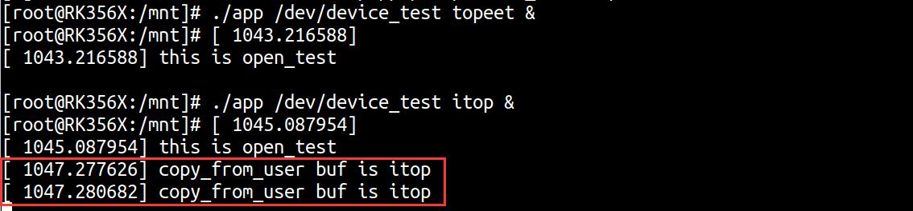
图26.12在不存在竞争的情况下，传递的两个字符串数据应该是topeet 和itop，而在上图中的打印信息为两个itop，原因是第二个app 应用程序运行之后对共享资源进行了修改，两个app 应用程序就产生了竞争关系，会在之后的章节中使用不同的方法对上述驱动程序进行改进，从而避免竞争的产生。最后可以使用rmmod example.ko 命令进行驱动的卸载，如图26.13 所示。
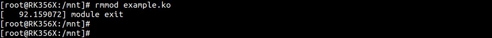
图26.13至此，并发与竞争的实验就完成了。

Linux 内核提供了四种处理并发与竞争的常见方法，分别是原子操作、自旋锁、信号量和互斥体，本章对四种常见方法中的原子操作进行讲解。
## 27.1 原子操作
原子是化学反应中不可再分的基本微粒，Linux 中的原子操作可以理解为“不可被拆分的操作”，也就是要么完全执行，要么不执行，不存在执行一部分的情况。原子操作的特性使得它能够在多线程或者并发执行的情况下，保证对共享资源操作的正确性。举个例子，在C 语言中可以使用以下代码对一个整形变量赋值，如代码清单27.1 所示。代码清单27.1
```c
int v;//定义一个int 类型的变量v
v = 1;//将int 类型的变量v 赋值为1
```
然而上述赋值操作并不是原子性的。因为C 语言代码最终会被编译为一系列汇编指令，而这些指令在执行过程中仍可能被中断，从而导致共享资源竞争。因此，原子操作的必要性在并发环境中尤为突出。原子操作会将对整形变量的一次读写操作视为一个整体，确保其不可分割，从而避免竞争。原子操作可以进一步细分为“整型原子操作”和“位原子操作”，这里首先对整型原子操作进行讲解。在Linux 内核中使用atomic_t 和atomic64_t 结构体分别来定义32 位系统和64 位系统下的原子变量，这两个结构体定义在内核源码/include/linux/types.h 文件中，如代码清单27.2 所示。代码清单27.2
```c
typedef struct {
    int counter;
} atomic_t;
#ifdef CONFIG_64BIT
typedef struct {
    long counter;
} atomic64_t;
#endif
```
例如可以使用以下代码定义一个64 位系统的原子整形变量：atomic64_t v;对原子变量进行读取、加减等动作，即整型变量的原子操作。常用API 函数如表27.1 所示，定义在内核源码/include/linux/atomic.h 文件中。

表27.1函数描述ATOMIC_INIT(int i)定义原子变量并初始化为i，如定义32 位系统下原子变量v 并初始化为0：atomic_t v = ATOMIC_INIT(0)int atomic_read(atomic_t *v)读取原子变量v 的值，并且返回。void atomic_set(atomic_t *v, int i)向原子变量v 写入i 值。void atomic_add(int i, atomic_t *v)原子变量v 加上i 值。void atomic_sub(int i, atomic_t *v)原子变量v 减去i 值。void atomic_inc(atomic_t *v)原子变量v 加1void atomic_dec(atomic_t *v)原子变量v 减1int atomic_dec_return(atomic_t *v)原子变量v 减1，并返回v 的值。int atomic_inc_return(atomic_t *v)原子变量v 加1，并返回v 的值。int atomic_sub_and_test(int i, atomic_t *v)原子变量v 减i，如果结果为0 就返回真，否则返回假int atomic_dec_and_test(atomic_t *v)原子变量v 减1，如果结果为0 就返回真，否则返回假int atomic_inc_and_test(atomic_t *v)原子变量v 加1，如果结果为0 就返回真，否则返回假int atomic_add_negative(int i, atomic_t *v)原子变量v 加i，如果结果为负就返回真，否则返回假与整型原子操作不同，位原子操作没有atomic_t 的数据结构，位原子操作是直接对内存进行操作，原子位操作相关API 函数如表27.2 所示。表27. 2函数描述void set_bit(int nr, void *p)将p 地址的第nr 位置1void clear_bit(int nr,void *p)将p 地址的第nr 位清零void change_bit(int nr, void *p)将p 地址的第nr 位进行翻转int test_bit(int nr, void *p)获取p 地址的第nr 位的值int test_and_set_bit(int nr, void *p)将p 地址的第nr 位置1，并且返回nr 位原来的值int test_and_clear_bit(int nr, void *p)将p 地址的第nr 位清零，并且返回nr 位原来的值int test_and_change_bit(int nr, void *p)将p 地址的第nr 位翻转，并且返回nr 位原来的值由于位操作相关内容在日常驱动开发中使用频率相对较低，本节不再展开详细实验，感兴趣的同学可以到相关网站上进行自主学习。
## 27.2 实验程序的编写
### 27.2.1 驱动程序编写
本实验代码存储在网盘iTOP-RK3568 开发板\07_学习教程配套资料\03_Linux 驱动配套资料\04_Linux 驱动例程\15\module 路径下。为了解决并发与竞争章节实验中竞争的问题，本章实验在原有实验代码open()函数和

release()函数中加入整型原子变量v 的赋值代码，并且在open()函数中加入原子整型变量v 的判断代码，从而实现同一时间内只允许一个应用打开该设备节点，以此来防止共享资源竞争的产生。实验代码atomic.c 如代码清单27.3 所示。代码清单27.3
```c
#include <linux/init.h>
#include <linux/module.h>
#include <linux/fs.h>
#include <linux/cdev.h>
#include <linux/kdev_t.h>
#include <linux/uaccess.h>
#include <linux/delay.h>
#include <linux/atomic.h>
#include <linux/errno.h>
static atomic64_t v = ATOMIC_INIT(1);//初始化原子类型变量v,并设置为1
static int open_test(struct inode *inode,struct file *file)
{
    if(atomic64_read(&v) != 1){//读取原子类型变量v 的值并判断是否等于1
        return -EBUSY;
    }
    atomic64_set(&v,0);//将原子类型变量v 的值设置为0
    //printk("\nthis is open_test \n");
    return 0;
}
static ssize_t read_test(struct file *file,char __user *ubuf,size_t len,loff_t *off)
{
    int ret;
    char kbuf[10] = "topeet";//定义char 类型字符串变量kbuf
    printk("\nthis is read_test \n");
    ret = copy_to_user(ubuf,kbuf,strlen(kbuf));//使用copy_to_user 内核空间向用户空间传数据
    if (ret != 0){
        printk("copy_to_user is error \n");
    }
    printk("copy_to_user is ok \n");
    return 0;
}
static char kbuf[10] = {0};//定义char 类型字符串全局变量kbuf
static ssize_t write_test(struct file *file,const char __user *ubuf,size_t len,loff_t *off)
{
    int ret;
    ret = copy_from_user(kbuf,ubuf,len);//使用copy_from_user 接收用户空间传递的数据
```

```c
if (ret != 0){
    printk("copy_from_user is error\n");
}
if(strcmp(kbuf,"topeet") == 0 ){//如果传递的kbuf 是topeet 就睡眠四秒钟
    ssleep(4);
}
else if(strcmp(kbuf,"itop") == 0){//如果传递的kbuf 是itop 就睡眠两秒钟
    ssleep(2);
}
printk("copy_from_user buf is %s \n",kbuf);
return 0;
}
static int release_test(struct inode *inode,struct file *file)
{
//printk("\nthis is release_test \n");
atomic64_set(&v,1);//将原子类型变量v 的值赋1
return 0;
}
struct chrdev_test {
  dev_t dev_num;//定义dev_t 类型变量dev_num 来表示设备号
  int major,minor;//定义int 类型的主设备号major 和次设备号minor
  struct cdev cdev_test;//定义struct cdev 类型结构体变量cdev_test，表示要注册的字符设备
  struct class *class_test;//定义struct class *类型结构体变量class_test，表示要创建的类
};
struct chrdev_test dev1;//创建chrdev_test 类型的
struct file_operations fops_test = {
 .owner = THIS_MODULE,//将owner 字段指向本模块，可以避免在模块的操作正在被使用时卸载该模
块
 .open = open_test,//将open 字段指向open_test(...)函数
 .read = read_test,//将read 字段指向read_test(...)函数
 .write = write_test,//将write 字段指向write_test(...)函数
 .release = release_test,//将release 字段指向release_test(...)函数
};
static int __init atomic_init(void)
{
if(alloc_chrdev_region(&dev1.dev_num,0,1,"chrdev_name") < 0 ){//自动获取设备号，设备名
chrdev_name
    printk("alloc_chrdev_region is error \n");
}
printk("alloc_chrdev_region is ok \n");
dev1.major = MAJOR(dev1.dev_num);//使用MAJOR()函数获取主设备号
dev1.minor = MINOR(dev1.dev_num);//使用MINOR()函数获取次设备号
```

```c
printk("major is %d,minor is %d\n",dev1.major,dev1.minor);
cdev_init(&dev1.cdev_test,&fops_test);//使用cdev_init()函数初始化cdev_test 结构体，并链接到
fops_test 结构体
dev1.cdev_test.owner = THIS_MODULE;//将owner 字段指向本模块，可以避免在模块的操作正在被使用
时卸载该模块
cdev_add(&dev1.cdev_test,dev1.dev_num,1);//使用cdev_add()函数进行字符设备的添加
dev1.class_test = class_create(THIS_MODULE,"class_test");//使用class_create 进行类的创建，类名称为
class_test
device_create(dev1.class_test,0,dev1.dev_num,0,"device_test");//使用device_create 进行设备的创建，设
备名称为device_test
return 0;
}
static void __exit atomic_exit(void)
{
device_destroy(dev1.class_test,dev1.dev_num);//删除创建的设备
class_destroy(dev1.class_test);//删除创建的类
cdev_del(&dev1.cdev_test);//删除添加的字符设备cdev_test
unregister_chrdev_region(dev1.dev_num,1);//释放字符设备所申请的设备号
printk("module exit \n");
}
module_init(atomic_init);
module_exit(atomic_exit)
MODULE_LICENSE("GPL v2");
MODULE_AUTHOR("topeet");
```
### 27.2.2 编写测试APP
本实验代码存储在网盘iTOP-RK3568 开发板\07_学习教程配套资料\03_Linux 驱动配套资料\04_Linux 驱动例程\15\app 路径下。本测试app 代码和上一章节相同，需要输入两个参数，第一个参数为对应的设备节点，第二个参数为topeet 或者itop，分别代表向设备写入的数据，实验代码app.c 内容如代码清单27.4所示。代码清单27.4
```c
#include <stdio.h>
#include <sys/types.h>
#include <sys/stat.h>
#include <fcntl.h>
#include <string.h>
 #include <unistd.h>
int main(int argc, char *argv[])
{
    int fd;//定义int 类型的文件描述符
```

```c
char str1[10] = {0};//定义读取缓冲区str1
fd = open(argv[1],O_RDWR);//调用open 函数，打开输入的第一个参数文件，权限为可读可写
if(fd < 0 ){
    printf("file open failed \n");
    return -1;
}
/*如果第二个参数为topeet，条件成立，调用write 函数，写入topeet*/
if (strcmp(argv[2],"topeet") == 0 ){
    write(fd,"topeet",10);
}
/*如果第二个参数为itop，条件成立，调用write 函数，写入itop*/
else if (strcmp(argv[2],"itop") == 0 ){
    write(fd,"itop",10);
}
close(fd);
return 0;
}
```
## 27.3 运行测试
### 27.3.1 编译驱动程序
在atomic.c 代码同一目录下创建Makefile 文件，如图27.1 所示。
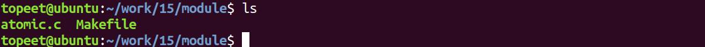
图27.1Makefile 文件内容如代码清单27.5 所示。代码清单27.5
```c
export ARCH=arm64#设置平台架构
export CROSS_COMPILE=aarch64-linux-gnu-#交叉编译器前缀
obj-m += atomic.o#此处要和你的驱动源文件同名
KDIR :=/home/topeet/Linux/linux_sdk/kernel#这里是你的内核目录
PWD ?= $(shell pwd)
all:
    make -C $(KDIR) M=$(PWD) modules#make 操作
clean:
    make -C $(KDIR) M=$(PWD) clean#make clean 操作
```
在存放atomic.c 和Makefile 文件目录下使用make 命令编译驱动程序，编译完成如图27.2所示。

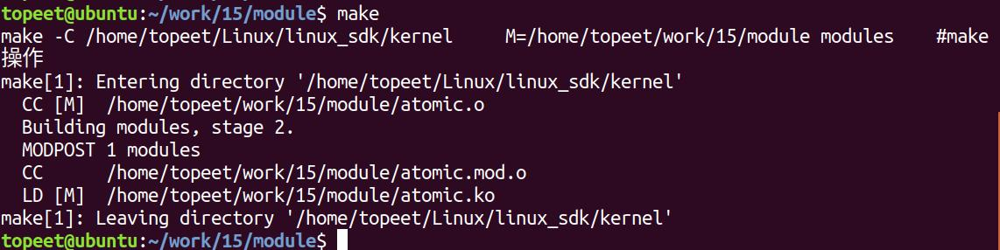
图27.2编译完生成atomic.ko 目标文件，如图27.3 所示。
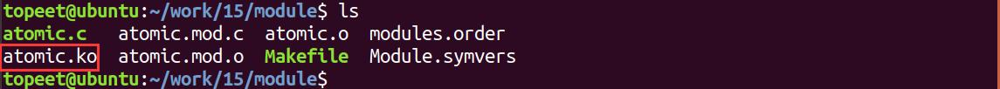
图27.3
### 27.3.2 编译应用程序
来到应用程序app.c 文件的存放路径如图27.4 所示。
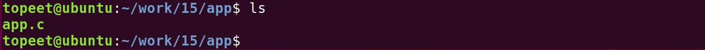
图27.4使用aarch64-linux-gnu-gcc -o app app.c -static 命令对app.c 进行交叉编译，编译完成如图27.5 所示。
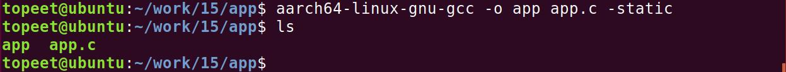
图27.5
### 27.3.3 运行测试
将本章节编译好的atomic.ko 驱动文件和app 可执行文件拷贝到开发板上。开发板启动之后，使用insmod atomic.ko 命令进行驱动模块的加载，如图27.6 所示。
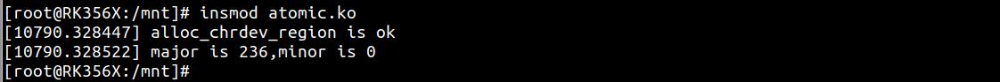
图27.6可以看到申请的主设备号和次设备号就被打印了出来，然后使用ls /dev/device_test 命令对自动生成的设备节点device_test 进行查看，如图27.7 所示。

图27.7可以看到device_test 节点已经被自动创建了，然后使用./app /dev/device_test topeet 命令运行测试app，运行结果如图27.8 所示。

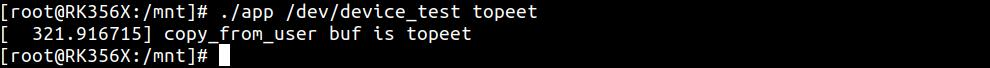
图27.8可以看到传递的buf 值为topeet ，然后输入./app /dev/device_test topeet & 和./app/dev/device_test itop 两个命令运行两个app，来进行竞争测试，运行结果如图27.9 所示。
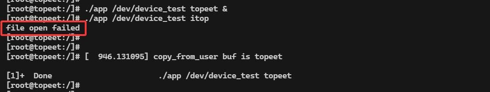
图27.9可以看到当第一个命令应用程序后台运行时，成功打开了设备并进入了写入操作。第一个应用程序会导致睡眠4 秒，在这段时间内设备未释放，即锁没有释放。所以紧接着执行的第二个命令应用程序在尝试打开/dev/device_test 文件的时候失败，出现了file open failed 打印。只有在第一个应用关闭后，下一个应用才能打开，如图27.10 所示。
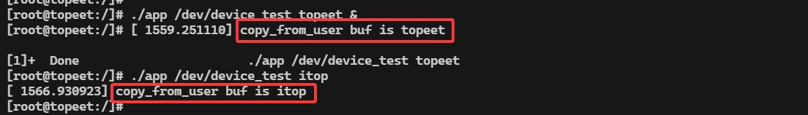
图27.10使用rmmod flag.ko 命令进行驱动的卸载，如图20.11 所示。
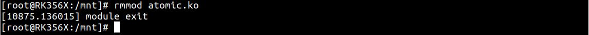
图27.11本实验通过原子变量限制同一时间内设备访问数量，实现对共享资源的保护。

