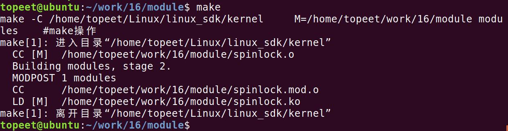
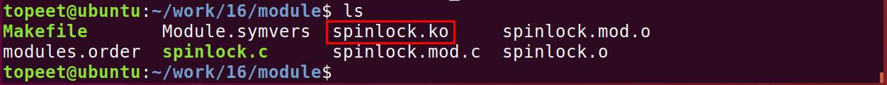
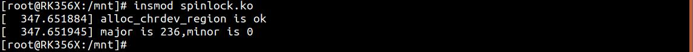
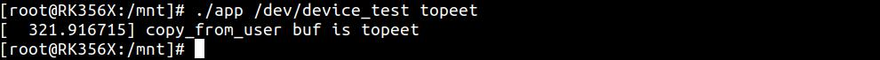
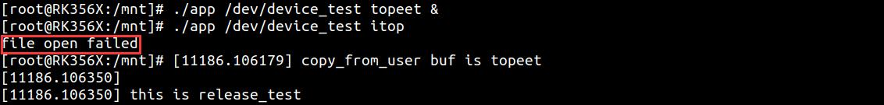

# 第028章 自旋锁实验

原子操作的能力有限，它仅适用于对整型变量或单个位的访问保护。对于结构体或更复杂的共享资源，原子操作就力不从心了。此时就引入了更强大的同步机制——自旋锁。
## 28.1 自旋锁
自旋锁是为了保护共享资源提出的一种锁机制。当一个线程尝试获取自旋锁而发现该锁已被其他线程持有时，它不会进入睡眠状态等待，而是会持续循环地尝试获取锁，直到成功为止。这个过程称为“自旋”，因此得名“自旋锁”。自旋锁适用于自旋锁锁持有时间短且线程不希望在重新调度上花费过多时间的情况。因为自旋锁需要不断循环检查锁状态，持有时间长会导致大量消耗CPU 资源。内核中以spinlock_t 结构体来表示自旋锁，定义在内核源码/include/linux/spinlock_types.h文件中，如代码清单28.1 所示。代码清单28.1
```c
typedef struct spinlock {
    union {
        struct raw_spinlock rlock;
#ifdef CONFIG_DEBUG_LOCK_ALLOC
# define LOCK_PADSIZE (offsetof(struct raw_spinlock, dep_map))
        struct {
            u8 __padding[LOCK_PADSIZE];
            struct lockdep_map dep_map;
        };
#endif
     };
} spinlock_t;
```
自旋锁相关API 函数定义在内核源码/include/linux/spinlock.h 文件中，所以在本章节的实验中要加入该头文件（spinlock.h 头文件包含spinlock_types.h 等，所以只需加入spinlock.h 头文件即可），常用API 函数如表28.1 所示。表28.1函数描述
```c
DEFINE_SPINLOCK(spinlock_t lock)定义并初始化自旋锁
int spin_lock_init(spinlock_t *lock)初始化自旋锁
void spin_lock(spinlock_t *lock)获取指定的自旋锁，也叫做加锁
```

```c
void spin_unlock(spinlock_t *lock)释放指定的自旋锁
int spin_trylock(spinlock_t *lock)尝试获取指定的自旋锁，如果没有获取到就返回0
int spin_is_locked(spinlock_t *lock)检查指定的自旋锁是否被获取，如果没有被获取就返回非0，否则返
                                     回0
```
## 28.2 实验程序的编写
### 28.2.1 驱动程序编写
本实验代码存储在网盘iTOP-RK3568 开发板\07_学习教程配套资料\03_Linux 驱动配套资料\04_Linux 驱动例程\16\module 路径下。使用自旋锁分为以下3 步。1 在访问临界资源的时候先申请自旋锁2 获取到自旋锁之后就进入临界区，获取不到自旋锁就原地等待。3 退出临界区的时候要释放自旋锁。实验代码spinlock.c 如代码清单28.2 所示。代码清单28.2
```c
#include <linux/init.h>
#include <linux/module.h>
#include <linux/fs.h>
#include <linux/cdev.h>
#include <linux/kdev_t.h>
#include <linux/delay.h>
#include <linux/uaccess.h>
#include <linux/spinlock.h>
static spinlock_t spinlock_test;//定义spinlock_t 类型的自旋锁变量spinlock_test
static int flag = 1;//定义flag 标准为，flag 等于1 表示设备没有被打开，等于0 则证明设备已经被打开了
static int open_test(struct inode *inode,struct file *file)
{
    spin_lock(&spinlock_test);//自旋锁加锁
    if(flag != 1){//判断标志位flag 的值是否等于1
          spin_unlock(&spinlock_test);//自旋锁解锁
          return -EBUSY;
     }
    flag = 0;//将标志位的值设置为0
    spin_unlock(&spinlock_test);//自旋锁解锁
    return 0;
}
```

```c
static ssize_t read_test(struct file *file,char __user *ubuf,size_t len,loff_t *off)
{
    int ret;
    char kbuf[10] = "topeet";//定义char 类型字符串变量kbuf
    printk("\nthis is read_test \n");
    ret = copy_to_user(ubuf,kbuf,strlen(kbuf));//使用copy_to_user 内核空间向用户空间传数据
    if (ret != 0){
        printk("copy_to_user is error \n");
    }
    printk("copy_to_user is ok \n");
    return 0;
}
static char kbuf[10] = {0};//定义char 类型字符串全局变量kbuf
static ssize_t write_test(struct file *file,const char __user *ubuf,size_t len,loff_t *off)
{
    int ret;
    ret = copy_from_user(kbuf,ubuf,len);//使用copy_from_user 接收用户空间传递的数据
    if (ret != 0){
        printk("copy_from_user is error\n");
    }
    if(strcmp(kbuf,"topeet") == 0 ){//如果传递的kbuf 是topeet 就睡眠四秒钟
        ssleep(4);
    }
    else if(strcmp(kbuf,"itop") == 0){//如果传递的kbuf 是itop 就睡眠两秒钟
        ssleep(2);
    }
    printk("copy_from_user buf is %s \n",kbuf);
    return 0;
}
static int release_test(struct inode *inode,struct file *file)
{
    printk("\nthis is release_test \n");
    spin_lock(&spinlock_test);//自旋锁加锁
    flag = 1;
    spin_unlock(&spinlock_test);//自旋锁解锁
    return 0;
}
struct chrdev_test {
       dev_t dev_num;//定义dev_t 类型变量dev_num 来表示设备号
       int major,minor;//定义int 类型的主设备号major 和次设备号minor
       struct cdev cdev_test;//定义struct cdev 类型结构体变量cdev_test，表示要注册的字符设备
       struct class *class_test;//定于struct class *类型结构体变量class_test，表示要创建的类
};
```

```c
struct chrdev_test dev1;//创建chrdev_test 类型的
struct file_operations fops_test = {
      .owner = THIS_MODULE,//将owner 字段指向本模块，可以避免在模块的操作正在被使用时卸载该模
块
      .open = open_test,//将open 字段指向open_test(...)函数
      .read = read_test,//将read 字段指向read_test(...)函数
      .write = write_test,//将write 字段指向write_test(...)函数
      .release = release_test,//将release 字段指向release_test(...)函数
};
static int __init atomic_init(void)
{
    spin_lock_init(&spinlock_test);
    if(alloc_chrdev_region(&dev1.dev_num,0,1,"chrdev_name") < 0 ){//自动获取设备号，设备名
chrdev_name
        printk("alloc_chrdev_region is error \n");
    }
    printk("alloc_chrdev_region is ok \n");
    dev1.major = MAJOR(dev1.dev_num);//使用MAJOR()函数获取主设备号
    dev1.minor = MINOR(dev1.dev_num);//使用MINOR()函数获取次设备号
    printk("major is %d,minor is %d\n",dev1.major,dev1.minor);
    cdev_init(&dev1.cdev_test,&fops_test);//使用cdev_init()函数初始化cdev_test 结构体，并链接到
fops_test 结构体
    dev1.cdev_test.owner = THIS_MODULE;//将owner 字段指向本模块，可以避免在模块的操作正在被使用
时卸载该模块
    cdev_add(&dev1.cdev_test,dev1.dev_num,1);//使用cdev_add()函数进行字符设备的添加
    dev1.class_test = class_create(THIS_MODULE,"class_test");//使用class_create 进行类的创建，类名称为
class_test
    device_create(dev1.class_test,0,dev1.dev_num,0,"device_test");//使用device_create 进行设备的创建，设
备名称为device_test
    return 0;
}
static void __exit atomic_exit(void)
{
    device_destroy(dev1.class_test,dev1.dev_num);//删除创建的设备
    class_destroy(dev1.class_test);//删除创建的类
    cdev_del(&dev1.cdev_test);//删除添加的字符设备cdev_test
    unregister_chrdev_region(dev1.dev_num,1);//释放字符设备所申请的设备号
    printk("module exit \n");
}
module_init(atomic_init);
module_exit(atomic_exit)
MODULE_LICENSE("GPL v2");
```

```c
MODULE_AUTHOR("topeet");
```
代码清单28.2 中在驱动入口函数初始化自旋锁，然后在open()函数中使用自旋锁实现对设备的互斥访问，最后在release()函数中释放自选锁表示设备被释放了，可以被其他的应用程序使用代码清单28.2 中通过自旋锁实现同一时间内只允许一个应用打开该设备节点，以此来防止共享资源竞争问题的产生。
### 28.2.2 编写测试APP
本实验代码存储在网盘iTOP-RK3568 开发板\07_学习教程配套资料\03_Linux 驱动配套资料\04_Linux 驱动例程\16\app 路径下。本测试app 代码和上一章节相同，需要输入两个参数，第一个参数为对应的设备节点，第二个参数为topeet 或者ito”，分别代表向设备写入的数据，实验代码app.c 内容如代码清单28.3 所示。代码清单28.3
```c
#include <stdio.h>
#include <sys/types.h>
#include <sys/stat.h>
#include <fcntl.h>
#include <string.h>
#include <unistd.h>
int main(int argc, char *argv[])
{
    int fd;//定义int 类型的文件描述符
    char str1[10] = {0};//定义读取缓冲区str1
    fd = open(argv[1],O_RDWR);//调用open 函数，打开输入的第一个参数文件，权限为可读可写
    if(fd < 0 ){
        printf("file open failed \n");
        return -1;
    }
    /*如果第二个参数为topeet，条件成立，调用write 函数，写入topeet*/
    if (strcmp(argv[2],"topeet") == 0 ){
        write(fd,"topeet",10);
    }
    /*如果第二个参数为itop，条件成立，调用write 函数，写入itop*/
    else if (strcmp(argv[2],"itop") == 0 ){
        write(fd,"itop",10);
    }
    close(fd);
    return 0;
}
```

## 28.3 运行测试
### 28.3.1 编译驱动程序
在spinlock.c 代码同一目录下创建Makefile 文件，如图28.1 所示。

图28.1Makefile 文件内容如代码清单28.4 所示。代码清单28.4
```c
export ARCH=arm64#设置平台架构
export CROSS_COMPILE=aarch64-linux-gnu-#交叉编译器前缀
obj-m += spinlock.o#此处要和你的驱动源文件同名
KDIR :=/home/topeet/Linux/linux_sdk/kernel#这里是你的内核目录
PWD ?= $(shell pwd)
all:
    make -C $(KDIR) M=$(PWD) modules#make 操作
clean:
    make -C $(KDIR) M=$(PWD) clean#make clean 操作
```
在存放spinlock.c 和Makefile 文件目录下使用make 命令编译驱动程序，编译完成如图28.2所示。

图28.2编译完生成spinlock.ko 目标文件，如图28.3 所示。

图28.3
### 28.3.2 编译应用程序
来到应用程序app.c 文件的存放路径如图28.4 所示。


图28.4然后使用aarch64-linux-gnu-gcc -o app app.c -static 命令对app.c 进行交叉编译，编译完成如图28.5 所示。

图28.5
### 28.3.3 运行测试
将本章节编译好的spinloc.ko 驱动文件和app 可执行文件拷贝到开发板上。开发板启动之后，使用insmod spinlock.ko 命令进行驱动模块的加载，如图28.6 所示。

图28.6可以看到申请的主设备号和次设备号就被打印了出来，然后使用ls /dev/device_test 代码对自动生成的设备节点device_test 进行查看，如图28.7 所示。

图28.7可以看到device_test 节点已经被自动创建了，然后使用./app /dev/device_test topeet 命令运行测试app，运行结果如图28.8 所示。

图28.8可以看到传递的buf 值为topeet ，然后输入./app /dev/device_test topeet & 和./app/dev/device_test itop 两个命令在后台运行两个app，来进行竞争测试，运行结果如图28.9 所示。

图28.9可以看到当第一个命令应用程序后台运行时，成功打开了设备并进入了写入操作。第一个应用程序会导致睡眠4 秒，在这段时间内设备未释放，即锁没有释放。所以紧接着执行的第二个命令应用程序在尝试打开/dev/device_test 文件的时候失败，出现了file open failed 打印。只有在第一个应用关闭后，下一个应用才能打开，如图28.10 所示。

