# 第029章 自旋锁死锁实验

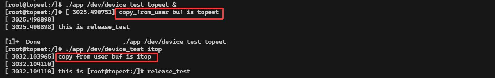
图28.10最后可以使用rmmod spinlock.ko 命令进行驱动的卸载，如图28.11 所示。
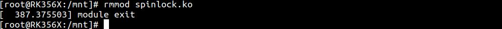
图28.11本实验通过自旋锁限制同一时间内设备访问数量，实现对共享资源的保护。

自旋锁若是使用不当就会产生死锁，在使用自旋锁时要格外注意。在本章将会对自旋锁的特殊情况-死锁进行讲解。
## 29.1 自旋锁死锁
自旋锁死锁是指多个任务或进程因互相等待彼此释放资源，导致谁也无法继续往下执行的现象。举个例子，假设有进程A 和进程B 俩个进程，进程A 对资源1 持有自旋锁，同时进程A也想获取资源2。而进程B 对资源2 持有自旋锁，同时进程B 也想获取资源1。在这种情况下进程A 和进程B 都在等待彼此释放资源，从而造成了死锁。如图29.1 所示。
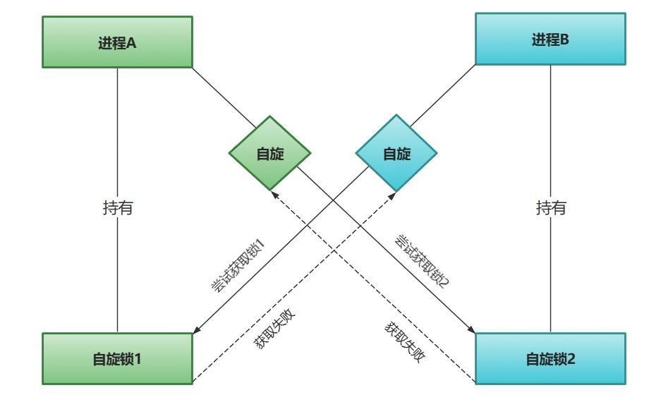
图29.1又如进程A 在拥有自旋锁期间发生了中断，CPU 转头去执行中断处理函数，而此时的中断处理函数也需要获取同一把自旋锁。这时由于锁已被A 占用，中断处理函数只能等待自旋，从而导致系统进入死锁状态，如图29.2 所示。

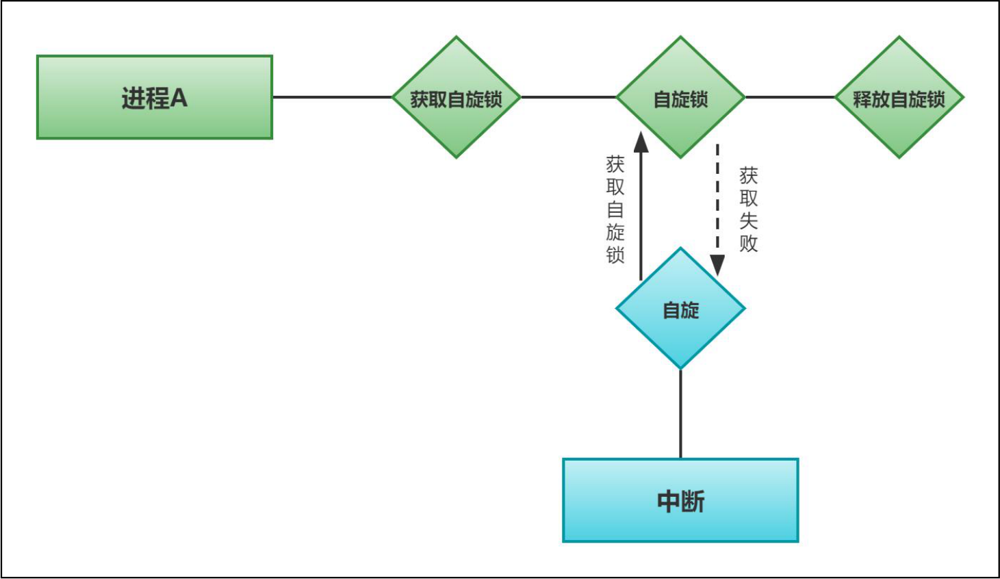
图29.2所以，在使用自旋锁的时候要格外注意死锁问题。如在中断处理函数中也要获得自旋锁时，驱动程序则需要在拥有自旋锁时禁止中断，在释放自旋锁时使能中断。同时尽量短时间拥有自旋锁，长时间拥有自旋锁可能会导致系统资源耗尽从而造成死锁。最后也要避免某个获得自旋锁的函数调用其他同样试图获取这个锁的函数，否则也会造成死锁。
## 29.2 实验程序的编写
### 29.2.1 驱动程序编写
本实验代码存储在网盘iTOP-RK3568 开发板\07_学习教程配套资料\03_Linux 驱动配套资料\04_Linux 驱动例程\17\module 路径下。本实验以并发与竞争实验为基础，在open()函数中加入了自旋锁加锁，在close()函数中加入了自旋锁解锁，由于在write()函数中存在sleep()睡眠函数，所以会造成内核阻塞，睡眠期间如果使用另一个进程获取该自旋锁，就会造成死锁。实验代码dielock.c 如代码清单29.1 所示。代码清单29.1
```c
#include <linux/init.h>
#include <linux/module.h>
#include <linux/fs.h>
#include <linux/cdev.h>
#include <linux/kdev_t.h>
```

```c
#include <linux/delay.h>
#include <linux/uaccess.h>
#include <linux/spinlock.h>
static spinlock_t spinlock_test;//定义spinlock_t 类型的自旋锁变量spinlock_test
static int open_test(struct inode *inode,struct file *file)
{
    //printk("\nthis is open_test \n");
    spin_lock(&spinlock_test);//自旋锁加锁
    return 0;
}
static ssize_t read_test(struct file *file,char __user *ubuf,size_t len,loff_t *off)
{
    int ret;
    char kbuf[10] = "topeet";//定义char 类型字符串变量kbuf
    printk("\nthis is read_test \n");
    ret = copy_to_user(ubuf,kbuf,strlen(kbuf));//使用copy_to_user 内核空间向用户空间传数据
    if (ret != 0){
        printk("copy_to_user is error \n");
    }
    printk("copy_to_user is ok \n");
    return 0;
}
static char kbuf[10] = {0};//定义char 类型字符串全局变量kbuf
static ssize_t write_test(struct file *file,const char __user *ubuf,size_t len,loff_t *off)
{
    int ret;
    ret = copy_from_user(kbuf,ubuf,len);//使用copy_from_user 接收用户空间传递的数据
    if (ret != 0){
        printk("copy_from_user is error\n");
    }
    if(strcmp(kbuf,"topeet") == 0 ){//如果传递的kbuf 是topeet 就睡眠四秒钟
        ssleep(4);
    }
    else if(strcmp(kbuf,"itop") == 0){//如果传递的kbuf 是itop 就睡眠两秒钟
        ssleep(2);
    }
    printk("copy_from_user buf is %s \n",kbuf);
    return 0;
}
static int release_test(struct inode *inode,struct file *file)
{
    printk("\nthis is release_test \n");
```

```c
spin_unlock(&spinlock_test);//自旋锁解锁
return 0;
}
struct chrdev_test {
  dev_t dev_num;//定义dev_t 类型变量dev_num 来表示设备号
  int major,minor;//定义int 类型的主设备号major 和次设备号minor
  struct cdev cdev_test;//定义struct cdev 类型结构体变量cdev_test，表示要注册的字符设备
  struct class *class_test;//定于struct class *类型结构体变量class_test，表示要创建的类
};
struct chrdev_test dev1;//创建chrdev_test 类型的
struct file_operations fops_test = {
 .owner = THIS_MODULE,//将owner 字段指向本模块，可以避免在模块的操作正在被使用时卸载该模
块
 .open = open_test,//将open 字段指向open_test(...)函数
 .read = read_test,//将read 字段指向read_test(...)函数
 .write = write_test,//将write 字段指向write_test(...)函数
 .release = release_test,//将release 字段指向release_test(...)函数
};
static int __init atomic_init(void)
{
spin_lock_init(&spinlock_test);
if(alloc_chrdev_region(&dev1.dev_num,0,1,"chrdev_name") < 0 ){//自动获取设备号，设备名
chrdev_name
    printk("alloc_chrdev_region is error \n");
}
printk("alloc_chrdev_region is ok \n");
dev1.major = MAJOR(dev1.dev_num);//使用MAJOR()函数获取主设备号
dev1.minor = MINOR(dev1.dev_num);//使用MINOR()函数获取次设备号
printk("major is %d,minor is %d\n",dev1.major,dev1.minor);
cdev_init(&dev1.cdev_test,&fops_test);//使用cdev_init()函数初始化cdev_test 结构体，并链接到
fops_test 结构体
dev1.cdev_test.owner = THIS_MODULE;//将owner 字段指向本模块，可以避免在模块的操作正在被使
用时卸载该模块
cdev_add(&dev1.cdev_test,dev1.dev_num,1);//使用cdev_add()函数进行字符设备的添加
dev1.class_test = class_create(THIS_MODULE,"class_test");//使用class_create 进行类的创建，类名称为
class_test
device_create(dev1.class_test,0,dev1.dev_num,0,"device_test");//使device_create 进行设备的创建，设
备名称为device_test
return 0;
}
static void __exit atomic_exit(void)
```

```c
{
    device_destroy(dev1.class_test,dev1.dev_num);//删除创建的设备
    class_destroy(dev1.class_test);//删除创建的类
    cdev_del(&dev1.cdev_test);//删除添加的字符设备cdev_test
    unregister_chrdev_region(dev1.dev_num,1);//释放字符设备所申请的设备号
    printk("module exit \n");
}
Module_init(atomic_init);
module_exit(atomic_exit)
MODULE_LICENSE("GPL v2");
MODULE_AUTHOR("topeet");
```
### 29.2.2 编写测试APP
本实验代码存储在网盘iTOP-RK3568 开发板\07_学习教程配套资料\03_Linux 驱动配套资料\04_Linux 驱动例程\17\app 路径下。本测试app 代码和上一章节相同，需要输入两个参数，第一个参数为对应的设备节点，第二个参数为topeet 或者itop，分别代表向设备写入的数据，实验代码app.c 内容如代码清单29.2所示。代码清单29.2
```c
#include <stdio.h>
#include <sys/types.h>
#include <sys/stat.h>
#include <fcntl.h>
#include <string.h>
 #include <unistd.h>
int main(int argc, char *argv[])
{
    int fd;//定义int 类型的文件描述符
    char str1[10] = {0};//定义读取缓冲区str1
    fd = open(argv[1],O_RDWR);//调用open 函数，打开输入的第一个参数文件，权限为可读可写
    if(fd < 0 ){
        printf("file open failed \n");
        return -1;
    }
    /*如果第二个参数为topeet，条件成立，调用write 函数，写入topeet*/
    if (strcmp(argv[2],"topeet") == 0 ){
        write(fd,"topeet",10);
    }
    /*如果第二个参数为itop，条件成立，调用write 函数，写入itop*/
    else if (strcmp(argv[2],"itop") == 0 ){
        write(fd,"itop",10);
    }
```

```c
close(fd);
return 0;
}
```
由于本次测试的CPU 为多核心CPU，其他核心仍旧可以调度其他进程，所以需要多次使用taskset()函数指定CPU 进行进程的运行，以此来产生死锁，在与app.c 同级目录下创建名为app.sh 的脚本文件，脚本内容如代码清单29.3 所示。代码清单29.3
```c
#!/bin/bash
taskset -c 0 ./app /dev/device_test topeet &
taskset -c 1 ./app /dev/device_test topeet &
taskset -c 2 ./app /dev/device_test topeet &
taskset -c 3 ./app /dev/device_test topeet &
taskset -c 0 ./app /dev/device_test topeet &
taskset -c 1 ./app /dev/device_test topeet &
taskset -c 2 ./app /dev/device_test topeet &
taskset -c 3 ./app /dev/device_test topeet &
```
需要使用chmod 777 app.sh 命令赋予脚本可执行权限，如图29.3 所示。
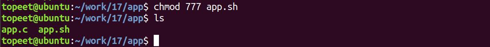
图29.3
## 29.3 运行测试
### 29.3.1 编译驱动程序
在dielock.c 代码同一目录下创建Makefile 文件，如图29.4 所示。
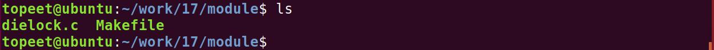
图29.4Makefile 文件内容如代码清单29.4 所示。代码清单29.4
```c
export ARCH=arm64#设置平台架构
export CROSS_COMPILE=aarch64-linux-gnu-#交叉编译器前缀
obj-m += dielock.o#此处要和你的驱动源文件同名
KDIR :=/home/topeet/Linux/linux_sdk/kernel#这里是你的内核目录
PWD ?= $(shell pwd)
all:
    make -C $(KDIR) M=$(PWD) modules#make 操作
clean:
    make -C $(KDIR) M=$(PWD) clean#make clean 操作
```

在存放dielock.c 和Makefile 文件目录下使用make 命令编译驱动程序，编译完成如图29.5所示。
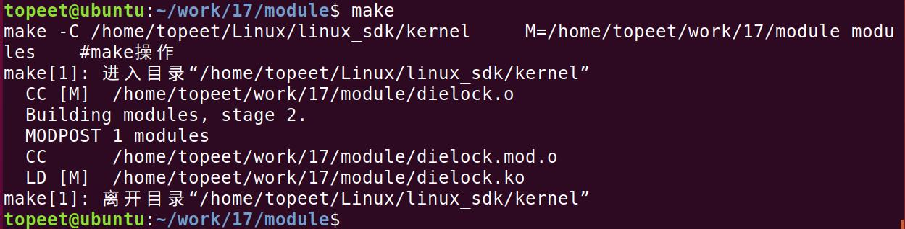
图29.5编译完生成dielock.ko 目标文件，如图29.6 所示。
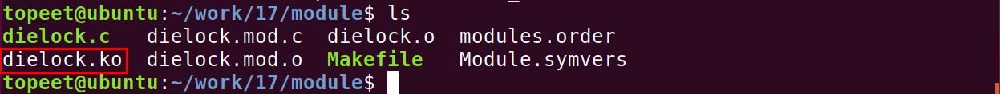
图29.6
### 29.3.2 编译应用程序
来到应用程序app.c 文件的存放路径如图29.7 所示。
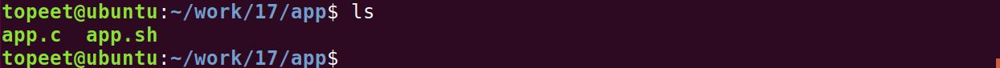
图29.7然后使用aarch64-linux-gnu-gcc -o app app.c -static 命令对app.c 进行交叉编译，编译完成如图29.8 所示。
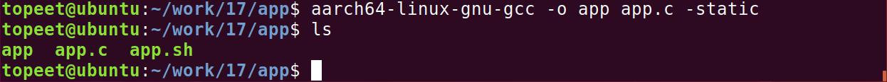
图29.8
### 29.3.3 运行测试
将本章节编译好的dielock.ko 驱动文件和app 可执行文件拷贝到开发板上。开发板启动之后，使用insmod dielock.ko 命令进行驱动模块的加载，如图29.9 所示。
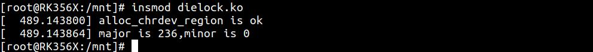
图29.9可以看到申请的主设备号和次设备号就被打印了出来，然后使用ls /dev/device_test 命令对自动生成的设备节点device_test 进行查看，如图29.10 所示。

图29.10

