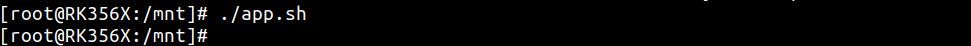
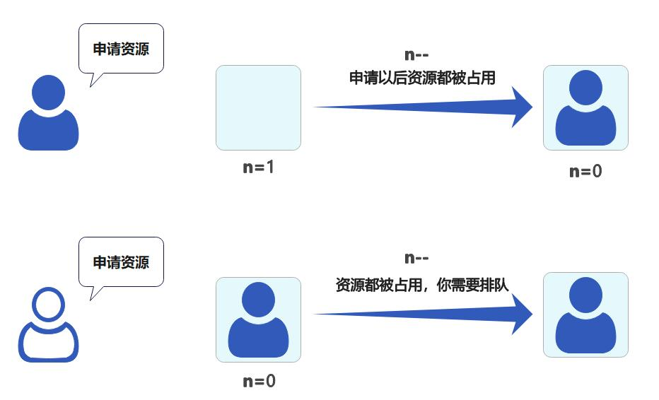
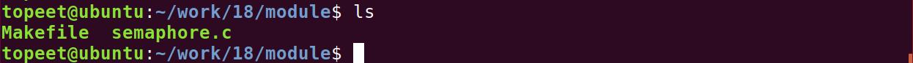
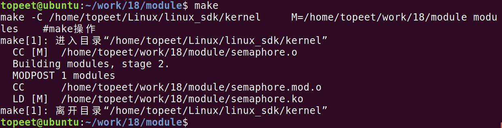
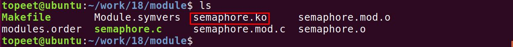
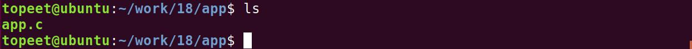
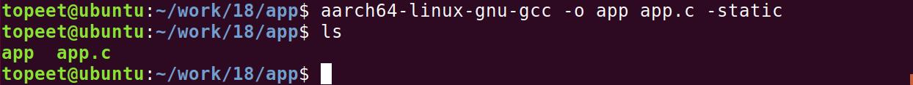
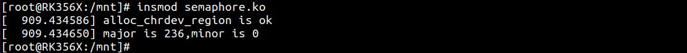
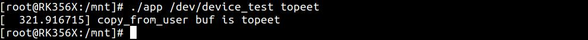
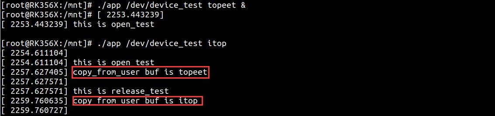

# 第030章 信号量实验

可以看到device_test 节点已经被自动创建了，然后使用./app.sh 命令运行app.sh 脚本，该脚本会指定CPU 在加锁之后进入内核休眠状态，如图29.11 所示。

图22.11在指令输入之后，串口终端无法输入，引发了死锁，进而造成了系统崩溃，所以在编写驱动的过程中，要尽可能的避免死锁的出现。至此，自旋锁死锁驱动实验就完成了。

当无法获取自旋锁时会一直进行等待，所以自旋锁只有当占用时间很短的情况下才会使用。如果需要长时间使用共享资源，也就是需要长时间占用锁，可以使用信号量。
## 30.1 信号量
信号量是一种睡眠锁。如果有一个任务试图获得一个已被占用的信号量，它会被推入等待队列中并进入睡眠状态。此刻处理器就可以去执行其它代码。当持有信号量的进程释放信号量后，在等待队列中的任务将被唤醒，进而尝试重新获取该信号量。信号量具有P 操作和V 操作。P 操作会使信号量的值减一，如果此时信号量的值小于等于0，说明资源都被占用，如果还有其他进程需要使用，则该进程会被加入等待队列，如果大于0，表示可用资源为n。例如可用资源n 被设置成了1，表示该资源最多只能被一个进程访问。P 操作会使信号量的值减一，并唤醒等待队列中的一个进程，如图30.1 所示。

图30.1信号量可类比为银行业务办理：窗口数量相当于信号量值，客户领号后如果窗口都在办理业务则客户在休息区等待（n 小于等于0 时睡眠），窗口空出后被叫号上前办理业务（唤醒与资源访问）。相比于自旋锁，信号量具有休眠特性，因此适用长时间占用资源的场合，但由于信号量会引起休眠，所以不能用在中断函数中。而且如果共享资源的持有时间比较短，使用信号量的话会造成频繁的休眠，反而带来更多资源的消耗，此时使用自旋锁反而效果更好。再同时使用信

号量和自旋锁的时候，要先获取信号量，再使用自旋锁，因为信号量会导致睡眠。Linux 内核使用semaphore 结构体来表示信号量，该结构体定义在内核源码/include/linux/semaphore.h 文件内（所以在下一章节的信号量实验中需要加入该头文件），结构体内容如代码清单30.1 所示。代码清单30.1
```c
struct semaphore {
    raw_spinlock_tlock;
    unsigned intcount;
    struct list_headwait_list;
};
```
与信号量相关的API 函数同样定义在semaphore.h 文件内，部分常用API 函数如表30.1 所示。表30.1函数描述
```c
DEFINE_SEAMPHORE(name)定义信号量，并且设置信号量的值为1
void sema_init(struct semaphore *sem, int val)初始化信号量sem，设置信号量值为val
void down(struct semaphore *sem)获取信号量，不能被中断打断，如ctrl+c
int down_interruptible(struct semaphore *sem)获取信号量，可以被中断打断，如ctrl+c
void up(struct semaphore *sem)释放信号量
int down_trylock(struct semaphore *sem);尝试获取信号量，如果能获取到信号量就获取，并且返回0。
                                            如果不能就返回非0
```
## 30.2 实验程序的编写
### 30.2.1 驱动程序编写
本实验代码存储在网盘iTOP-RK3568开发板\07_学习教程配套资料\03_Linux驱动配套资料\04_Linux 驱动例程\18\module 路径下。本实验在驱动入口函数设置信号量值为1，在open()函数中加对信号量的值减一，在release()函数对信号量的值加一，通过信号量值实现设备同一时间只能被一个设备访问从而避免竞争问题的出现。实验代码semaphore.c 如代码清单30.2 所示。代码清单30.2
```c
#include <linux/init.h>
#include <linux/module.h>
#include <linux/fs.h>
#include <linux/cdev.h>
#include <linux/kdev_t.h>
#include <linux/uaccess.h>
```

```c
#include <linux/delay.h>
#include <linux/semaphore.h>
struct semaphore semaphore_test;//定义一个semaphore 类型的结构体变量semaphore_test
static int open_test(struct inode *inode,struct file *file)
{
    printk("\nthis is open_test \n");
    down(&semaphore_test);//信号量数量减1
    return 0;
}
static ssize_t read_test(struct file *file,char __user *ubuf,size_t len,loff_t *off)
{
    int ret;
    char kbuf[10] = "topeet";//定义char 类型字符串变量kbuf
    printk("\nthis is read_test \n");
    ret = copy_to_user(ubuf,kbuf,strlen(kbuf));//使用copy_to_user 内核空间向用户空间传数据
    if (ret != 0){
        printk("copy_to_user is error \n");
    }
    printk("copy_to_user is ok \n");
    return 0;
}
static char kbuf[10] = {0};//定义char 类型字符串全局变量kbuf
static ssize_t write_test(struct file *file,const char __user *ubuf,size_t len,loff_t *off)
{
    int ret;
    ret = copy_from_user(kbuf,ubuf,len);//使用copy_from_user 接收用户空间传递的数据
    if (ret != 0){
        printk("copy_from_user is error\n");
    }
    if(strcmp(kbuf,"topeet") == 0 ){//如果传递的kbuf 是topeet 就睡眠四秒钟
        ssleep(4);
    }
    else if(strcmp(kbuf,"itop") == 0){//如果传递的kbuf 是itop 就睡眠两秒钟
        ssleep(2);
    }
    printk("copy_from_user buf is %s \n",kbuf);
    return 0;
}
static int release_test(struct inode *inode,struct file *file)
{
    up(&semaphore_test);//信号量数量加1
    printk("\nthis is release_test \n");
```

```c
return 0;
}
struct chrdev_test {
  dev_t dev_num;//定义dev_t 类型变量dev_num 来表示设备号
  int major,minor;//定义int 类型的主设备号major 和次设备号minor
  struct cdev cdev_test;//定义struct cdev 类型结构体变量cdev_test，表示要注册的字符设备
  struct class *class_test;//定于struct class *类型结构体变量class_test，表示要创建的类
};
struct chrdev_test dev1;//创建chrdev_test 类型的
struct file_operations fops_test = {
 .owner = THIS_MODULE,//将owner 字段指向本模块，可以避免在模块的操作正在被使用时卸载该模
块
 .open = open_test,//将open 字段指向open_test(...)函数
 .read = read_test,//将read 字段指向read_test(...)函数
 .write = write_test,//将write 字段指向write_test(...)函数
 .release = release_test,//将release 字段指向release_test(...)函数
};
static int __init atomic_init(void)
{
sema_init(&semaphore_test,1);//初始化信号量结构体semaphore_test，并设置信号量的数量为1
if(alloc_chrdev_region(&dev1.dev_num,0,1,"chrdev_name") < 0 ){//自动获取设备号，设备名
chrdev_name
    printk("alloc_chrdev_region is error \n");
}
printk("alloc_chrdev_region is ok \n");
dev1.major = MAJOR(dev1.dev_num);//使用MAJOR()函数获取主设备号
dev1.minor = MINOR(dev1.dev_num);//使用MINOR()函数获取次设备号
printk("major is %d,minor is %d\n",dev1.major,dev1.minor);
cdev_init(&dev1.cdev_test,&fops_test);//使用cdev_init()函数初始化cdev_test 结构体，并链接到
fops_test 结构体
dev1.cdev_test.owner = THIS_MODULE;//将owner 字段指向本模块，可以避免在模块的操作正在被使
用时卸载该模块
cdev_add(&dev1.cdev_test,dev1.dev_num,1);//使用cdev_add()函数进行字符设备的添加
dev1.class_test = class_create(THIS_MODULE,"class_test");//使用class_create 进行类的创建，类名称为
class_test
device_create(dev1.class_test,0,dev1.dev_num,0,"device_test");//使用device_create 进行设备的创建，
设备名称为device_test
return 0;
}
static void __exit atomic_exit(void)
{
device_destroy(dev1.class_test,dev1.dev_num);//删除创建的设备
```

```c
class_destroy(dev1.class_test);//删除创建的类
cdev_del(&dev1.cdev_test);//删除添加的字符设备cdev_test
unregister_chrdev_region(dev1.dev_num,1);//释放字符设备所申请的设备号
printk("module exit \n");
}
module_init(atomic_init);
module_exit(atomic_exit)
MODULE_LICENSE("GPL v2");
MODULE_AUTHOR("topeet");
```
### 30.2.2 编写测试APP
本实验代码存储在网盘iTOP-RK3568开发板\07_学习教程配套资料\03_Linux驱动配套资料\04_Linux 驱动例程\18\app 路径下。本测试app 代码和上一章节相同，需要输入两个参数，第一个参数为对应的设备节点，第二个参数为topeet 或者itop，分别代表向设备写入的数据，实验代码app.c 内容如代码清单30.3所示。代码清单30.3
```c
#include <stdio.h>
#include <sys/types.h>
#include <sys/stat.h>
#include <fcntl.h>
#include <string.h>
 #include <unistd.h>
int main(int argc, char *argv[])
{
    int fd;//定义int 类型的文件描述符
    char str1[10] = {0};//定义读取缓冲区str1
    fd = open(argv[1],O_RDWR);//调用open 函数，打开输入的第一个参数文件，权限为可读可写
    if(fd < 0 ){
        printf("file open failed \n");
        return -1;
    }
    /*如果第二个参数为topeet，条件成立，调用write 函数，写入topeet*/
    if (strcmp(argv[2],"topeet") == 0 ){
        write(fd,"topeet",10);
    }
    /*如果第二个参数为itop，条件成立，调用write 函数，写入itop*/
    else if (strcmp(argv[2],"itop") == 0 ){
        write(fd,"itop",10);
    }
    close(fd);
    return 0;
```

```c
}
```
## 30.3 运行测试
### 30.3.1 编译驱动程序
在semaphore.c 代码同一目录下创建Makefile 文件，如图30.2 所示。

图30.2Makefile 文件内容如代码清单30.4 所示。代码清单30.4
```c
export ARCH=arm64#设置平台架构
export CROSS_COMPILE=aarch64-linux-gnu-#交叉编译器前缀
obj-m += semaphore.o#此处要和你的驱动源文件同名
KDIR :=/home/topeet/Linux/linux_sdk/kernel#这里是你的内核目录
PWD ?= $(shell pwd)
all:
    make -C $(KDIR) M=$(PWD) modules#make 操作
clean:
    make -C $(KDIR) M=$(PWD) clean#make clean 操作
```
在存放semaphore.c 和Makefile 文件目录下使用make 命令编译驱动程序，编译完成如图30.3 所示。

图30.3编译完生成semaphore.ko 目标文件，如图30.4 所示。

图30.4
### 30.3.2 编译应用程序
来到应用程序app.c 文件的存放路径如图30.5 所示。


图30.5使用aarch64-linux-gnu-gcc -o app app.c -static 命令对app.c 进行交叉编译，编译完成如图30.6 所示。

图30.6
### 30.3.3 运行测试
将本章节编译好的semaphore.ko 驱动文件和app 可执行文件拷贝到开发板上。开发板启动之后，使用insmod semaphore.ko 命令进行驱动模块的加载，如图30.7 所示。

图30.7可以看到申请的主设备号和次设备号就被打印了出来，然后使用ls /dev/device_test 命令对自动生成的设备节点device_test 进行查看，如图30.8 所示。

图30.8可以看到device_test 节点已经被自动创建了，然后使用./app /dev/device_test topeet 命令运行测试app，运行结果如图30.9 所示。

图30.9可以看到传递的buf 值为topeet ，然后输入./app /dev/device_test topeet & 和./app/dev/device_test itop 两个命令在后台运行两个app，来进行竞争测试，运行结果如图30.10 所示。

图30.10通过图30.10 中打印信息可知数据已经被正确传递了，并没有发生共享资源竞争的问题。由于信号量值为1，当第一个任务运行之后，信号量的值变成了0，所以第二个任务执行时会进入休眠状态，只有当第一个任务执行完毕后，才会唤醒第二个任务去执行，因此避免了并发与竞争。最后可以使用rmmod semaphore.ko 命令进行驱动的卸载，如图30.11 所示。

