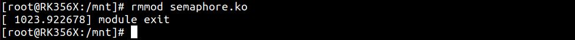
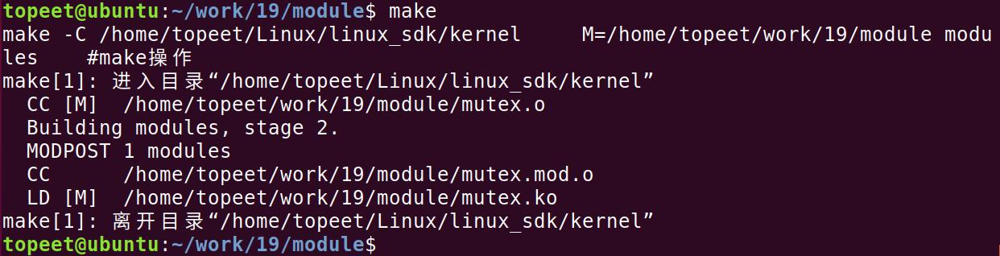
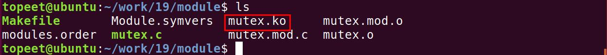
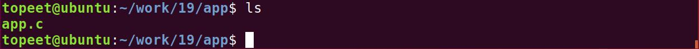
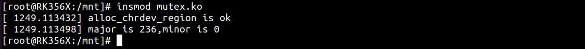
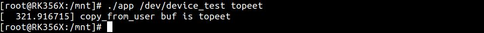
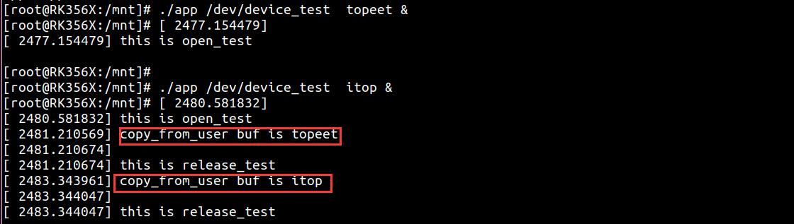
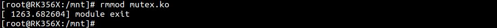

# 第031章 互斥锁实验


图30.11至此，信号量实验就完成了。

与信号量相比，互斥锁的实现更加高效、简洁。因此，在Linux 内核编程中，若使用信号量的目的是实现互斥（即其信号量值为1），通常建议使用互斥锁来代替。
## 31.1 互斥锁
互斥锁是一种用于实现线程同步的机制，可防止多个线程同时访问共享资源，一个线程在访问共享资源前先加锁，其他线程必须等待其释放锁后才能访问，这样就保证了同一时刻只有一个线程可访问资源，从而实现互斥。互斥锁会导致休眠，所以在中断里面不能用互斥锁。另外同一时刻只能有一个线程持有互斥锁，并且只有持有者才可以解锁，也不允许递归上锁和解锁。内核中以mutex 结构体来表示互斥锁，定义在内核源码/include/linux/mutex.h 文件中，如代码清单31.1 所示。代码清单31.1
```c
struct mutex {
    atomic_long_towner;
    spinlock_twait_lock;
#ifdef CONFIG_MUTEX_SPIN_ON_OWNER
    struct optimistic_spin_queue osq; /* Spinner MCS lock */
#endif
    struct list_headwait_list;
#ifdef CONFIG_DEBUG_MUTEXES
    void*magic;
#endif
#ifdef CONFIG_DEBUG_LOCK_ALLOC
    struct lockdep_mapdep_map;
#endif
};
```
一些和互斥锁相关的API 函数也定义在mutex.h 文件中，常用API 函数如表31.1 所示。表31.1函数描述DEFINE_MUTEX(name)定义并初始化一个mutex 变量void mutex_init(mutex *lock)初始化mutexvoid mutex_lock(struct mutex *lock)获取mutex，也就是给mutex 上锁。如果获取不到就进休眠void mutex_unlock(struct mutex *lock)释放mutex，也就给mute 解锁int mutex_is_locked(struct mutex *lock)判断mutex 是否被获取，如果是的话就返回1，

否则返回0
## 31.2 实验程序的编写
### 31.2.1 驱动程序编写
本实验代码存储在网盘iTOP-RK3568开发板\07_学习教程配套资料\03_Linux驱动配套资料\04_Linux 驱动例程\19\module 路径下。本实验在并发与竞争实验代码基础上添加互斥锁，首先在atomic_init()函数内初始化互斥锁，由于互斥锁在同一时间内只允许一个任务对共享资源进行，所以只需要在open()函数中加入互斥锁加锁函数，在release()函数中加入互斥锁解锁函数即可。实验代码mutex.c 如代码清单31.2 所示。代码清单31.2
```c
#include <linux/init.h>
#include <linux/module.h>
#include <linux/fs.h>
#include <linux/cdev.h>
#include <linux/kdev_t.h>
#include <linux/uaccess.h>
#include <linux/delay.h>
#include <linux/errno.h>
#include <linux/mutex.h>
struct mutex mutex_test;//定义mutex 类型的互斥锁结构体变量mutex_test
static int open_test(struct inode *inode,struct file *file)
{
    printk("\nthis is open_test \n");
    mutex_lock(&mutex_test);//互斥锁加锁
    return 0;
}
static ssize_t read_test(struct file *file,char __user *ubuf,size_t len,loff_t *off)
{
    int ret;
    char kbuf[10] = "topeet";//定义char 类型字符串变量kbuf
    printk("\nthis is read_test \n");
    ret = copy_to_user(ubuf,kbuf,strlen(kbuf));//使用copy_to_user 内核空间向用户空间传数据
    if (ret != 0){
        printk("copy_to_user is error \n");
    }
    printk("copy_to_user is ok \n");
    return 0;
```

```c
}
static char kbuf[10] = {0};//定义char 类型字符串全局变量kbuf
static ssize_t write_test(struct file *file,const char __user *ubuf,size_t len,loff_t *off)
{
    int ret;
    ret = copy_from_user(kbuf,ubuf,len);//使用copy_from_user 接收用户空间传递的数据
    if (ret != 0){
        printk("copy_from_user is error\n");
}
    if(strcmp(kbuf,"topeet") == 0 ){//如果传递的kbuf 是topeet 就睡眠四秒钟
        ssleep(4);
    }
    else if(strcmp(kbuf,"itop") == 0){//如果传递的kbuf 是itop 就睡眠两秒钟
        ssleep(2);
    }
    printk("copy_from_user buf is %s \n",kbuf);
    return 0;
}
static int release_test(struct inode *inode,struct file *file)
{
    mutex_unlock(&mutex_test);//互斥锁解锁
    printk("\nthis is release_test \n");
    return 0;
}
struct chrdev_test {
       dev_t dev_num;//定义dev_t 类型变量dev_num 来表示设备号
       int major,minor;//定义int 类型的主设备号major 和次设备号minor
       struct cdev cdev_test;//定义struct cdev 类型结构体变量cdev_test，表示要注册的字符设备
       struct class *class_test;//定于struct class *类型结构体变量class_test，表示要创建的类
};
struct chrdev_test dev1;//创建chrdev_test 类型的
struct file_operations fops_test = {
      .owner = THIS_MODULE,//将owner 字段指向本模块，可以避免在模块的操作正在被使用时卸载该模
块
      .open = open_test,//将open 字段指向open_test(...)函数
      .read = read_test,//将read 字段指向read_test(...)函数
      .write = write_test,//将write 字段指向write_test(...)函数
      .release = release_test,//将release 字段指向release_test(...)函数
};
static int __init atomic_init(void)
{
    mutex_init(&mutex_test);//对互斥体进行初始化
```

```c
if(alloc_chrdev_region(&dev1.dev_num,0,1,"chrdev_name") < 0 ){//自动获取设备号，设备名
chrdev_name
    printk("alloc_chrdev_region is error \n");
}
printk("alloc_chrdev_region is ok \n");
dev1.major = MAJOR(dev1.dev_num);//使用MAJOR()函数获取主设备号
dev1.minor = MINOR(dev1.dev_num);//使用MINOR()函数获取次设备号
printk("major is %d,minor is %d\n",dev1.major,dev1.minor);
cdev_init(&dev1.cdev_test,&fops_test);//使用cdev_init()函数初始化cdev_test 结构体，并链接到
fops_test 结构体
dev1.cdev_test.owner = THIS_MODULE;//将owner 字段指向本模块，可以避免在模块的操作正在被使用
时卸载该模块
cdev_add(&dev1.cdev_test,dev1.dev_num,1);//使用cdev_add()函数进行字符设备的添加
dev1.class_test = class_create(THIS_MODULE,"class_test");//使用class_create 进行类的创建，类名称为
class_test
device_create(dev1.class_test,0,dev1.dev_num,0,"device_test");//使用device_create 进行设备的创建，
设备名称为device_test
return 0;
}
static void __exit atomic_exit(void)
{
device_destroy(dev1.class_test,dev1.dev_num);//删除创建的设备
class_destroy(dev1.class_test);//删除创建的类
cdev_del(&dev1.cdev_test);//删除添加的字符设备cdev_test
unregister_chrdev_region(dev1.dev_num,1);//释放字符设备所申请的设备号
printk("module exit \n");
}
module_init(atomic_init);
module_exit(atomic_exit)
MODULE_LICENSE("GPL v2");
MODULE_AUTHOR("topeet");
```
### 31.2.2 编写测试APP
本实验代码存储在网盘iTOP-RK3568开发板\07_学习教程配套资料\03_Linux驱动配套资料\04_Linux 驱动例程\19\app 路径下。本测试app 代码和上一章节相同，需要输入两个参数，第一个参数为对应的设备节点，第二个参数为topeet 或者itop，分别代表向设备写入的数据，实验代码app.c 内容如代码清单31.3所示。代码清单31.3
```c
#include <stdio.h>
#include <sys/types.h>
```

```c
#include <sys/stat.h>
#include <fcntl.h>
#include <string.h>
 #include <unistd.h>
int main(int argc, char *argv[])
{
    int fd;//定义int 类型的文件描述符
    char str1[10] = {0};//定义读取缓冲区str1
    fd = open(argv[1],O_RDWR);//调用open 函数，打开输入的第一个参数文件，权限为可读可写
    if(fd < 0 ){
        printf("file open failed \n");
        return -1;
    }
    /*如果第二个参数为topeet，条件成立，调用write 函数，写入topeet*/
    if (strcmp(argv[2],"topeet") == 0 ){
        write(fd,"topeet",10);
    }
    /*如果第二个参数为itop，条件成立，调用write 函数，写入itop*/
    else if (strcmp(argv[2],"itop") == 0 ){
        write(fd,"itop",10);
    }
    close(fd);
    return 0;
}
```
## 31.3 运行测试
### 31.3.1 编译驱动程序
在mutex.c 代码同一目录下创建Makefile 文件，如图31.1 所示。

图31.1Makefile 文件内容如代码清单31.4 所示。代码清单31.4
```c
export ARCH=arm64#设置平台架构
export CROSS_COMPILE=aarch64-linux-gnu-#交叉编译器前缀
obj-m += mutex.c#此处要和你的驱动源文件同名
KDIR :=/home/topeet/Linux/linux_sdk/kernel#这里是你的内核目录
PWD ?= $(shell pwd)
all:
    make -C $(KDIR) M=$(PWD) modules#make 操作
clean:
```

```c
make -C $(KDIR) M=$(PWD) clean#make clean 操作
```
在存放mutex.c 和Makefile 文件目录下使用make 命令编译驱动程序，编译完成如图31.2所示。

图31.2编译完生成mutex.ko 目标文件，如图31.3 所示。

图31.3
### 31.3.2 编译应用程序
来到应用程序app.c 文件的存放路径，如图31.4 所示：

图31.4使用aarch64-linux-gnu-gcc -o app app.c -static 命令对app.c 进行交叉编译，编译完成如图31.5 所示。

图31.5
### 31.3.3 运行测试
将本章节编译好的mutex.ko 驱动文件和app 可执行文件拷贝到开发板上。开发板启动之后，使用insmod mutex.ko 命令进行驱动模块的加载，如图31.6 所示。

图31.6可以看到申请的主设备号和次设备号就被打印了出来，然后使用ls /dev/device_test 命令对自动生成的设备节点device_test 进行查看，如图31.7 所示。


图31.7可以看到device_test 节点已经被自动创建了，然后使用./app /dev/device_test topeet 命令运行测试app，运行结果如图31.8 所示。

图31.8可以看到传递的buf 值为topeet ，然后输入./app /dev/device_test topeet & 和./app/dev/device_test itop &两个命令在后台运行两个app，来进行竞争测试，运行结果如图31.9 所示。

图31.9与信号量实验测试现象相同，两个app 同时运行，打印信息正常，证明数据已经被正确传递，没有发生共享资源竞争的现象，说明互斥锁起到了作用。最后可以使用rmmod mutex.ko 命令进行驱动的卸载，如图31.10 所示。

图31.10至此，互斥锁实验就完成了。

