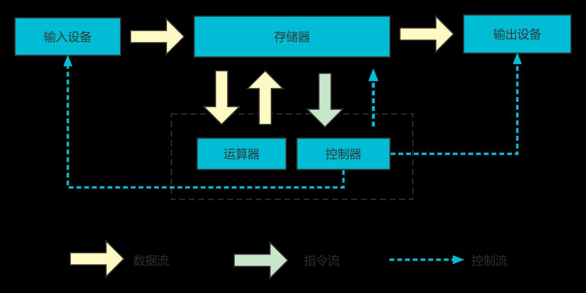
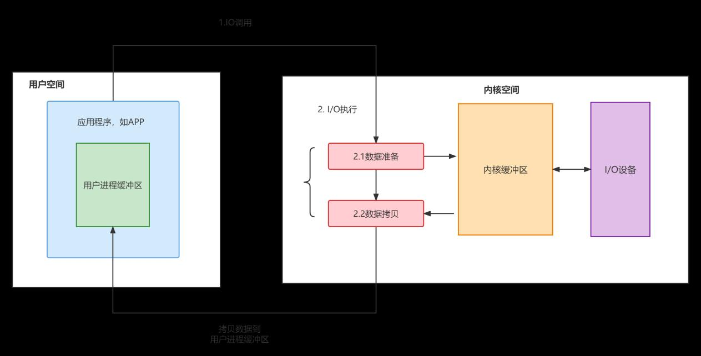
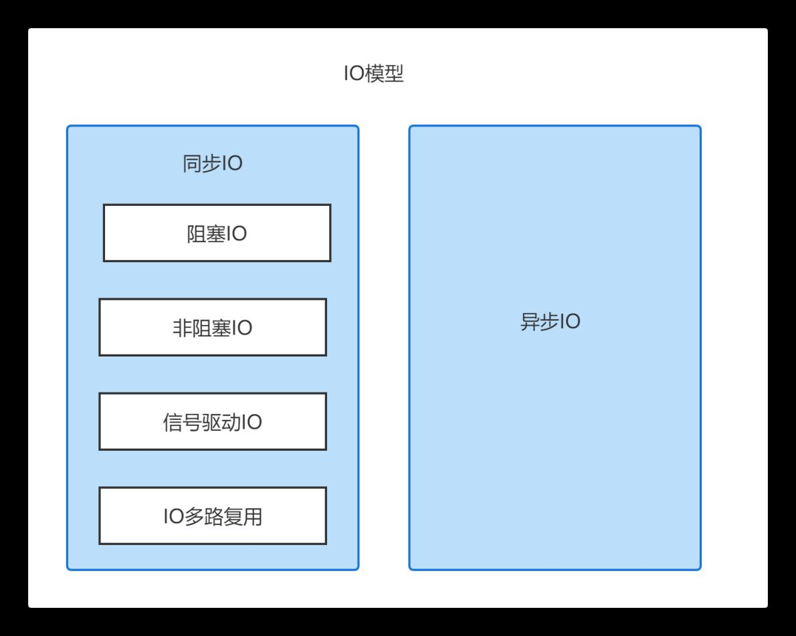
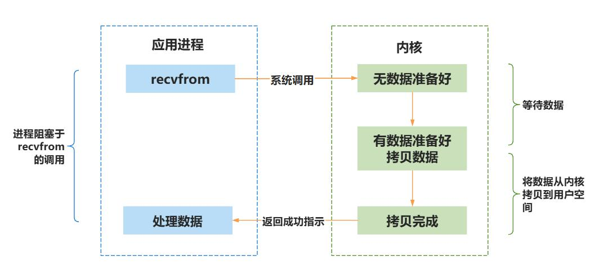
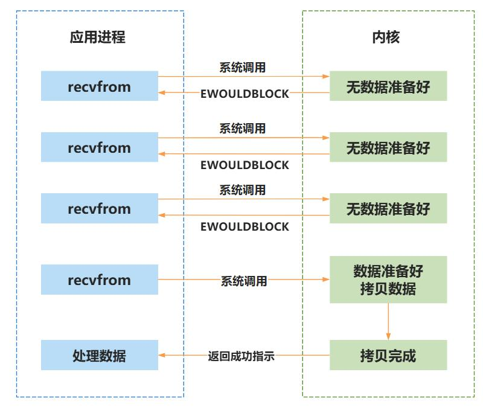
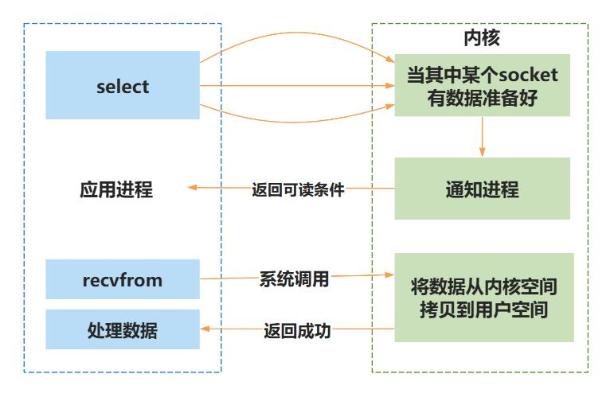
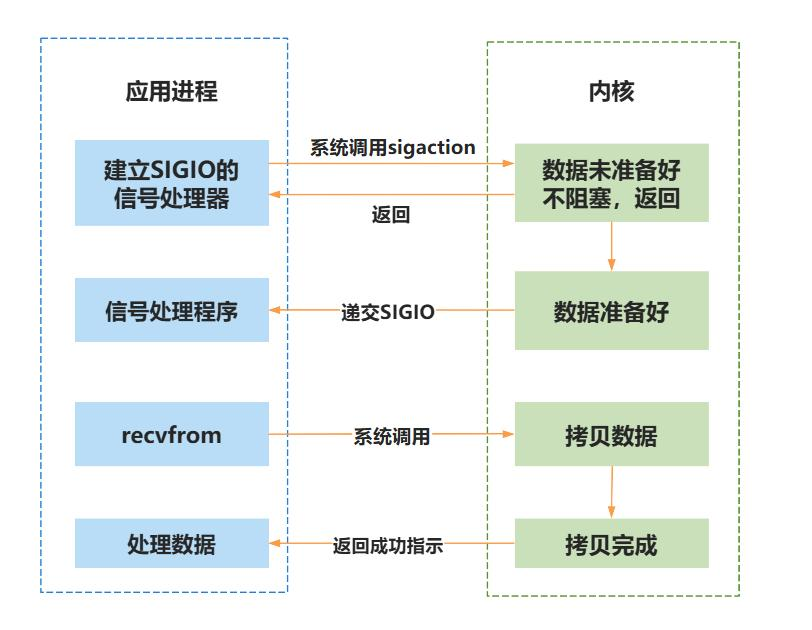
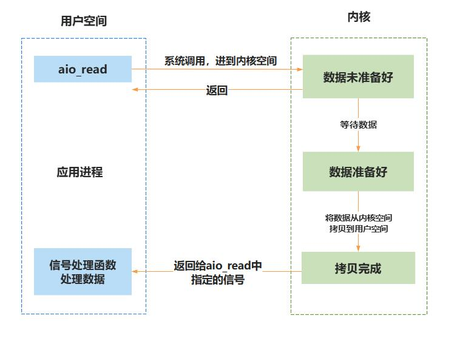

# 第032章 IO模型引入

本章节对IO 的概念、执行过程及IO 模型的分类进行介绍。
## 32.1 IO 的概念
IO 是英文Input 和Output 的首字母，代表了输入和输出，当然这样的描述有一点点抽象，更直观的意思是计算机的输入与输出。在冯.诺依曼结构中，将计算机分成了5 个部分，分别是运算器、控制器、存储器、输入设备和输出设备，如图32.1 所示。

图32.1上图中的输入设备指的是鼠标和键盘等向计算机输入数据和信息的设备，输出设备指的是电脑显示器等用于计算机信息输出的设备。当敲击键盘（输入设备）任意按键后，按键的数据会传递给计算机，计算机CPU 会对数据进行运算，运算完成之后会将数据输出到显示器（输出设备）上，整个过程如图32.2 所示。


图32.2上述事例中，鼠标（输入设备）、显示器（输出设备）分别是输入、输出的直观表现形式，而在计算机架构层面上，IO 是涉及计算机核心（如CPU、内存等）与其他设备间数据迁移的过程。以磁盘IO 为例，从磁盘读取数据到内存（输入过程）和将内存数据写入磁盘（输出过程），就是一对输入输出的过程。
## 32.2 IO 执行过程
在Linux 操作系统中，内核负责对计算机的资源进行管理和对进程进行调度。应用程序运行于用户空间，而IO 操作往往涉及硬件，由于硬件操作需要特权级权限，必须由操作系统在内核空间中完成。也就是说，应用程序不能直接对硬件进行操作，只能通过内核提供的系统调用接口（如read、write 等）间接完成IO 操作。此外，用户空间无法直接访问内核空间的数据，因此在IO 操作完成后，内核需要将数据从内核空间拷贝到用户空间供应用程序使用。一个完整的IO 流程，通常包含以下关键环节：IO 调用：应用程序通过系统调用接口向内核发起IO 请求（如读取文件）。IO 执行：内核收到请求之后，通过驱动程序操作硬件完成具体IO（如从磁盘读取数据），并将最终结果返回给用户空间。完整的IO 过程需要包含以下三个步骤，如图32.3 所示。（1）用户空间的应用程序向内核发起IO 调用请求(系统调用)（2）内核操作系统准备数据，把IO 设备的数据加载到内核缓冲区（3）操作系统拷贝数据，把内核缓冲区的数据拷贝到用户进程缓冲区


图32.3
## 32.3 IO 模型的分类
在实际开发中，IO 操作常常成为影响程序性能的关键因素。假设有一个场景：从磁盘读取100MB 数据并处理，读取数据耗时20 秒，处理数据也需要20 秒。如果采用最传统的顺序流程——读取完再处理，那么整个流程耗时约40 秒，效率明显偏低。那么能不能在等待数据的同时对数据进行处理呢？当然可以！这时候就轮到IO 编程模型来出场了。IO 模型根据实现的功能可以划分为阻塞IO、非阻塞IO、信号驱动IO、IO 多路复用和异步IO。根据等待IO 的执行结果进行划分，前四个IO 模型又被称为同步IO，如图32.4 所示。


图32.4同步IO 与异步IO 是数据处理中的两种重要模式。二者在处理输入输出（IO）操作时存在根本性差异，且会对程序的性能表现与执行效率产生显著影响。以下将具体阐述其主要区别：1 同步IO同步是指应用发起IO 请求后，必须等待内核完成数据准备和传输操作，才能继续执行后续任务。在此过程中，应用可能会被阻塞，直到数据从内核空间拷贝到用户空间。2 异步IO异步IO 允许应用在发起IO 请求后立即返回，并继续执行其他任务。内核会在数据准备好并完成传输后，通过回调或信号通知应用操作已完成。应用无需主动等待数据的准备过程。下面让我们来认识一下这五种IO 模型。1 同步阻塞IO以阻塞读为例：进程进行IO 操作时(如read 操作)，首先会发起一个系统调用，从而转到内核空间进行处理，内核空间的数据没有准备就绪时，进程会被阻塞，不会继续向下执行，直到内核空间的数据准备完成后，数据才会从内核空间拷贝到用户空间，最后返回应用进程，由用户空间进行数据的处理，如图32.5 所示。


图32.5阻塞IO 的可以及时地获取结果，并立刻对获取到的结果进行处理，然而在获取结果之前，无法去处理其他任务，需要时刻对结果进行监听。阻塞IO 比较有代表性的是C 语言中的scanf()函数。编写好的io.c 文件如代码清单32.1 所示。代码清单32.1
```c
#include <stdio.h>
int main(void){
    int i;
    scanf("%d",&i);
    printf("i = %d\n",i);
    return 0;
}
```
在以上代码中，scanf()函数用于从键盘上接收数据，如果键盘不进行数据的输入，该任务会持续阻塞，只有键盘输入数据之后，才会有相应的输入值打印到系统终端上。输入gcc io.c -oio 命令编译代码清单32.1 中的代码，如图32.6 所示。

图32.6编译完成之后，输入./io 运行可执行文件，如下所示，键盘没有输入数据时，该任务会持续阻塞，当在键盘上输入123 之后，输入的值才会被打印出来，如图32.7 所示。

图32.7

2 同步非阻塞IO和阻塞IO 模型不同，非阻塞IO 进行IO 操作时，如果内核数据没有准备好，内核会立即向进程返回err，不会进行阻塞；如果内核空间数据准备就绪，内核会立即把数据返回给用户空间的进程，如图32.8 所示。

图32.8非阻塞IO 的优点是效率高，同样的时间内可以做更多的事。但是缺点也很明显，当需要频繁检查数据就绪状态时可能导致较高的CPU 占用率。为了解决此问题，非阻塞IO 通常与IO多路复用技术结合使用。
3 IO 多路复用select()、poll()和epoll()函数是实现IO 多路复用的机制。IO 多路复用可以让单个进程监控多个描述符，当发现某个描述符就绪以后，就会通知程序进行相应的读写操作。这里以select()函数为例进行讲解，如图32.9 所示。使用时需要向select()传入待监听的文件描述符集合以及超时时间。当执行select()时，系统会触发一次系统调用，内核将遍历检查这些描述符是否触发了目标事件（如可读、可写）。若检测到事件则立即返回，若未检测到事件，进程将进入阻塞状态并休眠，直到任一描述符就绪或超时为止。当select()返回后，用户空间需遍历所有描述符，逐一确认具体是哪个触发了事件，从而实现单线程同时管理多个IO操作的效果。


图32.9IO 多路复用的优点是一个进程/线程可以同时监听和处理多路IO，效率成倍提高。但是IO多路复用并不是能医治百病的良药，虽然IO 多路复用可以监听多个IO，但是实际上对结果的处理也只能依次进行，比较适合IO 密集但是每一路IO 数据量不多且到达时间分散的场合（如网络聊天）。另外select 监听的描述符有上限（一般描述符最大不超过1024），而且需要遍历究竟是哪一个IO 产生了数据。因此IO 较多时，效率不高（这个问题被epoll 解决，感兴趣的读者可以自行了解）。
4 信号驱动IO信号驱动IO 指的是进程会预先告知内核，当某个描述符发生事件时，内核要向该进程发送SIGIO 信号进行通知，进程可以在信号处理函数中对该事件进行处理。例如在Linux 系统中，用户按下ctrl+C 终止运行中的任务时，系统实际上是对该进程发送一个SIGINT 信号，该信号的默认处理函数就是退出当前程序。具体到IO 模型上，进程需要先为SIGIO 信号注册相应的信号处理函数，并打开对应描述符的信号驱动。当数据准备好时，进程会收到一个SIGIO 信号，可以在信号处理函数中调用IO操作函数处理数据。如图32.10 所示。


图32.105 异步IOaio_read()函数常常用于异步IO，当进程使用aio_read()读取数据时，如果数据尚未准备就绪就立即返回，不会阻塞。若数据准备就绪就会把数据从内核空间拷贝到用户空间的缓冲区中，然后执行定义好的回调函数对接收到的数据进行处理。如图32.11 所示。

图32.11

