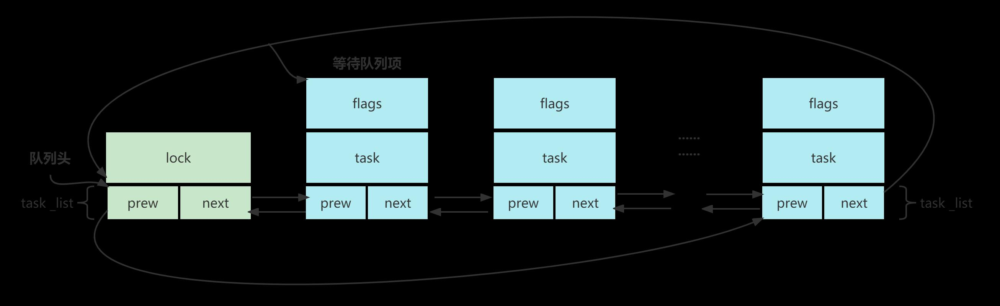
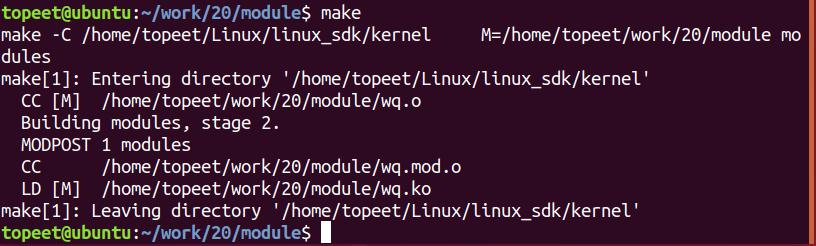
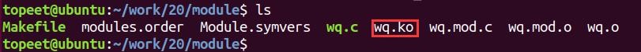

# 第033章  阻塞IO实验

本章节讲解的IO 模型是阻塞IO，阻塞IO 所依赖的机制是等待队列。
## 33.1 什么是等待队列
在Linux 驱动程序中，阻塞进程可以使用等待队列来实现。等待队列是实现阻塞和唤醒的内核机制，等待队列以双循环链表为基础结构，其中链表头和链表项两部分别表示等待队列头和等待队列元素，如图33.1 所示。

图33.1等待队列头使用结构体wait_queue_head_t 来表示，这个结构体定义在文件include/linux/wait.h 里面，结构体内容如代码清单33.1 所示。代码清单33.1struct _wait_queue_head{spinlock_t lock;//自旋锁struct list_head task_list //链表头}；typefef struct _wait_queue_head wait_queue_head_t;等待队列项使用结构体wait_queue_t 来表示，该结构体同样定义在文件include/linux/wait.h里面，结构体内容如代码清单33.2 所示。代码清单33.2struct _wait_queue{unsigned int flags;void *private;wait_queue_func_t func;struct list_head task_list;};typedef struct _wait_queue wait_queue_t;

## 33.2 等待队列API 函数
1 定义并初始化等待队列头使用等待队列第一步是初始化等待队列头，初始化等待队列头有以下两种办法。方法一：使用DECLARE_WAIT_QUEUE_HEAD 宏静态创建等待队列头，宏定义如代码清单33.3所示。代码清单33.3
```c
#define DECLARE_WAIT_QUEUE_HEAD(name) \
wait_queue_head_t name = __WAIT_QUEUE_HEAD_INITIALIZER(name)
```
参数name 表示要定义的队列头名字。通常以全局变量的方式定义，静态创建等待队列头如代码清单33.4 所示。代码清单33.4
```c
DECLARE_WAIT_QUEUE_HEAD(head);
```
方法二：使用init_waitqueue_head 宏动态初始化等待队列头，宏定义如代码清单33.5 所示。代码清单33.5#define init_waitqueue_head(q)\do {\static struct lock_class_key __key; \\__init_waitqueue_head((q), #q, &__key);\} while (0)参数q 表示需要初始化的队列头指针。动态初始化等待队列头如代码清单33.6 所示。代码清单33.6wait_queue_head_t head;//等待队列头init_waitqueue_head(&head);//初始化等待队列头指针
2 创建等待队列项一般使用宏DECLARE_WAITQUEUE(name,tsk)给当前正在运行的进程创建并初始化一个等待队列项，宏定义如代码清单33.7 所示。代码清单33.7#define DECLARE_WAITQUEUE(name, tsk)\struct wait_queue_entry name = __WAITQUEUE_INITIALIZER(name, tsk)第一个参数name 是等待队列项的名字，第二个参数tsk 表示此等待队列项属于哪个任务（进程），一般设置为current。在Linux 内核中current 相当于一个全局变量，表示当前进程。创建等待队列项如代码清单33.8 所示。代码清单33.8DECLARE_WAITQUEUE(wait,current);//给当前正在运行的进程创建一个名为wait 的等待队列项

add_wait_queue(wq,&wait); //将wait 这个等待队列项加到wq 这个等待队列当中
3 添加/删除队列当设备没有准备就绪（如没有可读数据）而需要进程阻塞的时候，就需要将进程对应的等待队列项添加到前面创建的等待队列中，只有添加到等待队列中后进程才能进入休眠态。当设备可以访问时（如有可读数据），再将进程对应的等待队列项从等待队列中移除即可。添加等待队列项到等待队列API 函数：函数原型:void add_wait_queue(wait_queue_head_t *q,wait_queue_t *wait)函数功能:将一个等待队列项添加到指定的等待队列头中参数含义:第一个参数q 指向等待队列头的指针，表示要添加等待项的目标等待队列第二个参数wait 指向等待队列项的指针，表示要添加的进程等待项函数返回值无从等待队列中移除等待队列项函数：函数原型：void remove_wait_queue(wait_queue_head_t *q,wait_queue_t *wait)函数功能：从等待队列中移除指定的等待队列项函数含义：第一个参数q 指向等待队列头的指针，表示要删除项所在的等待队列第二个参数wait 指向要删除的等待队列项的指针函数返回值：无
4 等待事件除了主动唤醒以外，也可以通过设置等待条件的方式，在某个事件满足后自动唤醒等待队列中的进程。Linux 内核提供以下几个宏。1.__wait_event 宏是一个不可中断的阻塞等待宏。如下所示：宏定义：#define __wait_event(wq_head, condition)\(void)___wait_event(wq_head, condition, TASK_UNINTERRUPTIBLE, 0, 0, schedule())宏定义功能：该宏会让调用进程进入不可中断的睡眠状态，直到condition 条件为真时被唤醒参数含义：第一个参数wq_head: wait_queue_head_t 类型的等待队列头第二个参数condition : 等待条件，只有当condition 为假时，才会进入休眠。如果condition为真，则不会阻塞，直接返回2.__wait_event_interruptible 的宏是可中断的阻塞等待，如下所示：

宏定义：#define __wait_event_interruptible(wq_head, condition)\___wait_event(wq_head, condition, TASK_INTERRUPTIBLE, 0, 0, schedule())宏含义功能：该宏会让调用进程进入可中断的睡眠状态，直到condition 条件变为真，或被信号打断唤醒参数含义：第一个参数wq _head:wait_queue_head_t 类型的等待队列头第二个参数condition :等待条件，为假时才可以进入休眠，为真时直接返回除以上等待宏，还有wait_event_timeout()和wait_event_interruptible_timeout()宏，如下所示：wait_event_timeout(wq_head, condition, timeout)wait_event_interruptible_timeout(wq_head, condition, timeout)与上面详细介绍的两个宏不同的是多了一个timeout 参数（单位为jiffy），支持设置超时时间。如果在timeout 到达时，不论condition 是否满足，均返回。注意：调用这些宏时必须确保condition 是在调用时为假，否则进程不会进入休眠状态，宏会立即返回。5 等待队列唤醒当设备可以使用的时候就要唤醒进入休眠态的进程，唤醒可以使用wake_up()者wake_up_interruptible()函数。1.wake_up()函数函数原型：wake_up(wait_queue_head_t *q)函数功能：唤醒所有休眠进程参数含义：q 表示要唤醒的等待队列的等待队列头2.wake_up_interruptible()函数函数原型：wake_up_interruptible(wait_queue_head_t *q)函数功能：唤醒可中断的休眠进程参数含义：q 表示要唤醒的等待队列的等待队列头
## 33.3 等待队列使用方法
步骤一：初始化等待队列头，并将条件置成假(condition=0)。步骤二：在需要阻塞的地方调用wait_event()，使进程进入休眠状态。步骤三：当条件满足时，需要解除休眠，先将条件设置成真(condition=1)，然后调用wake_up()函数唤醒等待队列中的休眠进程。

## 33.4 实验程序编写
### 33.4.1 驱动程序编写
本实验代码存储在网盘iTOP-RK3568开发板\07_学习教程配套资料\03_Linux驱动配套资料\04_Linux 驱动例程\20\module 路径下。接着编写等待队列的实验代码，在此代码中，按照上一小节等待队列使用方法的三个步骤进行编写，在read()函数中调用wait_event_interruptible()函数阻塞，使进程进入休眠状态。在write()函数中唤醒等待队列中的休眠进程。实验代码wq.c 如代码清单33.9 所示。代码清单33.9
```c
#include <linux/init.h>
#include <linux/module.h>
#include <linux/kdev_t.h>
#include <linux/fs.h>
#include <linux/cdev.h>
#include <linux/uaccess.h>
#include <linux/io.h>
#include<linux/wait.h>
struct device_test{
    dev_t dev_num;//设备号
    int major ;//主设备号
    int minor ;//次设备号
    struct cdev cdev_test; // cdev
    struct class *class;//类
    struct device *device; //设备
    char kbuf[32];
    intflag;//标志位
};
structdevice_test dev1;
DECLARE_WAIT_QUEUE_HEAD(read_wq); //定义并初始化等待队列头
/*打开设备函数*/
static int cdev_test_open(struct inode *inode, struct file *file)
{
    file->private_data=&dev1;//设置私有数据
    printk("This is cdev_test_open\r\n");
    return 0;
}
```

```c
/*向设备写入数据函数*/
static ssize_t cdev_test_write(struct file *file, const char __user *buf, size_t size, loff_t *off)
{
    struct device_test *test_dev=(struct device_test *)file->private_data;
    if (copy_from_user(test_dev->kbuf, buf, size) != 0) // copy_from_user:用户空间向内核空间传数据
    {
        printk("copy_from_user error\r\n");
        return -1;
    }
    test_dev->flag=1;//将条件置1
    wake_up_interruptible(&read_wq); //并使用wake_up_interruptible 唤醒等待队列中的休眠进程
    return 0;
}
/*从设备读取数据*/
static ssize_t cdev_test_read(struct file *file, char __user *buf, size_t size, loff_t *off)
{
    struct device_test *test_dev=(struct device_test *)file->private_data;
    wait_event_interruptible(read_wq,test_dev->flag); //可中断的阻塞等待，使进程进入休眠态
    if (copy_to_user(buf, test_dev->kbuf, strlen( test_dev->kbuf)) != 0) // copy_to_user:内核空间向用户空间
传数据
    {
        printk("copy_to_user error\r\n");
        return -1;
    }
    return 0;
}
static int cdev_test_release(struct inode *inode, struct file *file)
{
    return 0;
}
/*设备操作函数*/
struct file_operations cdev_test_fops = {
    .owner = THIS_MODULE, //将owner 字段指向本模块，可以避免在模块的操作正在被使用时卸载该模块
    .open = cdev_test_open, //将open 字段指向cdev_test_open(...)函数
    .read = cdev_test_read, //将read 字段指向cdev_test_read(...)函数
    .write = cdev_test_write, //将write 字段指向cdev_test_write(...)函数
    .release = cdev_test_release, //将release 字段指向cdev_test_release(...)函数
```

```c
};
static int __init chr_fops_init(void) //驱动入口函数
{
    /*注册字符设备驱动*/
    int ret;
    /*1 创建设备号*/
    ret = alloc_chrdev_region(&dev1.dev_num, 0, 1, "alloc_name"); //动态分配设备号
    if (ret < 0)
    {
       goto err_chrdev;
    }
    printk("alloc_chrdev_region is ok\n");
    dev1.major = MAJOR(dev1.dev_num); //获取主设备号
    dev1.minor = MINOR(dev1.dev_num); //获取次设备号
    printk("major is %d \r\n", dev1.major); //打印主设备号
    printk("minor is %d \r\n", dev1.minor); //打印次设备号
     /*2 初始化cdev*/
    dev1.cdev_test.owner = THIS_MODULE;
    cdev_init(&dev1.cdev_test, &cdev_test_fops);
    /*3 添加一个cdev,完成字符设备注册到内核*/
    ret =cdev_add(&dev1.cdev_test, dev1.dev_num, 1);
    if(ret<0)
    {
        gotoerr_chr_add;
    }
    /*4 创建类*/
    dev1. class = class_create(THIS_MODULE, "test");
    if(IS_ERR(dev1.class))
    {
        ret=PTR_ERR(dev1.class);
        goto err_class_create;
    }
    /*5创建设备*/
    dev1.device = device_create(dev1.class, NULL, dev1.dev_num, NULL, "test");
    if(IS_ERR(dev1.device))
    {
        ret=PTR_ERR(dev1.device);
        goto err_device_create;
    }
    return 0;
```

```c
err_device_create:
        class_destroy(dev1.class);//删除类
err_class_create:
       cdev_del(&dev1.cdev_test);//删除cdev
err_chr_add:
        unregister_chrdev_region(dev1.dev_num, 1); //注销设备号
err_chrdev:
        return ret;
}
static void __exit chr_fops_exit(void) //驱动出口函数
{
/*注销字符设备*/
unregister_chrdev_region(dev1.dev_num, 1); //注销设备号
cdev_del(&dev1.cdev_test);//删除cdev
device_destroy(dev1.class, dev1.dev_num);//删除设备
class_destroy(dev1.class);//删除类
}
module_init(chr_fops_init);
module_exit(chr_fops_exit);
MODULE_LICENSE("GPL v2");
MODULE_AUTHOR("topeet");
```
### 33.4.2 编写测试APP
本实验代码存储在网盘iTOP-RK3568开发板\07_学习教程配套资料\03_Linux驱动配套资料\04_Linux 驱动例程\20\app 路径下。接下来编写应用程序read.c，实现从设备读取数据的功能。实验代码read.c 内容如代码清单33.10 所示。代码清单33.10
```c
#include <stdio.h>
#include <sys/types.h>
#include <sys/stat.h>
#include <fcntl.h>
#include <unistd.h>
#include <stdlib.h>
int main(int argc, char *argv[])
{
    int fd;
```

```c
char buf1[32] = {0};
char buf2[32] = {0};
fd = open("/dev/test", O_RDWR);//打开led 驱动
if (fd < 0)
{
    perror("open error \n");
    return fd;
}
printf("read before \n");
read(fd,buf1,sizeof(buf1));//从/dev/test 文件读取数据
printf("buf is %s\n",buf1);
printf("read after \n");
close(fd);//关闭文件
return 0;
}
```
同理，编写应用程序write.c，实现向设备写入数据的功能，实验代码write.c 内容如代码清单33.11 所示。代码清单33.11
```c
#include <stdio.h>
#include <sys/types.h>
#include <sys/stat.h>
#include <fcntl.h>
#include <unistd.h>
#include <stdlib.h>
#include <string.h>
int main(int argc, char *argv[])
{
    int fd;
    char buf1[32] = {0};
    char buf2[32] = "nihao";
    fd = open("/dev/test", O_RDWR);//打开led 驱动
    if (fd < 0)
    {
        perror("open error \n");
        return fd;
    }
    printf("write before \n");
    write(fd,buf2,sizeof(buf2));//向/dev/test 文件写入数据
     printf("write after\n");
    close(fd);//关闭文件
    return 0;
}
```

## 33.5 运行测试
### 33.5.1 编译驱动程序
在wq.c 代码同一目录下创建Makefile 文件，如图33.2 所示。

图33.2Makefile 文件内容如代码清单33.12 所示。代码清单33.12
```c
export ARCH=arm64#设置平台架构
export CROSS_COMPILE=aarch64-linux-gnu-#交叉编译器前缀
obj-m += wq.o#此处要和你的驱动源文件同名
KDIR :=/home/topeet/Linux/linux_sdk/kernel#这里是你的内核目录
PWD ?= $(shell pwd)
all:
    make -C $(KDIR) M=$(PWD) modules#make 操作
clean:
    make -C $(KDIR) M=$(PWD) clean#make clean 操作
```
在存放wq.c 和Makefile 文件目录下使用make 命令编译驱动程序，编译完成如图33.3 所示。

图33.3编译完生成wq.ko 目标文件，如图33.4 所示。

图33.4
### 33.5.2 编译应用程序
来到存放应用程序read.c 和write.c 的文件夹下，分别使用aarch64-linux-gnu-gcc -o readread.c -static 和aarch64-linux-gnu-gcc -o write write.c -static 命令对read.c 和write.c 进行交叉编译，编译完成如图33.5 所示。

