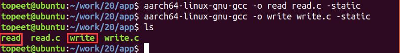
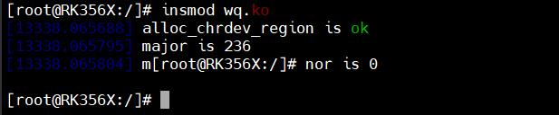
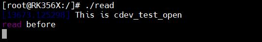
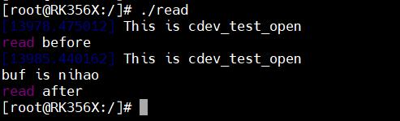
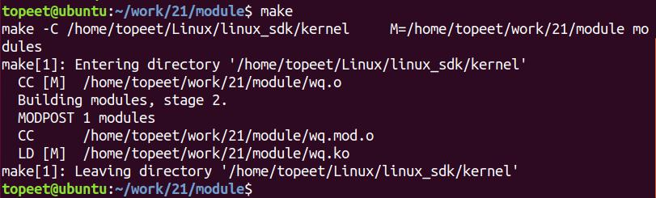
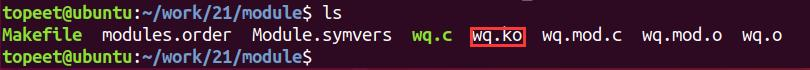
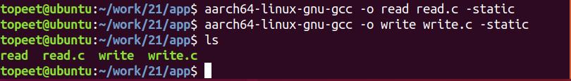

# 第034章 非阻塞IO实验


图33.5
### 33.5.3 运行测试
将本章节编译好的wq.ko 驱动文件和read、write 可执行文件拷贝到开发板上。开发板启动之后，使用insmod wq.ko 命令进行驱动模块的加载，如图33.6 所示。

图33.6输入./read 命令运行read 可执行文件，如图33.7 所示，read 应用程序进程阻塞。

图33.7然后输入./write 命令运行write 可执行文件，如图33.8 所示，使用write()函数向设备写入数据，唤醒等待队列中的休眠进程。

图33.8在使用可执行程序write 向缓冲区写入数据时，read 可执行程序读取到了缓冲区的数据并打印，如图33.9 所示。

图33.9

本章节讲解非阻塞IO。
## 34.1 非阻塞IO 简介
在非阻塞IO 模型中，内核数据还未就绪时，应用进程也可以做其他事情，应用进程需要不断询问内核数据是否就绪，并不会被直接挂起。如果应用程序要采用非阻塞的方式来访问驱动设备文件，在使用open()函数打开“/dev/xxx_dev”设备文件的时候需要添加参数“O_NONBLOCK”，O_NONBLOCK 表示以非阻塞方式打开设备，这样从设备中读取数据的时候就是非阻塞方式了。如代码清单34.1 所示。代码清单34.1int fd;int data = 0;fd = open("/dev/xxx_dev", O_RDWR | O_NONBLOCK); /* 非阻塞方式打开*/ret = read(fd, &data, sizeof(data)); /* 读取数据*/
## 34.2 实验程序编写
### 34.2.1 编写测试APP
非阻塞IO 实验需要应用程序和驱动配合，所以需要编写驱动代码和应用测试代码。本实验代码存储在网盘iTOP-RK3568 开发板\07_学习教程配套资料\03_Linux 驱动配套资料\04_Linux 驱动例程\21\app 路径下。首先来编写应用测试代码read.c，在此代码中使用非阻塞的方式打开设备，实验代码read.c内容如代码清单34.2 所示。代码清单34.2
```c
#include <stdio.h>
    #include <sys/types.h>
    #include <sys/stat.h>
    #include <fcntl.h>
    #include <unistd.h>
    #include <stdlib.h>
    int main(int argc, char *argv[])
    {
        int fd;//定义int 类型的文件描述符
        char buf1[32] = {0};//定义读取缓冲区buf
```

```c
char buf2[32] = {0};//定义读取缓冲区buf
fd = open("/dev/test",O_RDWR| O_NONBLOCK);//打开/dev/test 设备
if (fd < 0)
{
    perror("open error \n");
    return fd;
}
printf("read before \n");
while (1)
{
     read(fd,buf1,sizeof(buf1));//从/dev/test 文件读取数据
     printf("buf is %s \n",buf1);//打印读取的数据
     sleep(1);
}
printf("read after\n");
close(fd);//关闭文件
return 0;
}
```
接着编写应用程序write.c，用来向设备文件写入数据，实验代码write.c 内容如代码清单34.3 所示。代码清单34.3
```c
#include <stdio.h>
#include <sys/types.h>
#include <sys/stat.h>
#include <fcntl.h>
#include <unistd.h>
#include <stdlib.h>
#include <string.h>
int main(int argc, char *argv[])
{
    int fd;
    char buf1[32] = {0};
    char buf2[32] = "nihao";
    fd = open("/dev/test", O_RDWR|O_NONBLOCK);//打开/dev/test 设备
    if (fd < 0)
    {
        perror("open error \n");
        return fd;
    }
    printf("write before \n");
```

```c
write(fd,buf2,sizeof(buf2));//向/dev/test 文件写入数据
printf("write after\n");
close(fd);//关闭文件
return 0;
}
```
### 34.5.1 驱动程序编写
本实验代码存储在网盘iTOP-RK3568 开发板\07_学习教程配套资料\03_Linux 驱动配套资料\04_Linux 驱动例程\21\module 路径下。实验代码wq.c 如代码清单34.4 所示。代码清单34.4
```c
#include <linux/init.h>
#include <linux/module.h>
#include <linux/kdev_t.h>
#include <linux/fs.h>
#include <linux/cdev.h>
#include <linux/uaccess.h>
#include <linux/io.h>
#include<linux/wait.h>
struct device_test{
    dev_t dev_num;//设备号
    int major ;//主设备号
    int minor ;//次设备号
    struct cdev cdev_test; // cdev
    struct class *class;//类
    struct device *device; //设备
    char kbuf[32];
    intflag;//标志位
};
structdevice_test dev1;
DECLARE_WAIT_QUEUE_HEAD(read_wq); //定义并初始化等待队列头
/*打开设备函数*/
static int cdev_test_open(struct inode *inode, struct file *file)
{
    file->private_data=&dev1;//设置私有数据
    return 0;
}
/*向设备写入数据函数*/
static ssize_t cdev_test_write(struct file *file, const char __user *buf, size_t size, loff_t *off)
```

```c
{
    struct device_test *test_dev=(struct device_test *)file->private_data;
    if (copy_from_user(test_dev->kbuf, buf, size) != 0) // copy_from_user:用户空间向内核空间传数据
    {
        printk("copy_from_user error\r\n");
        return -1;
    }
    test_dev->flag=1;//将条件置1，并使用wake_up_interruptible 唤醒等待队列中的休眠进程
    wake_up_interruptible(&read_wq);
    return 0;
}
/*从设备读取数据*/
static ssize_t cdev_test_read(struct file *file, char __user *buf, size_t size, loff_t *off)
{
    struct device_test *test_dev=(struct device_test *)file->private_data;
    if(file->f_flags & O_NONBLOCK ){
        if (test_dev->flag !=1)
        return -EAGAIN;
    }
    wait_event_interruptible(read_wq,test_dev->flag); //可中断的阻塞等待，使进程进入休眠态
    if (copy_to_user(buf, test_dev->kbuf, strlen( test_dev->kbuf)) != 0) // copy_to_user:内核空间向用户空间
传数据
    {
        printk("copy_to_user error\r\n");
        return -1;
    }
    return 0;
}
static int cdev_test_release(struct inode *inode, struct file *file)
{
    return 0;
}
/*设备操作函数*/
struct file_operations cdev_test_fops = {
    .owner = THIS_MODULE, //将owner 字段指向本模块，可以避免在模块的操作正在被使用时卸载该模块
    .open = cdev_test_open, //将open 字段指向cdev_test_open(...)函数
    .read = cdev_test_read, //将read 字段指向cdev_test_read(...)函数
    .write = cdev_test_write, //将write 字段指向cdev_test_write(...)函数
    .release = cdev_test_release, //将release 字段指向cdev_test_release(...)函数
```

```c
};
static int __init chr_fops_init(void) //驱动入口函数
{
    /*注册字符设备驱动*/
    int ret;
    /*1 创建设备号*/
    ret = alloc_chrdev_region(&dev1.dev_num, 0, 1, "alloc_name"); //动态分配设备号
    if (ret < 0)
    {
       goto err_chrdev;
    }
    printk("alloc_chrdev_region is ok\n");
    dev1.major = MAJOR(dev1.dev_num); //获取主设备号
    dev1.minor = MINOR(dev1.dev_num); //获取次设备号
    printk("major is %d \r\n", dev1.major); //打印主设备号
    printk("minor is %d \r\n", dev1.minor); //打印次设备号
     /*2 初始化cdev*/
    dev1.cdev_test.owner = THIS_MODULE;
    cdev_init(&dev1.cdev_test, &cdev_test_fops);
    /*3 添加一个cdev,完成字符设备注册到内核*/
    ret =cdev_add(&dev1.cdev_test, dev1.dev_num, 1);
    if(ret<0)
    {
        gotoerr_chr_add;
    }
    /*4 创建类*/
    dev1. class = class_create(THIS_MODULE, "test");
    if(IS_ERR(dev1.class))
    {
        ret=PTR_ERR(dev1.class);
        goto err_class_create;
    }
    /*5创建设备*/
    dev1.device = device_create(dev1.class, NULL, dev1.dev_num, NULL, "test");
    if(IS_ERR(dev1.device))
    {
        ret=PTR_ERR(dev1.device);
        goto err_device_create;
    }
```

```c
return 0;
 err_device_create:
        class_destroy(dev1.class);//删除类
err_class_create:
       cdev_del(&dev1.cdev_test);//删除cdev
err_chr_add:
        unregister_chrdev_region(dev1.dev_num, 1); //注销设备号
err_chrdev:
        return ret;
}
static void __exit chr_fops_exit(void) //驱动出口函数
{
/*注销字符设备*/
unregister_chrdev_region(dev1.dev_num, 1); //注销设备号
cdev_del(&dev1.cdev_test);//删除cdev
device_destroy(dev1.class, dev1.dev_num);//删除设备
class_destroy(dev1.class);//删除类
}
module_init(chr_fops_init);
module_exit(chr_fops_exit);
MODULE_LICENSE("GPL v2");
MODULE_AUTHOR("topeet");
```
## 34.3 运行测试
### 34.3.1 编译驱动程序
在wq.c 代码同一目录下创建Makefile 文件，如图34.1 所示。

图34.1Makefile 文件内容如代码清单34.5 所示。代码清单34.5
```c
export ARCH=arm64#设置平台架构
export CROSS_COMPILE=aarch64-linux-gnu-#交叉编译器前缀
obj-m += wq.o#此处要和你的驱动源文件同名
KDIR :=/home/topeet/Linux/linux_sdk/kernel#这里是你的内核目录
PWD ?= $(shell pwd)
```

```c
all:
    make -C $(KDIR) M=$(PWD) modules#make 操作
clean:
    make -C $(KDIR) M=$(PWD) clean#make clean 操作
```
在存放wq.c 和Makefile 文件目录下使用make 命令编译驱动程序，编译完成如图34.2 所示。

图34.2编译完生成wq.ko 目标文件，如图34.3 所示。

图34.3
### 34.3.2 编译应用程序
来到存放应用程序read.c 和write.c 的文件夹下，分别使用aarch64-linux-gnu-gcc -o readread.c -static 和aarch64-linux-gnu-gcc -o write write.c -static 命令对read.c 和write.c 进行交叉编译，编译完成如图34.4 所示。

图34.4
### 34.3.3 运行测试
将本章节编译好的wq.ko 驱动文件和read、write 可执行文件拷贝到开发板上。开发板启动之后，使用insmod wq.ko 命令进行驱动模块的加载，如图34.5 所示。

图34.5

