# 第035章 IO多路复用实验

输入./read 命令运行read 可执行文件，如图34.6 所示，应用程序进程非阻塞，读取不到数据便返回，然后一直轮询查看是否有数据。
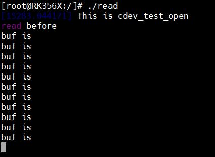
图34.6然后输入./write 命令运行write 可执行文件向设备文件写入数据，如图34.7 所示。
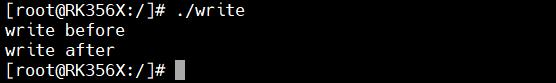
图34.7在使用可执行程序write 向缓冲区写入数据时，read 可执行程序读取到了缓冲区的数据并打印，如图34.8 所示。
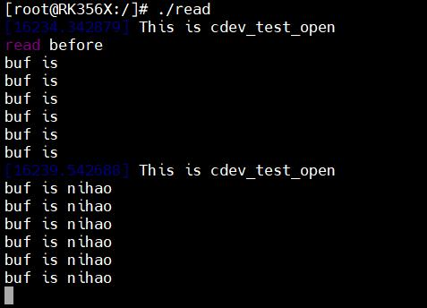
图34.8

本章节讲解多路复用IO。
## 35.1 IO 多路复用简介
IO 多路复用允许一个进程同时监视多个文件描述符的状态。一旦某个文件描述符准备就绪（如可读或可写），内核便通知应用程序进行相应的读写操作。若没有任何文件描述符就绪就会阻塞应用程序，从而释放出CPU 资源。在应用层Linux 提供了三种实现IO 多路复用的模型，分别是select()、poll()和epoll()。在本驱动手册中主要偏重于对驱动的讲解，所以应用层中select()、poll()和epoll()函数的使用在这里不做重点讲解。这三个函数有什么区别呢？举个形象的例子，假设poll()和select()是公司的前台，某天一位客户来公司找硬件工程师小李，并请求前台帮忙寻找。这时poll()和select()函数就像前台一样，带着客户挨个房间询问，直到找到小李为止。而如果epoll()是公司的前台，它提前掌握了公司每位员工的工位信息，当客户来找小李时，epoll()不必像poll()和select()那样逐个查询，而是可以直接带客户去小李所在的位置。从这这个例子来看，select()和poll()函数会随着文件描述符fd 数量的增多而降低效率，而epoll()函数则不会出现这个问题。在单个线程中，select()函数最大可以监视1024 个文件描述符，而poll()函数和select()函数并没有什么区别，只是poll()函数没有最大文件描述符的限制。在本章节的实验中，以poll()为例进行实验。在Linux 应用程序中poll()函数如下所示：函数原型：int poll(struct pollfd *fds,nfds_t nfds,int timeout);函数功能：监视并等待多个文件描述符的属性变化函数参数：第一个参数fds: 要监视的文件描述符集合以及要监视的事件，为一个数组，数组元素都是结构体pollfd 类型，pollfd 结构体如下所示：struct pollfd {int fd;//被监视的文件描述符short events;//等待的事件short revents;//实际发生的事件}；在pollfd 结构体中，第一个成员fd 是被监视的文件描述符。第二个成员events 是要监视的事件，可监视的事件类型如下所示：POLLIN有数据可以读取POLLPRI有紧急的数据需要读取

POLLOUT可以写数据POLLERR指定的文件描述符发生错误POLLHUP指定的文件描述符挂起POLLNVAL无效的请求POLLRDNORM等同于POLLIN第三个成员是返回事件，由Linux 内核设置具体的返回事件。第二个参数nfds: poll 函数要监视的文件描述符数量第三个参数timeout:指定等待的时间，单位是ms。无论I/O 是否准备好，时间到POLL就会返回。如果timepoll 大于0 等待指定的时间，如果timeout 等于0，立即返回。如果timeout等于-1，事件发生以后才返回。函数返回值：失败返回-1，成功返回revents 不为0 的文件描述符个数。当应用程序使用select()、epoll()或poll()函数对驱动设备文件进行非阻塞访问时，内核会调用驱动程序中的poll()函数。因此，驱动需要实现file_operations 结构体中的poll()函数。驱动中的poll()函数原型如下所示：unsigned int (*poll)(struct file *filp,struct poll_table_struct *wait);poll()函数介绍如下：函数参数：filp:要打开的文件描述符wait: 结构体poll_table_struct 类型指针，此参数是由应用程序中传递的。一般此参数要传递给poll_wait 函数。返回值：向应用程序返回资源状态，可以返回的资源状态如下：POLLIN有数据可以读取POLLPRI有紧急的数据需要读取POLLOUT可以写数据POLLERR指定的文件描述符发生错误POLLHUP指定的文件描述符挂起POLLNVAL无效的请求POLLRDNORM等同于POLLIN，普通数据可读函数功能：1.在该函数中要调用poll_wait()函数将等待队列头添加至poll_table 中（用于内核监听）2.返回设备状态的掩码值，指示当前是否可以无阻塞读写驱动程序的poll()函数中调用的poll_wait()函数，其函数原型如下所示：void poll_wait(struct file *filp,wait_queue_head_t *queue,poll_table *wait);poll_wait()函数介绍如下：函数参数：filp：要打开的文件描述符queue：要添加到poll_table 中的等待队列头wait：poll_table，也就是file_operations 中poll 函数的wait 参数注意：poll_wait()本身不会引起阻塞，它的作用是将等待队列头注册到poll_table 中，供内核后续管理使用。

## 35.2 实验程序编写
### 35.2.1 编写测试APP
本实验代码存储在网盘iTOP-RK3568 开发板\07_学习教程配套资料\03_Linux 驱动配套资料\04_Linux 驱动例程\22\app 路径下。在应用层Linux 提供了三种API 函数，分别是select()、poll()和epoll()。本次实验使用poll()函数进行实验。实验代码read.c 如代码清单35.1 所示。代码清单35.1
```c
#include <stdio.h>
#include <sys/types.h>
#include <sys/stat.h>
#include <fcntl.h>
#include <unistd.h>
#include <stdlib.h>
#include <poll.h>
int main(int argc, char *argv[])
{
    int fd;//要监视的文件描述符
    char buf1[32] = {0};
    char buf2[32] = {0};
    struct pollfdfds[1];
    int ret;
    fd = open("/dev/test", O_RDWR);//打开/dev/test 设备，阻塞式访问
    if (fd < 0)
    {
        perror("open error \n");
        return fd;
    }
   //构造结构体
    fds[0] .fd =fd;
    fds[0].events = POLLIN; //监视数据是否可以读取
    printf("read before \n");
    while (1)
    {
        ret = poll(fds,1,3000);//轮询文件是否可操作，超时3000ms
        if(!ret){//超时
            printf("time out !!\n,");
        }else if(fds[0].revents == POLLIN) //如果返回事件是有数据可读取
```

```c
{
    read(fd,buf1,sizeof(buf1));//从/dev/test 文件读取数据
    printf("buf is %s \n,",buf1); //打印读取的数据
    sleep(1);
}
}
printf("read after\n");
close(fd);//关闭文件
return 0;
}
```
上述代码第16 行，在打开设备节点时不使用非阻塞方式，要使用阻塞方式，所以改为O_RDWR。在上述代码的第35 行，使用poll()函数监视并等待多个文件描述符的属性变化。poll()函数第一个参数是被监视的文件描述符，是pollfd 结构体类型的数组，所以在14 行定义了pollfd结构体类型的数组fds。poll()函数第2 个参数是要监视的文件描述符数量，这里监视的文件描述符为1 个。poll()函数第3 个参数是指定等待的时间3000ms。然后编写应用程序write.c，实现向设备文件写入数据的功能，实验代码write.c 如代码清单35.2 所示。代码清单35.2
```c
#include <stdio.h>
#include <sys/types.h>
#include <sys/stat.h>
#include <fcntl.h>
#include <unistd.h>
#include <stdlib.h>
#include <string.h>
int main(int argc, char *argv[])
{
    int fd;
    char buf1[32] = {0};
    char buf2[32] = "nihao";
    fd = open("/dev/test",O_RDWR);//打开/dev/test 设备
    if (fd < 0)
    {
        perror("open error \n");
        return fd;
    }
    printf("write before \n");
    write(fd,buf2,sizeof(buf2));//向/dev/test 文件写入数据
    printf("write after\n");
```

```c
close(fd);//关闭文件
return 0;
}
```
### 35.2.2 驱动程序编写
本实验代码存储在网盘iTOP-RK3568 开发板\07_学习教程配套资料\03_Linux 驱动配套资料\04_Linux 驱动例程\22\module 路径下。IO多路复用实验需要应用程序和驱动程序进行配合，接下来编写驱动程序。实验代码poll.c如代码清单35.3 所示。代码清单35.3
```c
#include <linux/init.h>
#include <linux/module.h>
#include <linux/kdev_t.h>
#include <linux/fs.h>
#include <linux/cdev.h>
#include <linux/uaccess.h>
#include <linux/io.h>
#include <linux/wait.h>
#include <linux/poll.h>
struct device_test{
    dev_t dev_num;//设备号
    int major ;//主设备号
    int minor ;//次设备号
    struct cdev cdev_test; // cdev
    struct class *class;//类
    struct device *device; //设备
    char kbuf[32];
    intflag;//标志位
};
structdevice_test dev1;
DECLARE_WAIT_QUEUE_HEAD(read_wq); //定义并初始化等待队列头
/*打开设备函数*/
static int cdev_test_open(struct inode *inode, struct file *file)
{
    file->private_data=&dev1;//设置私有数据
    printk("This is cdev_test_open\r\n");
    return 0;
}
/*向设备写入数据函数*/
```

```c
static ssize_t cdev_test_write(struct file *file, const char __user *buf, size_t size, loff_t *off)
{
    struct device_test *test_dev=(struct device_test *)file->private_data;
    if (copy_from_user(test_dev->kbuf, buf, size) != 0) // copy_from_user:用户空间向内核空间传数据
    {
        printk("copy_from_user error\r\n");
        return -1;
    }
    test_dev->flag=1;
    wake_up_interruptible(&read_wq);
    return 0;
}
/*从设备读取数据*/
static ssize_t cdev_test_read(struct file *file, char __user *buf, size_t size, loff_t *off)
{
    struct device_test *test_dev=(struct device_test *)file->private_data;
    if(file->f_flags & O_NONBLOCK ){
        if (test_dev->flag !=1)
        return -EAGAIN;
    }
    wait_event_interruptible(read_wq,test_dev->flag);
    if (copy_to_user(buf, test_dev->kbuf, strlen( test_dev->kbuf)) != 0) // copy_to_user:内核空间向用户空间
传数据
    {
        printk("copy_to_user error\r\n");
        return -1;
    }
    printk("This is cdev_test_read\r\n");
    return 0;
}
static int cdev_test_release(struct inode *inode, struct file *file)
{
    printk("This is cdev_test_release\r\n");
    return 0;
}
static__poll_tcdev_test_poll(struct file *file, struct poll_table_struct *p){
     struct device_test *test_dev=(struct device_test *)file->private_data;//设置私有数据
     __poll_t mask=0;
     poll_wait(file,&read_wq,p);//应用阻塞
```

```c
if (test_dev->flag == 1)
{
    mask |= POLLIN;
}
return mask;
}
/*设备操作函数*/
struct file_operations cdev_test_fops = {
.owner = THIS_MODULE, //将owner 字段指向本模块，可以避免在模块的操作正在被使用时卸载该模块
.open = cdev_test_open, //将open 字段指向cdev_test_open(...)函数
.read = cdev_test_read, //将read 字段指向cdev_test_read(...)函数
.write = cdev_test_write, //将write 字段指向cdev_test_write(...)函数
.release = cdev_test_release, //将release 字段指向cdev_test_release(...)函数
.poll = cdev_test_poll,//将poll 字段指向cdev_test_poll(...)函数
};
static int __init chr_fops_init(void) //驱动入口函数
{
/*注册字符设备驱动*/
int ret;
/*1 创建设备号*/
ret = alloc_chrdev_region(&dev1.dev_num, 0, 1, "alloc_name"); //动态分配设备号
if (ret < 0)
{
  goto err_chrdev;
}
printk("alloc_chrdev_region is ok\n");
dev1.major = MAJOR(dev1.dev_num); //获取主设备号
dev1.minor = MINOR(dev1.dev_num); //获取次设备号
printk("major is %d \r\n", dev1.major); //打印主设备号
printk("minor is %d \r\n", dev1.minor); //打印次设备号
/*2 初始化cdev*/
dev1.cdev_test.owner = THIS_MODULE;
cdev_init(&dev1.cdev_test, &cdev_test_fops);
/*3 添加一个cd，完成字符设备注册到内核*/
ret =cdev_add(&dev1.cdev_test, dev1.dev_num, 1);
if(ret<0)
{
   gotoerr_chr_add;
}
```

```c
/*4 创建类*/
dev1. class = class_create(THIS_MODULE, "test");
if(IS_ERR(dev1.class))
{
    ret=PTR_ERR(dev1.class);
    goto err_class_create;
}
/*5创建设备*/
dev1.device = device_create(dev1.class, NULL, dev1.dev_num, NULL, "test");
if(IS_ERR(dev1.device))
{
    ret=PTR_ERR(dev1.device);
    goto err_device_create;
}
return 0;
err_device_create:
        class_destroy(dev1.class);//删除类
err_class_create:
       cdev_del(&dev1.cdev_test);//删除cdev
err_chr_add:
        unregister_chrdev_region(dev1.dev_num, 1); //注销设备号
err_chrdev:
        return ret;
}
static void __exit chr_fops_exit(void) //驱动出口函数
{
/*注销字符设备*/
unregister_chrdev_region(dev1.dev_num, 1);//注销设备号
cdev_del(&dev1.cdev_test);//删除cdev
device_destroy(dev1.class, dev1.dev_num);//删除设备
class_destroy(dev1.class);//删除类
}
module_init(chr_fops_init);
module_exit(chr_fops_exit);
MODULE_LICENSE("GPL v2");
MODULE_AUTHOR("topeet");
```

## 35.3 运行测试
### 35.3.1 编译驱动程序
在poll.c 代码同一目录下创建Makefile 文件，如图35.1 所示。

图35.1Makefile 文件内容如代码清单35.4 所示。代码清单35.4
```c
export ARCH=arm64#设置平台架构
export CROSS_COMPILE=aarch64-linux-gnu-#交叉编译器前缀
obj-m += poll.o#此处要和你的驱动源文件同名
KDIR :=/home/topeet/Linux/linux_sdk/kernel#这里是你的内核目录
PWD ?= $(shell pwd)
all:
    make -C $(KDIR) M=$(PWD) modules#make 操作
clean:
    make -C $(KDIR) M=$(PWD) clean#make clean 操作
```
在存放poll.c 和Makefile 文件目录下使用make 命令编译驱动程序，编译完成如图35.2 所示。
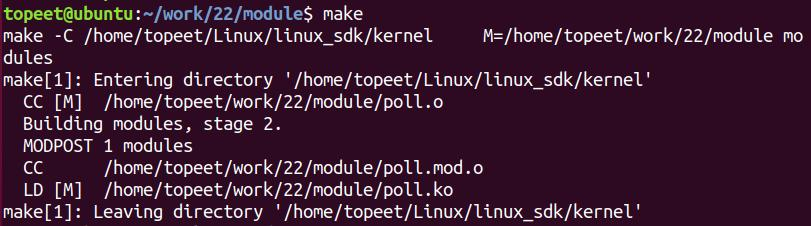
图35.2编译完生成poll.ko 目标文件，如图35.3 所示。
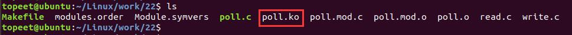
图35.3
### 35.3.2 编译应用程序
来到存放应用程序read.c 和write.c 的文件夹下，分别使用aarch64-linux-gnu-gcc -o readread.c -static 和aarch64-linux-gnu-gcc -o write write.c -static 命令对read.c 和write.c 进行交叉编译，编译完成如图35.4 所示。

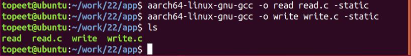
图35.4
### 35.3.3 运行测试
将本章节编译好的poll.ko 驱动文件和read、write 可执行文件拷贝到开发板上。开发板启动之后，使用insmod poll.ko 命令进行驱动模块的加载，如图35.5 所示。
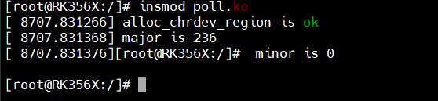
图35.5在加载驱动程序之后，会生成如图35.6 所示的设备节点，在应用程序中也是操作这个设备节点。
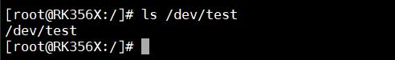
图35.6首先运行read 可执行程序，如图35.7 所示，因为应用程序中poll()函数里设置监控的时间是3s，所以无论数据是否准备好在三秒钟以后回立刻返回，因此当数据没有准备好时每过三秒钟会打印一次“time out”。
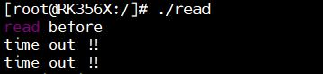
图35.7然后运行write 可执行程序写入数据，如图35.8 所示。
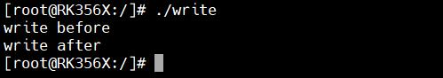
图35.8write 可执行程序执行完成后数据已经准备好，驱动中的poll()函数会返回POLLIN，所以接着可以看到read 应用程序读取到了数据，如图35.9 所示。

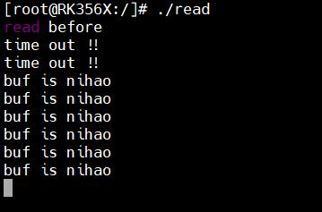
图35.9

