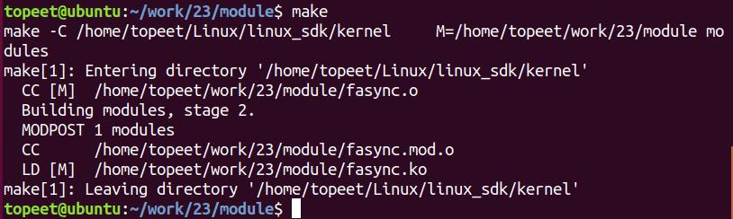
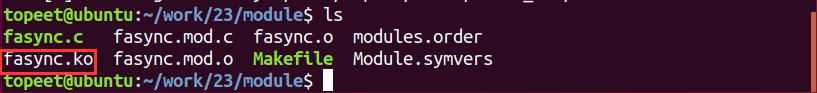
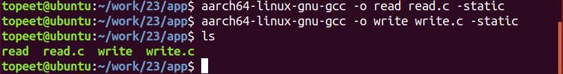
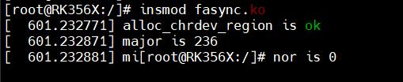

# 第036章 信号驱动IO实验

本章讲解信号驱动IO。
## 36.1 信号驱动IO 简介
信号驱动IO 指的是进程会预先告知内核，当某个描述符发生事件时，内核要向该进程发送SIGIO 信号进行通知，进程可以在信号处理函数中对该事件进行处理。要使用信号驱动IO，需要应用程序和驱动程序配合，应用程序使用信号驱动IO 的步骤有三步：步骤1：注册信号处理函数，应用程序中使用signal()函数来注册SIGIO 信号的信号处理函数。步骤2：使用fcntl()函数设置能够接收这个信号的进程。步骤3：使用fcntl()函数的F_SETFL 参数打开FASYNC 标志开启信号驱动IO。fcntl()函数如下所示：函数原型：int fcntl(int fd,int cmd, ...)函数功能：fcntl 函数可以用来操作文件描述符函数参数:fd: 被操作的文件描述符cmd: 操作文件描述符的命令，cmd 参数决定了要如何操作文件描述符fd...: 根据cmd 的参数来决定是不是需要使用第三个参数操作文件描述符的命令如表36.1 所示。表36.1命令名描述F_DUPFD复制文件描述符F_GETFD获取文件描述符标志F_SETFD设置文件描述符标志F_GETFL获取文件状态标志F_SETFL设置文件状态标志F_GETLK获取文件锁F_SETLK设置文件锁F_SETLKW类似F_SETLK，但等待返回F_GETOWN获取当前接收SIGIO 和SIGURG 信号的进程ID 和进程组IDF_SETOWN设置当前接收SIGIO 和SIGURG 信号的进程ID 和进程组ID
驱动程序使用信号驱动IO 的步骤也包括三步：：

步骤1应用程序使用信号驱动IO 时，会触发驱动中的fasync()函数。因此要在file_operations 结构体中实现fasync()函数，fasync()函数原型为如下：int (*fasync) (int fd,struct file *filp,int on)步骤2在驱动的fasync() 函数中调用fasync_helper() 函数来初始化fasync_struct 结构体，fasync_helper()函数原型如下：int fasync_helper(int fd,struct file *filp,int on,struct fasync_struct **fapp)步骤3：当设备准备好（即可以访问）时，驱动程序需要调用kill_fasync()函数通知应用程序，此时应用程序的SIGIO 信号处理函数就会被执行。kill_fasync()负责发送指定的信号，函数原型如下：void kill_fasync(struct fasync_struct **fp,int sig,int band)函数参数：fp: 要操作的fasync_structsig: 发送的信号band: 事件类型，可读的时候设置成POLLIN ，可写的时候设置成POLLOUT
## 36.2 实验程序编写
### 36.2.1 编写测试APP
本实验代码存储在网盘iTOP-RK3568 开发板\07_学习教程配套资料\03_Linux 驱动配套资料\04_Linux 驱动例程\23\app 路径下。编写应用程序write.c，在此代码中，调用write()函数向/dev/test 设备写入数据“nihao”。实验代码write.c 如代码清单36.1 所示。代码清单36.1
```c
#include <stdio.h>
#include <sys/types.h>
#include <sys/stat.h>
#include <fcntl.h>
#include <unistd.h>
#include <stdlib.h>
#include <string.h>
int main(int argc, char *argv[])
{
    int fd;
    char buf1[32] = {0};
    char buf2[32] = "nihao";
    fd = open("/dev/test",O_RDWR);//打开/dev/test 设备
    if (fd < 0)
    {
```

```c
perror("open error \n");
return fd;
}
printf("write before \n");
write(fd,buf2,sizeof(buf2));//向/dev/test 文件写入数据
printf("write after\n");
close(fd);//关闭文件
return 0;
}
```
然后来编写应用程序read.c，在此代码中要使用信号驱动IO 读取数据。实验代码read.c 如代码清单36.2 所示。代码清单36.2
```c
#include <stdio.h>
#include <sys/types.h>
#include <sys/stat.h>
#include <fcntl.h>
#include <unistd.h>
#include <stdlib.h>
#include <poll.h>
#include <fcntl.h>
#include <signal.h>
int fd;
char buf1[32] = {0};
//SIGIO 信号的信号处理函数
static void func(int signum)
{
    read(fd,buf1,32);
    printf ("buf is %s\n",buf1);
}
int main(int argc, char *argv[])
{
    int ret;
    int flags;
       fd = open("/dev/test", O_RDWR);//打开/dev/test 设备
    if (fd < 0)
    {
        perror("open error \n");
        return fd;
    }
```

```c
signal(SIGIO,func);//步骤一：使用signal 函数注册SIGIO 信号的信号处理函数
 //步骤二：设置能接收这个信号的进程
 //fcntl 函数用来操作文件描述符，
 //F_SETOWN 设置当前接收的SIGIO 的进程ID
 fcntl(fd,F_SETOWN,getpid());
flags = fcntl(fd,F_GETFD); //获取文件描述符标志
//步骤三：开启信号驱动IO 使用fcntl()函数的F_SETFL 命令打开FASYNC 标志
fcntl(fd,F_SETFL,flags| FASYNC);
while(1);
close(fd);//关闭文件
return 0;
}
```
### 36.2.2 驱动程序编写
本实验代码存储在网盘iTOP-RK3568 开发板\07_学习教程配套资料\03_Linux 驱动配套资料\04_Linux 驱动例程\23\module 路径下。按照信号驱动IO 介绍章节中讲解的驱动中编写信号驱动IO 的三个步骤编写驱动程序，实验代码fasync.c 如代码清单36.3 所示。代码清单36.3
```c
#include <linux/init.h>
#include <linux/module.h>
#include <linux/kdev_t.h>
#include <linux/fs.h>
#include <linux/cdev.h>
#include <linux/uaccess.h>
#include <linux/io.h>
#include<linux/wait.h>
#include <linux/poll.h>
#include <linux/fcntl.h>
#include <linux/signal.h>
struct device_test{
    dev_t dev_num;//设备号
    int major ;//主设备号
    int minor ;//次设备号
    struct cdev cdev_test; // cdev
    struct class *class;//类
    struct device *device; //设备
    char kbuf[32];
    intflag;//标志位
```

```c
struct fasync_struct *fasync;
};
structdevice_test dev1;
DECLARE_WAIT_QUEUE_HEAD(read_wq); //定义并初始化等待队列头
/*打开设备函数*/
static int cdev_test_open(struct inode *inode, struct file *file)
{
file->private_data=&dev1;//设置私有数据
return 0;
}
/*向设备写入数据函数*/
static ssize_t cdev_test_write(struct file *file, const char __user *buf, size_t size, loff_t *off)
{
struct device_test *test_dev=(struct device_test *)file->private_data;
if (copy_from_user(test_dev->kbuf, buf, size) != 0) // copy_from_user:用户空间向内核空间传数据
{
    printk("copy_from_user error\r\n");
    return -1;
}
test_dev->flag=1;
wake_up_interruptible(&read_wq);
kill_fasync(&test_dev->fasync,SIGIO,POLLIN);
    return 0;
}
/*从设备读取数据*/
static ssize_t cdev_test_read(struct file *file, char __user *buf, size_t size, loff_t *off)
{
struct device_test *test_dev=(struct device_test *)file->private_data;
if(file->f_flags & O_NONBLOCK ){
    if (test_dev->flag !=1)
        return -EAGAIN;
}
wait_event_interruptible(read_wq,test_dev->flag);
if (copy_to_user(buf, test_dev->kbuf, strlen( test_dev->kbuf)) != 0) // copy_to_user:内核空间向用户空间
传数据
{
        printk("copy_to_user error\r\n");
        return -1;
}
return 0;
```

```c
}
static int cdev_test_release(struct inode *inode, struct file *file)
{
    return 0;
}
static__poll_tcdev_test_poll(struct file *file, struct poll_table_struct *p){
     struct device_test *test_dev=(struct device_test *)file->private_data;//设置私有数据
     __poll_t mask=0;
     poll_wait(file,&read_wq,p);//应用阻塞
     if (test_dev->flag == 1)
     {
         mask |= POLLIN;
     }
     return mask;
}
static int cdev_test_fasync (int fd, struct file *file, int on)
{
     struct device_test *test_dev=(struct device_test *)file->private_data;//设置私有数据
     returnfasync_helper(fd,file,on,&test_dev->fasync);
}
/*设备操作函数*/
struct file_operations cdev_test_fops = {
    .owner = THIS_MODULE, //将owner 字段指向本模块，可以避免在模块的操作正在被使用时卸载该模块
    .open = cdev_test_open, //将open 字段指向cdev_test_open(...)函数
    .read = cdev_test_read, //将read 字段指向cdev_test_read(...)函数
    .write = cdev_test_write, //write 字段指向cdev_test_write(...)函数
    .release = cdev_test_release, //将release 字段指向cdev_test_release(...)函数
    .poll = cdev_test_poll,//将poll 字段指向cdev_test_poll(...)函数
    .fasync = cdev_test_fasync,//将fasync 字段指向cdev_test_fasync(...)函数
};
static int __init chr_fops_init(void) //驱动入口函数
{
    /*注册字符设备驱动*/
    int ret;
    /*1 创建设备号*/
    ret = alloc_chrdev_region(&dev1.dev_num, 0, 1, "alloc_name"); //动态分配设备号
    if (ret < 0)
    {
```

```c
goto err_chrdev;
}
printk("alloc_chrdev_region is ok\n");
dev1.major = MAJOR(dev1.dev_num); //获取主设备号
dev1.minor = MINOR(dev1.dev_num); //获取次设备号
printk("major is %d \r\n", dev1.major); //打印主设备号
printk("minor is %d \r\n", dev1.minor); //打印次设备号
/*2 初始化cdev*/
dev1.cdev_test.owner = THIS_MODULE;
cdev_init(&dev1.cdev_test, &cdev_test_fops);
/*3 添加一个cdev,完成字符设备注册到内核*/
ret =cdev_add(&dev1.cdev_test, dev1.dev_num, 1);
if(ret<0)
{
 gotoerr_chr_add;
}
/*4 创建类*/
dev1. class = class_create(THIS_MODULE, "test");
if(IS_ERR(dev1.class))
{
 ret=PTR_ERR(dev1.class);
 goto err_class_create;
}
/*5创建设备*/
dev1.device = device_create(dev1.class, NULL, dev1.dev_num, NULL, "test");
if(IS_ERR(dev1.device))
{
 ret=PTR_ERR(dev1.device);
 goto err_device_create;
}
return 0;
err_device_create:
     class_destroy(dev1.class);//删除类
err_class_create:
    cdev_del(&dev1.cdev_test);//删除cdev
err_chr_add:
     unregister_chrdev_region(dev1.dev_num, 1); //注销设备号
err_chrdev:
     return ret;
}
```

```c
static void __exit chr_fops_exit(void) //驱动出口函数
{
    /*注销字符设备*/
    unregister_chrdev_region(dev1.dev_num, 1); //注销设备号
    cdev_del(&dev1.cdev_test);//删除cdev
    device_destroy(dev1.class, dev1.dev_num);//删除设备
    class_destroy(dev1.class);//删除类
}
module_init(chr_fops_init);
module_exit(chr_fops_exit);
MODULE_LICENSE("GPL v2");
MODULE_AUTHOR("topeet");
```
## 36.3 运行测试
### 36.3.1 编译驱动程序
在fasync.c 代码同一目录下创建Makefile 文件，如图36.1 所示。

图36.1Makefile 文件内容如代码清单36.4 所示。代码清单36.4
```c
export ARCH=arm64#设置平台架构
export CROSS_COMPILE=aarch64-linux-gnu-#交叉编译器前缀
obj-m +=fasync.o#此处要和你的驱动源文件同名
KDIR :=/home/topeet/Linux/linux_sdk/kernel#这里是你的内核目录
PWD ?= $(shell pwd)
all:
    make -C $(KDIR) M=$(PWD) modules#make 操作
clean:
    make -C $(KDIR) M=$(PWD) clean#make clean 操作
```
在存放fasync.c 和Makefile 文件目录下使用make 命令编译驱动程序，编译完成如图36.2所示。


图36.2编译完生成fasync.ko 目标文件，如图36.3 所示。

图36.3
### 36.3.2 编译应用程序
来到存放应用程序read.c 和write.c 的文件夹下，分别使用aarch64-linux-gnu-gcc -o readread.c -static 和aarch64-linux-gnu-gcc -o write write.c -static 命令对read.c 和write.c 进行交叉编译，编译完成如图36.4 所示。

图36.4
### 36.3.3 运行测试
将本章节编译好的fasync.ko 驱动文件和read、write 可执行文件拷贝到开发板上。开发板启动之后，输入insmod fasync.ko 命令加载驱动程序，如图36.5 所示。

图36.5输入./read 命令运行read 应用程序，如图36.6 所示。

