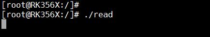
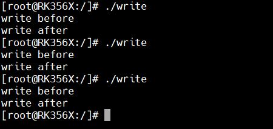
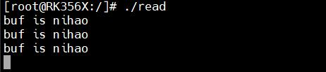
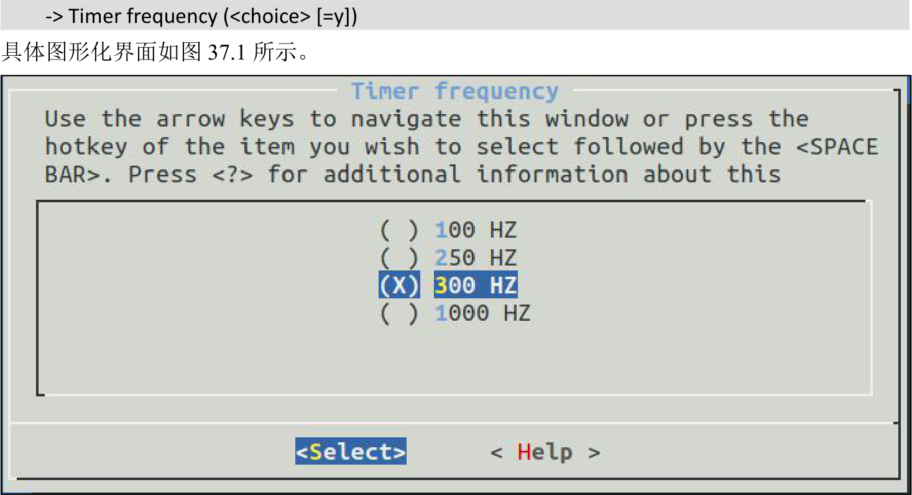
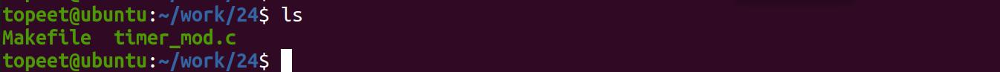
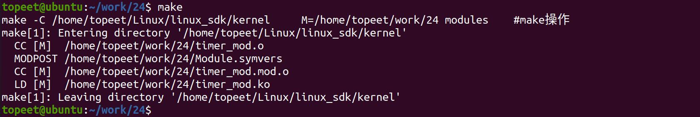
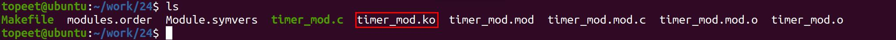
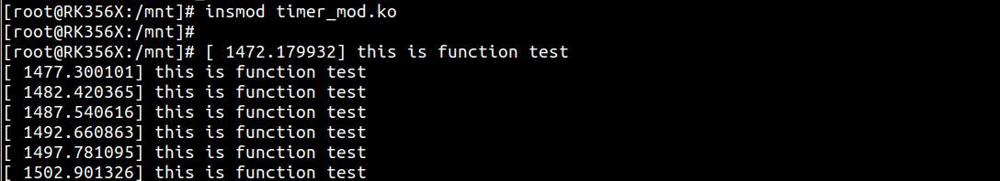
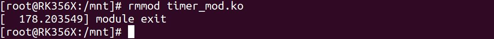

# 第037章 定时器实验


图36.6然后输入./write 命令运行write 应用程序，如图36.7 所示。

图36.7write 应用程序执行成功以后，内核会通过信号告知应用数据数据准好，此时应用中的信号处理函数则会执行，所以read 应用程序打印了读取到的数据。如图36.8 所示，

图36.8

本节讲解Linux 中的定时器。
## 37.1 Linux 定时器
Linux 提供了基于未来时间点的计时方式，也就是以当前时刻为计时开始的起点，以未来的某一时刻为计时的终点。但是内核定时器的精度并不高，所以不能作为高精度定时器使用。并且内核定时器的运行没有周期性，到达计时终点后会自动关闭。如果要实现周期性定时，就要在定时处理函数中重新开启定时器。Linux 内核中使用timer_list 结构体表示内核定时器，该结构体定义在内核源码/include/linux/timer.h 文件中，具体内容如代码清单37.1 所示。代码清单37.1
```c
struct timer_list {
    struct hlist_nodeentry;
    unsigned longexpires;/* 定时器超时时间，单位是节拍数*/
    void(*function)(struct timer_list *);/* 定时处理函数*/
    u32flags;
#ifdef CONFIG_LOCKDEP
    struct lockdep_maplockdep_map;
#endif
    ANDROID_KABI_RESERVE(1);
    ANDROID_KABI_RESERVE(2);
};
```
可以使用代码清单37.2 中的宏对timer_list 结构体进行定义，其中_name 为定义的结构体名称，_function 为定时处理函数，该宏同样定义在内核源码/include/linux/timer.h 文件中，如代码清单37.2 所示。代码清单37.2
```c
#define DEFINE_TIMER(_name, _function)\
    struct timer_list _name =\
        __TIMER_INITIALIZER(_function, 0)
```
例如使用以下代码对定时器和相应的定时处理函数进行定义：
```c
DEFINE_TIMER(timer_test,function_test);
```
定时器定义完成之后还需要通过一系列的API 函数来初始化此定时器，常用函数说明如表30.1 所示。表37.1

函数作用void add_timer(struct timer_list *timer)向Linux 内核注册定时器，使用add_timer()函数向内核注册定时器以后，定时器就会开始运行int del_timer(struct timer_list * timer)删除一个定时器intmod_timer(structtimer_list修改定时值，如果定时器还没有激活的话，*timer,unsigned long expires)mod_timer 函数会激活定时器在使用add_timer()函数向Linux 内核注册定时器之前，还需要设置定时时间，定时时间由timer_list 结构体中的expires 参数决定，单位为节拍数。在linux 内核中有一个宏HZ，这个宏用来表示1s 内对应的节点数量。通过这个宏就可以把时间转换成节拍数。比如定时1s 对应的节拍数为jiffies+1*HZ，jiffies 是系统当前时间对应的节拍数，是一个全局变量。宏HZ 的值可以通过图形化配置界面修改，具体路径如下：-> Kernel Features

图37.1从图37.1 中可以看出可选的系统节拍率有100Hz、250Hz、300Hz 和1000Hz，默认情况下选择300Hz。全局变量jiffies 用来记录自系统启动以来产生节拍的总数。启动时内核将该变量初始化为0，此后每次时钟中断处理程序都会增加该变量的值，一秒内jiffes 增加的值为设置的系统节拍数，即增加宏HZ 的大小，该变量定义在内核源码/include/linux/jiffies.h 文件中（timer.h 文件中已经包含，不需要重复引用），具体定义如代码清单37.3 所示。代码清单37.3
```c
extern u64 __cacheline_aligned_in_smp jiffies_64;
extern unsigned long volatile __cacheline_aligned_in_smp __jiffy_arch_data jiffies;
```

其中jiffies_64 用于64 位系统，jiffies 用于32 位系统。为了方便开发，Linux 内核还提供了几个jiffies 和ms、us、ns 之间的转换函数，如表37.2 所示。表37.2函数作用
```c
int jiffies_to_msecs(const unsigned long j)将jiffies 类型的参数j 转换为对应的毫秒
int jiffies_to_usecs(const unsigned long j)将jiffies 类型的参数j 转换为对应的微秒
u64 jiffies_to_nsecs(const unsigned long j)将jiffies 类型的参数j 转换为对应的纳秒
long msecs_to_jiffies(const unsigned int m)将毫秒转换为jiffies 类型
long usecs_to_jiffies(const unsigned int u)将微秒转换为jiffies 类型
  unsigned long nsecs_to_jiffies(u64 n)将纳秒转换为jiffies 类型
```
例如可以使用以下命令进行3 秒钟的定时：timer_test.expires = jiffies_64 +msecs_to_jiffies(3000)
## 37.2 实验程序编写
本实验代码存储在网盘iTOP-RK3568 开发板\07_学习教程配套资料\03_Linux 驱动配套资料\04_Linux 驱动例程\24_timer\module 路径下。本实验将实现五秒钟的计时，五秒钟之后将打印this is function test 相关字符，并在定时处理函数中使用mod_timer()函数重新设置定时时间实现循环打印。实验代码timer_mod.c 如代码清单37.4 所示。代码清单37.4
```c
#include <linux/init.h>
#include <linux/module.h>
#include <linux/timer.h>
static void function_test(struct timer_list *t);//定义function_test 定时功能函数
DEFINE_TIMER(timer_test,function_test);//定义一个定时器
static void function_test(struct timer_list *t)
{
    printk("this is function test \n");
    mod_timer(&timer_test,jiffies_64 + msecs_to_jiffies(5000));//使用mod_timer()函数将定时时间设置为五
秒后，从而实现5s 循环定时。也就是说每5s 会执行一次超时服务函数。
}
static int __init timer_mod_init(void) //驱动入口函数
{
    timer_test.expires = jiffies_64 + msecs_to_jiffies(5000);//将定时时间设置为五秒后
    add_timer(&timer_test);//添加一个定时器
    return 0;
}
```

```c
static void __exit timer_mod_exit(void) //驱动出口函数
{
    del_timer(&timer_test);//删除一个定时器
    printk("module exit \n");
}
module_init(timer_mod_init);
module_exit(timer_mod_exit);
MODULE_LICENSE("GPL v2");
MODULE_AUTHOR("topeet");
```
## 37.3 运行测试
### 37.3.1 编译驱动程序
在timer_mod.c 代码同一目录下创建Makefile 文件，如图37.2 所示。

图37.2Makefile 文件内容如代码清单37.5 所示。代码清单37.5
```c
export ARCH=arm64#设置平台架构
export CROSS_COMPILE=aarch64-linux-gnu-#交叉编译器前缀
obj-m += timer_mod.o#此处要和你的驱动源文件同名
KDIR :=/home/topeet/Linux/linux_sdk/kernel#这里是你的内核目录
PWD ?= $(shell pwd)
all:
    make -C $(KDIR) M=$(PWD) modules#make 操作
clean:
    make -C $(KDIR) M=$(PWD) clean#make clean 操作
```
在存放timer_mod.c 和Makefile 文件目录下使用make 命编译驱动程序，编译完成如图37.3所示。

图37.3编译完生成timer_mod.ko 目标文件，如图37.4 所示。

图37.4

### 37.3.2 运行测试
将本章节编译好的example.ko 驱动文件拷贝到开发板上。开发板启动之后，使用insmod timer_mod.ko 命令进行驱动模块的加载，如图37.5 所示。

图37.5可以看到驱动加载之后，每隔五秒钟会打印this is function test 相关打印，证明编写的驱动程序没有问题，最后使用rmmod timer_mod.ko 命令卸载相应的驱动，如图37.6 所示。

图37.6

