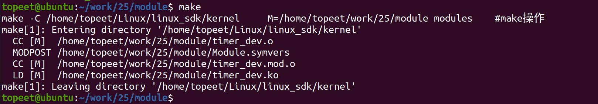
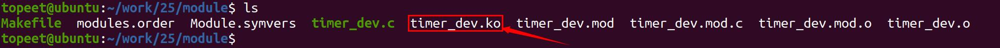
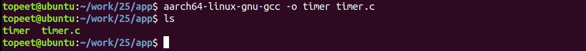
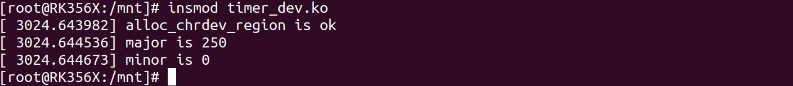
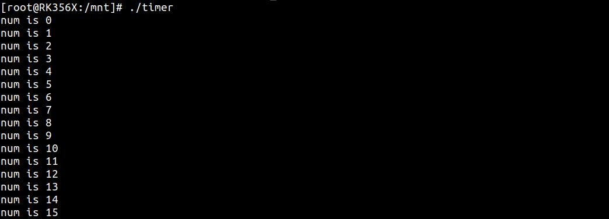
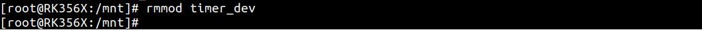

# 第038章 秒字符设备驱动实验

本章节实验目标如下：1. 实现字符设备驱动框架，自动生成设备节点。2. 根据Linux 定时器实现秒计时。3. 通过原子变量来记录递增的秒数，避免竞争的发生。4. 通过用户空间和内核空间的数据交换，将记录的秒数传递到应用空间，并通过应用程序打印出来。
## 38.1 实验程序编写
### 38.1.1 编写测试APP
本实验代码存储在网盘iTOP-RK3568 开发板\07_学习教程配套资料\03_Linux 驱动配套资料\04_Linux 驱动例程\25_timer_dev\app 路径下。首先来编写应用测试代码timer.c，在此代码中每隔一秒钟打印从内核空间传递来的秒数，实验代码timer.c 如代码清单38.1 所示。代码清单38.1
```c
#include <stdio.h>
#include <sys/types.h>
#include <sys/stat.h>
#include <fcntl.h>
#include <unistd.h>
int main(int argc,char *argv[]){
    int fd;//定义int 类型的文件描述符fd
    int count;//定义int 类型记录秒数的变量count
    fd = open("/dev/test",O_RDWR);//使用open()函数以可读可写的方式打开设备文件
    while(1)
    {
        read(fd,&count,sizeof(count));//使用read()函数读取内核传递来的秒数
        sleep(1);
        printf("num is %d\n",count);
    }
    return 0;
}
```

### 38.1.2 驱动程序编写
本实验代码存储在网盘iTOP-RK3568 开发板\07_学习教程配套资料\03_Linux 驱动配套资料\04_Linux 驱动例程\25_timer_dev\module 路径下。实验代码timer_dev.c 如代码清单38.2 所示。代码清单38.2
```c
#include <linux/module.h>
#include <linux/init.h>
#include <linux/fs.h>
#include <linux/cdev.h>
#include <linux/kdev_t.h>
#include <linux/uaccess.h>
#include <linux/atomic.h>
struct device_test{
    dev_t dev_num;//设备号
    int major ;//主设备号
    int minor ;//次设备号
    struct cdev cdev_test; // cdev
    struct class *class;//类
    struct device *device; //设备
    int sec; //秒
};
atomic64_t v = ATOMIC_INIT(0);//定义原子类型变量v，并定义为0
static struct device_test dev1;
static void function_test(struct timer_list *t);//定义function_test 定时功能函数
DEFINE_TIMER(timer_test,function_test);//定义一个定时器
static void function_test(struct timer_list *t)
{
    atomic64_inc(&v);//原子变量v 自增
    dev1.sec = atomic_read(&v);//将读取到的原子变量v,赋值给sec
    //printk("the sec is %d\n",dev1.sec);
    mod_timer(&timer_test,jiffies_64 + msecs_to_jiffies(1000));//使用mod_timer 函数将定时时间设置为一
秒后
}
static int cdev_test_open(struct inode *inode, struct file *file)
{
    file->private_data=&dev1;//设置私有数据
    add_timer(&timer_test); //添加一个定时器
    return 0;
}
/**从设备读取数据*/
```

```c
static ssize_t cdev_test_read(struct file *file, char __user *buf, size_t size, loff_t *off)
{
    if(copy_to_user(buf,&dev1.sec,sizeof(dev1.sec))){//使用copy_to_user 函数将sec 传递到应用层
        printk("copy_to_user error \n");
        return -1;
    }
    return 0;
}
static int cdev_test_release(struct inode *inode, struct file *file)
{
    del_timer(&timer_test);//删除一个定时器
    return 0;
}
/*设备操作函数*/
struct file_operations cdev_test_fops = {
    .owner = THIS_MODULE, //将owner 字段指向本模块，可以避免在模块的操作正在被使用时卸载该模块
    .open = cdev_test_open, //将open 字段指向cdev_test_open(...)函数
    .read = cdev_test_read, //将read 字段指向cdev_test_read(...)函数
    .release = cdev_test_release, //将release 字段指向cdev_test_release(...)函数
};
static int __init timer_dev_init(void) //驱动入口函数
{
    /*注册字符设备驱动*/
    int ret;
    /*1 创建设备号*/
    ret = alloc_chrdev_region(&dev1.dev_num, 0, 1, "alloc_name"); //动态分配设备号
    if (ret < 0)
    {
       goto err_chrdev;
    }
    printk("alloc_chrdev_region is ok\n");
    dev1.major = MAJOR(dev1.dev_num); //获取主设备号
    dev1.minor = MINOR(dev1.dev_num); //获取次设备号
    printk("major is %d \r\n", dev1.major); //打印主设备号
    printk("minor is %d \r\n", dev1.minor); //打印次设备号
     /*2 初始化cdev*/
    dev1.cdev_test.owner = THIS_MODULE;
    cdev_init(&dev1.cdev_test, &cdev_test_fops);
    /*3 添加一个cdev,完成字符设备注册到内核*/
   ret =cdev_add(&dev1.cdev_test, dev1.dev_num, 1);
```

```c
if(ret<0)
{
    gotoerr_chr_add;
}
/*4 创建类*/
dev1. class = class_create(THIS_MODULE, "test");
if(IS_ERR(dev1.class))
{
    ret=PTR_ERR(dev1.class);
    goto err_class_create;
}
/*5创建设备*/
dev1.device = device_create(dev1.class, NULL, dev1.dev_num, NULL, "test");
if(IS_ERR(dev1.device))
{
    ret=PTR_ERR(dev1.device);
    goto err_device_create;
}
return 0;
err_device_create:
    class_destroy(dev1.class);//删除类
err_class_create:
   cdev_del(&dev1.cdev_test);//删除cdev
err_chr_add:
    unregister_chrdev_region(dev1.dev_num, 1); //注销设备号
err_chrdev:
    return ret;
}
static void __exit timer_dev_exit(void) //驱动出口函数
{
/*注销字符设备*/
unregister_chrdev_region(dev1.dev_num, 1); //注销设备号
cdev_del(&dev1.cdev_test);//删除cdev
device_destroy(dev1.class, dev1.dev_num);//删除设备
class_destroy(dev1.class);//删除类
}
module_init(timer_dev_init);
module_exit(timer_dev_exit);
```

```c
MODULE_LICENSE("GPL v2");
MODULE_AUTHOR("topeet");
```
## 38.2 运行测试
### 38.2.1 编译驱动程序
在timer_dev.c 代码同一目录下创建Makefile 文件，如图38.1 所示。

图38.1Makefile 文件内容如代码清单38.3 所示。代码清单38.3
```c
export ARCH=arm64#设置平台架构
export CROSS_COMPILE=aarch64-linux-gnu-#交叉编译器前缀
obj-m += timer_dev.o#此处要和你的驱动源文件同名
KDIR :=/home/topeet/Linux/linux_sdk/kernel#这里是你的内核目录
PWD ?= $(shell pwd)
all:
    make -C $(KDIR) M=$(PWD) modules#make 操作
clean:
    make -C $(KDIR) M=$(PWD) clean#make clean 操作
```
在存放timer_dev.c 和Makefile 文件目录下使用make 命令进行驱动的编译，编译完成如图38.2 所示。

图38.2编译完生成timer_dev.ko 目标文件，如图38.3 所示。

图38.3
### 38.2.2 编译应用程序
然后来到存放应用程序timer.c 的文件夹下，使用aarch64-linux-gnu-gcc -o timer timer.c命令对timer.c 进行交叉编译，编译完成如图38.4 所示。


图38.4
### 38.2.3 运行测试
将本章节编译好的timer_dev.ko 驱动文件和timer 可执行文件拷贝到开发板上。开发板启动之后，使用insmod timer_dev.ko 命令进行驱动模块的加载，如图38.5 所示。

图38.5然后输入./timer 命令进行可执行程序的运行，如图38.6 所示。

图38.6可以看到每隔一秒钟就会打印由内核空间传递来的秒数，我们要实现的任务就完成了，最后使用rmmod timer_dev 命令卸载对应的驱动，如图38.7 所示。

图38.7

