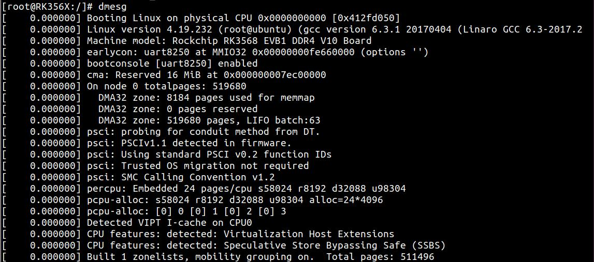
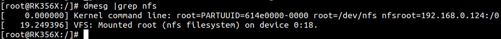
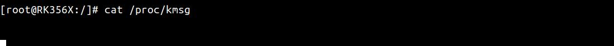
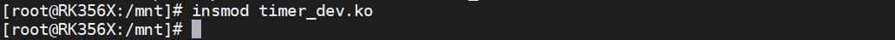
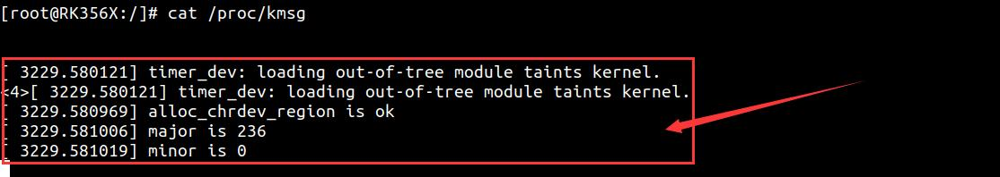
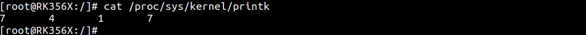
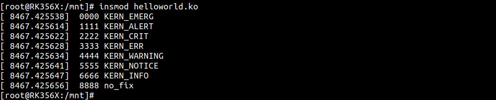
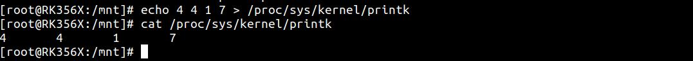
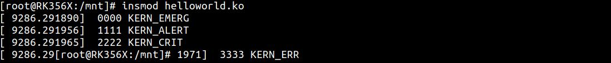

# 第039章 Linux内核打印实验

本手册的实验都是在buildroot 系统上完成的，由于buildroot 系统已经设置了相应的打印等级，所以驱动中相关打印都能正常显示在串口终端上，如果将实验系统换成了ubuntu，然后加载同样的驱动，会发现打印信息不见了，这一现象的基本原因是内核打印等级不同，那打印等级是如何修改的呢，查看打印等级的方式又有哪些呢，就让我们进入本章节的学习吧！
## 39.1 方法一：dmesg 命令
在终端使用dmesg 命令可以获取内核打印信息。dmesg 命令使用方法如下：英文全称：display message（显示信息）作用：kernel 会将打印信息存储在ring buffer 中。可以利用dmesg 命令来查看内核打印信息。。常用参数:-C，--clear 清除内核环形缓冲区-c，—-read-clear 读取并清除所有消息-T，--显示时间戳提示：dmesg 命令也可以与grep 命令组合使用。如查找待用usb 关键字的打印信息，就可以使用如下命令:dmesg | grep usb如在串口终端使用“dmesg”命令，可以看见相应的内核打印信息已经加载了出来，如图39.1 所示。

图39.1

然后使dmesg | grep nfs 下组合命令查找nfs 相关的打印信息，如图39.2 所示。

图39.2至此关于dmesg 命令就讲解演示完成了。
## 39.2 方法二：查看kmsg 文件
内核所有的打印信息都会输出到循环缓冲区log_buf，为了能够方便的在用户空间读取内核打印信息，Linux 内核驱动将该循环缓冲区映射到了/proc 目录下的文件节点kmsg 中。通过cat 命令或者其他应用程序读取Log Buffer 的时候可以不断的等待新的log，所以访问/proc/kmsg 的方式适合长时间的读取log，一旦有新的log 就可以被打印出来。首先使用cat /proc/kmsg 命令读取kmsg 文件，在没有新的内核打印信息时会阻塞，如图39.3 所示。

图39.3然后使用的是ssh 链接开发板，并加载任意一个驱动程序，如图39.4 所示。

图39.4在串口终端中可以看到对应驱动的打印信息就被打印了出来，如图39.5 所示。

图39.5
## 39.3 方法三：调整内核打印等级
内核的日志输出受打印等级来控制，可以通过调整内核打印等级来过滤和控制哪些信息可以被输出到终端。使用cat /proc/sys/kernel/printk 命令查看当前默认打印等级，如图39.6 所示。

图39.6可以看到内核打印等级为7 4 1 7 四个数字，其分别对应console_loglevel 、default_message_loglevel、minimum_console_loglevel、default_console_loglevel，具体类型说明

如表39.1 所示。表39.1终端打印类型对应类型说明console_loglevel只有当printk 打印消息的log 优先级高于console_loglevel 时，才能输出到终端上default_message_loglevelprintk 打印消息时默认的log 等级minimum_console_loglevelconsole_loglevel 可以被设置的最小值default_console_loglevelconsole_loglevel 的缺省值上面的“7 4 1 7”其中的第一个“7”代表当前console_loglevel，意味着只有优先级高于（数值小于）KERN_DEBUG（即小于等于6）的打印信息才会被输出到终端。在内核源码/include/linux/kern_levels.h 文件中对于文件打印等级进行了如下定义，如代码清单39.1 所示。代码清单39.1
```c
#define KERN_EMERGKERN_SOH "0"/* 系统无法使用*/
#define KERN_ALERTKERN_SOH "1"/* 必须立即采取行动*/
#define KERN_CRITKERN_SOH "2"/* 严重的情况*/
#define KERN_ERRKERN_SOH "3"/* 错误情况*/
#define KERN_WARNINGKERN_SOH "4"/* 警告情况*/
#define KERN_NOTICEKERN_SOH "5"/* 正常但重要的情况*/
#define KERN_INFOKERN_SOH "6"/* 信息性消息*/
#define KERN_DEBUGKERN_SOH "7"/* 调试级别消息*/
```
注：printk 的优先级值越小，表示优先级越高，如KERN_EMERG 值为最大，KERN_DEBUG代表的优先级最低。printk 在打印信息前，可以加入相应的打印等级宏定义，具体格式如下所示：
```c
printk(打印等级"打印信息")
```
接下来将使用以下驱动例程进行实际的打印等级测试，如代码清单39.2 所示。代码清单39.2
```c
#include <linux/module.h>
#include <linux/kernel.h>
static int __init helloworld_init(void)
{
    printk(KERN_EMERG " 0000 KERN_EMERG\n");
    printk(KERN_ALERT " 1111 KERN_ALERT\n");
    printk(KERN_CRIT " 2222 KERN_CRIT\n");
    printk(KERN_ERR " 3333 KERN_ERR\n");
    printk(KERN_WARNING " 4444 KERN_WARNING\n");
    printk(KERN_NOTICE " 5555 KERN_NOTICE\n");
    printk(KERN_INFO " 6666 KERN_INFO\n");
    printk(KERN_DEBUG " 7777 KERN_DEBUG\n");
    printk(" 8888 no_fix\n");
    return 0;
}
```

```c
static void __exit helloworld_exit(void)
{
    printk(KERN_EMERG "helloworld_exit\r\n");
}
module_init(helloworld_init);
module_exit(helloworld_exit);
MODULE_LICENSE("GPL v2");
MODULE_AUTHOR("topeet");
```
加载该驱动之后，第5-11 行代码对应的0-6 等级的打印信息就被打印了出来，如图39.7所示。

图39.7
代码清单39.3 中第13 行打印由于没有设置打印等级，所以会被赋予默认打印等级4，打印等级7 高于console_loglevel 打印等级，所以也会被打印出来，代码清单39.3 中第12 行打印等级为7 和console_loglevel 打印等级相同，所以不会被打印出来。然后使用echo 4 4 1 7 > /proc/sys/kernel/printk 命令将console_loglevel 打印等级设置为4，如图39.8 所示。

图39.8卸载驱动再一次加载驱动，发现只有打印等级高于4 的相关信息被打印了出来，如图39.9所示。

图39.9至此关于内核打印等级的实验就结束了。

