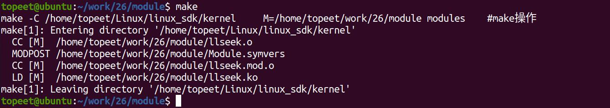
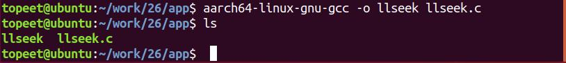
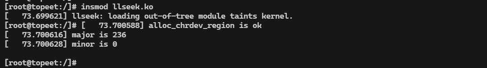
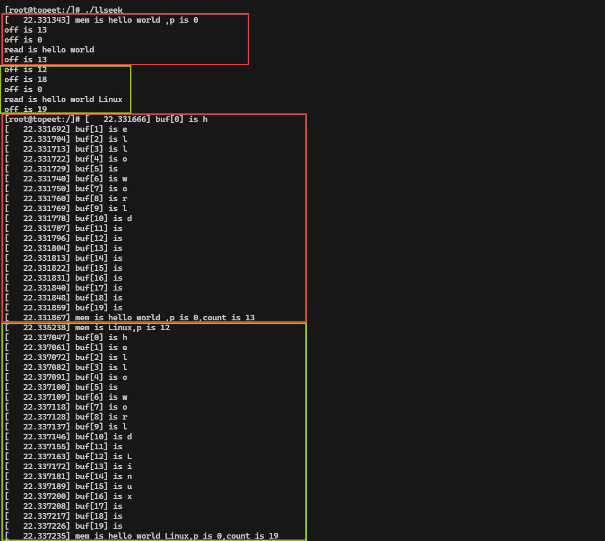
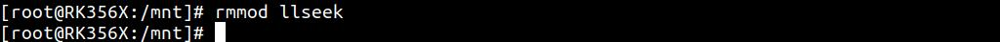

# 第040章llseek定位设备驱动实验

假如现在有这样一个场景，将两个字符串依次进行写入，并对写入完成的字符串进行读取，如果仍采用之前的方式，第二次的写入值会覆盖第一次的写入值，那要如何解决这一问题呢？这就要轮到llseek 出场了。
## 40.1 定位设备llseek
### 40.1.1 lseek 函数的使用
在应用程序中使用lseek()函数进行读写位置的调整。lseek 函数()详细函数介绍如下：函数原型：off_t lseek(int fd, off_t offset, int whence);头文件：#include <sys/types.h>#include <unistd.h>函数作用：移动文件的读写位置。参数含义：fd: 要操作的文件描述符；off_t offset: 以whence 为基准的偏移量。可为正值或负值，如果是负值表示向前移动；如果是正值表示向后移动。whence：当前位置的基点，可以使用以下三组值。SEEK_SET：文件指针开头SEEK_CUR:文件指针当前位置SEEK_END:文件指针末尾函数返回值：成功返回文件读写指针距离文件开头的字节大小，失败返回-1函数使用示例：把文件位置指针设置为5：lseek(fd,5,SEEK_SET);把文件位置设置成文件末尾：lseek(fd,0,SEEK_END);

确定当前的文件位置：lseek(fd,0,SEEK_CUR);
### 40.1.2 编写驱动接口函数
在应用程序中使用lseek()函数会调用驱动file_operation 结构体中的llseek 接口，所以需要对驱动中的llseek()函数进行填充，并且完善驱动read()和write()函数中偏移相关代码。1.驱动中llseek 函数编写llseek()填充完成的函数如代码清单40.1 所示。代码清单40.1
```c
static loff_t cdev_test_llseek(struct file *file, loff_t offset, int whence)
{
    loff_t new_offset;//定义loff_t 类型的新的偏移值
    switch(whence)//对lseek 函数传递的whence 参数进行判断
    {
        case SEEK_SET:
             if(offset < 0){
                 return -EINVAL;
                 break;
             }
             if(offset > BUFSIZE){
                return -EINVAL;
                break;
             }
             new_offset = offset;//如果whence 参数为SEEK_SET，则新偏移值为offset
             break;
        case SEEK_CUR:
            if(file->f_pos + offset > BUFSIZE){
                return -EINVAL;
                break;
            }
            if(file->f_pos + offset < 0){
                return -EINVAL;
                break;
            }
            new_offset = file->f_pos + offset;//如果whence 参数为SEEK_CUR，则新偏移值为file->f_pos +
offset，file->f_pos 为当前的偏移值
             break;
        case SEEK_END:
            if(file->f_pos + offset < 0){
                return -EINVAL;
                break;
            }
```

```c
new_offset = BUFSIZE + offset;//如果whence 参数为SEEK_END，则新偏移值为BUFSIZE + offset，
BUFSIZE 为最大偏移量
break;
default:
break;
}
file->f_pos = new_offset;//更新file->f_pos 偏移值
return new_offset;
}
```
在第4 行使用switch 语句对传递的whence 参数进行判断，whence 在这里可以有三个取值，分别为SEEK_SET、SEEK_CUR 和SEEK_END。在6-16、17-28、29-38 行代码中，分别对三个参数所代表的功能进行实现，其中需要注意的是file->f_pos 指的是当前文件的偏移值。在第40 行和41 行分别对f_pos 偏移值进行更新，对新的偏移值进行返回。2.read()函数编写read()函数如代码清单40.2 所示。代码清单40.2
```c
static ssize_t cdev_test_read(struct file *file, char __user *buf, size_t size, loff_t *off)
{
    loff_t p = *off;//将读取数据的偏移量赋值给loff_t 类型变量p
    int i;
    size_t count = size;
    if(p > BUFSIZE){//如果当前偏移值比最大偏移量大则返回错误
        return -1;
    }
    if(count > BUFSIZE - p){
        count= BUFSIZE - p;//如果要读取的偏移值超出剩余的空间，则读取到最后位置
    }
    if(copy_to_user(buf,mem+p,count)){//将mem 中的值写入buf，并传递到用户空间
        printk("copy_to_user error \n");
        return -1;
    }
    for(i=0;i<20;i++){
        printk("buf[%d] is %c\n",i,mem[i]);//将mem 中的值打印出来
    }
    printk("mem is %s,p is %llu,count is %d\n",mem+p,p,count);
    *off = *off + count;//更新偏移值
    return count;
}
```
相较于之前的read()接口函数，在第6 行和第9 行分别加入了对偏移值p 和读取字节数count 进行判定，在第12 行使用copy_to_user()函数从内核空间mem + p 拷贝数据到用户空间buf，最后在第20 行更新*off 偏移值。3.write 函数编写

write()接口函数的完善和read()接口函数相似，填充完成的write()接口函数如代码清单40.3所示。代码清单40.3
```c
static ssize_t cdev_test_write(struct file *file, const char __user *buf, size_t size, loff_t *off)
{
    loff_t p = *off;//将写入数据的偏移量赋值给loff_t 类型变量p
    size_t count = size;
    if(p > BUFSIZE){//如果当前偏移值比最大偏移量大则返回错误
        return 0;
    }
    if(count > BUFSIZE - p){
        count= BUFSIZE - p;//如果要写入的偏移值超出剩余的空间，则写入到最后位置
    }
    if(copy_from_user(mem+p,buf,count)){//将buf 中的值，从用户空间传递到内核空间
        printk("copy_to_user error \n");
        return -1;
    }
    printk("mem is %s,p is %llu\n",mem+p,p);//打印写入的值
    *off = *off + count;//更新偏移值
    return count;
}
```
相较于之前的write接口函数，在第5行和第8行分别加入了对偏移值p 和读取字节数count进行判定，在第11 行调用copy_from_user()将用户空间数据buf 写入内核空间的mem + p，最后在第16 行更新*off 偏移值。
## 40.2 实验程序编写
### 40.2.1 编写测试APP
本实验代码存储在网盘iTOP-RK3568 开发板\07_学习教程配套资料\03_Linux 驱动配套资料\04_Linux 驱动例程\26_llseek\app 路径下。首先来编写应用测试代码llseek.c 如代码清单40.4 所示。代码清单40.4
```c
#include <stdio.h>
#include <sys/types.h>
#include <sys/stat.h>
#include <fcntl.h>
#include <unistd.h>
int main(int argc,char *argv[]){
    int fd;//定义int 类型文件描述符
    unsigned int off;//定义读写偏移位置
```

```c
char readbuf[13] = {0};//定义读取缓冲区readbuf
char readbuf1[19] = {0};//定义读取缓冲区readbuf1
fd = open("/dev/test",O_RDWR,666);//打开/dev/test 设备
if(fd < 0 ){
    printf("file open error \n");
}
write(fd,"hello world ",13);//向fd 写入数据hello world
off = lseek(fd,0,SEEK_CUR);//读取当前位置的偏移量
printf("off is %d\n",off);
off = lseek(fd,0,SEEK_SET);//将偏移量设置为0
printf("off is %d\n",off);
read(fd,readbuf,sizeof(readbuf));//将写入的数据读取到readbuf 缓冲区
printf("read is %s\n",readbuf);
off = lseek(fd,0,SEEK_CUR);//读取当前位置的偏移量
printf("off is %d\n",off);
off = lseek(fd,-1,SEEK_CUR);//将当前位置的偏移量向前挪动一位
printf("off is %d\n",off);
write(fd,"Linux",6);//向fd 写入数据Linux
off = lseek(fd,0,SEEK_CUR);//读取当前位置的偏移量
printf("off is %d\n",off);
off = lseek(fd,0,SEEK_SET);//将偏移量设置为0
printf("off is %d\n",off);
read(fd,readbuf1,sizeof(readbuf1));//将写入的数据读取到readbuf1 缓冲区
printf("read is %s\n",readbuf1);
off = lseek(fd,0,SEEK_CUR);//读取当前位置的偏移量
printf("off is %d\n",off);
close(fd);
return 0;
}
```
### 40.2.2 驱动程序编写
本实验代码存储在网盘iTOP-RK3568 开发板\07_学习教程配套资料\03_Linux 驱动配套资料\04_Linux 驱动例程\26_llseek\module 路径下。

实验代码llseek.c 如代码清单40.5 所示。代码清单40.5
```c
#include <linux/module.h>
#include <linux/init.h>
#include <linux/fs.h>
#include <linux/cdev.h>
#include <linux/kdev_t.h>
#include <linux/uaccess.h>
#include <linux/atomic.h>
#define BUFSIZE 1024//设置最大偏移量为1024
static char mem[BUFSIZE] = {0};//设置数据存储数组mem
struct device_test{
    dev_t dev_num;//设备号
    int major ;//主设备号
    int minor ;//次设备号
    struct cdev cdev_test; // cdev
    struct class *class;//类
    struct device *device; //设备
    char kbuf[32];
};
static struct device_test dev1;
static int cdev_test_open(struct inode *inode, struct file *file)
{
    file->private_data=&dev1;//设置私有数据
    return 0;
}
/*从设备读取数据*/
static ssize_t cdev_test_read(struct file *file, char __user *buf, size_t size, loff_t *off)
{
    loff_t p = *off;//将读取数据的偏移量赋值给loff_t 类型变量p
    int i;
    size_t count = size;
    if(p > BUFSIZE){//如果当前偏移值比最大偏移量大则返回错误
        return -1;
    }
    if(count > BUFSIZE - p){
        count= BUFSIZE - p;//如果要读取的偏移值超出剩余的空间，则读取到最后位置
    }
    if(copy_to_user(buf,mem+p,count)){//将mem+p 中的值写入buf，并传递到用户空间
        printk("copy_to_user error \n");
        return -1;
```

```c
}
for(i=0;i<20;i++){
    printk("buf[%d] is %c\n",i,mem[i]);//将mem 中的值打印出来
}
printk("mem is %s,p is %llu,count is %d\n",mem+p,p,count);
*off = *off + count;//更新偏移值
return count;
}
/*向设备写入数据函数*/
static ssize_t cdev_test_write(struct file *file, const char __user *buf, size_t size, loff_t *off)
{
loff_t p = *off;//将写入数据的偏移量赋值给loff_t 类型变量p
size_t count = size;
if(p > BUFSIZE){//如果当前偏移值比最大偏移量大则返回错误
   return 0;
}
if(count > BUFSIZE - p){
   count= BUFSIZE - p;//如果要写入的偏移值超出剩余的空间，则写入到最后位置
}
if(copy_from_user(mem+p,buf,count)){//将buf 中的值，从用户空间传递到内核空间
    printk("copy_to_user error \n");
   return -1;
}
printk("mem is %s,p is %llu\n",mem+p,p);//打印写入的值
*off = *off + count;//更新偏移值
return count;
}
static int cdev_test_release(struct inode *inode, struct file *file)
{
return 0;
}
static loff_t cdev_test_llseek(struct file *file, loff_t offset, int whence)
{
loff_t new_offset;//定义loff_t 类型的新的偏移值
switch(whence)//对lseek 函数传递的whence 参数进行判断
{
    case SEEK_SET:
        if(offset < 0){
             return -EINVAL;
             break;
        }
```

```c
if(offset > BUFSIZE){
   return -EINVAL;
   break;
}
new_offset = offset;//如果whence 参数为SEEK_SET，则新偏移值为offset
break;
case SEEK_CUR:
if(file->f_pos + offset > BUFSIZE){
   return -EINVAL;
   break;
}
if(file->f_pos + offset < 0){
   return -EINVAL;
   break;
}
new_offset = file->f_pos + offset;//如果whence 参数为SEEK_CUR，则新偏移值为file->f_pos +
offset，file->f_pos 为当前的偏移值
break;
case SEEK_END:
if(file->f_pos + offset < 0){
   return -EINVAL;
   break;
}
new_offset = BUFSIZE + offset;//如果whence 参数为SEEK_END，则新偏移值为BUFSIZE +
offset，BUFSIZE 为最大偏移量
break;
default:
break;
}
file->f_pos = new_offset;//更新file->f_pos 偏移值
return new_offset;
}
/*设备操作函数*/
struct file_operations cdev_test_fops = {
.owner = THIS_MODULE, //将owner 字段指向本模块，可以避免在模块的操作正在被使用时卸载该模
块
.open = cdev_test_open, //将open 字段指向cdev_test_open(...)函数
.read = cdev_test_read, //将read 字段指向cdev_test_read(...)函数
.write = cdev_test_write, //将write 字段指向cdev_test_write(...)函数
.release = cdev_test_release, //将release 字段指向cdev_test_release(...)函数
.llseek = cdev_test_llseek,
};
static int __init timer_dev_init(void) //驱动入口函数
{
```

```c
/*注册字符设备驱动*/
int ret;
/*1 创建设备号*/
ret = alloc_chrdev_region(&dev1.dev_num, 0, 1, "alloc_name"); //动态分配设备号
if (ret < 0)
{
   goto err_chrdev;
}
printk("alloc_chrdev_region is ok\n");
dev1.major = MAJOR(dev1.dev_num); //获取主设备号
dev1.minor = MINOR(dev1.dev_num); //获取次设备号
printk("major is %d \r\n", dev1.major); //打印主设备号
printk("minor is %d \r\n", dev1.minor); //打印次设备号
 /*2 初始化cdev*/
dev1.cdev_test.owner = THIS_MODULE;
cdev_init(&dev1.cdev_test, &cdev_test_fops);
/*3 添加一个cdev,完成字符设备注册到内核*/
ret =cdev_add(&dev1.cdev_test, dev1.dev_num, 1);
if(ret<0)
{
    gotoerr_chr_add;
}
/*4 创建类*/
dev1. class = class_create(THIS_MODULE, "test");
if(IS_ERR(dev1.class))
{
    ret=PTR_ERR(dev1.class);
    goto err_class_create;
}
/*5创建设备*/
dev1.device = device_create(dev1.class, NULL, dev1.dev_num, NULL, "test");
if(IS_ERR(dev1.device))
{
    ret=PTR_ERR(dev1.device);
    goto err_device_create;
}
return 0;
err_device_create:
    class_destroy(dev1.class);//删除类
```

```c
err_class_create:
       cdev_del(&dev1.cdev_test);//删除cdev
err_chr_add:
        unregister_chrdev_region(dev1.dev_num, 1); //注销设备号
err_chrdev:
        return ret;
}
static void __exit timer_dev_exit(void) //驱动出口函数
{
    /*注销字符设备*/
    unregister_chrdev_region(dev1.dev_num, 1); //注销设备号
    cdev_del(&dev1.cdev_test);//删除cdev
    device_destroy(dev1.class, dev1.dev_num);//删除设备
    class_destroy(dev1.class);//删除类
}
module_init(timer_dev_init);
module_exit(timer_dev_exit);
MODULE_LICENSE("GPL v2");
MODULE_AUTHOR("topeet");
```
## 40.3 运行测试
### 40.3.1 编译驱动程序
在llseek.c 代码同一目录下创建Makefile 文件，如图40.1 所示。

图40.1Makefile 文件内容如代码清单40.6 所示。代码清单40.6
```c
export ARCH=arm64#设置平台架构
export CROSS_COMPILE=aarch64-linux-gnu-#交叉编译器前缀
obj-m += llseek.o#此处要和你的驱动源文件同名
KDIR :=/home/topeet/Linux/linux_sdk/kernel#这里是你的内核目录
PWD ?= $(shell pwd)
all:
    make -C $(KDIR) M=$(PWD) modules#make 操作
clean:
```

```c
make -C $(KDIR) M=$(PWD) clean#make clean 操作
```
在存放llseek.c 和Makefile 文件目录下使用make 命令编译驱动程序，编译完成如图40.2所示。

图40.2编译完生成llseek.ko 目标文件，如图40.3 所示。

图40.3
### 40.3.2 编译应用程序
来到存放应用程序llseek.c 的文件夹下，使用aarch64-linux-gnu-gcc -o read read.c -static 命令对llseek.c 进行交叉编译，编译完成如图40.4 所示。

图40.4
### 40.3.3 运行测试
将本章节编译好的llseek.ko 驱动文件和llseek 可执行文件拷贝到开发板上。开发板启动之后，使用insmod llseek.ko 命令进行驱动模块的加载，如图40.5 所示。

图40.5然后使用./llseek 命令运行可执行文件llseek，运行结果如图40.6 所示。


图40.6由图40.6 可见程序首次写入字符串hello world 后，应用层打印off is 13，偏移量更新为13，说明数据写入正确。接着通过lseek 将偏移量重置为0，打印off is 0，再次读取后显示helloworld，偏移量变为13（off is 13），说明数据读取正常说明llseek 调整读写位置成功，从内核打印可见，前11 字节为有效字符，后续为空字符，表示缓冲区其余空间尚未被写入。然后将偏移量回退一字节至12 位置（打印off is 12），接着写入字符串Linux，此时偏移量更新为18（off is 18），从内核打印mem is Linux, p is 12 可见数据从偏移量12 开始写入，因此覆盖了原末尾空白区域。然后再次将偏移重置为0（打印off is 0），重新读取数据则会获得完整字符串hello world Linux，最终偏移量为19（打印off is 19），同时内核打印显示mem is hello world Linux,p is 0, count is 19，llseek 功能实验成功。然后使用rmmod timer_dev 命令卸载对应的驱动，如图40.7 所示。

图40.7

