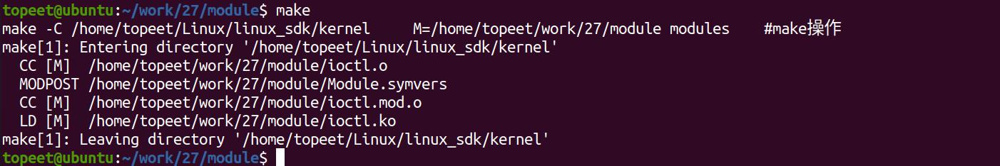
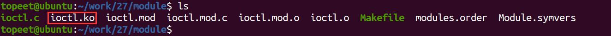
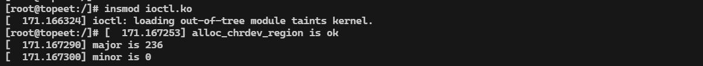
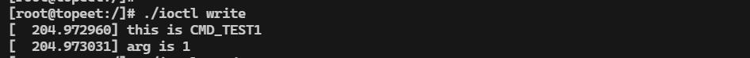

# 第041章 IOCTL驱动传参实验

本章学习ioctl 函数的基本使用。
## 41.1 ioctl 基础
ioctl（Input/Output Control）是设备驱动程序提供的一种控制接口，用于在用户空间与内核空间之间传递特定的控制命令和参数。下面将从应用层和驱动函数两个方面来对ioctl 函数进行讲解。1. 应用层应用层ioctl 函数介绍如下：函数原型：int ioctl(int fd, unsigned int cmd, unsigned long args);头文件：#include <sys/ioctl.h>函数作用：用于向设备发送控制和配置命令参数含义：fd：是用户程序打开设备时返回的文件描述符cmd：是用户程序对设备的控制命令args：应用程序向驱动程序下发的参数，如果传递的参数为指针类型，则可以接收驱动向用户空间传递的数上述三个参数中，最重要的是第二个unsigned int 类型的cmd 参数，cmd 参数表示控制名命令，cmd 参数为了传递更多的控制信息，被拆分为了4 段，每一段都有各自的意义，每一段详细介绍如下：cmd[31:30]数据传输方向（即args 的读写方向）：00 无传输，01 从驱动读数据到用户空间（读），10 从用户空间写数据到驱动（写），11 双向传输（读写）cmd[29:16]数据大小（以字节为单位），即args 所指数据的长度cmd[15:8]命令的类型，可以理解成命令的密钥，通常是一个ASCII 码

cmd[7:0]命令的序号，代表某个命令在该类型下的具体编号（0-255）以上四个部分不需要手动进行创建，在Linux 内核提供了四个宏用于创建ioctl 命令，如下所示：定义一个不需要参数的命令：#define _IO(type,nr)_IOC(_IOC_NONE,(type),(nr),0)定义一个应用程序从驱动程序读参数的命令：#define _IOR(type,nr,size)_IOC(_IOC_READ,(type),(nr),(_IOC_TYPECHECK(size)))定义一个应用程序向驱动程序写参数命令：#define _IOW(type,nr,size)_IOC(_IOC_WRITE,(type),(nr),(_IOC_TYPECHECK(size)))定义一个参数是双向传递的命令：#define _IOWR(type,nr,size) _IOC(_IOC_READ|_IOC_WRITE,(type),(nr),(_IOC_TYPECHECK(size)))宏定义参数说明如下：type：命令的类型，一般为一个ASCII 码值nr：该命令的序号size：参数的类型例如可以使用代码清单41.1 中代码定义不需要参数、向驱动程序写参数、向驱动程序读参数三个命令。代码清单41.1
```c
#define CMD_TEST0 _IO('L',0)
#define CMD_TEST1 _IOW('L',1,int)
#define CMD_TEST2 _IOR('L',2,int)
```
2.驱动函数应用程序中调用ioctl()函数时，会触发驱动中file_operation 结构体里的unlocked_ioctl()函数，该函数定义如下所示：函数原型：long (*unlocked_ioctl) (struct file *file , unsigned int cmd, unsigned long arg);参数说明：file：指向内核中文件结构体的指针，代表当前被操作的设备文件。cmd：与应用程序的cmd 参数对应，在驱动程序中对传递来的cmd 参数进行判断从而做出不同的动作。arg：与应用程序的args 参数对应，从而实现内核空间和用户空间参数的传递。
## 41.2 实验程序编写
### 41.2.1 编写测试APP
本实验代码存储在网盘iTOP-RK3568 开发板\07_学习教程配套资料\03_Linux 驱动配套资

料\04_Linux 驱动例程\27_ioctl01\app 路径下。首先来编写应用测试代码ioctl.c，在此代码中使用非阻塞的方式打开设备，实验代码如代码清单41.2 所示。代码清单41.2
```c
#include <stdio.h>
#include <sys/types.h>
#include <sys/stat.h>
#include <fcntl.h>
#include <unistd.h>
#include <sys/ioctl.h>
#include <string.h>
#define CMD_TEST0 _IO('L',0)
#define CMD_TEST1 _IOW('L',1,int)
#define CMD_TEST2 _IOR('L',2,int)
int main(int argc,char *argv[]){
    int fd;//定义int 类型的文件描述符fd
    int val;//定义int 类型的传递参数val
    fd = open("/dev/test",O_RDWR);//打开test 设备节点
    if(fd < 0){
        printf("file open fail\n");
    }
    if(!strcmp(argv[1], "write")){
        ioctl(fd,CMD_TEST1,1);//如果第二个参数为write，向内核空间写入1
    }
    else if(!strcmp(argv[1], "read")){
        ioctl(fd,CMD_TEST2,&val);//如果第二个参数为read，则读取内核空间传递向用户空间传递的值
        printf("val is %d\n",val);
    }
    close(fd);
}
```
### 41.2.2 驱动程序编写
本实验代码存储在网盘iTOP-RK3568 开发板\07_学习教程配套资料\03_Linux 驱动配套资料\04_Linux 驱动例程\27_ioctl01\module 路径下。实验代码ioctl.c 如代码清单41.3 所示。代码清单41.3
```c
#include <linux/module.h>
```

```c
#include <linux/init.h>
#include <linux/fs.h>
#include <linux/cdev.h>
#include <linux/kdev_t.h>
#include <linux/uaccess.h>
#define CMD_TEST0 _IO('L',0)
#define CMD_TEST1 _IOW('L',1,int)
#define CMD_TEST2 _IOR('L',2,int)
struct device_test{
    dev_t dev_num;//设备号
     int major ;//主设备号
    int minor ;//次设备号
    struct cdev cdev_test; // cdev
    struct class *class;//类
    struct device *device; //设备
    char kbuf[32];
};
static struct device_test dev1;
static long cdev_test_ioctl(struct file *file, unsigned int cmd, unsigned long arg)
{
    int val;//定义int 类型向应用空间传递的变量val
    switch(cmd){
        case CMD_TEST0:
            printk("this is CMD_TEST0\n");
            break;
        case CMD_TEST1:
            printk("this is CMD_TEST1\n");
             printk("arg is %ld\n",arg);//打印应用空间传递来的arg 参数
            break;
        case CMD_TEST2:
             val = 1;//将要传递的变量val 赋值为1
            printk("this is CMD_TEST2\n");
             if(copy_to_user((int *)arg,&val,sizeof(val)) != 0){//通过copy_to_user 向用户空间传递数据
                 printk("copy_to_user error \n");
             }
            break;
    default:
             break;
    }
    return 0;
```

```c
}
/*设备操作函数*/
struct file_operations cdev_test_fops = {
    .owner = THIS_MODULE, //将owner 字段指向本模块，可以避免在模块的操作正在被使用时卸载该模块
    .unlocked_ioctl = cdev_test_ioctl,
};
static int __init timer_dev_init(void) //驱动入口函数
{
    /*注册字符设备驱动*/
    int ret;
    /*1 创建设备号*/
    ret = alloc_chrdev_region(&dev1.dev_num, 0, 1, "alloc_name"); //动态分配设备号
    if (ret < 0)
    {
       goto err_chrdev;
    }
    printk("alloc_chrdev_region is ok\n");
    dev1.major = MAJOR(dev1.dev_num); //获取主设备号
    dev1.minor = MINOR(dev1.dev_num); //获取次设备号
    printk("major is %d \r\n", dev1.major); //打印主设备号
    printk("minor is %d \r\n", dev1.minor); //打印次设备号
     /*2 初始化cdev*/
    dev1.cdev_test.owner = THIS_MODULE;
    cdev_init(&dev1.cdev_test, &cdev_test_fops);
    /*3 添加一个cdev,完成字符设备注册到内核*/
   ret =cdev_add(&dev1.cdev_test, dev1.dev_num, 1);
    if(ret<0)
    {
        gotoerr_chr_add;
    }
    /*4 创建类*/
  dev1. class = class_create(THIS_MODULE, "test");
    if(IS_ERR(dev1.class))
    {
        ret=PTR_ERR(dev1.class);
        goto err_class_create;
    }
    /*5创建设备*/
    dev1.device = device_create(dev1.class, NULL, dev1.dev_num, NULL, "test");
    if(IS_ERR(dev1.device))
    {
```

```c
ret=PTR_ERR(dev1.device);
goto err_device_create;
}
return 0;
err_device_create:
class_destroy(dev1.class);//删除类
err_class_create:
cdev_del(&dev1.cdev_test);//删除cdev
err_chr_add:
unregister_chrdev_region(dev1.dev_num, 1); //注销设备号
err_chrdev:
return ret;
}
static void __exit timer_dev_exit(void) //驱动出口函数
{
/*注销字符设备*/
unregister_chrdev_region(dev1.dev_num, 1); //注销设备号
cdev_del(&dev1.cdev_test);//删除cdev
device_destroy(dev1.class, dev1.dev_num);//删除设备
class_destroy(dev1.class);//删除类
}
module_init(timer_dev_init);
module_exit(timer_dev_exit);
MODULE_LICENSE("GPL v2");
MODULE_AUTHOR("topeet");
```
## 41.3 运行测试
### 41.3.1 编译驱动程序
在ioctl.c 代码同一目录下创建Makefile 文件，如图41.1 所示。

图41.1Makefile 文件内容如代码清单41.4 所示。代码清单41.4
```c
export ARCH=arm64#设置平台架构
```

```c
export CROSS_COMPILE=aarch64-linux-gnu-#交叉编译器前缀
obj-m += ioctl.o#此处要和你的驱动源文件同名
KDIR :=/home/topeet/Linux/linux_sdk/kernel#这里是你的内核目录
PWD ?= $(shell pwd)
all:
    make -C $(KDIR) M=$(PWD) modules#make 操作
clean:
    make -C $(KDIR) M=$(PWD) clean#make clean 操作
```
在存放ioctl.c 和Makefile 文件目录下使用make 命令进行驱动的编译，编译完成如图41.2所示。

图41.2编译完生成ioctl.ko 目标文件，如图41.3 所示。

图41.3
### 41.3.2 编译应用程序
来到存放应用程序ioctl.c 的文件夹下，使用aarch64-linux-gnu-gcc -o ioctl ioctl.c -static 命令对ioctl.c 进行交叉编译，编译完成如图41.4 所示。

图41.4
### 41.3.3 运行测试
将本章节编译好的ioctl.ko 驱动文件和ioctl 可执行文件拷贝到开发板上。开发板启动之后，使用insmod ioctl.ko 命令进行驱动模块的加载，如图41.5 所示。

图41.5然后使用./ioctl write 命令通过ioctl 向内核空间传递arg 参数，传递成功如图41.6 所示。

图41.6

