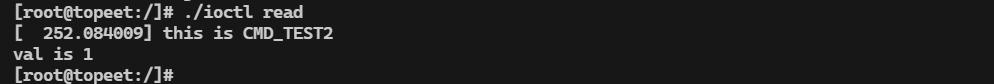
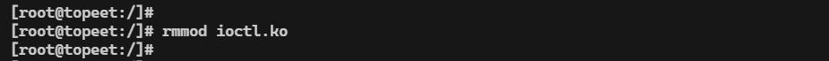
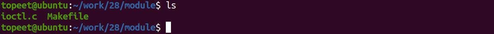
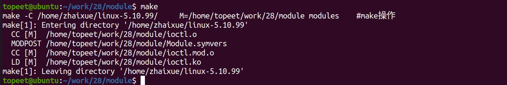
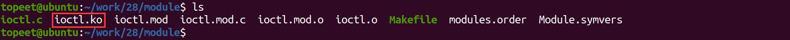
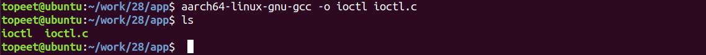

# 第042章 IOCTL地址传参实验

由图41.6 可以看到内核接收到命令后，匹配到CMD_TEST1 的case 分支，打印了this isCMD_TEST1 和接收到的参数值arg is 1，表明参数成功从用户空间传递到内核空间然后使用./ioctl read 命令通过ioctl 读取内核空间向用户空间传递的val 值，读取成功如图41.7 所示。

图41.7由图41.7 可以看到内核接收到用户空间发送的命令后匹配到CMD_TEST2 的case 分支，将变量val 赋值为1 并返回给用户空间，用户程序接收到返回值后在终端打印出val is 1，说明内核成功完成了一次向用户空间的参数返回操作。至此关于iocto 驱动传参实验就测试完成了，可以使用rmmod ioctl.ko 命令卸载对应的驱动，如图41.8 所示。

图41.8

本章学习ioctl 函数的进阶使用。
## 42.1 实验程序编写
### 42.1.1 编写测试APP
本实验对应的应用程序网盘路径为：iTOP-RK3568 开发板\07_学习教程配套资料\03_Linux驱动配套资料\04_Linux 驱动例程\28_ioctl02\app。应用程序ioctl.c 通过ioctl 系统调用，向内核传递一个结构体的地址，让内核读取用户空间结构体中的多个字段，实验代码如代码清单42.1 所示。代码清单42.1
```c
#include <stdio.h>
#include <sys/types.h>
#include <sys/stat.h>
#include <fcntl.h>
#include <unistd.h>
#include <sys/ioctl.h>
#define CMD_TEST0 _IOW('L',0,int) //向内核写数据
struct args{//定义要传递的结构体
    int a;
    int b;
    int c;
};
int main(int argc,char *argv[]){
    int fd;//定义int 类型文件描述符
    struct args test;//定义args 类型的结构体变量test
    //初始化结构体字段
    test.a = 1;
    test.b = 2;
    test.c = 3;
    fd = open("/dev/test",O_RDWR,0777);//打开/dev/test 设备
    if(fd < 0){
        printf("file open error \n");
    }
    ioctl(fd,CMD_TEST0,&test);//使用ioctl 函数传递结构体变量test 地址
```

```c
close(fd);
}
```
### 42.1.2 驱动程序编写
本实验对应的网盘路径为：iTOP-RK3568 开发板\07_学习教程配套资料\03_Linux 驱动配套资料\04_Linux 驱动例程\28_ioctl02\module。实验代码ioctl.c 如代码清单42.2 所示。代码清单42.2
```c
#include <linux/module.h>
#include <linux/init.h>
#include <linux/fs.h>
#include <linux/cdev.h>
#include <linux/kdev_t.h>
#include <linux/uaccess.h>
#define CMD_TEST0 _IOW('L',0,int)
struct args{
    int a;
    int b;
    int c;
};
struct device_test{
    dev_t dev_num;//设备号
    int major ;//主设备号
    int minor ;//次设备号
    struct cdev cdev_test; // cdev
    struct class *class;//类
    struct device *device; //设备
};
static struct device_test dev1;
static long cdev_test_ioctl(struct file *file, unsigned int cmd, unsigned long arg)
{
    struct args test;
    switch(cmd){
        case CMD_TEST0:
             if(copy_from_user(&test,(int *)arg,sizeof(test)) != 0){//将用户空间传递来的arg 赋值给test
                 printk("copy_from_user error\n");
             }
             printk("a = %d\n",test.a);//对传递的值进行打印验证
             printk("b = %d\n",test.b);
```

```c
printk("c = %d\n",test.c);
break;
default:
break;
}
return 0;
}
/*设备操作函数*/
struct file_operations cdev_test_fops = {
.owner = THIS_MODULE, //将owner 字段指向本模块，可以避免在模块的操作正在被使用时卸载该模
块
.unlocked_ioctl = cdev_test_ioctl,
};
static int __init timer_dev_init(void) //驱动入口函数
{
/*注册字符设备驱动*/
int ret;
/*1 创建设备号*/
ret = alloc_chrdev_region(&dev1.dev_num, 0, 1, "alloc_name"); //动态分配设备号
if (ret < 0)
{
goto err_chrdev;
}
printk("alloc_chrdev_region is ok\n");
dev1.major = MAJOR(dev1.dev_num); //获取主设备号
dev1.minor = MINOR(dev1.dev_num); //获取次设备号
printk("major is %d \r\n", dev1.major); //打印主设备号
printk("minor is %d \r\n", dev1.minor); //打印次设备号
/*2 初始化cdev*/
dev1.cdev_test.owner = THIS_MODULE;
cdev_init(&dev1.cdev_test, &cdev_test_fops);
/*3 添加一个cdev,完成字符设备注册到内核*/
ret =cdev_add(&dev1.cdev_test, dev1.dev_num, 1);
if(ret<0)
{
gotoerr_chr_add;
}
/*4 创建类*/
dev1. class = class_create(THIS_MODULE, "test");
if(IS_ERR(dev1.class))
{
```

```c
ret=PTR_ERR(dev1.class);
goto err_class_create;
}
/*5创建设备*/
dev1.device = device_create(dev1.class, NULL, dev1.dev_num, NULL, "test");
if(IS_ERR(dev1.device))
{
ret=PTR_ERR(dev1.device);
goto err_device_create;
}
return 0;
err_device_create:
class_destroy(dev1.class);//删除类
err_class_create:
cdev_del(&dev1.cdev_test);//删除cdev
err_chr_add:
unregister_chrdev_region(dev1.dev_num, 1); //注销设备号
err_chrdev:
return ret;
}
static void __exit timer_dev_exit(void) //驱动出口函数
{
/*注销字符设备*/
unregister_chrdev_region(dev1.dev_num, 1); //注销设备号
cdev_del(&dev1.cdev_test);//删除cdev
device_destroy(dev1.class, dev1.dev_num);//删除设备
class_destroy(dev1.class);//删除类
}
module_init(timer_dev_init);
module_exit(timer_dev_exit);
MODULE_LICENSE("GPL v2");
MODULE_AUTHOR("topeet");
```
## 42.2 运行测试
### 42.2.1 编译驱动程序
在ioctl.c 代码同一目录下创建Makefile 文件，如图42.1 所示。


图42.1Makefile 文件内容如代码清单42.3 所示。代码清单42.3
```c
export ARCH=arm64#设置平台架构
export CROSS_COMPILE=aarch64-linux-gnu-#交叉编译器前缀
obj-m += ioctl.o#此处要和你的驱动源文件同名
KDIR :=/home/topeet/Linux/linux_sdk/kernel#这里是你的内核目录
PWD ?= $(shell pwd)
all:
    make -C $(KDIR) M=$(PWD) modules#make 操作
clean:
    make -C $(KDIR) M=$(PWD) clean#make clean 操作
```
在存放ioctl.c 和Makefile 文件目录下使用make 命令编译驱动程序，编译完成如图42.2 所示。

图42.2编译完生成wq.ko 目标文件，如图42.3 所示。

图42.3
### 42.2.2 编译应用程序
来到存放应用程序ioctl.c 的文件夹下，使用aarch64-linux-gnu-gcc -o ioctl ioctl.c 命令对ioctl.c进行交叉编译，编译完成如图42.4 所示。

图42.4
### 42.2.3 运行测试
将本章节编译好的ioctl.ko 驱动文件和ioctl 可执行文件拷贝到开发板上。开发板启动之后，使用insmod ioctl.ko 命令进行驱动模块的加载，如图42.5 所示。

