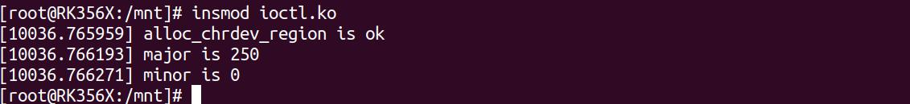
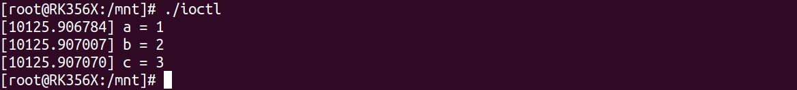
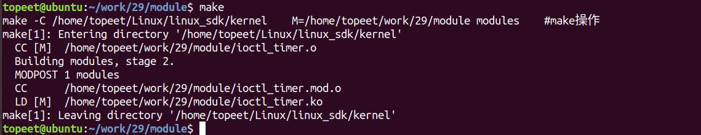
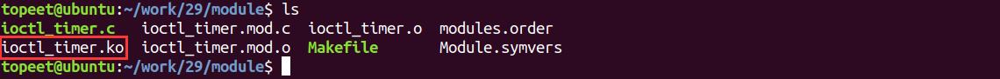
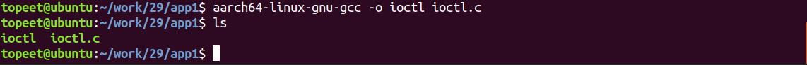
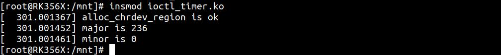
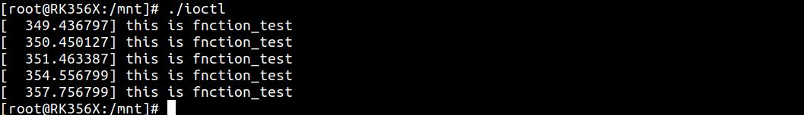
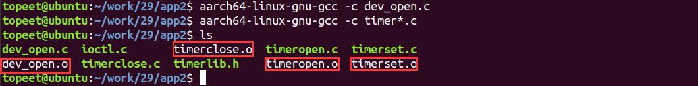
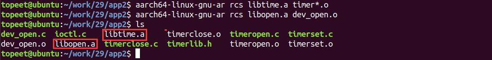
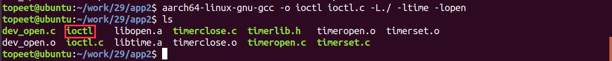

# 第043章 封装驱动API接口实验


图42.5然后使用./ioctl 命令运行可执行程序，运行成功如图42.6 所示。

图42.6可以看到结构体类型变量test 已经成功传递到了内核空间，a、b、c 的值都被正确打印了出来。最后可以使用rmmod ioctl.ko 命令进行驱动的卸载，如图42.7 所示。

图42.7至此，我们的ioctl 地址传参实验就完成了。

在本章节会进行两个实验：实验一：通过ioctl 对定时器进行控制，分别实现打开定时器、关闭定时器和设置定时时间的功能。实验二：对实验一的应用程序进行封装，从而让应用编程人员更好的对设备进行编程。
## 43.1 ioctl 控制定时器实验
首先进行ioctl 控制定时器实验，通过该实验可以综合ioctl 函数和定时器相关知识，从而进一步加深对ioctl 的理解。
### 43.1.1 编写测试APP
本实验代码存储在网盘iTOP-RK3568 开发板\07_学习教程配套资料\03_Linux 驱动配套资料\04_Linux 驱动例程\29\app1 路径下。首先来编写应用测试代码ioctl.c，实验代码如代码清单43.1 所示。代码清单43.1
```c
#include <stdio.h>
#include <sys/types.h>
#include <sys/stat.h>
#include <fcntl.h>
#include <unistd.h>
#include <sys/ioctl.h>
#define TIME_OPEN _IO('L',0)//定时器打开
#define TIME_CLOSE _IO('L',1)//定时器关闭
#define TIME_SET _IOW('L',2,int)//定时时间设置
int main(int argc,char *argv[]){
    int fd;
    fd = open("/dev/test",O_RDWR,0777);//打开test 节点
    if(fd < 0){
        printf("file open error \n");
    }
    ioctl(fd,TIME_SET,1000);//设置定时时间1 秒
    ioctl(fd,TIME_OPEN);//打开定时器
    sleep(3);
    ioctl(fd,TIME_SET,3000);//设置定时时间3 秒
```

```c
sleep(7);
ioctl(fd,TIME_CLOSE);;//关闭定时器
close(fd);
}
```
### 43.1.2 驱动程序编写
本实验代码存储在网盘iTOP-RK3568 开发板\07_学习教程配套资料\03_Linux 驱动配套资料\04_Linux 驱动例程\29\module 路径下。实验代码ioctl_timer.c 如代码清单43.2 所示。代码清单43.2
```c
#include <linux/module.h>
#include <linux/init.h>
#include <linux/fs.h>
#include <linux/cdev.h>
#include <linux/kdev_t.h>
#include <linux/uaccess.h>
#include <linux/timer.h>
#define TIMER_OPEN _IO('L',0)
#define TIMER_CLOSE _IO('L',1)
#define TIMER_SET _IOW('L',2,int)
struct device_test{
    dev_t dev_num;//设备号
    int major ;//主设备号
    int minor ;//次设备号
    struct cdev cdev_test; // cdev
    struct class *class;//类
    struct device *device; //设备
    int counter;
};
static struct device_test dev1;
static void fnction_test(struct timer_list *t);//定义function_test 定时功能函数
DEFINE_TIMER(timer_test,fnction_test);//定义一个定时器
void fnction_test(struct timer_list *t)
{
    printk("this is fnction_test\n");
    mod_timer(&timer_test,jiffies_64 + msecs_to_jiffies(dev1.counter));//使用mod_timer 函数重新设置定时
时间
}
static int cdev_test_open(struct inode *inode, struct file *file)
```

```c
{
    file->private_data=&dev1;//设置私有数据
    return 0;
}
static int cdev_test_release(struct inode *inode, struct file *file)
{
    file->private_data=&dev1;//设置私有数据
    return 0;
}
static long cdev_test_ioctl(struct file *file, unsigned int cmd, unsigned long arg)
{
    struct device_test *test_dev = (struct device_test *)file->private_data;//设置私有数据
    switch(cmd){
        case TIMER_OPEN:
             add_timer(&timer_test);//添加一个定时器
            break;
        case TIMER_CLOSE:
             del_timer(&timer_test);//删除一个定时器
            break;
        case TIMER_SET:
             test_dev->counter = arg;
             timer_test.expires = jiffies_64 + msecs_to_jiffies(test_dev->counter);//设置定时时间
            break;
    default:
             break;
    }
    return 0;
}
/*设备操作函数*/
struct file_operations cdev_test_fops = {
    .owner = THIS_MODULE, //将owner 字段指向本模块，可以避免在模块的操作正在被使用时卸载该模块
    .open = cdev_test_open,
    .release = cdev_test_release,
    .unlocked_ioctl = cdev_test_ioctl,
};
static int __init timer_dev_init(void) //驱动入口函数
{
    /*注册字符设备驱动*/
    int ret;
    /*1 创建设备号*/
```

```c
ret = alloc_chrdev_region(&dev1.dev_num, 0, 1, "alloc_name"); //动态分配设备号
if (ret < 0)
{
   goto err_chrdev;
}
printk("alloc_chrdev_region is ok\n");
dev1.major = MAJOR(dev1.dev_num); //获取主设备号
dev1.minor = MINOR(dev1.dev_num); //获取次设备号
printk("major is %d \r\n", dev1.major); //打印主设备号
printk("minor is %d \r\n", dev1.minor); //打印次设备号
 /*2 初始化cdev*/
dev1.cdev_test.owner = THIS_MODULE;
cdev_init(&dev1.cdev_test, &cdev_test_fops);
/*3 添加一个cdev,完成字符设备注册到内核*/
ret =cdev_add(&dev1.cdev_test, dev1.dev_num, 1);
if(ret<0)
{
    gotoerr_chr_add;
}
/*4 创建类*/
dev1. class = class_create(THIS_MODULE, "test");
if(IS_ERR(dev1.class))
{
    ret=PTR_ERR(dev1.class);
    goto err_class_create;
}
/*5创建设备*/
dev1.device = device_create(dev1.class, NULL, dev1.dev_num, NULL, "test");
if(IS_ERR(dev1.device))
{
    ret=PTR_ERR(dev1.device);
    goto err_device_create;
}
return 0;
err_device_create:
    class_destroy(dev1.class);//删除类
err_class_create:
   cdev_del(&dev1.cdev_test);//删除cdev
```

```c
err_chr_add:
        unregister_chrdev_region(dev1.dev_num, 1); //注销设备号
err_chrdev:
    return ret;
}
static void __exit timer_dev_exit(void) //驱动出口函数
{
    /*注销字符设备*/
    unregister_chrdev_region(dev1.dev_num, 1); //注销设备号
    cdev_del(&dev1.cdev_test);//删除cdev
    device_destroy(dev1.class, dev1.dev_num);//删除设备
    class_destroy(dev1.class);//删除类
}
module_init(timer_dev_init);
module_exit(timer_dev_exit);
MODULE_LICENSE("GPL v2");
MODULE_AUTHOR("topeet");
```
## 43.2 运行测试
### 43.2.1 编译驱动程序
在ioctl_timer.c 代码同一目录下创建Makefile 文件，如图43.1 所示。

图43.1Makefile 文件内容如代码清单43.3 所示。代码清单43.3
```c
export ARCH=arm64#设置平台架构
export CROSS_COMPILE=aarch64-linux-gnu-#交叉编译器前缀
obj-m += ioctl_timer.o#此处要和你的驱动源文件同名
KDIR :=/home/topeet/Linux/linux_sdk/kernel#这里是你的内核目录
PWD ?= $(shell pwd)
all:
    make -C $(KDIR) M=$(PWD) modules#make 操作
clean:
    make -C $(KDIR) M=$(PWD) clean#make clean 操作
```
在存放ioctl_timer.c 和Makefile 文件目录下使用make 命令编译驱动程序，编译完成如图43.2 所示。


图43.2编译完生成ioctl_timer.ko 目标文件，如图43.3 所示。

图43.3
### 43.2.2 编译应用程序
来到存放应用程序ioctl.c 的文件夹下，使用aarch64-linux-gnu-gcc -o ioctl ioctl.c 命令对ioctl.c进行交叉编译，编译完成如图43.4 所示。

图43.4
### 43.2.3 运行测试
将本章节编译好的ioctl_timer.ko 驱动文件和上一小节编译的ioctl 可执行文件拷贝到开发板上。开发板启动之后，使用insmod ioctl_timer.ko 命令进行驱动模块的加载，如图43.5 所示。

图43.5输入./ioctl 命令运行可执行文件，运行成功如图43.6 所示。

图43.6可以看到前面三个打印信息间隔为1 秒钟，后面三个打印信息间隔为3 秒钟，由此说明使用ioctl 设置定时器定时时间成功，然后使用rmmod ioctl_timer.ko 命令卸载驱动模块，如图43.7所示。


图43.7
## 43.3 封装驱动API 接口
一般情况下，应用程序都是由专业的应用工程师来进行编写的，在使用ioctl 命令时，应用工程师无需关心ioctl 命令的具体实现，所以对于应用程序中的ioctl 命令封装是一件必然的事情。如代码清单43.4 中在应用程序中定义的ioctl 命令应用工程师无需关系具体实现。代码清单43.4
```c
#define TIME_OPEN _IO('L',0)
#define TIME_CLOSE _IO('L',1)
#define TIME_SET _IOW('L',2,int)
int main(int argc,char *argv[]){
    int fd;
    fd = open("/dev/test",O_RDWR,0777);//打开test 节点
    if(fd < 0){
        printf("file open error \n");
    }
    ioctl(fd,TIME_SET,1000);
    ioctl(fd,TIME_OPEN);
    sleep(3);
    ioctl(fd,TIME_SET,3000);
    sleep(7);
    ioctl(fd,TIME_CLOSE);
    close(fd);
}
```
封装好的应用程序存储在网盘iTOP-RK3568 开发板\07_学习教程配套资料\03_Linux 驱动配套资料\04_Linux 驱动例程\29\app2 路径下。1.封装步骤1首先来编写整体库文件timerlib.h，实验代码如代码清单43.5 所示。代码清单43.5
```c
#ifndef _TIMELIB_H_
#define _TIMELIB_H_
#include <sys/types.h>
#include <sys/stat.h>
#include <fcntl.h>
#include <unistd.h>
#include <sys/ioctl.h>
#define TIMER_OPEN _IO('L',0)
#define TIMER_CLOSE _IO('L',1)
```

```c
#define TIMER_SET _IOW('L',2,int)
int dev_open();//定义设备打开函数
int timer_open(int fd);//定义定时器打开函数
int timer_close(int fd);//定义定时器关闭函数
int timer_set(int fd,int arg);//定义设置计时时间函数
#endif
```
在9-11 行使用合成宏定义了三个ioctl 命令，分别代表定时器打开、定时器关闭、定时时间设置。在第12-15 行定义了四个功能函数，所代表的功能分别为设备打开、定时器打开、定时器关闭、定时时间设置。2.封装步骤2接下来创建每个功能函数的c 文件，编写dev_open()数对应的dev_open.c 文件，如代码清单43.6 所示。代码清单43.6
```c
#include <stdio.h>
#include "timerlib.h"
int dev_open()
{
    int fd；
    fd = open("/dev/test",O_RDWR,0777);
    if(fd < 0){
        printf("file open error \n");
    }
    return fd;
}
```
编写定时器打开函数对应的timeropen.c 文件，如代码清单43.7 所示。代码清单43.7
```c
#include <stdio.h>
#include "timerlib.h"
int timer_open(int fd)
{
    int ret;
    ret = ioctl(fd,TIMER_OPEN);
    if(ret < 0){
        printf("ioctl open error \n");
        return -1;
    }
    return ret;
}
```
编写定时器关闭函数对应的timerclose.c 文件，如代码清单43.8 所示。

代码清单43.8
```c
#include <stdio.h>
#include "timerlib.h"
int timer_close(int fd)
{
int ret;
ret = ioctl(fd,TIMER_CLOSE);
if(ret < 0){
    printf("ioctlclose error \n");
    return -1;
}
return ret;
}
```
编写定时时间设置函数对应的timerset.c 文件，如代码清单43.9 所示。代码清单43.9
```c
#include <stdio.h>
#include "timerlib.h"
int timer_set(int fd,int arg)
{
    int ret;
    ret = ioctl(fd,TIMER_SET,arg);
    if(ret < 0){
        printf("ioctl error \n");
        return -1;
    }
    return ret;
}
```
最后编写测试程序ioctl.c 文件，如代码清单43.10 所示。代码清单43.10
```c
#include <stdio.h>
#include "timerlib.h"
int main(int argc,char *argv[]){
    int fd;
    fd = dev_open();
    timer_set(fd,1000);
    timer_open(fd);
    sleep(3);
    timer_set(fd,3000);
    sleep(7);
    timer_close(fd);
    close(fd);
}
```

通过测试程序可以看出封装后的应用程序不再直接调用繁杂的ioctl 宏指令，而是直接通过简单的函数接口来完成设备操作，这样可以提升程序的可读性和可维护性。
## 43.4 运行测试
### 43.4.1 编译应用程序
首先使用aarch64-linux-gnu-gcc -c dev_open.c 和aarch64-linux-gnu-gcc -c timer*.c 命令将存放功能函数的c 文件编译成.o 文件，编译完成如图43.8 所示。

图43.8然后使用aarch64-linux-gnu-ar rcs libtime.a timer*.o 和aarch64-linux-gnu-ar rcs libopen.adev_open.o 命令将相应的.o 文件编译成.a 静态库（这里要注意库的名称都以lib 开头），编译完成如图43.9 所示。

图43.9最后使用arch64-linux-gnu-gcc -o ioctl ioctl.c -L./ -ltime -lopen 命令对ioctl.c 进行交叉编译，编译完成如图43.10 所示。

图43.10
### 43.4.2 运行测试
将本章节编译好的ioctl_timer.ko 驱动文件和上一小节编译的ioctl 可执行文件拷贝到开发板上。开发板启动之后，使用insmod ioctl_timer.ko 命令进行驱动模块的加载，如图43.11 所示。

图43.11输入./ioctl 命令运行可执行文件，运行成功如图43.12 所示。


图43.12可以看到前面三个打印信息间隔为1 秒钟，后面三个打印信息间隔为3 秒钟，由此可见使用封装后的ioctl 命令也可以实现控制定时器的功能，说明封装API 接口成功，最后使用rmmodioctl_timer.ko 命令卸载驱动模块，如图43.13 所示。

图43.13

