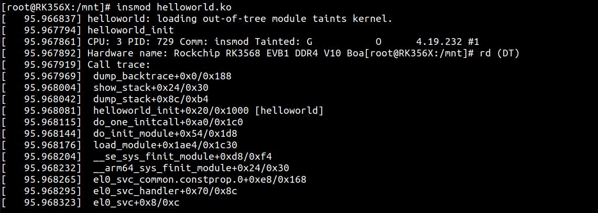
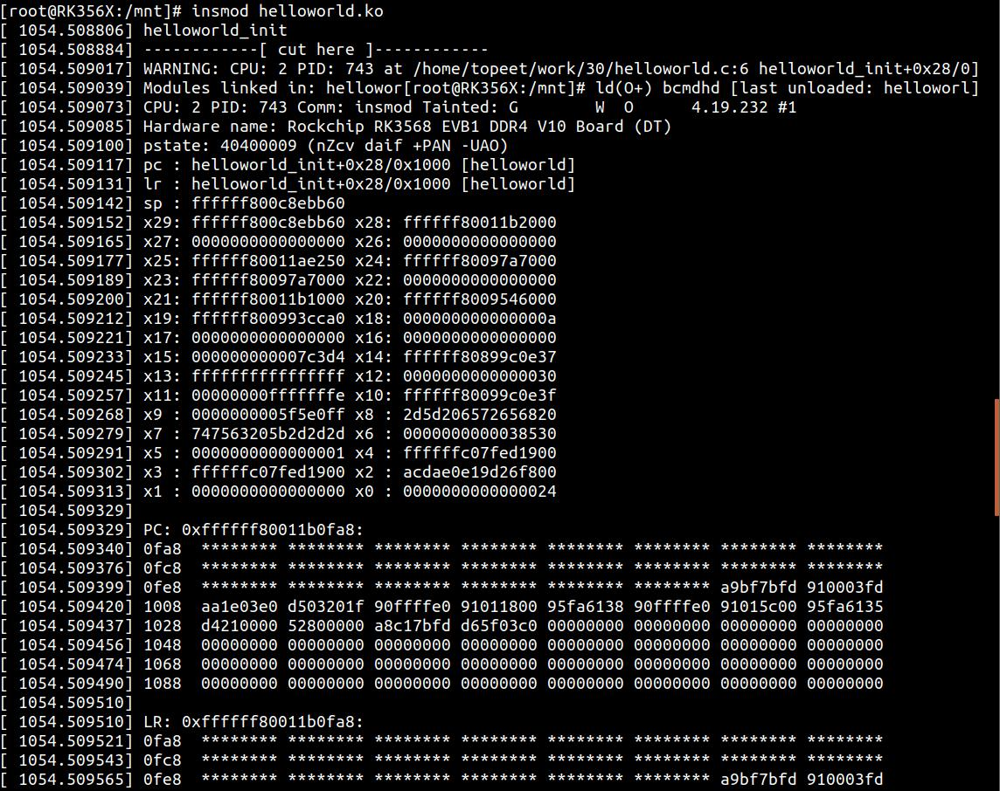
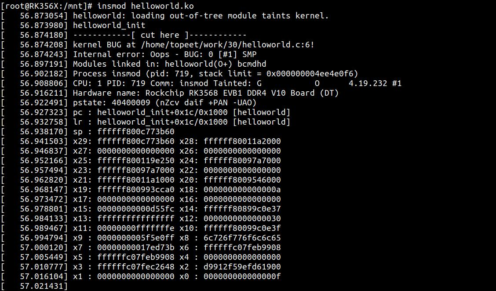
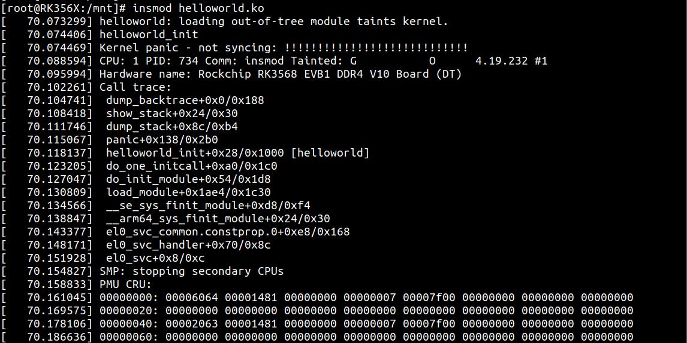

# 第045章 驱动调试方法实验

在调试驱动时没有IDE 开发工具供我们使用。大多数情况下，使用printk()函数这种原始的方法在驱动调试仍是最有效的方法。除了使用printk()函数，还可以使用dump_stack()函数、WARN_ON ()函数、BUG_ON()函数和panic ()函数。
## 45.1 方法1：dump_stack 函数
作用:打印内核调用堆栈，并打印函数的调用关系。这里以最简单的helloworld 驱动为例演示dump_stack()函数，实验代码如代码清单45.1 所示。代码清单45.1
```c
#include <linux/module.h>
#include <linux/kernel.h>
static int __init helloworld_init(void)
{
    printk(KERN_EMERG "helloworld_init\r\n");
    dump_stack();
    return 0;
}
static void __exit helloworld_exit(void)
{
    printk(KERN_EMERG "helloworld_exit\r\n");
}
module_init(helloworld_init);
module_exit(helloworld_exit);
MODULE_LICENSE("GPL v2");
MODULE_AUTHOR("topeet");
```
和原helloworld 驱动程序相比，在第6 行添加了dump_stack()，驱动加载之后打印信息如图45.1 所示。


图45.1通过图45.1 可以看出打印了helloworld_init()函数的调用关系。
## 45.2 方法2：WARN_ON(condition)函数
WARN_ON (condition)函数在括号中的条件成立时，内核会抛出栈回溯，打印函数的调用关系。因此通常用于内核抛出一个警告，暗示某种不太合理的事情发生了。WARN_ON 实际上也是调用dump_stack()函数，只是多了参数condition 判断条件是否成立，例如WARN_ON (1)则条件判断成功，函数会成功执行。这里仍然以最简单的helloworld 驱动为例演示WARN_ON()函数，实验代码如代码清单45.2 所示。代码清单45.2
```c
#include <linux/module.h>
#include <linux/kernel.h>
static int __init helloworld_init(void)
{
    printk(KERN_EMERG "helloworld_init\r\n");
    WARN_ON(1);
    return 0;
}
static void __exit helloworld_exit(void)
{
    printk(KERN_EMERG "helloworld_exit\r\n");
}
module_init(helloworld_init);
module_exit(helloworld_exit);
MODULE_LICENSE("GPL v2");
```

```c
MODULE_AUTHOR("topeet");
```
和原helloworld 驱动程序相比，在第6 行添加了WARN_ON(1)，驱动加载之后打印信息如图45.2 所示。

图45.2通过图45.2 可以看出打印了helloworld_init()函数的调用关系以及寄存器值。
## 45.3 方法3：BUG_ON(condition)函数
内核中有许多地方调用了BUG_ON()的语句，它非常像一个内核运行时的断言，意味着本来不该执行到BUG_ON()这条语句但是确执行了，一旦BUG_ON()函数执行内核就会立刻抛出oops。BUG_ON()函数的参数condition 用来判断条件是否成立，当condition 为非0（真）时，立即触发BUG；当condition 为0（假）时，继续执行程序。例如BUG_ON (1)表示条件判断成功，立即触发BUG。这里仍然以最简单的helloworld 驱动为例演示BUG_ON()函数，实验代码如代码清单45.3所示。

代码清单45.3
```c
#include <linux/module.h>
#include <linux/kernel.h>
static int __init helloworld_init(void)
{
    printk(KERN_EMERG "helloworld_init\r\n");
    BUG_ON(1);
    return 0;
}
static void __exit helloworld_exit(void)
{
    printk(KERN_EMERG "helloworld_exit\r\n");
}
module_init(helloworld_init);
module_exit(helloworld_exit);
MODULE_LICENSE("GPL v2");
MODULE_AUTHOR("topeet");
```
和原helloworld 驱动程序相比，在第6 行添加了BUG_ON(1)，强制触发一个内核BUG，因此在加载模块时，系统会立即打印调用栈等调试信息如图45.3 所示。

图45.3

## 45.4 方法4：panic(fmt...)函数
panic (fmt...)函数可以将函数的调用关系以及寄存器值就都打印出来，并且会造成系统死机。这里仍然以最简单的helloworld 驱动为例演示panic()函数，实验代码如代码清单45.4 所示。代码清单45.4
```c
#include <linux/module.h>
#include <linux/kernel.h>
static int __init helloworld_init(void)
{
    printk(KERN_EMERG "helloworld_init\r\n");
    panic("!!!!!!!!!!!!!!!!!!!!!!!!!!!!");
    return 0;
}
static void __exit helloworld_exit(void)
{
    printk(KERN_EMERG "helloworld_exit\r\n");
}
module_init(helloworld_init);
module_exit(helloworld_exit);
MODULE_LICENSE("GPL v2");
MODULE_AUTHOR("topeet");
```
和原helloworld 驱动程序相比，在第6 行添加了panic("!!!!!!!!!!!!!!!!!!!!!!!!!!!!")，驱动加载之后打印信息如图45.4 所示。

图45.4通过图45.4 可以看出helloworld_init()函数的调用关系以及寄存器值被打印了出来，打印完

