# 第046章 中断实验

成之后系统崩溃。

中断是操作系统中至关重要的机制，从本章开始我们学习中断相关的知识。
## 46.1 什么是中断？
### 46.1.1 中断的概念
中断指的是CPU 在执行程序的过程中出现了突发事件需要处理，CPU 必须暂停当前正在执行的程序转头去处理突发事件。突发事件处理完毕后返回之前被打断的程序，在被打断的位置继续执行。中断的概念流程图如下图46.1 所示：
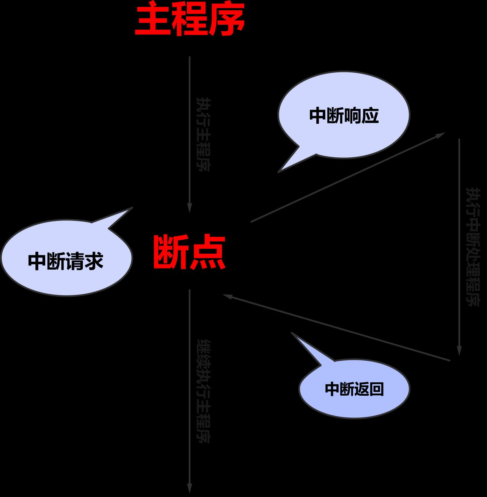
图46.1
### 46.1.2 中断的上下半部
中断会打断正在执行的程序去转头执行其他程序。转头去执行的这个程序如果很耗时间，则会影响被打断程序的执行。所以我们希望转头去执行的这个程序尽量小。但是当中断到来时，转头去执行的这个程序往往会执行一些耗时的操作。为此Linux 的中断机制将中断处理程序（转头要执行的程序）分成了顶半部和底半部，顶半部用来处理比较紧急但是又不是很耗时的事情，如设置标志位，底半部用来处理耗时的事情，中断机制如图46.2 所示。需要注意的是中断处理程序并不是总是分成两个部分，如果中断处理程序中要执行的代码很小，则直接在顶半部完成即可，就不需要激活底半部。


图46.2
## 46.2 中断框架
处理器中断引脚数量有限，给每个外设预留一个引脚是不现实的。为了解决这个问题，现代设备的中断信号线并不直接连接至处理器，而是先连接至中断控制器，再由中断控制器统一连接至处理器的中断引脚。中断硬件组成架构示例如图46.3 所示。
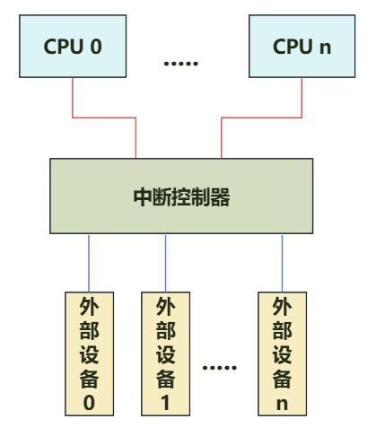
图46.3如果硬件系统非常复杂，外设很多，硬件系统可能有多个中断控制器，中断控制器可以级联。一个中断控制器级联的硬件框架示例如图46.4 所示。

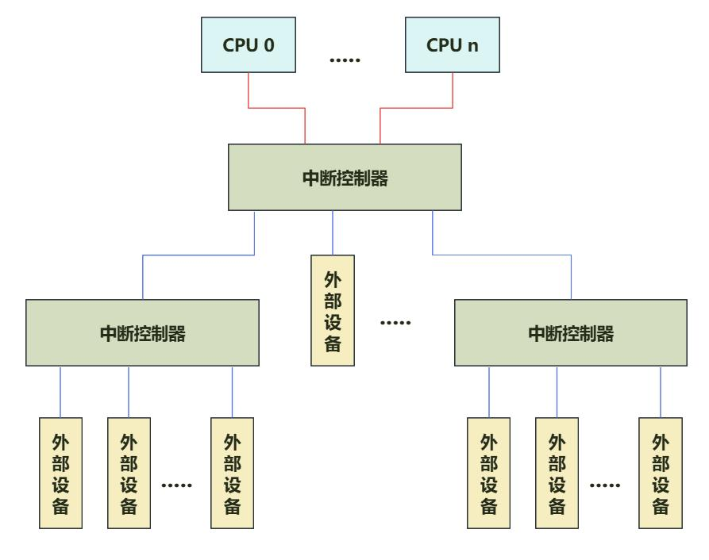
图46.4
Linux 的中断子系统框架如下图46.5 所示。最上面的driver 层，是中断的使用者，使用Linux内核通用中断处理模块的API。再往下是通用中断处理层，是硬件代码无关，抽象了一套数据结构与接口实现对中断的管理，提供了通用的中断处理函数。通用中断处理层再往下是硬件相关层，它包含两部分代码，一部分是CPU arch 相关的中断处理，如异常向量表相关设置、中断上下文的保护与恢复等，和系统使用的具体的CPU arch 相关。另一部分是中断控制器驱动，实现中断控制器的编程接口，与系统使用的中断控制器相关。最底层的是硬件层，包括CPU和中断控制器。

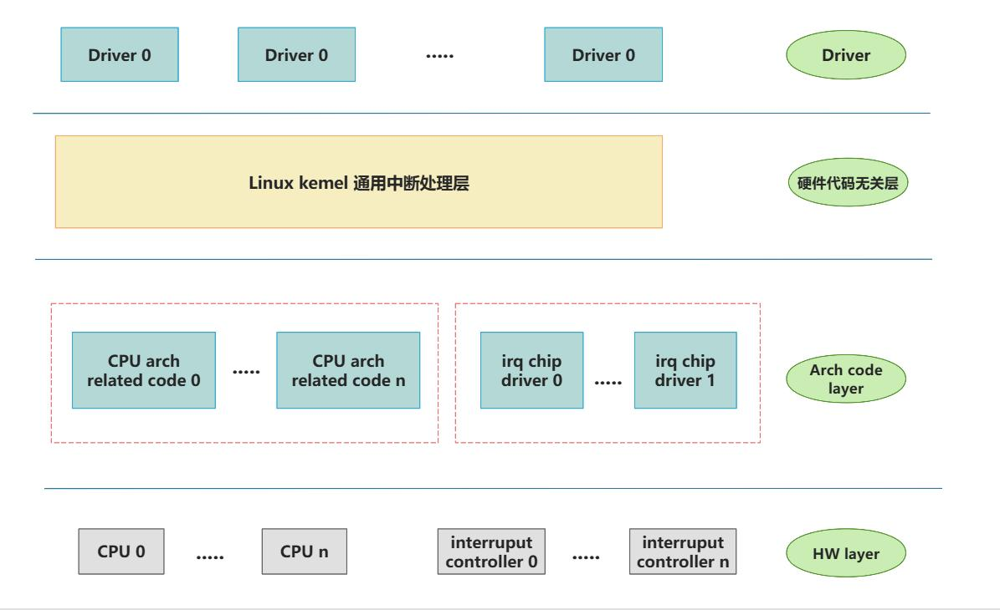
图46.5
## 46.3 中断基本概念
### 46.3.1 中断控制器简介
ARM 多核处理器里最常用的中断控制器是GIC（Generic Interrupt Controller），用于管理和控制中断。它接收来自各种中断源的中断请求，并根据一定的设置策略，将中断请求分发给对应的CPU 进行处理。GIC 是由ARM 公司提出设计规范，当前有四个版本GIC V1-v4，每个GIC 版本及相应特性如表46.1 所示。表46.1版本关键特性常用核心ARM Cortex-A5 MPCore-支持最多八个处理器核心（PE）GICv1ARM Cortex-A9 MPCore- 支持最多1020 个中断IDARM Cortex-R7 MPCoreARM Cortex-A7 MPCore- GICv1 的所有关键特性ARM Cortex-A15 MPCoreGICv2-支持虚拟化ARM Cortex-A53 MPCoreARM Cortex-A57 MPCoreGICv3- GICv2 的所有关键特性ARM Cortex-A53MPCore

-支持超过8 个处理器核心ARM Cortex-A57MPCore-支持基于消息的中断ARM Cortex-A72 MPCore-支持超过1020 个中断ID- CPU 接口寄存器的系统寄存器访问-增强的安全模型，分离安全和非安全的Group 1 中断ARM Cortex-A53 MPCore- GICv3 的所有关键特性GICv4ARMCortex-A57MPCore-虚拟中断的直接注入ARM Cortex-A72 MPCore
GICv3 版本设计主要运行在Armv8-A, Armv9-A 等架构上。在RK3568 上使用的GIC 版本为GICv3，相应的中断控制器模型如下图46.6 所示：
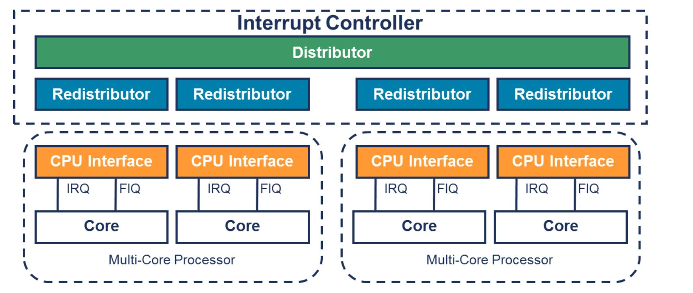
图46.6由图46.6 可以看出，GIC 中断控制器可以分为Distributor 接口、Redistributor 接口和CPU接口，下面是每个部分的简要说明：Distributor：用于SPI 中断的管理，具有仲裁和分发的作用，会将中断发送给Redistributor。Redistributor 重新分配器：管理SGI、PPI、LPI 中断，然后将中断发送给CPU interface。CPU 接口：每个Redistributor 都连接到一个CPU 接口。CPU 接口可以开启或关闭发往CPU 的中断请求，CPU 中断开启之后只有优先级高于“中断优先级掩码”的中断请求才能被发送到CPU。
### 46.3.2 中断类型
GIC-V3 支持四种类型的中断，分别是SGI、PPI、SPI 和LPI，每种中断类型的介绍如下：SGI(Software Generated Interrupt): 软中断，主要用于核间通信，通过写SGI 寄存器产生。PPI(Private Peripheral Interrupt):私有外设中断，为某个核的私有中断。SPI(Shared Peripheral Interrupt):共享外设中断，外设中断可以发送到任何一个连接的core。LPI(Locality-specific Peripheral Interrupt):特定区域外设中断。只在GICv3 和GICv4 上支持。不同中断类型的INITD(中断标识符)范围如下表46.2 所示。

表46.2INTID 范围中断类型备注0 - 15SGI（软件生成中断）每个核心分别存储16 - 31PPI（私有外设中断）每个核心分别存储32 - 1019SPI（共享外设中断）1020 - 1023特殊中断号用于表示特殊情况1024 - 8191保留8192 及更大LPI（特定局部外设中断）上限由实现定义
### 46.3.3 中断状态
对于SPI、SGI、PPI 等类型中断，中断控制器的状态机有以下四种状态。LPI 中断没有active和active&pending 状态。1. Inactive: 中断源未触发。2. Pending：中断源已经触发，但是处理器核心没有应答。3. Active：中断源触发且中断已经被处理器核心响应。4. Active&Pending: 该中断源的一个中断处理器核心响应，另一个中断被Pending。中断处理的状态机如下图46.7 所示：
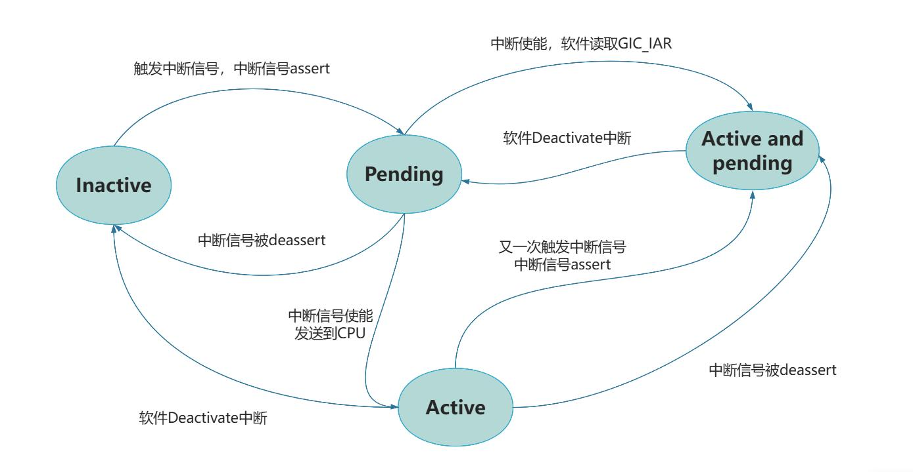
图46.7
### 46.3.4 中断触发方式
中断的触发方式，包含以下两种方式：1.边沿触发（Edge-triggered）：

当中断源产生一个边沿，中断有效。如上升沿触发和下降沿触发。2.电平触发（Level-sensitive）：当中断源为指定电平，中断有效。如高电平触发和低电平触发。
### 46.3.5 中断号
在Linux kernel 中，每个中断由唯一的IRQ number(中断请求号)标识。当外设触发中断时，内核通过IRQ number 找到对应的中断服务程序。IRQ number 本质是虚拟的中断标识符，它与具体硬件无关，仅作为CPU 识别中断的软件编号，因此也被称为软件中断号。与软件中断号不同，硬件中断号（HW interrupt ID）由中断控制器负责管理。作为外设中
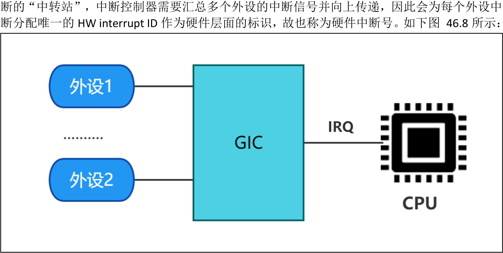
图46.8在硬件相对简单的系统里，只有一个中断控制器，硬件中断号可以直接作为软件中断号，但在一个有中断控制器级联的系统里，如图46.9 所示。仅仅用HW interrupt ID 就不能唯一标识一个外设中断，还需要知道该HW interrupt ID 所属的GIC 中断控制器（HW interrupt ID 在不同的Interrupt controller 上是会重复编码的）。为了解决这个问题，Linux 中断子系统提供了相应的映射机制，通过irq domain 来解决映射的问题。每个中断控制器可连接多个外设的中断源(interrupt source),并会为这些连接的中断源分配本地唯一的硬件中断号。由于该编号仅在本中断控制器范围内有效，因此每个中断控制器可视为一个独立的irq domain。

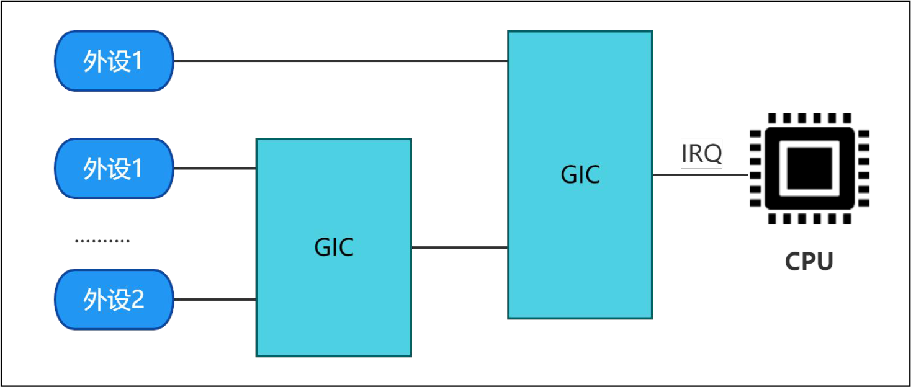
图46.9
## 46.4 中断相关函数
1. 申请中断函数request_irq() 函数是Linux 内核中用于注册中断处理程序的函数。函数原型如代码清单46.1 所示。代码清单46.1int request_irq(unsigned int irq, irq_handler_t handler, unsigned long flags, const char *name,void *dev);该函数详细介绍如下：头文件：#include <linux/interrupt.h>函数作用：request_irq 函数允许设备驱动程序为特定的中断号（IRQ）绑定一个中断处理函数，从而在硬件设备触发中断时调用该函数进行处理。参数含义：irq：要申请的中断号（IRQ number）。handler：指向中断处理程序的函数指针（顶半部）。函数原型为irqreturn_t handler(int irq, void *dev_id)。函数参数irq 表示中断号，dev_id 是一个void 类型的指针，用于传递设备特定的数据或标识符。函数返回值irqreturn_t 是一个特定类型的枚举值，用于表示中断处理程序的返回状态。返回值有3 种取值，分别是：IRQ_NONE 表示中断处理程序未处理该中断。IRQ_HANDLED 表示中断处理程序已成功处理该中断。IRQ_WAKE_THREAD 表示中断处理程序已成功处理该中断，并且请求唤醒一个内核线程来继续执行进一步的处理。flags：标志位，用来指定中断的触发方式。触发方式有：宏IRQF_TRIGGER_NONE 表示无触

发方式，即中断不会被触发。宏IRQF_TRIGGER_RISING 表示上升沿触发方式。宏IRQF_TRIGGER_FALLING 表示下降沿触发方式。宏IRQF_TRIGGER_HIGH 表示高电平触发方式。宏IRQF_TRIGGER_LOW 表示低电平触发方式。宏IRQF_SHARED 表示共享中断，即多个设备共享中断。name：中断的名称，用于标识该中断。dev：指向设备或数据结构的指针，可以在中断处理程序中使用。也可以设置成NULL。返回值：返回0 表示中断请求成功。返回负数表示中断请求失败，返回的负数值表示错误代码。2.获取中断号函数gpio_to_irq()函数来获取gpio 对应的中断号，函数原型如代码清单46.2 所示。代码清单46.2int gpio_to_irq(unsigned int gpio)该函数详细介绍如下：
头文件：#include <linux/gpio.h>函数作用：如果使用GPIO，则可以使用gpio_to_irq()函数来获取gpio 对应的中断号参数说明：gpio：要获取的GPIO 引脚号。返回值：返回值为该GPIO 引脚所对应的中断号表示成功。返回值为负数表示映射失败或无效的GPIO 引脚号。3.释放中断函数中断使用完成之后通过free_irq()函数释放掉相应的中断。函数原型如代码清单46.3 所示。代码清单46.3void free_irq(unsigned int irq, void *dev_id);该函数详细介绍如下：头文件：#include <linux/interrupt.h>函数功能：free_irq 函数用于释放之前通过request_irq 函数注册的中断处理程序。它会取消对中断的注册并释放相关的系统资源，包括中断号、中断处理程序和设备标识等。参数说明：irq：要释放的中断号。

dev_id：它通常是在request_irq 函数中传递的设备特定数据指针。返回值：free_irq 函数没有返回值。
4.中断服务函数中断处理程序是在中断事件发生时自动调用的函数。它负责处理与中断相关的操作，例如读取数据、清除中断标志、更新状态等。irqreturn_t handler() 函数是一个中断服务函数，函数原型如代码清单46.4 所示。代码清单46.4typedef irqreturn_t handler(int irq, void *dev_id);该函数详细介绍如下：函数功能：handler 函数是一个中断服务函数，用于处理特定中断事件。它在中断事件发生时被操作系统或硬件调用，执行必要的操作来响应和处理中断请求。参数说明：irq：表示要申请的中断处理函数要对应的中断号。dev_id：是一个指向void 类型的指针，需要与request_irq 函数的dev 参数保持一致，用于区分共享中断的不同设备，dev 也可以指向设备数据结构。返回值：中断处理函数的返回值为irqreturn_t 类型，irqreturn_t 类型如下所示：IRQ_NONE：表示中断服务函数未处理该中断，中断控制器可以继续处理其他中断请求。IRQ_HANDLED：表示中断服务函数已成功处理该中断，中断控制器无需进一步处理。IRQ_WAKE_THREAD：表示中断服务函数已处理该中断，并且请求唤醒一个内核线程来继续执行进一步的处理。这在一些需要长时间处理的中断情况下使用。
## 46.5 实验程序编写
本实验代码存储在网盘iTOP-RK3568 开发板\07_学习教程配套资料\03_Linux 驱动配套资料\04_Linux 驱动例程\30_interrupt\03_中断驱动例程路径下。本实验注册LVDS 触摸屏的触摸中断，每当触摸LVDS 显示屏就会触发中断服务函数，在中断服务函数中会打印申请的GPIO 号和This is irq_handler。1.计算中断引脚对应的GPIO 编号LVDS 触摸屏对应的中断引脚标号为TP_INT_L_GPIO3_A5，GPIO 编号对应的计算过程如代码清单46.5 所示：

代码清单46.5
```c
bank = 3;//GPIO3_A5=> 3, bank ∈[0,4]
group = 0;//GPIO3_A5 => 0, group ∈{(A=0), (B=1), (C=2), (D=3)}
X = 5;//GPIO3_A5 => 5, X ∈[0,7]
number = group * 8 + X = 0 * 8 + 5 =5
pin = bank*32 + number= 3 * 32 + 5 = 101;
```
2.编写实验代码实验代码interrupt.c 如代码清单46.6 所示：代码清单46.6
```c
#include <linux/module.h>
#include <linux/init.h>
#include <linux/gpio.h>
#include <linux/interrupt.h>
#define GPIO_PIN 101
// 中断处理函数
static irqreturn_t gpio_irq_handler(int irq, void *dev_id)
{
    printk(KERN_INFO "Interrupt occurred on GPIO %d\n", GPIO_PIN);
    printk(KERN_INFO "This is irq_handler\n");
    return IRQ_HANDLED;
}
static int __init interrupt_init(void)
{
    int irq_num;
    printk(KERN_INFO "Initializing GPIO Interrupt Driver\n");
    // 将GPIO 引脚映射到中断号
    irq_num = gpio_to_irq(GPIO_PIN);
    printk(KERN_INFO "GPIO %d mapped to IRQ %d\n", GPIO_PIN, irq_num);
    // 请求中断
    if (request_irq(irq_num, gpio_irq_handler, IRQF_TRIGGER_RISING, "irq_test", NULL) != 0){
        printk(KERN_ERR "Failed to request IRQ %d\n", irq_num);
        // 请求中断失败，释放GPIO 引脚
        gpio_free(GPIO_PIN);
        return -ENODEV;
    }
    return 0;
}
```

```c
static void __exit interrupt_exit(void)
{
    int irq_num = gpio_to_irq(GPIO_PIN);
    // 释放中断
    free_irq(irq_num, NULL);
    printk(KERN_INFO "GPIO Interrupt Driver exited successfully\n");
}
module_init(interrupt_init);
module_exit(interrupt_exit);
MODULE_LICENSE("GPL");
MODULE_AUTHOR("topeet");
```
## 46.4 运行测试
### 46.4.1 编译驱动程序
在和interrupt.c 的同一目录下创建Makefile 文件，如图46.10 所示。

Makefile 文件内容如代码清单46.7 所示：代码清单46.7
```c
export ARCH=arm64#设置平台架构
export CROSS_COMPILE=aarch64-linux-gnu-#交叉编译器前缀
obj-m := interrupt.o
KDIR :=/home/topeet/Linux/linux_sdk/kernel#这里是你的内核目录
PWD ?= $(shell pwd)
all:
    make -C $(KDIR) M=$(PWD) modules#make 操作
clean:
    make -C $(KDIR) M=$(PWD) clean#make clean 操作
```
使用命令make 编译驱动程序，编译成功后如图46.11 所示：
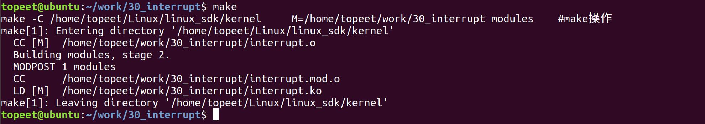
46.11编译完后会生成interrupt.ko 目标文件，如图46.12 所示：


图46.12至此驱动模块就编译成功了。
### 46.4.2 运行测试
将本章节编译好的interrupt.ko 驱动文件拷贝到开发板上。开发板启动之后，使用insmod interrupt.ko 命令进行驱动模块的加载，如下图46.13 所示：
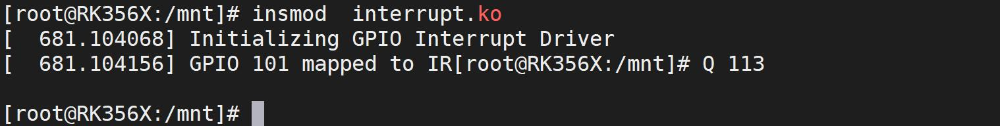
图46.13通过图46.13 可以看到驱动加载后打印了“Initializing GPIO Interrupt Driver”，表示驱动程序已经加载成功，gpio 映射后的中断请求号为113，然后触摸MIPI 屏幕触发中断服务程序，如果实验成功会打印如下图46.14 所示信息：
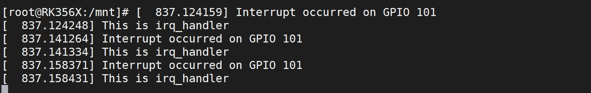
图46.14图46.14 中成功打印了GPIO 的引脚编号以及“This is irq_handler”，证明编写的驱动程序没有问题，实验成功后使用rmmodinterrupt.ko 命令卸载驱动程序，如下图46.15 所示：
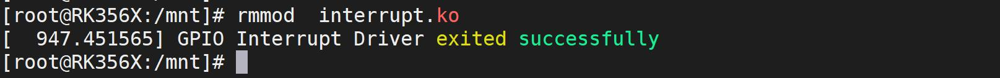
图46.15

